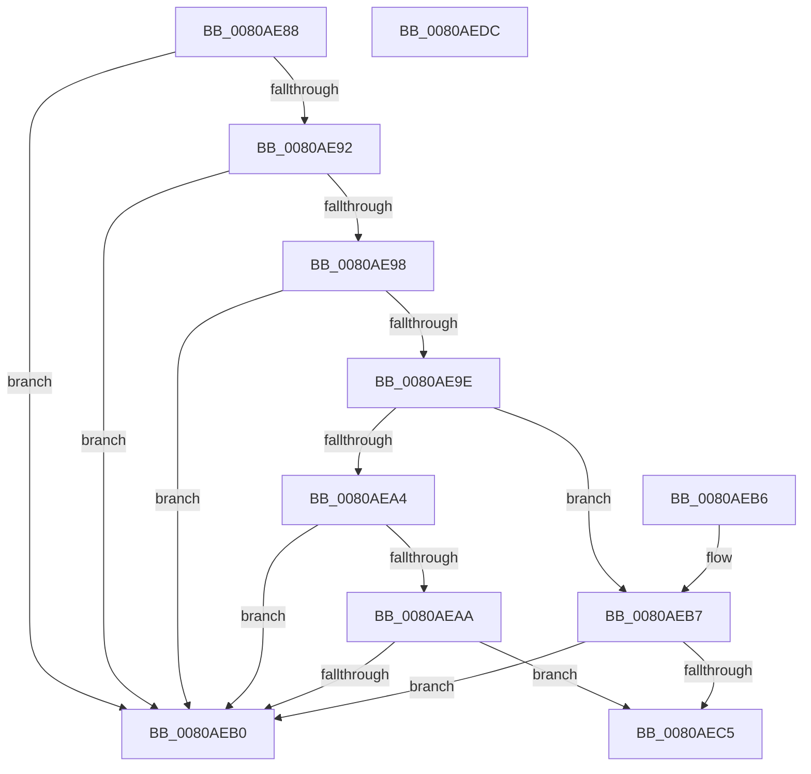

# MiValidateUserPhysicalExternalFlags

- RVA: `0x0080AE88`–`0x0080AEDD` (길이 `85` bytes)
- VA: `0x000000014080AE88`
- 실행 섹션: `PAGE`
- PDB 이름 있음: `예`; PDB Function 태그: `아니요`
- unwind 정보 RVA: `0x000DB714`
- 디코드: `29`개 명령, `85/85` bytes 표시
- 미해석 바이트: `0` (있으면 어셈블리에 `.byte`로 보존)

> 이 문서는 커널 이미지의 기계어와 PDB 기호를 분석해 생성했습니다. 4번과 5번은 함수 원형과 자료형을 바이너리 사용 방식에서 추정한 C 해석이며 원본 소스 복구 결과는 아닙니다.

## 1. Dependencies

- 직접 호출 지점: **0**; 고유 호출 대상: **0**
- 직접 호출자로 확인된 함수: **1**
- RIP 상대 이미지 참조: **0**

### Outgoing calls
- 직접 디코드된 call 명령이 없습니다.

### Direct callers
- [MiCreatePagingFileMap](../98/MiCreatePagingFileMap_function_009852F8.md) at `0x00985A25`

### Static image references
- 디코드된 RIP-relative 메모리 참조가 없습니다.

## 2. Other-region calls and transfers

- 다른 실행 섹션으로 향하는 call: **0**
- 별도 외부 분기/꼬리 이동을 확인하지 못했습니다.

## 3. Assembly (complete function range)

```asm
0080AE88  8B C1                           mov eax, ecx
0080AE8A  F7 C1 FF FF F4 2B               test ecx, 0x2bf4ffff
0080AE90  75 1E                           jne 0x14080aeb0
0080AE92  0F BA E0 1A                     bt eax, 0x1a
0080AE96  73 18                           jae 0x14080aeb0
0080AE98  0F BA E0 1B                     bt eax, 0x1b
0080AE9C  72 12                           jb 0x14080aeb0
0080AE9E  33 D2                           xor edx, edx
0080AEA0  85 C0                           test eax, eax
0080AEA2  79 13                           jns 0x14080aeb7
0080AEA4  0F BA E0 13                     bt eax, 0x13
0080AEA8  72 06                           jb 0x14080aeb0
0080AEAA  0F BA E0 11                     bt eax, 0x11
0080AEAE  73 15                           jae 0x14080aec5
0080AEB0  B8 0D 00 00 C0                  mov eax, 0xc000000d
0080AEB5  C3                              ret
0080AEB6  CC                              int3
0080AEB7  41 B8 00 00 0A 00               mov r8d, 0xa0000
0080AEBD  41 23 C8                        and ecx, r8d
0080AEC0  41 3B C8                        cmp ecx, r8d
0080AEC3  74 EB                           je 0x14080aeb0
0080AEC5  41 B8 00 00 00 50               mov r8d, 0x50000000
0080AECB  B9 0D 00 00 C0                  mov ecx, 0xc000000d
0080AED0  41 23 C0                        and eax, r8d
0080AED3  41 3B C0                        cmp eax, r8d
0080AED6  0F 44 D1                        cmove edx, ecx
0080AED9  8B C2                           mov eax, edx
0080AEDB  C3                              ret
0080AEDC  CC                              int3
```

## 4. C-style interpretation (structured pseudocode)

```c
__int64 __fastcall MiValidateUserPhysicalExternalFlags(int a1, int a2)
{
    __int64 result;

    if (((a1) & (0x2BF4FFFFULL)) != 0) goto loc_0080AEB0;
    if (condition_is_above_or_equal) goto loc_0080AEB0;
    if (condition_is_below) goto loc_0080AEB0;
    a2 = 0;
    if (!sign_flag) goto loc_0080AEB7;
    if (condition_is_below) goto loc_0080AEB0;
    if (condition_is_above_or_equal) goto loc_0080AEC5;
loc_0080AEB0:
    return (unsigned int)(0xC000000DULL);
loc_0080AEB7:
    a1 = (unsigned int)((a1) & ((unsigned int)((unsigned int)(0xA0000ULL))));
    if (a1 == ((unsigned int)((unsigned int)(0xA0000ULL)))) goto loc_0080AEB0;
loc_0080AEC5:
    result = (unsigned int)(((unsigned int)(0xC000000DULL)) & ((unsigned int)((unsigned int)(0x50000000ULL))));
    if (((unsigned int)(result)) == ((unsigned int)((unsigned int)(0x50000000ULL)))) { a2 = (unsigned int)((unsigned int)(0xC000000DULL)); }
    return (unsigned int)(a2);
}
```

## 5. (Beta) C Style

```c
int64_t MiValidateUserPhysicalExternalFlags(int32_t Arg1, int32_t Arg2)
{
    int64_t result;

    if (((Arg1) & (0x2BF4FFFFULL)) != 0) goto loc_0080AEB0;
    if (condition_is_above_or_equal) goto loc_0080AEB0;
    if (condition_is_below) goto loc_0080AEB0;
    Arg2 = 0;
    if (!sign_flag) goto loc_0080AEB7;
    if (condition_is_below) goto loc_0080AEB0;
    if (condition_is_above_or_equal) goto loc_0080AEC5;
loc_0080AEB0:
    return (uint32_t)(0xC000000DULL);
loc_0080AEB7:
    Arg1 = (uint32_t)((Arg1) & ((uint32_t)((uint32_t)(0xA0000ULL))));
    if (Arg1 == ((uint32_t)((uint32_t)(0xA0000ULL)))) goto loc_0080AEB0;
loc_0080AEC5:
    result = (uint32_t)(((uint32_t)(0xC000000DULL)) & ((uint32_t)((uint32_t)(0x50000000ULL))));
    if (((uint32_t)(result)) == ((uint32_t)((uint32_t)(0x50000000ULL)))) { Arg2 = (uint32_t)((uint32_t)(0xC000000DULL)); }
    return (uint32_t)(Arg2);
}
```

## 6. Execution-region graph

[열기: 2D/3D 그래프와 함수 탐색 컨트롤 패널](../../../control-panel.html?section=page&rva=0x0080AE88&view=graph)

- 2D 그래프는 위에서 아래로 흐르고, 3D 그래프는 빈 공간을 드래그해 회전합니다. Shift+드래그는 이동, 휠은 확대·축소, 함수 노드 선택은 대상 보고서 이동입니다.

### Static fallback


