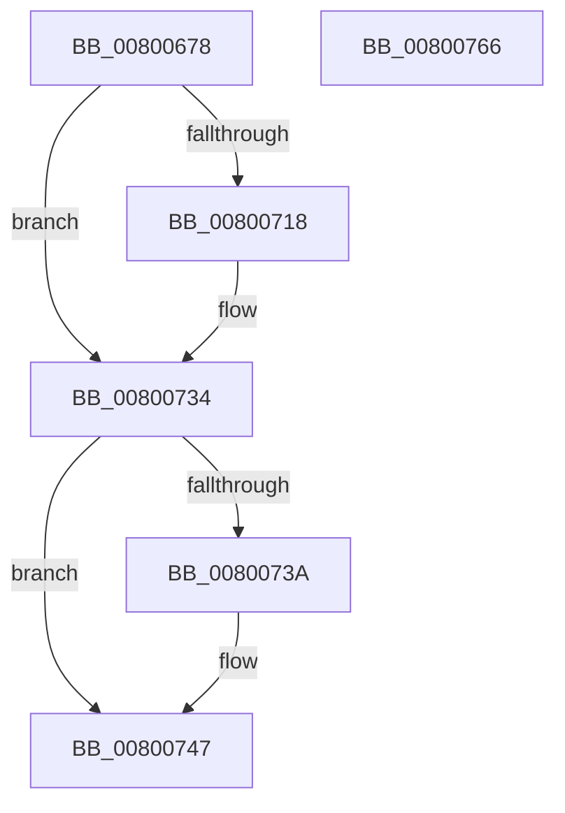

# MiZeroPageFileFirstPage

- RVA: `0x00800678`–`0x00800767` (길이 `239` bytes)
- VA: `0x0000000140800678`
- 실행 섹션: `PAGE`
- PDB 이름 있음: `예`; PDB Function 태그: `아니요`
- unwind 정보 RVA: `0x000D81DC`
- 디코드: `60`개 명령, `239/239` bytes 표시
- 미해석 바이트: `0` (있으면 어셈블리에 `.byte`로 보존)

> 이 문서는 커널 이미지의 기계어와 PDB 기호를 분석해 생성했습니다. 4번과 5번은 함수 원형과 자료형을 바이너리 사용 방식에서 추정한 C 해석이며 원본 소스 복구 결과는 아닙니다.

## 1. Dependencies

- 직접 호출 지점: **5**; 고유 호출 대상: **5**
- 직접 호출자로 확인된 함수: **1**
- RIP 상대 이미지 참조: **2**

### Outgoing calls
- `0x008006E5` → [KeInitializeEvent](../../text/40/KeInitializeEvent_function_0040DD10.md) (function, `0x0040DD10`)
- `0x0080070D` → [MiSynchronousPageWrite](../../text/29/MiSynchronousPageWrite_function_0029A2E4.md) (function, `0x0029A2E4`)
- `0x0080072C` → [KeWaitForSingleObject](../../text/20/KeWaitForSingleObject_function_0020E6B0.md) (function, `0x0020E6B0`)
- `0x00800742` → [MmUnmapLockedPages](../../text/24/MmUnmapLockedPages_function_00246E60.md) (function, `0x00246E60`)
- `0x00800750` → [_security_check_cookie](../../text/6A/_security_check_cookie_function_006AC640.md) (function, `0x006AC640`)

### Direct callers
- [MiCreatePagingFile](../7F/MiCreatePagingFile_function_007FEFF4.md) at `0x007FF6BF`

### Static image references
- `0x0080068A` → RVA `0x00E0A740` (`.data`; read)
- `0x008006C6` → RVA `0x00E37440` (`.data`; read)

## 2. Other-region calls and transfers

- 다른 실행 섹션으로 향하는 call: **5**
  - `0x008006E5` → [KeInitializeEvent](../../text/40/KeInitializeEvent_function_0040DD10.md) (`PAGE` → `.text`)
  - `0x0080070D` → [MiSynchronousPageWrite](../../text/29/MiSynchronousPageWrite_function_0029A2E4.md) (`PAGE` → `.text`)
  - `0x0080072C` → [KeWaitForSingleObject](../../text/20/KeWaitForSingleObject_function_0020E6B0.md) (`PAGE` → `.text`)
  - `0x00800742` → [MmUnmapLockedPages](../../text/24/MmUnmapLockedPages_function_00246E60.md) (`PAGE` → `.text`)
  - `0x00800750` → [_security_check_cookie](../../text/6A/_security_check_cookie_function_006AC640.md) (`PAGE` → `.text`)
- 별도 외부 분기/꼬리 이동을 확인하지 못했습니다.

## 3. Assembly (complete function range)

```asm
00800678  48 89 5C 24 10                  mov qword ptr [rsp + 0x10], rbx
0080067D  55                              push rbp
0080067E  48 8D 6C 24 A9                  lea rbp, [rsp - 0x57]
00800683  48 81 EC B0 00 00 00            sub rsp, 0xb0
0080068A  48 8B 05 AF A0 60 00            mov rax, qword ptr [rip + 0x60a0af]
00800691  48 33 C4                        xor rax, rsp
00800694  48 89 45 4F                     mov qword ptr [rbp + 0x4f], rax
00800698  33 C0                           xor eax, eax
0080069A  C7 45 1F 38 00 02 40            mov dword ptr [rbp + 0x1f], 0x40020038
008006A1  48 21 45 E7                     and qword ptr [rbp - 0x19], rax
008006A5  0F 57 C0                        xorps xmm0, xmm0
008006A8  21 45 33                        and dword ptr [rbp + 0x33], eax
008006AB  48 8B D9                        mov rbx, rcx
008006AE  48 21 45 17                     and qword ptr [rbp + 0x17], rax
008006B2  48 8D 4D EF                     lea rcx, [rbp - 0x11]
008006B6  48 21 45 37                     and qword ptr [rbp + 0x37], rax
008006BA  45 33 C0                        xor r8d, r8d
008006BD  21 45 43                        and dword ptr [rbp + 0x43], eax
008006C0  33 D2                           xor edx, edx
008006C2  48 89 45 FF                     mov qword ptr [rbp - 1], rax
008006C6  48 8B 05 73 6D 63 00            mov rax, qword ptr [rip + 0x636d73]
008006CD  48 89 45 47                     mov qword ptr [rbp + 0x47], rax
008006D1  0F 11 45 EF                     movups xmmword ptr [rbp - 0x11], xmm0
008006D5  C7 45 3F 00 10 00 00            mov dword ptr [rbp + 0x3f], 0x1000
008006DC  0F 11 45 07                     movups xmmword ptr [rbp + 7], xmm0
008006E0  F3 0F 7F 45 23                  movdqu xmmword ptr [rbp + 0x23], xmm0
008006E5  E8 26 D6 C0 FF                  call 0x14040dd10
008006EA  48 8D 45 07                     lea rax, [rbp + 7]
008006EE  48 8B CB                        mov rcx, rbx
008006F1  48 89 44 24 30                  mov qword ptr [rsp + 0x30], rax
008006F6  4C 8D 4D EF                     lea r9, [rbp - 0x11]
008006FA  48 83 64 24 28 00               and qword ptr [rsp + 0x28], 0
00800700  4C 8D 45 E7                     lea r8, [rbp - 0x19]
00800704  48 8D 55 17                     lea rdx, [rbp + 0x17]
00800708  C6 44 24 20 00                  mov byte ptr [rsp + 0x20], 0
0080070D  E8 D2 9B A9 FF                  call 0x14029a2e4
00800712  8B D8                           mov ebx, eax
00800714  85 C0                           test eax, eax
00800716  78 1C                           js 0x140800734
00800718  48 83 64 24 20 00               and qword ptr [rsp + 0x20], 0
0080071E  48 8D 4D EF                     lea rcx, [rbp - 0x11]
00800722  45 33 C9                        xor r9d, r9d
00800725  45 33 C0                        xor r8d, r8d
00800728  41 8D 51 12                     lea edx, [r9 + 0x12]
0080072C  E8 7F DF A0 FF                  call 0x14020e6b0
00800731  8B 5D 07                        mov ebx, dword ptr [rbp + 7]
00800734  F6 45 21 01                     test byte ptr [rbp + 0x21], 1
00800738  74 0D                           je 0x140800747
0080073A  48 8B 4D 2F                     mov rcx, qword ptr [rbp + 0x2f]
0080073E  48 8D 55 17                     lea rdx, [rbp + 0x17]
00800742  E8 19 67 A4 FF                  call 0x140246e60
00800747  8B C3                           mov eax, ebx
00800749  48 8B 4D 4F                     mov rcx, qword ptr [rbp + 0x4f]
0080074D  48 33 CC                        xor rcx, rsp
00800750  E8 EB BE EA FF                  call 0x1406ac640
00800755  48 8B 9C 24 C8 00 00 00         mov rbx, qword ptr [rsp + 0xc8]
0080075D  48 81 C4 B0 00 00 00            add rsp, 0xb0
00800764  5D                              pop rbp
00800765  C3                              ret
00800766  CC                              int3
```

## 4. C-style interpretation (structured pseudocode)

```c
__int64 __fastcall MiZeroPageFileFirstPage(__int64 a1, int a2, int a3)
{
    __int64 result;
    __int64 v_rbx;
    __int64 v_rsp;
    unsigned __int64 v_stack_m10;
    unsigned __int64 v_stack_m18;
    unsigned int v_stack_m1C;
    unsigned int v_stack_m20;
    unsigned __int64 v_stack_m28;
    unsigned int v_stack_m2C;
    unsigned __int64 v_stack_m30;
    unsigned __int64 v_stack_m3C;
    unsigned __int8 v_stack_m3E;
    unsigned int v_stack_m40;
    unsigned __int64 v_stack_m48;
    unsigned __int64 v_stack_m58;
    unsigned __int64 v_stack_m5F;
    unsigned __int64 v_stack_m60;
    unsigned __int64 v_stack_m70;
    unsigned __int64 v_stack_m78;
    unsigned __int64 v_stack_m88;
    unsigned __int64 v_stack_m90;
    unsigned __int8 v_stack_m98;
    unsigned __int64 v_stack_p10;

    v_stack_p10 = v_rbx;
    v_rsp = (v_rsp) - (176);
    result = (*(unsigned __int64 *)(v_rip + 6332591)) ^ (v_rsp);
    v_stack_m10 = result;
    result = 0;
    v_stack_m40 = 0x40020038ULL;
    a3 = 0;
    a2 = 0;
    v_stack_m60 = 0;
    v_stack_m18 = *(unsigned __int64 *)(v_rip + 6516083);
    v_stack_m70 = v_xmm0;
    v_stack_m20 = 0x1000ULL;
    v_stack_m58 = v_xmm0;
    v_stack_m3C = v_xmm0;
    result = KeInitializeEvent(v_stack_m70, a2, a3, a4);
    v_stack_m88 = v_stack_m58;
    v_stack_m98 = 0;
    result = MiSynchronousPageWrite(a1, v_stack_m48, v_stack_m78, v_stack_m70);
    v_rbx = (unsigned int)((unsigned int)(result));
    if (!(sign_flag)) {
        a1 = v_stack_m70;
        a4 = 0;
        a3 = 0;
        a2 = a4 + 18;
        result = KeWaitForSingleObject(a1, a2, a3, a4);
        v_rbx = v_stack_m58;
    }
    if (((v_stack_m3E) & (1)) != 0) {
        a1 = v_stack_m30;
        a2 = v_stack_m48;
        result = MmUnmapLockedPages(a1, a2, a3, a4);
    }
    a1 = (v_stack_m10) ^ (v_rsp);
    result = _security_check_cookie(a1, a2, a3, a4);
    v_rsp = (v_rsp) + (176);
    return result;
}
```

## 5. (Beta) C Style

```c
int64_t MiZeroPageFileFirstPage(int64_t Arg1, int32_t Arg2, int32_t Arg3)
{
    int64_t result;
    int64_t local_rbx;
    int64_t local_rsp;
    uint64_t v_stack_m10;
    uint64_t v_stack_m18;
    uint32_t v_stack_m1C;
    uint32_t v_stack_m20;
    uint64_t v_stack_m28;
    uint32_t v_stack_m2C;
    uint64_t v_stack_m30;
    uint64_t v_stack_m3C;
    uint8_t v_stack_m3E;
    uint32_t v_stack_m40;
    uint64_t v_stack_m48;
    uint64_t v_stack_m58;
    uint64_t v_stack_m5F;
    uint64_t v_stack_m60;
    uint64_t v_stack_m70;
    uint64_t v_stack_m78;
    uint64_t v_stack_m88;
    uint64_t v_stack_m90;
    uint8_t v_stack_m98;
    uint64_t v_stack_p10;

    v_stack_p10 = local_rbx;
    local_rsp = (local_rsp) - (176);
    result = (*(uint64_t *)(v_rip + 0x60A0AF)) ^ (local_rsp);
    v_stack_m10 = result;
    result = 0;
    v_stack_m40 = 0x40020038ULL;
    Arg3 = 0;
    Arg2 = 0;
    v_stack_m60 = 0;
    v_stack_m18 = *(uint64_t *)(v_rip + 0x636D73);
    v_stack_m70 = v_xmm0;
    v_stack_m20 = 0x1000ULL;
    v_stack_m58 = v_xmm0;
    v_stack_m3C = v_xmm0;
    result = KeInitializeEvent(v_stack_m70, Arg2, Arg3, a4);
    v_stack_m88 = v_stack_m58;
    v_stack_m98 = 0;
    result = MiSynchronousPageWrite(Arg1, v_stack_m48, v_stack_m78, v_stack_m70);
    local_rbx = (uint32_t)((uint32_t)(result));
    if (!(sign_flag)) {
        Arg1 = v_stack_m70;
        a4 = 0;
        Arg3 = 0;
        Arg2 = a4 + 18;
        result = KeWaitForSingleObject(Arg1, Arg2, Arg3, a4);
        local_rbx = v_stack_m58;
    }
    if (((v_stack_m3E) & (1)) != 0) {
        Arg1 = v_stack_m30;
        Arg2 = v_stack_m48;
        result = MmUnmapLockedPages(Arg1, Arg2, Arg3, a4);
    }
    Arg1 = (v_stack_m10) ^ (local_rsp);
    result = _security_check_cookie(Arg1, Arg2, Arg3, a4);
    local_rsp = (local_rsp) + (176);
    return result;
}
```

## 6. Execution-region graph

[열기: 2D/3D 그래프와 함수 탐색 컨트롤 패널](../../../control-panel.html?section=page&rva=0x00800678&view=graph)

- 2D 그래프는 위에서 아래로 흐르고, 3D 그래프는 빈 공간을 드래그해 회전합니다. Shift+드래그는 이동, 휠은 확대·축소, 함수 노드 선택은 대상 보고서 이동입니다.

### Static fallback


