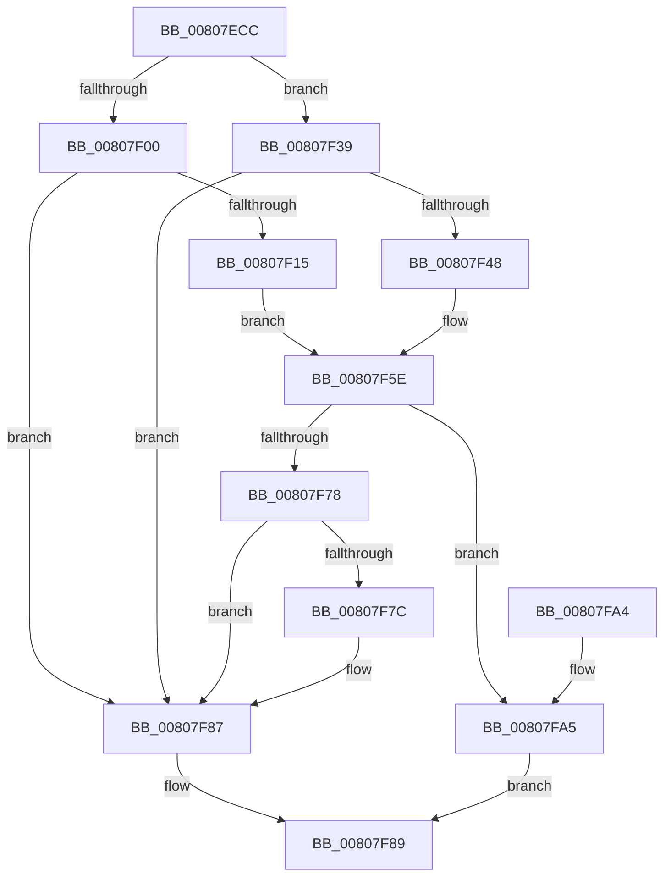

# MmAllocateIsrStack

- RVA: `0x00807ECC`–`0x00807FB9` (길이 `237` bytes)
- VA: `0x0000000140807ECC`
- 실행 섹션: `PAGE`
- PDB 이름 있음: `예`; PDB Function 태그: `아니요`
- unwind 정보 RVA: `0x000A6780`
- 디코드: `65`개 명령, `237/237` bytes 표시
- 미해석 바이트: `0` (있으면 어셈블리에 `.byte`로 보존)

> 이 문서는 커널 이미지의 기계어와 PDB 기호를 분석해 생성했습니다. 4번과 5번은 함수 원형과 자료형을 바이너리 사용 방식에서 추정한 C 해석이며 원본 소스 복구 결과는 아닙니다.

## 1. Dependencies

- 직접 호출 지점: **8**; 고유 호출 대상: **7**
- 직접 호출자로 확인된 함수: **2**
- RIP 상대 이미지 참조: **1**

### Outgoing calls
- `0x00807F08` → [MmAllocateIndependentPagesEx](../AA/MmAllocateIndependentPagesEx_function_00AA0CFC.md) (function, `0x00AA0CFC`)
- `0x00807F26` → [MiSetPageProtection](../../text/67/MiSetPageProtection_function_00674BDC.md) (function, `0x00674BDC`)
- `0x00807F3F` → [MI_IS_PHYSICAL_ADDRESS](../../text/23/MI_IS_PHYSICAL_ADDRESS_function_0023B3A0.md) (function, `0x0023B3A0`)
- `0x00807F59` → [MiSetPageProtection](../../text/67/MiSetPageProtection_function_00674BDC.md) (function, `0x00674BDC`)
- `0x00807F6F` → [KasanTrackAddress](../../text/46/KasanTrackAddress_function_00462520.md) (function, `0x00462520`)
- `0x00807F82` → [MmFreeIndependentPages](../../text/2A/MmFreeIndependentPages_function_002A2510.md) (function, `0x002A2510`)
- `0x00807FA8` → [MiGetPteAddress](../../text/43/MiGetPteAddress_function_0043E130.md) (function, `0x0043E130`)
- `0x00807FB0` → [MiMarkBootGuardPage](../../text/68/MiMarkBootGuardPage_function_0068643C.md) (function, `0x0068643C`)

### Direct callers
- [KiAllocateProcessorStacks](../../text/5B/KiAllocateProcessorStacks_function_005B6D74.md) at `0x005B6DD6`
- [KiAllocateProcessorStacks](../../text/5B/KiAllocateProcessorStacks_function_005B6D74.md) at `0x005B6DEF`
- [KiAllocateProcessorStacks](../../text/5B/KiAllocateProcessorStacks_function_005B6D74.md) at `0x005B6E0E`
- [KiCompleteBootProcessorContextInitialization](../../text/5B/KiCompleteBootProcessorContextInitialization_function_005B7634.md) at `0x005B7683`
- [KiCompleteBootProcessorContextInitialization](../../text/5B/KiCompleteBootProcessorContextInitialization_function_005B7634.md) at `0x005B76AF`
- [KiCompleteBootProcessorContextInitialization](../../text/5B/KiCompleteBootProcessorContextInitialization_function_005B7634.md) at `0x005B76EF`

### Static image references
- `0x00807EE5` → RVA `0x00FC505C` (`ALMOSTRO`; read)

## 2. Other-region calls and transfers

- 다른 실행 섹션으로 향하는 call: **7**
  - `0x00807F26` → [MiSetPageProtection](../../text/67/MiSetPageProtection_function_00674BDC.md) (`PAGE` → `.text`)
  - `0x00807F3F` → [MI_IS_PHYSICAL_ADDRESS](../../text/23/MI_IS_PHYSICAL_ADDRESS_function_0023B3A0.md) (`PAGE` → `.text`)
  - `0x00807F59` → [MiSetPageProtection](../../text/67/MiSetPageProtection_function_00674BDC.md) (`PAGE` → `.text`)
  - `0x00807F6F` → [KasanTrackAddress](../../text/46/KasanTrackAddress_function_00462520.md) (`PAGE` → `.text`)
  - `0x00807F82` → [MmFreeIndependentPages](../../text/2A/MmFreeIndependentPages_function_002A2510.md) (`PAGE` → `.text`)
  - `0x00807FA8` → [MiGetPteAddress](../../text/43/MiGetPteAddress_function_0043E130.md) (`PAGE` → `.text`)
  - `0x00807FB0` → [MiMarkBootGuardPage](../../text/68/MiMarkBootGuardPage_function_0068643C.md) (`PAGE` → `.text`)
- 별도 외부 분기/꼬리 이동을 확인하지 못했습니다.

## 3. Assembly (complete function range)

```asm
00807ECC  48 8B C4                        mov rax, rsp
00807ECF  48 89 58 08                     mov qword ptr [rax + 8], rbx
00807ED3  48 89 68 10                     mov qword ptr [rax + 0x10], rbp
00807ED7  48 89 70 18                     mov qword ptr [rax + 0x18], rsi
00807EDB  48 89 78 20                     mov qword ptr [rax + 0x20], rdi
00807EDF  41 56                           push r14
00807EE1  48 83 EC 20                     sub rsp, 0x20
00807EE5  8B 3D 71 D1 7B 00               mov edi, dword ptr [rip + 0x7bd171]
00807EEB  33 F6                           xor esi, esi
00807EED  48 8B 19                        mov rbx, qword ptr [rcx]
00807EF0  81 C7 00 10 00 00               add edi, 0x1000
00807EF6  8B EA                           mov ebp, edx
00807EF8  4C 8B F1                        mov r14, rcx
00807EFB  48 85 DB                        test rbx, rbx
00807EFE  75 39                           jne 0x140807f39
00807F00  45 33 C9                        xor r9d, r9d
00807F03  45 33 C0                        xor r8d, r8d
00807F06  8B CF                           mov ecx, edi
00807F08  E8 EF 8D 29 00                  call 0x140aa0cfc
00807F0D  48 8B D8                        mov rbx, rax
00807F10  48 85 C0                        test rax, rax
00807F13  74 72                           je 0x140807f87
00807F15  8B 15 41 D1 7B 00               mov edx, dword ptr [rip + 0x7bd141]
00807F1B  48 8D 88 00 10 00 00            lea rcx, [rax + 0x1000]
00807F22  44 8D 46 1F                     lea r8d, [rsi + 0x1f]
00807F26  E8 B1 CC E6 FF                  call 0x140674bdc
00807F2B  48 8D 04 1F                     lea rax, [rdi + rbx]
00807F2F  BE 01 00 00 00                  mov esi, 1
00807F34  49 89 06                        mov qword ptr [r14], rax
00807F37  EB 25                           jmp 0x140807f5e
00807F39  48 2B DF                        sub rbx, rdi
00807F3C  48 8B CB                        mov rcx, rbx
00807F3F  E8 5C 34 A3 FF                  call 0x14023b3a0
00807F44  85 C0                           test eax, eax
00807F46  75 3F                           jne 0x140807f87
00807F48  8B 15 0E D1 7B 00               mov edx, dword ptr [rip + 0x7bd10e]
00807F4E  48 8D 8B 00 10 00 00            lea rcx, [rbx + 0x1000]
00807F55  44 8D 40 1F                     lea r8d, [rax + 0x1f]
00807F59  E8 7E CC E6 FF                  call 0x140674bdc
00807F5E  8B 15 F8 D0 7B 00               mov edx, dword ptr [rip + 0x7bd0f8]
00807F64  44 8D 45 01                     lea r8d, [rbp + 1]
00807F68  48 8D 8B 00 10 00 00            lea rcx, [rbx + 0x1000]
00807F6F  E8 AC A5 C5 FF                  call 0x140462520
00807F74  85 C0                           test eax, eax
00807F76  79 2D                           jns 0x140807fa5
00807F78  85 F6                           test esi, esi
00807F7A  74 0B                           je 0x140807f87
00807F7C  48 8B D7                        mov rdx, rdi
00807F7F  48 8B CB                        mov rcx, rbx
00807F82  E8 89 A5 A9 FF                  call 0x1402a2510
00807F87  32 C0                           xor al, al
00807F89  48 8B 5C 24 30                  mov rbx, qword ptr [rsp + 0x30]
00807F8E  48 8B 6C 24 38                  mov rbp, qword ptr [rsp + 0x38]
00807F93  48 8B 74 24 40                  mov rsi, qword ptr [rsp + 0x40]
00807F98  48 8B 7C 24 48                  mov rdi, qword ptr [rsp + 0x48]
00807F9D  48 83 C4 20                     add rsp, 0x20
00807FA1  41 5E                           pop r14
00807FA3  C3                              ret
00807FA4  CC                              int3
00807FA5  48 8B CB                        mov rcx, rbx
00807FA8  E8 83 61 C3 FF                  call 0x14043e130
00807FAD  48 8B C8                        mov rcx, rax
00807FB0  E8 87 E4 E7 FF                  call 0x14068643c
00807FB5  B0 01                           mov al, 1
00807FB7  EB D0                           jmp 0x140807f89
```

## 4. C-style interpretation (structured pseudocode)

```c
__int64 __fastcall MmAllocateIsrStack(__int64 a1, int a2, int a3, int a4)
{
    __int64 result;
    __int64 v_rbx;
    __int64 v_rdi;
    __int64 v_rsi;
    __int64 v_rsp;
    unsigned __int64 v_stack_p10;
    unsigned __int64 v_stack_p18;
    unsigned __int64 v_stack_p20;
    unsigned __int64 v_stack_p8;

    *(unsigned __int64 *)(v_rsp + 8) = v_rbx;
    *(unsigned __int64 *)(v_rsp + 16) = v_rbp;
    *(unsigned __int64 *)(v_rsp + 24) = v_rsi;
    *(unsigned __int64 *)(v_rsp + 32) = v_rdi;
    v_rsp = (v_rsp) - (32);
    v_rsi = 0;
    v_rdi = (unsigned int)(((unsigned int)(*(unsigned int *)(v_rip + 8114545))) + (0x1000ULL));
    if (*(unsigned __int64 *)(a1) != 0) goto loc_00807F39;
    a4 = 0;
    a3 = 0;
    result = MmAllocateIndependentPagesEx((unsigned int)((unsigned int)(v_rdi)), a2, a3, a4);
    if (result == 0) goto loc_00807F87;
    result = MiSetPageProtection(result + 4096, (unsigned int)(*(unsigned int *)(v_rip + 8114497)), v_rsi + 31, a4);
    *(unsigned __int64 *)(a1) = v_rdi + result * 1;
    goto loc_00807F5E;
loc_00807F39:
    v_rbx = (result) - (v_rdi);
    result = MI_IS_PHYSICAL_ADDRESS(v_rbx, (unsigned int)(*(unsigned int *)(v_rip + 8114497)), v_rsi + 31, a4);
    if ((unsigned int)(result) != 0) goto loc_00807F87;
    result = MiSetPageProtection(v_rbx + 4096, (unsigned int)(*(unsigned int *)(v_rip + 8114446)), result + 31, a4);
loc_00807F5E:
    result = KasanTrackAddress(v_rbx + 4096, (unsigned int)(*(unsigned int *)(v_rip + 8114424)), (unsigned int)(a2) + 1, a4);
    if (!sign_flag) goto loc_00807FA5;
    if (1 != 0) {
        a2 = v_rdi;
        a1 = v_rbx;
        result = MmFreeIndependentPages(a1, a2, (unsigned int)(a2) + 1, a4);
    }
    result = 0;
loc_00807F89:
    v_rsp = (v_rsp) + (32);
    return result;
loc_00807FA5:
    result = MiGetPteAddress(v_stack_p8, a2, (unsigned int)(a2) + 1, a4);
    result = MiMarkBootGuardPage(result, a2, (unsigned int)(a2) + 1, a4);
    goto loc_00807F89;
}
```

## 5. (Beta) C Style

```c
int64_t MmAllocateIsrStack(void *Arg1, void *Arg2, int32_t Arg3, int32_t Arg4)
{
    uint8_t *arg1 = (uint8_t *)Arg1;
    uint8_t *arg2 = (uint8_t *)Arg2;

    int64_t result;
    int64_t local_rbx;
    int64_t local_rdi;
    int64_t local_rsi;
    int64_t local_rsp;
    uint64_t v_stack_p10;
    uint64_t v_stack_p18;
    uint64_t v_stack_p20;
    uint64_t v_stack_p8;

    *(uint64_t *)(local_rsp + 0x8) = local_rbx;
    *(uint64_t *)(local_rsp + 0x10) = local_rbp;
    *(uint64_t *)(local_rsp + 0x18) = local_rsi;
    *(uint64_t *)(local_rsp + 0x20) = local_rdi;
    local_rsp = (local_rsp) - (32);
    local_rsi = 0;
    local_rdi = (uint32_t)(((uint32_t)(*(uint32_t *)(v_rip + 0x7BD171))) + (0x1000ULL));
    if (*(uint64_t *)(arg1) != 0) goto loc_00807F39;
    Arg4 = 0;
    Arg3 = 0;
    result = MmAllocateIndependentPagesEx((uint32_t)((uint32_t)(local_rdi)), Arg2, Arg3, Arg4);
    if (result == 0) goto loc_00807F87;
    result = MiSetPageProtection(result + 4096, (uint32_t)(*(uint32_t *)(v_rip + 0x7BD141)), local_rsi + 31, Arg4);
    *(uint64_t *)(arg1) = local_rdi + result * 1;
    goto loc_00807F5E;
loc_00807F39:
    local_rbx = (result) - (local_rdi);
    result = MI_IS_PHYSICAL_ADDRESS(local_rbx, (uint32_t)(*(uint32_t *)(v_rip + 0x7BD141)), local_rsi + 31, Arg4);
    if ((uint32_t)(result) != 0) goto loc_00807F87;
    result = MiSetPageProtection(local_rbx + 4096, (uint32_t)(*(uint32_t *)(v_rip + 0x7BD10E)), result + 31, Arg4);
loc_00807F5E:
    result = KasanTrackAddress(local_rbx + 4096, (uint32_t)(*(uint32_t *)(v_rip + 0x7BD0F8)), (uint32_t)(Arg2) + 1, Arg4);
    if (!sign_flag) goto loc_00807FA5;
    if (1 != 0) {
        Arg2 = local_rdi;
        Arg1 = local_rbx;
        result = MmFreeIndependentPages(Arg1, Arg2, (uint32_t)(Arg2) + 1, Arg4);
    }
    result = 0;
loc_00807F89:
    local_rsp = (local_rsp) + (32);
    return result;
loc_00807FA5:
    result = MiGetPteAddress(v_stack_p8, Arg2, (uint32_t)(Arg2) + 1, Arg4);
    result = MiMarkBootGuardPage(result, Arg2, (uint32_t)(Arg2) + 1, Arg4);
    goto loc_00807F89;
}
```

### 관측된 메모리 오프셋

구조체 형식이 확인되지 않은 접근은 인자 기준의 오프셋으로만 기록했습니다.

| 기준 인자 | 오프셋 표현 | 폭 (bit) | 접근 |
|---|---:|---:|---|
| `Arg1` | `+ 0x0` | `64` | `R` |
| `Arg1` | `+ 0x0` | `64` | `W` |
| `Arg2` | `+ 0x1` | `32` | `R` |

## 6. Execution-region graph

[열기: 2D/3D 그래프와 함수 탐색 컨트롤 패널](../../../control-panel.html?section=page&rva=0x00807ECC&view=graph)

- 2D 그래프는 위에서 아래로 흐르고, 3D 그래프는 빈 공간을 드래그해 회전합니다. Shift+드래그는 이동, 휠은 확대·축소, 함수 노드 선택은 대상 보고서 이동입니다.

### Static fallback


