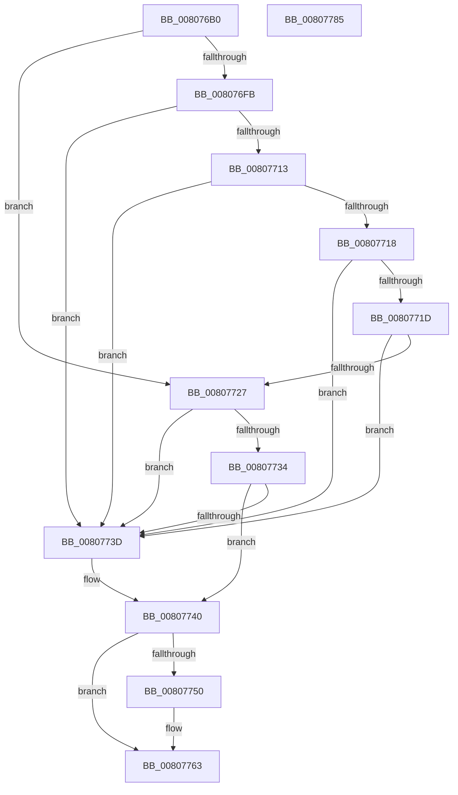

# MmCheckForSafeExecution

- RVA: `0x008076B0`–`0x00807786` (길이 `214` bytes)
- VA: `0x00000001408076B0`
- 실행 섹션: `PAGE`
- PDB 이름 있음: `예`; PDB Function 태그: `아니요`
- unwind 정보 RVA: `0x0005FEF8`
- 디코드: `66`개 명령, `214/214` bytes 표시
- 미해석 바이트: `0` (있으면 어셈블리에 `.byte`로 보존)

> 이 문서는 커널 이미지의 기계어와 PDB 기호를 분석해 생성했습니다. 4번과 5번은 함수 원형과 자료형을 바이너리 사용 방식에서 추정한 C 해석이며 원본 소스 복구 결과는 아닙니다.

## 1. Dependencies

- 직접 호출 지점: **6**; 고유 호출 대상: **4**
- 직접 호출자로 확인된 함수: **1**
- RIP 상대 이미지 참조: **0**

### Outgoing calls
- `0x008076F2` → [LOCK_ADDRESS_SPACE_SHARED](../../text/2A/LOCK_ADDRESS_SPACE_SHARED_function_002A8B3C.md) (function, `0x002A8B3C`)
- `0x008076FE` → [MiLocateAddress](../../text/31/MiLocateAddress_function_003168D0.md) (function, `0x003168D0`)
- `0x00807709` → [MiLocateAddress](../../text/31/MiLocateAddress_function_003168D0.md) (function, `0x003168D0`)
- `0x0080772A` → [MiLocateAddress](../../text/31/MiLocateAddress_function_003168D0.md) (function, `0x003168D0`)
- `0x00807746` → [UNLOCK_ADDRESS_SPACE_SHARED](../../text/2A/UNLOCK_ADDRESS_SPACE_SHARED_function_002A8ACC.md) (function, `0x002A8ACC`)
- `0x00807758` → [MmValidateUserCallTarget](../AC/MmValidateUserCallTarget_function_00AC0950.md) (function, `0x00AC0950`)

### Direct callers
- [KiEmulateAtlThunk](../../text/3D/KiEmulateAtlThunk_function_003D8854.md) at `0x003D8926`
- [KiEmulateAtlThunk](../../text/3D/KiEmulateAtlThunk_function_003D8854.md) at `0x003D8982`
- [KiEmulateAtlThunk](../../text/3D/KiEmulateAtlThunk_function_003D8854.md) at `0x003D89C5`
- [KiEmulateAtlThunk](../../text/3D/KiEmulateAtlThunk_function_003D8854.md) at `0x003D8A0D`
- [KiEmulateAtlThunk](../../text/3D/KiEmulateAtlThunk_function_003D8854.md) at `0x003D8AA4`

### Static image references
- 디코드된 RIP-relative 메모리 참조가 없습니다.

## 2. Other-region calls and transfers

- 다른 실행 섹션으로 향하는 call: **5**
  - `0x008076F2` → [LOCK_ADDRESS_SPACE_SHARED](../../text/2A/LOCK_ADDRESS_SPACE_SHARED_function_002A8B3C.md) (`PAGE` → `.text`)
  - `0x008076FE` → [MiLocateAddress](../../text/31/MiLocateAddress_function_003168D0.md) (`PAGE` → `.text`)
  - `0x00807709` → [MiLocateAddress](../../text/31/MiLocateAddress_function_003168D0.md) (`PAGE` → `.text`)
  - `0x0080772A` → [MiLocateAddress](../../text/31/MiLocateAddress_function_003168D0.md) (`PAGE` → `.text`)
  - `0x00807746` → [UNLOCK_ADDRESS_SPACE_SHARED](../../text/2A/UNLOCK_ADDRESS_SPACE_SHARED_function_002A8ACC.md) (`PAGE` → `.text`)
- 별도 외부 분기/꼬리 이동을 확인하지 못했습니다.

## 3. Assembly (complete function range)

```asm
008076B0  48 8B C4                        mov rax, rsp
008076B3  48 89 58 08                     mov qword ptr [rax + 8], rbx
008076B7  48 89 68 10                     mov qword ptr [rax + 0x10], rbp
008076BB  48 89 70 18                     mov qword ptr [rax + 0x18], rsi
008076BF  48 89 78 20                     mov qword ptr [rax + 0x20], rdi
008076C3  41 54                           push r12
008076C5  41 56                           push r14
008076C7  41 57                           push r15
008076C9  48 83 EC 20                     sub rsp, 0x20
008076CD  65 48 8B 2C 25 88 01 00 00      mov rbp, qword ptr gs:[0x188]
008076D6  4C 8B FA                        mov r15, rdx
008076D9  4C 8B E1                        mov r12, rcx
008076DC  41 8A D9                        mov bl, r9b
008076DF  48 8B CD                        mov rcx, rbp
008076E2  49 8B F0                        mov rsi, r8
008076E5  40 B7 01                        mov dil, 1
008076E8  4C 8B B5 B8 00 00 00            mov r14, qword ptr [rbp + 0xb8]
008076EF  49 8B D6                        mov rdx, r14
008076F2  E8 45 14 AA FF                  call 0x1402a8b3c
008076F7  84 DB                           test bl, bl
008076F9  75 2C                           jne 0x140807727
008076FB  49 8B CC                        mov rcx, r12
008076FE  E8 CD F1 B0 FF                  call 0x1403168d0
00807703  49 8B CF                        mov rcx, r15
00807706  4C 8B D8                        mov r11, rax
00807709  E8 C2 F1 B0 FF                  call 0x1403168d0
0080770E  4D 85 DB                        test r11, r11
00807711  74 2A                           je 0x14080773d
00807713  48 85 C0                        test rax, rax
00807716  74 25                           je 0x14080773d
00807718  4C 3B D8                        cmp r11, rax
0080771B  74 20                           je 0x14080773d
0080771D  41 8B 43 30                     mov eax, dword ptr [r11 + 0x30]
00807721  24 70                           and al, 0x70
00807723  3C 20                           cmp al, 0x20
00807725  74 16                           je 0x14080773d
00807727  48 8B CE                        mov rcx, rsi
0080772A  E8 A1 F1 B0 FF                  call 0x1403168d0
0080772F  48 85 C0                        test rax, rax
00807732  74 09                           je 0x14080773d
00807734  8B 40 30                        mov eax, dword ptr [rax + 0x30]
00807737  24 70                           and al, 0x70
00807739  3C 20                           cmp al, 0x20
0080773B  74 03                           je 0x140807740
0080773D  40 32 FF                        xor dil, dil
00807740  49 8B D6                        mov rdx, r14
00807743  48 8B CD                        mov rcx, rbp
00807746  E8 81 13 AA FF                  call 0x1402a8acc
0080774B  40 84 FF                        test dil, dil
0080774E  74 13                           je 0x140807763
00807750  BA 01 00 00 00                  mov edx, 1
00807755  48 8B CE                        mov rcx, rsi
00807758  E8 F3 91 2B 00                  call 0x140ac0950
0080775D  85 C0                           test eax, eax
0080775F  40 0F 95 C7                     setne dil
00807763  48 8B 5C 24 40                  mov rbx, qword ptr [rsp + 0x40]
00807768  40 8A C7                        mov al, dil
0080776B  48 8B 7C 24 58                  mov rdi, qword ptr [rsp + 0x58]
00807770  48 8B 6C 24 48                  mov rbp, qword ptr [rsp + 0x48]
00807775  48 8B 74 24 50                  mov rsi, qword ptr [rsp + 0x50]
0080777A  48 83 C4 20                     add rsp, 0x20
0080777E  41 5F                           pop r15
00807780  41 5E                           pop r14
00807782  41 5C                           pop r12
00807784  C3                              ret
00807785  CC                              int3
```

## 4. C-style interpretation (structured pseudocode)

```c
__int64 __fastcall MmCheckForSafeExecution(__int64 a1, __int64 a2, __int64 a3, unsigned __int8 a4)
{
    __int64 result;
    __int64 v_rdi;
    __int64 v_rsp;
    unsigned __int64 v_stack_p10;
    unsigned __int64 v_stack_p18;
    unsigned __int64 v_stack_p20;
    unsigned __int64 v_stack_p8;

    *(unsigned __int64 *)(v_rsp + 8) = v_rbx;
    *(unsigned __int64 *)(v_rsp + 16) = v_rbp;
    *(unsigned __int64 *)(v_rsp + 24) = v_rsi;
    *(unsigned __int64 *)(v_rsp + 32) = v_rdi;
    v_rsp = (v_rsp) - (32);
    result = LOCK_ADDRESS_SPACE_SHARED(*(unsigned __int64 *)(gs_base + (0 + 392)), *(unsigned __int64 *)(*(unsigned __int64 *)(gs_base + (0 + 392)) + 184), a3, a4);
    if (a4 != 0) goto loc_00807727;
    result = MiLocateAddress(a1, *(unsigned __int64 *)(*(unsigned __int64 *)(gs_base + (0 + 392)) + 184), a3, a4);
    result = MiLocateAddress(a2, *(unsigned __int64 *)(*(unsigned __int64 *)(gs_base + (0 + 392)) + 184), a3, a4);
    if (result == 0) goto loc_0080773D;
    if (result == 0) goto loc_0080773D;
    if (result == result) goto loc_0080773D;
    result = (unsigned __int8)(((unsigned int)(*(unsigned int *)(result + 48))) & (112));
    if (((unsigned __int8)(result)) == 32) goto loc_0080773D;
loc_00807727:
    result = MiLocateAddress(a3, *(unsigned __int64 *)(*(unsigned __int64 *)(gs_base + (0 + 392)) + 184), a3, a4);
    if (result == 0) goto loc_0080773D;
    result = (unsigned __int8)(((unsigned int)(*(unsigned int *)(result + 48))) & (112));
    v_rdi = 1;
    if (((unsigned __int8)(result)) != 32) {
        v_rdi = 0;
    }
    result = UNLOCK_ADDRESS_SPACE_SHARED(*(unsigned __int64 *)(gs_base + (0 + 392)), *(unsigned __int64 *)(*(unsigned __int64 *)(gs_base + (0 + 392)) + 184), a3, a4);
    if (0 != 0) {
        a2 = 1;
        a1 = a3;
        result = MmValidateUserCallTarget(a1, a2, a3, a4);
        v_rdi = ((unsigned int)(result) != 0) ? 1 : 0;
    }
    v_rsp = (v_rsp) + (32);
    return (unsigned __int8)(v_rdi);
}
```

## 5. (Beta) C Style

```c
int64_t MmCheckForSafeExecution(int64_t Arg1, int64_t Arg2, int64_t Arg3, uint8_t Arg4)
{
    int64_t result;
    int64_t local_rdi;
    int64_t local_rsp;
    uint64_t v_stack_p10;
    uint64_t v_stack_p18;
    uint64_t v_stack_p20;
    uint64_t v_stack_p8;

    *(uint64_t *)(local_rsp + 0x8) = local_rbx;
    *(uint64_t *)(local_rsp + 0x10) = local_rbp;
    *(uint64_t *)(local_rsp + 0x18) = local_rsi;
    *(uint64_t *)(local_rsp + 0x20) = local_rdi;
    local_rsp = (local_rsp) - (32);
    result = LOCK_ADDRESS_SPACE_SHARED(*(uint64_t *)(gs_base + (0 + 0x188)), *(uint64_t *)(*(uint64_t *)(gs_base + (0 + 0x188)) + 0xB8), Arg3, Arg4);
    if (Arg4 != 0) goto loc_00807727;
    result = MiLocateAddress(Arg1, *(uint64_t *)(*(uint64_t *)(gs_base + (0 + 0x188)) + 0xB8), Arg3, Arg4);
    result = MiLocateAddress(Arg2, *(uint64_t *)(*(uint64_t *)(gs_base + (0 + 0x188)) + 0xB8), Arg3, Arg4);
    if (result == 0) goto loc_0080773D;
    if (result == 0) goto loc_0080773D;
    if (result == result) goto loc_0080773D;
    result = (uint8_t)(((uint32_t)(*(uint32_t *)(result + 0x30))) & (112));
    if (((uint8_t)(result)) == 32) goto loc_0080773D;
loc_00807727:
    result = MiLocateAddress(Arg3, *(uint64_t *)(*(uint64_t *)(gs_base + (0 + 0x188)) + 0xB8), Arg3, Arg4);
    if (result == 0) goto loc_0080773D;
    result = (uint8_t)(((uint32_t)(*(uint32_t *)(result + 0x30))) & (112));
    local_rdi = 1;
    if (((uint8_t)(result)) != 32) {
        local_rdi = 0;
    }
    result = UNLOCK_ADDRESS_SPACE_SHARED(*(uint64_t *)(gs_base + (0 + 0x188)), *(uint64_t *)(*(uint64_t *)(gs_base + (0 + 0x188)) + 0xB8), Arg3, Arg4);
    if (0 != 0) {
        Arg2 = 1;
        Arg1 = Arg3;
        result = MmValidateUserCallTarget(Arg1, Arg2, Arg3, Arg4);
        local_rdi = ((uint32_t)(result) != 0) ? 1 : 0;
    }
    local_rsp = (local_rsp) + (32);
    return (uint8_t)(local_rdi);
}
```

## 6. Execution-region graph

[열기: 2D/3D 그래프와 함수 탐색 컨트롤 패널](../../../control-panel.html?section=page&rva=0x008076B0&view=graph)

- 2D 그래프는 위에서 아래로 흐르고, 3D 그래프는 빈 공간을 드래그해 회전합니다. Shift+드래그는 이동, 휠은 확대·축소, 함수 노드 선택은 대상 보고서 이동입니다.

### Static fallback


