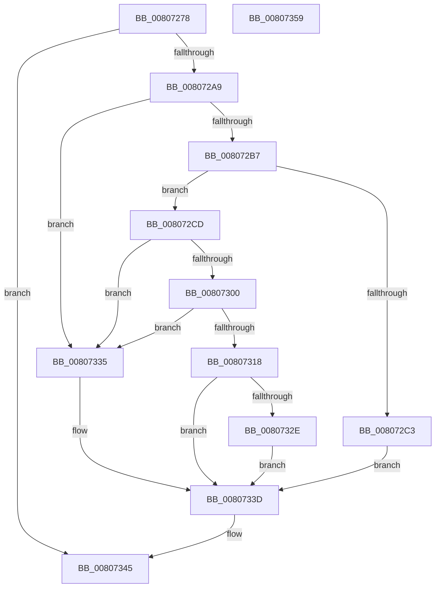

# MmCommitHotPatchTable

- RVA: `0x00807278`–`0x0080735A` (길이 `226` bytes)
- VA: `0x0000000140807278`
- 실행 섹션: `PAGE`
- PDB 이름 있음: `예`; PDB Function 태그: `아니요`
- unwind 정보 RVA: `0x000BC3A0`
- 디코드: `65`개 명령, `226/226` bytes 표시
- 미해석 바이트: `0` (있으면 어셈블리에 `.byte`로 보존)

> 이 문서는 커널 이미지의 기계어와 PDB 기호를 분석해 생성했습니다. 4번과 5번은 함수 원형과 자료형을 바이너리 사용 방식에서 추정한 C 해석이며 원본 소스 복구 결과는 아닙니다.

## 1. Dependencies

- 직접 호출 지점: **4**; 고유 호출 대상: **4**
- 직접 호출자로 확인된 함수: **1**
- RIP 상대 이미지 참조: **2**

### Outgoing calls
- `0x00807298` → [MiObtainReferencedVadEx](../../text/31/MiObtainReferencedVadEx_function_00316690.md) (function, `0x00316690`)
- `0x008072BA` → [MiImageVadHotPatchEligible](MiImageVadHotPatchEligible_function_00803FB8.md) (function, `0x00803FB8`)
- `0x00807321` → [MiCommitHotPatchTable](../../text/68/MiCommitHotPatchTable_function_00683420.md) (function, `0x00683420`)
- `0x00807340` → [MiUnlockAndDereferenceVad](../../text/31/MiUnlockAndDereferenceVad_function_00316E60.md) (function, `0x00316E60`)

### Direct callers
- [sub_006F88AE](../../text/6F/Unknown_function_006F88AE.md) at `0x006F9061`

### Static image references
- `0x008072F2` → RVA `0x00E2D8A8` (`.data`; read)
- `0x00807300` → RVA `0x00E375AC` (`.data`; read)

## 2. Other-region calls and transfers

- 다른 실행 섹션으로 향하는 call: **3**
  - `0x00807298` → [MiObtainReferencedVadEx](../../text/31/MiObtainReferencedVadEx_function_00316690.md) (`PAGE` → `.text`)
  - `0x00807321` → [MiCommitHotPatchTable](../../text/68/MiCommitHotPatchTable_function_00683420.md) (`PAGE` → `.text`)
  - `0x00807340` → [MiUnlockAndDereferenceVad](../../text/31/MiUnlockAndDereferenceVad_function_00316E60.md) (`PAGE` → `.text`)
- 별도 외부 분기/꼬리 이동을 확인하지 못했습니다.

## 3. Assembly (complete function range)

```asm
00807278  48 8B C4                        mov rax, rsp
0080727B  48 89 58 08                     mov qword ptr [rax + 8], rbx
0080727F  48 89 70 10                     mov qword ptr [rax + 0x10], rsi
00807283  57                              push rdi
00807284  48 83 EC 20                     sub rsp, 0x20
00807288  83 60 18 00                     and dword ptr [rax + 0x18], 0
0080728C  4C 8D 40 18                     lea r8, [rax + 0x18]
00807290  48 8B F2                        mov rsi, rdx
00807293  48 8B F9                        mov rdi, rcx
00807296  33 D2                           xor edx, edx
00807298  E8 F3 F3 B0 FF                  call 0x140316690
0080729D  48 8B D8                        mov rbx, rax
008072A0  48 85 C0                        test rax, rax
008072A3  0F 84 9C 00 00 00               je 0x140807345
008072A9  44 8B 40 30                     mov r8d, dword ptr [rax + 0x30]
008072AD  41 80 E0 70                     and r8b, 0x70
008072B1  41 80 F8 20                     cmp r8b, 0x20
008072B5  75 7E                           jne 0x140807335
008072B7  48 8B C8                        mov rcx, rax
008072BA  E8 F9 CC FF FF                  call 0x140803fb8
008072BF  85 C0                           test eax, eax
008072C1  75 0A                           jne 0x1408072cd
008072C3  C7 44 24 40 BB 00 00 C0         mov dword ptr [rsp + 0x40], 0xc00000bb
008072CB  EB 70                           jmp 0x14080733d
008072CD  8B 43 18                        mov eax, dword ptr [rbx + 0x18]
008072D0  0F B6 53 20                     movzx edx, byte ptr [rbx + 0x20]
008072D4  48 C1 E2 20                     shl rdx, 0x20
008072D8  48 0B D0                        or rdx, rax
008072DB  48 8B 43 48                     mov rax, qword ptr [rbx + 0x48]
008072DF  48 C1 E2 0C                     shl rdx, 0xc
008072E3  48 8B 08                        mov rcx, qword ptr [rax]
008072E6  48 8B 01                        mov rax, qword ptr [rcx]
008072E9  8B 40 08                        mov eax, dword ptr [rax + 8]
008072EC  C1 E0 0C                        shl eax, 0xc
008072EF  48 03 D0                        add rdx, rax
008072F2  8B 05 B0 65 62 00               mov eax, dword ptr [rip + 0x6265b0]
008072F8  48 03 D0                        add rdx, rax
008072FB  48 3B D7                        cmp rdx, rdi
008072FE  77 35                           ja 0x140807335
00807300  8B 05 A6 02 63 00               mov eax, dword ptr [rip + 0x6302a6]
00807306  48 8B CE                        mov rcx, rsi
00807309  48 C1 E1 0C                     shl rcx, 0xc
0080730D  48 2B CA                        sub rcx, rdx
00807310  48 03 CF                        add rcx, rdi
00807313  48 3B C8                        cmp rcx, rax
00807316  77 1D                           ja 0x140807335
00807318  4C 8B C6                        mov r8, rsi
0080731B  48 8B D7                        mov rdx, rdi
0080731E  48 8B CB                        mov rcx, rbx
00807321  E8 FA C0 E7 FF                  call 0x140683420
00807326  89 44 24 40                     mov dword ptr [rsp + 0x40], eax
0080732A  85 C0                           test eax, eax
0080732C  78 0F                           js 0x14080733d
0080732E  83 64 24 40 00                  and dword ptr [rsp + 0x40], 0
00807333  EB 08                           jmp 0x14080733d
00807335  C7 44 24 40 18 00 00 C0         mov dword ptr [rsp + 0x40], 0xc0000018
0080733D  48 8B CB                        mov rcx, rbx
00807340  E8 1B FB B0 FF                  call 0x140316e60
00807345  8B 44 24 40                     mov eax, dword ptr [rsp + 0x40]
00807349  48 8B 5C 24 30                  mov rbx, qword ptr [rsp + 0x30]
0080734E  48 8B 74 24 38                  mov rsi, qword ptr [rsp + 0x38]
00807353  48 83 C4 20                     add rsp, 0x20
00807357  5F                              pop rdi
00807358  C3                              ret
00807359  CC                              int3
```

## 4. C-style interpretation (structured pseudocode)

```c
__int64 __fastcall MmCommitHotPatchTable(__int64 a1, __int64 a2)
{
    __int64 result;
    __int64 v_rsp;
    unsigned __int64 v_stack_p10;
    unsigned int v_stack_p18;
    unsigned __int64 v_stack_p8;

    *(unsigned __int64 *)(v_rsp + 8) = v_rbx;
    *(unsigned __int64 *)(v_rsp + 16) = v_rsi;
    v_rsp = (v_rsp) - (32);
    a2 = 0;
    result = MiObtainReferencedVadEx(a1, a2, v_rsp + 24, a4);
    if (result == 0) goto loc_00807345;
    a3 = (unsigned __int8)(((unsigned int)(*(unsigned int *)(result + 48))) & (112));
    if (((unsigned __int8)(a3)) != 32) goto loc_00807335;
    result = MiImageVadHotPatchEligible(result, a2, a3, a4);
    if ((unsigned int)(result) != 0) goto loc_008072CD;
    v_stack_p18 = 0xC00000BBULL;
    goto loc_0080733D;
loc_008072CD:
    a2 = (*(unsigned __int8 *)(result + 32)) << (32);
    a2 = (a2) | ((unsigned int)(*(unsigned int *)(result + 24)));
    a2 = (a2) << (12);
    result = (unsigned int)(((unsigned int)(*(unsigned int *)(*(unsigned __int64 *)(*(unsigned __int64 *)(*(unsigned __int64 *)(result + 72))) + 8))) << (12));
    a2 = (a2) + (result);
    a2 = (a2) + ((unsigned int)(*(unsigned int *)(v_rip + 6448560)));
    if (a2 > a1) goto loc_00807335;
    a1 = (a2) << (12);
    a1 = (a1) - (a2);
    a1 = (a1) + (a1);
    if (a1 > ((unsigned int)(*(unsigned int *)(v_rip + 6488742)))) goto loc_00807335;
    result = MiCommitHotPatchTable(result, a1, a2, a4);
    v_stack_p18 = (unsigned int)(result);
    if (sign_flag) goto loc_0080733D;
    goto loc_0080733D;
loc_00807335:
    v_stack_p18 = 0xC0000018ULL;
loc_0080733D:
    result = MiUnlockAndDereferenceVad(result, a1, a2, a4);
loc_00807345:
    v_rsp = (v_rsp) + (32);
    return (unsigned int)(v_stack_p18);
}
```

## 5. (Beta) C Style

```c
int64_t MmCommitHotPatchTable(int64_t Arg1, int64_t Arg2)
{
    int64_t result;
    int64_t local_rsp;
    uint64_t v_stack_p10;
    uint32_t v_stack_p18;
    uint64_t v_stack_p8;

    *(uint64_t *)(local_rsp + 0x8) = local_rbx;
    *(uint64_t *)(local_rsp + 0x10) = local_rsi;
    local_rsp = (local_rsp) - (32);
    Arg2 = 0;
    result = MiObtainReferencedVadEx(Arg1, Arg2, local_rsp + 24, a4);
    if (result == 0) goto loc_00807345;
    a3 = (uint8_t)(((uint32_t)(*(uint32_t *)(result + 0x30))) & (112));
    if (((uint8_t)(a3)) != 32) goto loc_00807335;
    result = MiImageVadHotPatchEligible(result, Arg2, a3, a4);
    if ((uint32_t)(result) != 0) goto loc_008072CD;
    v_stack_p18 = 0xC00000BBULL;
    goto loc_0080733D;
loc_008072CD:
    Arg2 = (*(uint8_t *)(result + 0x20)) << (32);
    Arg2 = (Arg2) | ((uint32_t)(*(uint32_t *)(result + 0x18)));
    Arg2 = (Arg2) << (12);
    result = (uint32_t)(((uint32_t)(*(uint32_t *)(*(uint64_t *)(*(uint64_t *)(*(uint64_t *)(result + 0x48))) + 0x8))) << (12));
    Arg2 = (Arg2) + (result);
    Arg2 = (Arg2) + ((uint32_t)(*(uint32_t *)(v_rip + 0x6265B0)));
    if (Arg2 > Arg1) goto loc_00807335;
    Arg1 = (Arg2) << (12);
    Arg1 = (Arg1) - (Arg2);
    Arg1 = (Arg1) + (Arg1);
    if (Arg1 > ((uint32_t)(*(uint32_t *)(v_rip + 0x6302A6)))) goto loc_00807335;
    result = MiCommitHotPatchTable(result, Arg1, Arg2, a4);
    v_stack_p18 = (uint32_t)(result);
    if (sign_flag) goto loc_0080733D;
    goto loc_0080733D;
loc_00807335:
    v_stack_p18 = 0xC0000018ULL;
loc_0080733D:
    result = MiUnlockAndDereferenceVad(result, Arg1, Arg2, a4);
loc_00807345:
    local_rsp = (local_rsp) + (32);
    return (uint32_t)(v_stack_p18);
}
```

## 6. Execution-region graph

[열기: 2D/3D 그래프와 함수 탐색 컨트롤 패널](../../../control-panel.html?section=page&rva=0x00807278&view=graph)

- 2D 그래프는 위에서 아래로 흐르고, 3D 그래프는 빈 공간을 드래그해 회전합니다. Shift+드래그는 이동, 휠은 확대·축소, 함수 노드 선택은 대상 보고서 이동입니다.

### Static fallback


