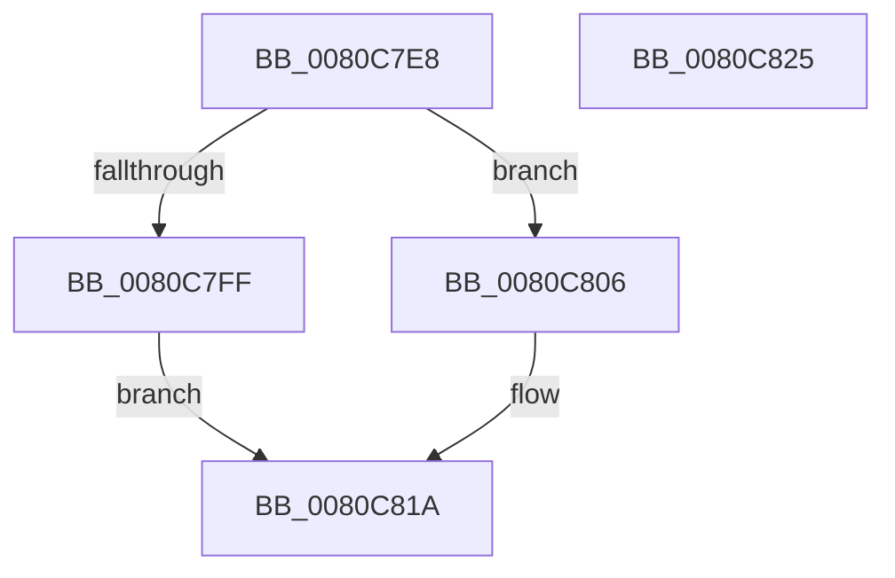

# MmCompactServiceTable

- RVA: `0x0080C7E8`–`0x0080C826` (길이 `62` bytes)
- VA: `0x000000014080C7E8`
- 실행 섹션: `PAGE`
- PDB 이름 있음: `예`; PDB Function 태그: `아니요`
- unwind 정보 RVA: `0x0005CAAC`
- 디코드: `20`개 명령, `62/62` bytes 표시
- 미해석 바이트: `0` (있으면 어셈블리에 `.byte`로 보존)

> 이 문서는 커널 이미지의 기계어와 PDB 기호를 분석해 생성했습니다. 4번과 5번은 함수 원형과 자료형을 바이너리 사용 방식에서 추정한 C 해석이며 원본 소스 복구 결과는 아닙니다.

## 1. Dependencies

- 직접 호출 지점: **3**; 고유 호출 대상: **3**
- 직접 호출자로 확인된 함수: **1**
- RIP 상대 이미지 참조: **0**

### Outgoing calls
- `0x0080C7F2` → [MmLockLoadedDataTableEntry](../../text/2A/MmLockLoadedDataTableEntry_function_002A437C.md) (function, `0x002A437C`)
- `0x0080C809` → [MiCompactServiceTable](MiCompactServiceTable_function_0080C63C.md) (function, `0x0080C63C`)
- `0x0080C813` → [MmUnlockLoadedDataTableEntry](../../text/2A/MmUnlockLoadedDataTableEntry_function_002A3C98.md) (function, `0x002A3C98`)

### Direct callers
- [PsInitializeWin32kServiceTable](../../init/C4/PsInitializeWin32kServiceTable_function_00C44C08.md) at `0x00C44C96`

### Static image references
- 디코드된 RIP-relative 메모리 참조가 없습니다.

## 2. Other-region calls and transfers

- 다른 실행 섹션으로 향하는 call: **2**
  - `0x0080C7F2` → [MmLockLoadedDataTableEntry](../../text/2A/MmLockLoadedDataTableEntry_function_002A437C.md) (`PAGE` → `.text`)
  - `0x0080C813` → [MmUnlockLoadedDataTableEntry](../../text/2A/MmUnlockLoadedDataTableEntry_function_002A3C98.md) (`PAGE` → `.text`)
- 별도 외부 분기/꼬리 이동을 확인하지 못했습니다.

## 3. Assembly (complete function range)

```asm
0080C7E8  48 89 5C 24 08                  mov qword ptr [rsp + 8], rbx
0080C7ED  57                              push rdi
0080C7EE  48 83 EC 20                     sub rsp, 0x20
0080C7F2  E8 85 7B A9 FF                  call 0x1402a437c
0080C7F7  48 8B F8                        mov rdi, rax
0080C7FA  48 85 C0                        test rax, rax
0080C7FD  75 07                           jne 0x14080c806
0080C7FF  B8 25 02 00 C0                  mov eax, 0xc0000225
0080C804  EB 14                           jmp 0x14080c81a
0080C806  48 8B CF                        mov rcx, rdi
0080C809  E8 2E FE FF FF                  call 0x14080c63c
0080C80E  48 8B CF                        mov rcx, rdi
0080C811  8B D8                           mov ebx, eax
0080C813  E8 80 74 A9 FF                  call 0x1402a3c98
0080C818  8B C3                           mov eax, ebx
0080C81A  48 8B 5C 24 30                  mov rbx, qword ptr [rsp + 0x30]
0080C81F  48 83 C4 20                     add rsp, 0x20
0080C823  5F                              pop rdi
0080C824  C3                              ret
0080C825  CC                              int3
```

## 4. C-style interpretation (structured pseudocode)

```c
__int64 __fastcall MmCompactServiceTable(void)
{
    __int64 result;
    __int64 v_rsp;
    unsigned __int64 v_stack_p8;

    v_stack_p8 = v_rbx;
    v_rsp = (v_rsp) - (32);
    result = MmLockLoadedDataTableEntry(a1, a2, a3, a4);
    if (result != 0) goto loc_0080C806;
    goto loc_0080C81A;
loc_0080C806:
    result = MiCompactServiceTable(result, a2, a3, a4);
    result = MmUnlockLoadedDataTableEntry(result, a2, a3, a4);
loc_0080C81A:
    v_rsp = (v_rsp) + (32);
    return (unsigned int)((unsigned int)((unsigned int)((unsigned int)(result))));
}
```

## 5. (Beta) C Style

```c
void MmCompactServiceTable(void)
{
    int64_t result;
    int64_t local_rsp;
    uint64_t v_stack_p8;

    v_stack_p8 = local_rbx;
    local_rsp = (local_rsp) - (32);
    result = MmLockLoadedDataTableEntry(a1, a2, a3, a4);
    if (result != 0) goto loc_0080C806;
    goto loc_0080C81A;
loc_0080C806:
    result = MiCompactServiceTable(result, a2, a3, a4);
    result = MmUnlockLoadedDataTableEntry(result, a2, a3, a4);
loc_0080C81A:
    local_rsp = (local_rsp) + (32);
    return (uint32_t)((uint32_t)((uint32_t)((uint32_t)(result))));
}
```

## 6. Execution-region graph

[열기: 2D/3D 그래프와 함수 탐색 컨트롤 패널](../../../control-panel.html?section=page&rva=0x0080C7E8&view=graph)

- 2D 그래프는 위에서 아래로 흐르고, 3D 그래프는 빈 공간을 드래그해 회전합니다. Shift+드래그는 이동, 휠은 확대·축소, 함수 노드 선택은 대상 보고서 이동입니다.

### Static fallback


