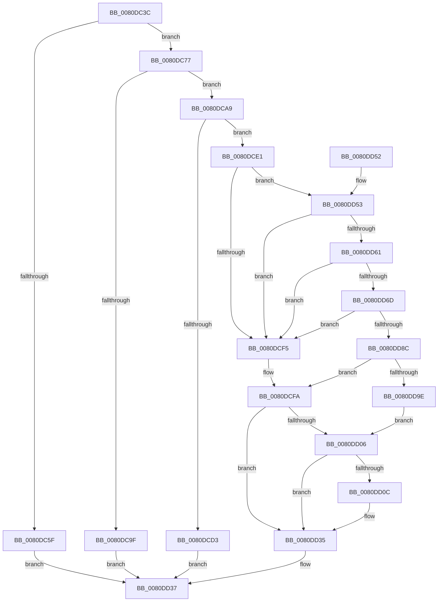

# MmCreatePartition

- RVA: `0x0080DC3C`–`0x0080DDA6` (길이 `362` bytes)
- VA: `0x000000014080DC3C`
- 실행 섹션: `PAGE`
- PDB 이름 있음: `예`; PDB Function 태그: `아니요`
- unwind 정보 RVA: `0x000D91D4`
- 디코드: `93`개 명령, `362/362` bytes 표시
- 미해석 바이트: `0` (있으면 어셈블리에 `.byte`로 보존)

> 이 문서는 커널 이미지의 기계어와 PDB 기호를 분석해 생성했습니다. 4번과 5번은 함수 원형과 자료형을 바이너리 사용 방식에서 추정한 C 해석이며 원본 소스 복구 결과는 아닙니다.

## 1. Dependencies

- 직접 호출 지점: **12**; 고유 호출 대상: **11**
- 직접 호출자로 확인된 함수: **2**
- RIP 상대 이미지 참조: **2**

### Outgoing calls
- `0x0080DC7B` → [MiCreatePartitionOffsets](../7F/MiCreatePartitionOffsets_function_007FD18C.md) (function, `0x007FD18C`)
- `0x0080DC92` → [MiAllocatePool](../../text/35/MiAllocatePool_function_0035B540.md) (function, `0x0035B540`)
- `0x0080DCB7` → [MiCreatePartitionOffsets](../7F/MiCreatePartitionOffsets_function_007FD18C.md) (function, `0x007FD18C`)
- `0x0080DCC6` → [MiAllocatePartitionId](../7F/MiAllocatePartitionId_function_007FD040.md) (function, `0x007FD040`)
- `0x0080DCD5` → [ExFreePoolWithTag](../../poolcode/B8/ExFreePoolWithTag_function_00B82870.md) (function, `0x00B82870`)
- `0x0080DCE4` → [MiInitializePartition](../7F/MiInitializePartition_function_007FD3E8.md) (function, `0x007FD3E8`)
- `0x0080DCEC` → [MiInitializeMemoryEvents](../81/MiInitializeMemoryEvents_function_0081123C.md) (function, `0x0081123C`)
- `0x0080DCFD` → [MiDeletePartition](../7F/MiDeletePartition_function_007FD2BC.md) (function, `0x007FD2BC`)
- `0x0080DD58` → [MiCreatePfnBitMaps](MiCreatePfnBitMaps_function_0080BBC8.md) (function, `0x0080BBC8`)
- `0x0080DD64` → [MiInitializeWorkingSetManagerParameters](../../text/67/MiInitializeWorkingSetManagerParameters_function_0067E7F8.md) (function, `0x0067E7F8`)
- `0x0080DD77` → [ExAllocateCacheAwareRundownProtection](../9A/ExAllocateCacheAwareRundownProtection_function_009A5790.md) (function, `0x009A5790`)
- `0x0080DD8F` → [MiInitializePartitionThreads](../7F/MiInitializePartitionThreads_function_007FDD1C.md) (function, `0x007FDD1C`)

### Direct callers
- [DifGetAvailableSystemPages](../../text/61/DifGetAvailableSystemPages_function_0061B704.md) at `0x0061B71E`
- [PspAllocatePartition](../78/PspAllocatePartition_function_0078802C.md) at `0x00788136`

### Static image references
- `0x0080DC5F` → RVA `0x00E38D00` (`.data`; read)
- `0x0080DC6B` → RVA `0x00E38DB8` (`.data`; write)

## 2. Other-region calls and transfers

- 다른 실행 섹션으로 향하는 call: **3**
  - `0x0080DC92` → [MiAllocatePool](../../text/35/MiAllocatePool_function_0035B540.md) (`PAGE` → `.text`)
  - `0x0080DCD5` → [ExFreePoolWithTag](../../poolcode/B8/ExFreePoolWithTag_function_00B82870.md) (`PAGE` → `POOLCODE`)
  - `0x0080DD64` → [MiInitializeWorkingSetManagerParameters](../../text/67/MiInitializeWorkingSetManagerParameters_function_0067E7F8.md) (`PAGE` → `.text`)
- 별도 외부 분기/꼬리 이동을 확인하지 못했습니다.

## 3. Assembly (complete function range)

```asm
0080DC3C  48 8B C4                        mov rax, rsp
0080DC3F  48 89 58 08                     mov qword ptr [rax + 8], rbx
0080DC43  48 89 68 10                     mov qword ptr [rax + 0x10], rbp
0080DC47  48 89 70 18                     mov qword ptr [rax + 0x18], rsi
0080DC4B  48 89 78 20                     mov qword ptr [rax + 0x20], rdi
0080DC4F  41 56                           push r14
0080DC51  48 83 EC 20                     sub rsp, 0x20
0080DC55  8B EA                           mov ebp, edx
0080DC57  48 8B F1                        mov rsi, rcx
0080DC5A  F6 C2 01                        test dl, 1
0080DC5D  74 18                           je 0x14080dc77
0080DC5F  48 8D 05 9A B0 62 00            lea rax, [rip + 0x62b09a]
0080DC66  48 89 01                        mov qword ptr [rcx], rax
0080DC69  33 C0                           xor eax, eax
0080DC6B  48 89 0D 46 B1 62 00            mov qword ptr [rip + 0x62b146], rcx
0080DC72  E9 C0 00 00 00                  jmp 0x14080dd37
0080DC77  33 D2                           xor edx, edx
0080DC79  33 C9                           xor ecx, ecx
0080DC7B  E8 0C F5 FE FF                  call 0x1407fd18c
0080DC80  B9 40 00 00 00                  mov ecx, 0x40
0080DC85  41 B8 4D 69 50 61               mov r8d, 0x6150694d
0080DC8B  48 8D 90 40 5D 00 00            lea rdx, [rax + 0x5d40]
0080DC92  E8 A9 D8 B4 FF                  call 0x14035b540
0080DC97  48 8B F8                        mov rdi, rax
0080DC9A  48 85 C0                        test rax, rax
0080DC9D  75 0A                           jne 0x14080dca9
0080DC9F  B8 9A 00 00 C0                  mov eax, 0xc000009a
0080DCA4  E9 8E 00 00 00                  jmp 0x14080dd37
0080DCA9  48 8D 90 7F 5D 00 00            lea rdx, [rax + 0x5d7f]
0080DCB0  48 8B CF                        mov rcx, rdi
0080DCB3  48 83 E2 C0                     and rdx, 0xffffffffffffffc0
0080DCB7  E8 D0 F4 FE FF                  call 0x1407fd18c
0080DCBC  48 8B CF                        mov rcx, rdi
0080DCBF  48 89 B7 B8 00 00 00            mov qword ptr [rdi + 0xb8], rsi
0080DCC6  E8 75 F3 FE FF                  call 0x1407fd040
0080DCCB  48 8B CF                        mov rcx, rdi
0080DCCE  66 85 C0                        test ax, ax
0080DCD1  75 0E                           jne 0x14080dce1
0080DCD3  33 D2                           xor edx, edx
0080DCD5  E8 96 4B 37 00                  call 0x140b82870
0080DCDA  B8 17 00 00 C0                  mov eax, 0xc0000017
0080DCDF  EB 56                           jmp 0x14080dd37
0080DCE1  0F B7 D0                        movzx edx, ax
0080DCE4  E8 FF F6 FE FF                  call 0x1407fd3e8
0080DCE9  48 8B CF                        mov rcx, rdi
0080DCEC  E8 4B 35 00 00                  call 0x14081123c
0080DCF1  85 C0                           test eax, eax
0080DCF3  75 5E                           jne 0x14080dd53
0080DCF5  BB 9A 00 00 C0                  mov ebx, 0xc000009a
0080DCFA  48 8B CF                        mov rcx, rdi
0080DCFD  E8 BA F5 FE FF                  call 0x1407fd2bc
0080DD02  85 DB                           test ebx, ebx
0080DD04  78 2F                           js 0x14080dd35
0080DD06  40 F6 C5 02                     test bpl, 2
0080DD0A  74 29                           je 0x14080dd35
0080DD0C  F0 81 4F 04 80 00 00 00         lock or dword ptr [rdi + 4], 0x80
0080DD14  0F 57 C0                        xorps xmm0, xmm0
0080DD17  33 C0                           xor eax, eax
0080DD19  0F 11 87 D8 44 00 00            movups xmmword ptr [rdi + 0x44d8], xmm0
0080DD20  0F 11 87 E8 44 00 00            movups xmmword ptr [rdi + 0x44e8], xmm0
0080DD27  0F 11 87 F8 44 00 00            movups xmmword ptr [rdi + 0x44f8], xmm0
0080DD2E  48 89 87 08 45 00 00            mov qword ptr [rdi + 0x4508], rax
0080DD35  8B C3                           mov eax, ebx
0080DD37  48 8B 5C 24 30                  mov rbx, qword ptr [rsp + 0x30]
0080DD3C  48 8B 6C 24 38                  mov rbp, qword ptr [rsp + 0x38]
0080DD41  48 8B 74 24 40                  mov rsi, qword ptr [rsp + 0x40]
0080DD46  48 8B 7C 24 48                  mov rdi, qword ptr [rsp + 0x48]
0080DD4B  48 83 C4 20                     add rsp, 0x20
0080DD4F  41 5E                           pop r14
0080DD51  C3                              ret
0080DD52  CC                              int3
0080DD53  33 D2                           xor edx, edx
0080DD55  48 8B CF                        mov rcx, rdi
0080DD58  E8 6B DE FF FF                  call 0x14080bbc8
0080DD5D  85 C0                           test eax, eax
0080DD5F  74 94                           je 0x14080dcf5
0080DD61  48 8B CF                        mov rcx, rdi
0080DD64  E8 8F 0A E7 FF                  call 0x14067e7f8
0080DD69  85 C0                           test eax, eax
0080DD6B  74 88                           je 0x14080dcf5
0080DD6D  BA 4D 69 70 72                  mov edx, 0x7270694d
0080DD72  B9 00 02 00 00                  mov ecx, 0x200
0080DD77  E8 14 7A 19 00                  call 0x1409a5790
0080DD7C  48 89 87 F0 0A 00 00            mov qword ptr [rdi + 0xaf0], rax
0080DD83  48 85 C0                        test rax, rax
0080DD86  0F 84 69 FF FF FF               je 0x14080dcf5
0080DD8C  48 8B CF                        mov rcx, rdi
0080DD8F  E8 88 FF FE FF                  call 0x1407fdd1c
0080DD94  8B D8                           mov ebx, eax
0080DD96  85 C0                           test eax, eax
0080DD98  0F 88 5C FF FF FF               js 0x14080dcfa
0080DD9E  48 89 3E                        mov qword ptr [rsi], rdi
0080DDA1  E9 60 FF FF FF                  jmp 0x14080dd06
```

## 4. C-style interpretation (structured pseudocode)

```c
__int64 __fastcall MmCreatePartition(__int64 a1, int a2)
{
    __int64 result;
    __int64 v_rsp;
    unsigned __int64 v_stack_p10;
    unsigned __int64 v_stack_p18;
    unsigned __int64 v_stack_p20;
    unsigned __int64 v_stack_p8;

    *(unsigned __int64 *)(v_rsp + 8) = v_rbx;
    *(unsigned __int64 *)(v_rsp + 16) = v_rbp;
    *(unsigned __int64 *)(v_rsp + 24) = v_rsi;
    *(unsigned __int64 *)(v_rsp + 32) = v_rdi;
    v_rsp = (v_rsp) - (32);
    if ((((unsigned __int8)(a2)) & (1)) == 0) goto loc_0080DC77;
    *(unsigned __int64 *)(a1) = v_rip + 6467738;
    result = 0;
    *(unsigned __int64 *)(v_rip + 6467910) = a1;
    goto loc_0080DD37;
loc_0080DC77:
    a2 = 0;
    a1 = 0;
    result = MiCreatePartitionOffsets(a1, a2, a3, a4);
    result = MiAllocatePool(64, result + 23872, (unsigned int)(0x6150694DULL), a4);
    if (result != 0) goto loc_0080DCA9;
    goto loc_0080DD37;
loc_0080DCA9:
    a2 = ((unsigned int)(0xC000009AULL) + 23935) & (-64);
    result = MiCreatePartitionOffsets(result, a2, (unsigned int)(0x6150694DULL), a4);
    *(unsigned __int64 *)(result + 184) = 0;
    result = MiAllocatePartitionId(result, a2, (unsigned int)(0x6150694DULL), a4);
    if ((unsigned __int16)(result) != 0) goto loc_0080DCE1;
    a2 = 0;
    result = ExFreePoolWithTag(result, a2, (unsigned int)(0x6150694DULL), a4);
    goto loc_0080DD37;
loc_0080DCE1:
    result = MiInitializePartition(result, (unsigned __int16)((unsigned int)(0xC0000017ULL)), (unsigned int)(0x6150694DULL), a4);
    result = MiInitializeMemoryEvents(result, (unsigned __int16)((unsigned int)(0xC0000017ULL)), (unsigned int)(0x6150694DULL), a4);
    if ((unsigned int)(result) != 0) goto loc_0080DD53;
loc_0080DCF5:
loc_0080DCFA:
    result = MiDeletePartition(result, (unsigned __int16)((unsigned int)(0xC0000017ULL)), (unsigned int)(0x6150694DULL), a4);
    if (sign_flag) goto loc_0080DD35;
loc_0080DD06:
    if ((((unsigned __int8)((unsigned int)(a2))) & (2)) != 0) {
        result = 0;
        *(unsigned __int64 *)(result + 17624) = v_xmm0;
        *(unsigned __int64 *)(result + 17640) = v_xmm0;
        *(unsigned __int64 *)(result + 17656) = v_xmm0;
        *(unsigned __int64 *)(result + 17672) = 0;
    }
loc_0080DD37:
    v_rsp = (v_rsp) + (32);
    return (unsigned int)((unsigned int)((unsigned int)(0xC000009AULL)));
loc_0080DD53:
    a2 = 0;
    result = MiCreatePfnBitMaps(v_stack_p20, a2, (unsigned int)(0x6150694DULL), a4);
    if ((unsigned int)(result) == 0) goto loc_0080DCF5;
    result = MiInitializeWorkingSetManagerParameters(v_stack_p20, a2, (unsigned int)(0x6150694DULL), a4);
    if ((unsigned int)(result) == 0) goto loc_0080DCF5;
    result = ExAllocateCacheAwareRundownProtection(512, (unsigned int)(0x7270694DULL), (unsigned int)(0x6150694DULL), a4);
    *(unsigned __int64 *)(v_stack_p20 + 2800) = result;
    if (result == 0) goto loc_0080DCF5;
    result = MiInitializePartitionThreads(v_stack_p20, (unsigned int)(0x7270694DULL), (unsigned int)(0x6150694DULL), a4);
    if (sign_flag) goto loc_0080DCFA;
    *(unsigned __int64 *)(v_stack_p18) = v_stack_p20;
    goto loc_0080DD06;
}
```

## 5. (Beta) C Style

```c
int64_t MmCreatePartition(void *Arg1, int32_t Arg2)
{
    uint8_t *arg1 = (uint8_t *)Arg1;

    int64_t result;
    int64_t local_rsp;
    uint64_t v_stack_p10;
    uint64_t v_stack_p18;
    uint64_t v_stack_p20;
    uint64_t v_stack_p8;

    *(uint64_t *)(local_rsp + 0x8) = local_rbx;
    *(uint64_t *)(local_rsp + 0x10) = local_rbp;
    *(uint64_t *)(local_rsp + 0x18) = local_rsi;
    *(uint64_t *)(local_rsp + 0x20) = local_rdi;
    local_rsp = (local_rsp) - (32);
    if ((((uint8_t)(Arg2)) & (1)) == 0) goto loc_0080DC77;
    *(uint64_t *)(arg1) = v_rip + 6467738;
    result = 0;
    *(void **)(v_rip + 0x62B146) = Arg1;
    goto loc_0080DD37;
loc_0080DC77:
    Arg2 = 0;
    Arg1 = 0;
    result = MiCreatePartitionOffsets(Arg1, Arg2, a3, a4);
    result = MiAllocatePool(64, result + 23872, (uint32_t)(0x6150694DULL), a4);
    if (result != 0) goto loc_0080DCA9;
    goto loc_0080DD37;
loc_0080DCA9:
    Arg2 = ((uint32_t)(0xC000009AULL) + 23935) & (-64);
    result = MiCreatePartitionOffsets(result, Arg2, (uint32_t)(0x6150694DULL), a4);
    *(uint64_t *)(result + 0xB8) = 0;
    result = MiAllocatePartitionId(result, Arg2, (uint32_t)(0x6150694DULL), a4);
    if ((uint16_t)(result) != 0) goto loc_0080DCE1;
    Arg2 = 0;
    result = ExFreePoolWithTag(result, Arg2, (uint32_t)(0x6150694DULL), a4);
    goto loc_0080DD37;
loc_0080DCE1:
    result = MiInitializePartition(result, (uint16_t)((uint32_t)(0xC0000017ULL)), (uint32_t)(0x6150694DULL), a4);
    result = MiInitializeMemoryEvents(result, (uint16_t)((uint32_t)(0xC0000017ULL)), (uint32_t)(0x6150694DULL), a4);
    if ((uint32_t)(result) != 0) goto loc_0080DD53;
loc_0080DCF5:
loc_0080DCFA:
    result = MiDeletePartition(result, (uint16_t)((uint32_t)(0xC0000017ULL)), (uint32_t)(0x6150694DULL), a4);
    if (sign_flag) goto loc_0080DD35;
loc_0080DD06:
    if ((((uint8_t)((uint32_t)(Arg2))) & (2)) != 0) {
        result = 0;
        *(uint64_t *)(result + 0x44D8) = v_xmm0;
        *(uint64_t *)(result + 0x44E8) = v_xmm0;
        *(uint64_t *)(result + 0x44F8) = v_xmm0;
        *(uint64_t *)(result + 0x4508) = 0;
    }
loc_0080DD37:
    local_rsp = (local_rsp) + (32);
    return (uint32_t)((uint32_t)((uint32_t)(0xC000009AULL)));
loc_0080DD53:
    Arg2 = 0;
    result = MiCreatePfnBitMaps(v_stack_p20, Arg2, (uint32_t)(0x6150694DULL), a4);
    if ((uint32_t)(result) == 0) goto loc_0080DCF5;
    result = MiInitializeWorkingSetManagerParameters(v_stack_p20, Arg2, (uint32_t)(0x6150694DULL), a4);
    if ((uint32_t)(result) == 0) goto loc_0080DCF5;
    result = ExAllocateCacheAwareRundownProtection(512, (uint32_t)(0x7270694DULL), (uint32_t)(0x6150694DULL), a4);
    *(uint64_t *)(v_stack_p20 + 0xAF0) = result;
    if (result == 0) goto loc_0080DCF5;
    result = MiInitializePartitionThreads(v_stack_p20, (uint32_t)(0x7270694DULL), (uint32_t)(0x6150694DULL), a4);
    if (sign_flag) goto loc_0080DCFA;
    *(uint64_t *)(v_stack_p18) = v_stack_p20;
    goto loc_0080DD06;
}
```

### 관측된 메모리 오프셋

구조체 형식이 확인되지 않은 접근은 인자 기준의 오프셋으로만 기록했습니다.

| 기준 인자 | 오프셋 표현 | 폭 (bit) | 접근 |
|---|---:|---:|---|
| `Arg1` | `+ 0x0` | `64` | `W` |

## 6. Execution-region graph

[열기: 2D/3D 그래프와 함수 탐색 컨트롤 패널](../../../control-panel.html?section=page&rva=0x0080DC3C&view=graph)

- 2D 그래프는 위에서 아래로 흐르고, 3D 그래프는 빈 공간을 드래그해 회전합니다. Shift+드래그는 이동, 휠은 확대·축소, 함수 노드 선택은 대상 보고서 이동입니다.

### Static fallback


