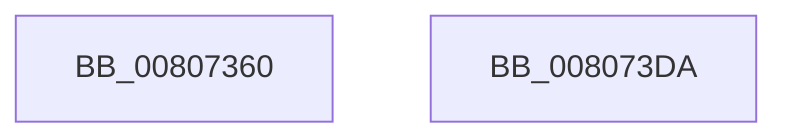

# MmCreateSectionForHotpatch

- RVA: `0x00807360`–`0x008073DB` (길이 `123` bytes)
- VA: `0x0000000140807360`
- 실행 섹션: `PAGE`
- PDB 이름 있음: `예`; PDB Function 태그: `아니요`
- unwind 정보 RVA: `0x000AA4F0`
- 디코드: `28`개 명령, `123/123` bytes 표시
- 미해석 바이트: `0` (있으면 어셈블리에 `.byte`로 보존)

> 이 문서는 커널 이미지의 기계어와 PDB 기호를 분석해 생성했습니다. 4번과 5번은 함수 원형과 자료형을 바이너리 사용 방식에서 추정한 C 해석이며 원본 소스 복구 결과는 아닙니다.

## 1. Dependencies

- 직접 호출 지점: **1**; 고유 호출 대상: **1**
- 직접 호출자로 확인된 함수: **2**
- RIP 상대 이미지 참조: **0**

### Outgoing calls
- `0x008073CD` → [MiCreateSectionCommon](../8A/MiCreateSectionCommon_function_008A9AA4.md) (function, `0x008A9AA4`)

### Direct callers
- [sub_006F88AE](../../text/6F/Unknown_function_006F88AE.md) at `0x006F8FCC`
- [MiCreatePatchSectionRequest](MiCreatePatchSectionRequest_function_008031E0.md) at `0x00803394`

### Static image references
- 디코드된 RIP-relative 메모리 참조가 없습니다.

## 2. Other-region calls and transfers

- 다른 실행 섹션으로 향하는 call: **0**
- 별도 외부 분기/꼬리 이동을 확인하지 못했습니다.

## 3. Assembly (complete function range)

```asm
00807360  4C 8B DC                        mov r11, rsp
00807363  48 81 EC 98 00 00 00            sub rsp, 0x98
0080736A  45 33 D2                        xor r10d, r10d
0080736D  49 C7 43 C8 30 00 00 00         mov qword ptr [r11 - 0x38], 0x30
00807375  F6 9C 24 C0 00 00 00            neg byte ptr [rsp + 0xc0]
0080737C  0F 57 C0                        xorps xmm0, xmm0
0080737F  45 88 53 B8                     mov byte ptr [r11 - 0x48], r10b
00807383  C7 44 24 48 06 00 00 00         mov dword ptr [rsp + 0x48], 6
0080738B  1B C0                           sbb eax, eax
0080738D  45 89 53 A8                     mov dword ptr [r11 - 0x58], r10d
00807391  F7 D0                           not eax
00807393  4D 89 53 A0                     mov qword ptr [r11 - 0x60], r10
00807397  25 00 02 00 00                  and eax, 0x200
0080739C  49 89 4B 98                     mov qword ptr [r11 - 0x68], rcx
008073A0  48 8B 8C 24 C8 00 00 00         mov rcx, qword ptr [rsp + 0xc8]
008073A8  45 89 4B 90                     mov dword ptr [r11 - 0x70], r9d
008073AC  45 33 C9                        xor r9d, r9d
008073AF  45 89 53 E4                     mov dword ptr [r11 - 0x1c], r10d
008073B3  4D 89 53 D0                     mov qword ptr [r11 - 0x30], r10
008073B7  89 44 24 78                     mov dword ptr [rsp + 0x78], eax
008073BB  45 89 43 88                     mov dword ptr [r11 - 0x78], r8d
008073BF  4D 8D 43 C8                     lea r8, [r11 - 0x38]
008073C3  4D 89 53 D8                     mov qword ptr [r11 - 0x28], r10
008073C7  F3 41 0F 7F 43 E8               movdqu xmmword ptr [r11 - 0x18], xmm0
008073CD  E8 D2 26 0A 00                  call 0x1408a9aa4
008073D2  48 81 C4 98 00 00 00            add rsp, 0x98
008073D9  C3                              ret
008073DA  CC                              int3
```

## 4. C-style interpretation (structured pseudocode)

```c
__int64 __fastcall MmCreateSectionForHotpatch(__int64 a1, __int64 a2, int a3, int a4, unsigned __int8 a5, __int64 a6)
{
    __int64 result;
    __int64 v_r10;
    __int64 v_rsp;
    unsigned int v_stack_m20;
    unsigned int v_stack_m50;

    v_rsp = (v_rsp) - (152);
    v_r10 = 0;
    *(unsigned __int64 *)(v_rsp - 56) = 48;
    *(unsigned __int8 *)(v_rsp - 72) = 0;
    v_stack_m50 = 6;
    *(unsigned int *)(v_rsp - 88) = 0;
    result = (unsigned int)(~(result));
    *(unsigned __int64 *)(v_rsp - 96) = 0;
    result = (unsigned int)((result) & (512));
    *(unsigned __int64 *)(v_rsp - 104) = a1;
    *(unsigned int *)(v_rsp - 112) = a4;
    a4 = 0;
    *(unsigned int *)(v_rsp - 28) = 0;
    *(unsigned __int64 *)(v_rsp - 48) = 0;
    v_stack_m20 = (unsigned int)(result);
    *(unsigned int *)(v_rsp - 120) = a3;
    *(unsigned __int64 *)(v_rsp - 40) = 0;
    *(unsigned __int64 *)(v_rsp - 24) = v_xmm0;
    result = MiCreateSectionCommon(a6, a2, v_rsp - 56, a4);
    v_rsp = (v_rsp) + (152);
    return result;
}
```

## 5. (Beta) C Style

```c
int64_t MmCreateSectionForHotpatch(int64_t Arg1, int64_t Arg2, int32_t Arg3, int32_t Arg4, uint8_t Arg5, int64_t Arg6)
{
    int64_t result;
    int64_t local_r10;
    int64_t local_rsp;
    uint32_t v_stack_m20;
    uint32_t v_stack_m50;

    local_rsp = (local_rsp) - (152);
    local_r10 = 0;
    *(uint64_t *)(local_rsp - 0x38) = 48;
    *(uint8_t *)(local_rsp - 0x48) = 0;
    v_stack_m50 = 6;
    *(uint32_t *)(local_rsp - 0x58) = 0;
    result = (uint32_t)(~(result));
    *(uint64_t *)(local_rsp - 0x60) = 0;
    result = (uint32_t)((result) & (512));
    *(uint64_t *)(local_rsp - 0x68) = Arg1;
    *(uint32_t *)(local_rsp - 0x70) = Arg4;
    Arg4 = 0;
    *(uint32_t *)(local_rsp - 0x1C) = 0;
    *(uint64_t *)(local_rsp - 0x30) = 0;
    v_stack_m20 = (uint32_t)(result);
    *(uint32_t *)(local_rsp - 0x78) = Arg3;
    *(uint64_t *)(local_rsp - 0x28) = 0;
    *(uint64_t *)(local_rsp - 0x18) = v_xmm0;
    result = MiCreateSectionCommon(Arg6, Arg2, local_rsp - 56, Arg4);
    local_rsp = (local_rsp) + (152);
    return result;
}
```

## 6. Execution-region graph

[열기: 2D/3D 그래프와 함수 탐색 컨트롤 패널](../../../control-panel.html?section=page&rva=0x00807360&view=graph)

- 2D 그래프는 위에서 아래로 흐르고, 3D 그래프는 빈 공간을 드래그해 회전합니다. Shift+드래그는 이동, 휠은 확대·축소, 함수 노드 선택은 대상 보고서 이동입니다.

### Static fallback


