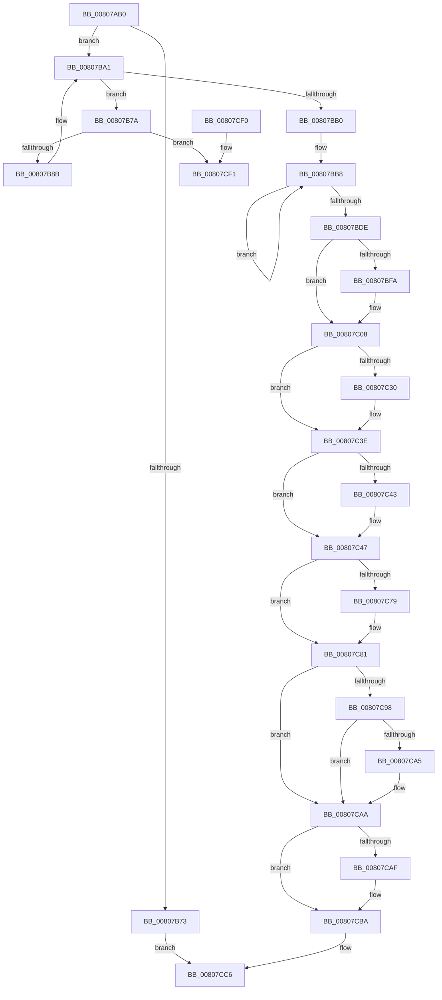

# MmCreateShadowMapping

- RVA: `0x00807AB0`–`0x00807CF8` (길이 `584` bytes)
- VA: `0x0000000140807AB0`
- 실행 섹션: `PAGE`
- PDB 이름 있음: `예`; PDB Function 태그: `아니요`
- unwind 정보 RVA: `0x000D880C`
- 디코드: `154`개 명령, `584/584` bytes 표시
- 미해석 바이트: `0` (있으면 어셈블리에 `.byte`로 보존)

> 이 문서는 커널 이미지의 기계어와 PDB 기호를 분석해 생성했습니다. 4번과 5번은 함수 원형과 자료형을 바이너리 사용 방식에서 추정한 C 해석이며 원본 소스 복구 결과는 아닙니다.

## 1. Dependencies

- 직접 호출 지점: **18**; 고유 호출 대상: **17**
- 직접 호출자로 확인된 함수: **3**
- RIP 상대 이미지 참조: **5**

### Outgoing calls
- `0x00807B11` → [memset](../../text/6C/memset_function_006C6C40.md) (function, `0x006C6C40`)
- `0x00807B22` → [MiInitializeLargePfnList](../../text/43/MiInitializeLargePfnList_function_00432E70.md) (function, `0x00432E70`)
- `0x00807B4A` → [MiInitializeColorBase](../../text/3B/MiInitializeColorBase_function_003B5E38.md) (function, `0x003B5E38`)
- `0x00807B55` → [MiPageTablesNeeded](../../text/67/MiPageTablesNeeded_function_0067FB80.md) (function, `0x0067FB80`)
- `0x00807B6A` → [MiGetPageTablePages](../../text/37/MiGetPageTablePages_function_00376C3C.md) (function, `0x00376C3C`)
- `0x00807BA6` → [MiUnlinkPageChainHead](../../text/36/MiUnlinkPageChainHead_function_00365C40.md) (function, `0x00365C40`)
- `0x00807BBB` → [MiGetPteAddress](../../text/43/MiGetPteAddress_function_0043E130.md) (function, `0x0043E130`)
- `0x00807BC6` → [MiGetPteAddress](../../text/43/MiGetPteAddress_function_0043E130.md) (function, `0x0043E130`)
- `0x00807C03` → [KiStackAttachProcess](../../text/21/KiStackAttachProcess_function_00216820.md) (function, `0x00216820`)
- `0x00807C1F` → [KeAbPreAcquire](../../text/21/KeAbPreAcquire_function_00210230.md) (function, `0x00210230`)
- `0x00807C39` → [ExfAcquirePushLockExclusiveEx](../../text/20/ExfAcquirePushLockExclusiveEx_function_0020FC90.md) (function, `0x0020FC90`)
- `0x00807C61` → [MiMakeShadowPageTableRange](MiMakeShadowPageTableRange_function_00807998.md) (function, `0x00807998`)
- `0x00807C7C` → [ExfTryToWakePushLock](../../text/26/ExfTryToWakePushLock_function_00265DD0.md) (function, `0x00265DD0`)
- `0x00807C84` → [KeAbPostRelease](../../text/2E/KeAbPostRelease_function_002E1600.md) (function, `0x002E1600`)
- `0x00807CA5` → [KiCheckForKernelApcDelivery](../../text/2E/KiCheckForKernelApcDelivery_function_002E2C80.md) (function, `0x002E2C80`)
- `0x00807CB5` → [KiUnstackDetachProcess](../../text/21/KiUnstackDetachProcess_function_00217D30.md) (function, `0x00217D30`)
- `0x00807CBF` → [MiCleanupPageTablePages](../../text/3B/MiCleanupPageTablePages_function_003B5EB8.md) (function, `0x003B5EB8`)
- `0x00807CD0` → [_security_check_cookie](../../text/6A/_security_check_cookie_function_006AC640.md) (function, `0x006AC640`)

### Direct callers
- [KeAllocateProcessorProfileStructures](../../text/5B/KeAllocateProcessorProfileStructures_function_005B14B0.md) at `0x005B15A5`
- [KiShadowKernelSectionByAddress](../../text/5C/KiShadowKernelSectionByAddress_function_005C5040.md) at `0x005C50A1`
- [KiShadowProcessorAllocation](../../pagelk/B6/KiShadowProcessorAllocation_function_00B6AE5C.md) at `0x00B6AE9C`
- [KiShadowProcessorAllocation](../../pagelk/B6/KiShadowProcessorAllocation_function_00B6AE5C.md) at `0x00B6AEBE`
- [KiShadowProcessorAllocation](../../pagelk/B6/KiShadowProcessorAllocation_function_00B6AE5C.md) at `0x00B6AF31`
- [KiShadowProcessorAllocation](../../pagelk/B6/KiShadowProcessorAllocation_function_00B6AE5C.md) at `0x00B6AF61`
- [KiShadowProcessorAllocation](../../pagelk/B6/KiShadowProcessorAllocation_function_00B6AE5C.md) at `0x00B6AFB3`

### Static image references
- `0x00807ACF` → RVA `0x00E0A740` (`.data`; read)
- `0x00807B27` → RVA `0x00E38D00` (`.data`; read)
- `0x00807BE7` → RVA `0x00FC6AB0` (`ALMOSTRO`; read)
- `0x00807C0F` → RVA `0x00E2EE70` (`.data`; read)
- `0x00807C6A` → RVA `0x00E2EE70` (`.data`; read/write)

## 2. Other-region calls and transfers

- 다른 실행 섹션으로 향하는 call: **17**
  - `0x00807B11` → [memset](../../text/6C/memset_function_006C6C40.md) (`PAGE` → `.text`)
  - `0x00807B22` → [MiInitializeLargePfnList](../../text/43/MiInitializeLargePfnList_function_00432E70.md) (`PAGE` → `.text`)
  - `0x00807B4A` → [MiInitializeColorBase](../../text/3B/MiInitializeColorBase_function_003B5E38.md) (`PAGE` → `.text`)
  - `0x00807B55` → [MiPageTablesNeeded](../../text/67/MiPageTablesNeeded_function_0067FB80.md) (`PAGE` → `.text`)
  - `0x00807B6A` → [MiGetPageTablePages](../../text/37/MiGetPageTablePages_function_00376C3C.md) (`PAGE` → `.text`)
  - `0x00807BA6` → [MiUnlinkPageChainHead](../../text/36/MiUnlinkPageChainHead_function_00365C40.md) (`PAGE` → `.text`)
  - `0x00807BBB` → [MiGetPteAddress](../../text/43/MiGetPteAddress_function_0043E130.md) (`PAGE` → `.text`)
  - `0x00807BC6` → [MiGetPteAddress](../../text/43/MiGetPteAddress_function_0043E130.md) (`PAGE` → `.text`)
  - `0x00807C03` → [KiStackAttachProcess](../../text/21/KiStackAttachProcess_function_00216820.md) (`PAGE` → `.text`)
  - `0x00807C1F` → [KeAbPreAcquire](../../text/21/KeAbPreAcquire_function_00210230.md) (`PAGE` → `.text`)
  - `0x00807C39` → [ExfAcquirePushLockExclusiveEx](../../text/20/ExfAcquirePushLockExclusiveEx_function_0020FC90.md) (`PAGE` → `.text`)
  - `0x00807C7C` → [ExfTryToWakePushLock](../../text/26/ExfTryToWakePushLock_function_00265DD0.md) (`PAGE` → `.text`)
  - `0x00807C84` → [KeAbPostRelease](../../text/2E/KeAbPostRelease_function_002E1600.md) (`PAGE` → `.text`)
  - `0x00807CA5` → [KiCheckForKernelApcDelivery](../../text/2E/KiCheckForKernelApcDelivery_function_002E2C80.md) (`PAGE` → `.text`)
  - `0x00807CB5` → [KiUnstackDetachProcess](../../text/21/KiUnstackDetachProcess_function_00217D30.md) (`PAGE` → `.text`)
  - `0x00807CBF` → [MiCleanupPageTablePages](../../text/3B/MiCleanupPageTablePages_function_003B5EB8.md) (`PAGE` → `.text`)
  - `0x00807CD0` → [_security_check_cookie](../../text/6A/_security_check_cookie_function_006AC640.md) (`PAGE` → `.text`)
- 별도 외부 분기/꼬리 이동을 확인하지 못했습니다.

## 3. Assembly (complete function range)

```asm
00807AB0  48 89 5C 24 18                  mov qword ptr [rsp + 0x18], rbx
00807AB5  55                              push rbp
00807AB6  56                              push rsi
00807AB7  57                              push rdi
00807AB8  41 54                           push r12
00807ABA  41 55                           push r13
00807ABC  41 56                           push r14
00807ABE  41 57                           push r15
00807AC0  48 8D AC 24 70 FF FF FF         lea rbp, [rsp - 0x90]
00807AC8  48 81 EC 90 01 00 00            sub rsp, 0x190
00807ACF  48 8B 05 6A 2C 60 00            mov rax, qword ptr [rip + 0x602c6a]
00807AD6  48 33 C4                        xor rax, rsp
00807AD9  48 89 85 80 00 00 00            mov qword ptr [rbp + 0x80], rax
00807AE0  0F 57 C9                        xorps xmm1, xmm1
00807AE3  48 8B DA                        mov rbx, rdx
00807AE6  4C 8B F1                        mov r14, rcx
00807AE9  0F 57 C0                        xorps xmm0, xmm0
00807AEC  33 C0                           xor eax, eax
00807AEE  48 8D 4C 24 50                  lea rcx, [rsp + 0x50]
00807AF3  33 D2                           xor edx, edx
00807AF5  48 89 44 24 40                  mov qword ptr [rsp + 0x40], rax
00807AFA  41 B8 B8 00 00 00               mov r8d, 0xb8
00807B00  0F 11 44 24 30                  movups xmmword ptr [rsp + 0x30], xmm0
00807B05  0F 11 4D 10                     movups xmmword ptr [rbp + 0x10], xmm1
00807B09  0F 11 4D 20                     movups xmmword ptr [rbp + 0x20], xmm1
00807B0D  0F 11 4D 30                     movups xmmword ptr [rbp + 0x30], xmm1
00807B11  E8 2A F1 EB FF                  call 0x1406c6c40
00807B16  4D 8D 7E FF                     lea r15, [r14 - 1]
00807B1A  48 8D 4C 24 50                  lea rcx, [rsp + 0x50]
00807B1F  4C 03 FB                        add r15, rbx
00807B22  E8 49 B3 C2 FF                  call 0x140432e70
00807B27  48 8D 05 D2 11 63 00            lea rax, [rip + 0x6311d2]
00807B2E  C7 45 C8 0B 00 00 00            mov dword ptr [rbp - 0x38], 0xb
00807B35  BE 01 00 00 00                  mov esi, 1
00807B3A  48 89 45 B0                     mov qword ptr [rbp - 0x50], rax
00807B3E  4C 8D 45 E8                     lea r8, [rbp - 0x18]
00807B42  89 75 D0                        mov dword ptr [rbp - 0x30], esi
00807B45  33 D2                           xor edx, edx
00807B47  49 8B CE                        mov rcx, r14
00807B4A  E8 E9 E2 BA FF                  call 0x1403b5e38
00807B4F  49 8B D7                        mov rdx, r15
00807B52  49 8B CE                        mov rcx, r14
00807B55  E8 26 80 E7 FF                  call 0x14067fb80
00807B5A  48 8B D0                        mov rdx, rax
00807B5D  4C 8D 4C 24 30                  lea r9, [rsp + 0x30]
00807B62  45 33 C0                        xor r8d, r8d
00807B65  48 8D 4C 24 50                  lea rcx, [rsp + 0x50]
00807B6A  E8 CD F0 B6 FF                  call 0x140376c3c
00807B6F  85 C0                           test eax, eax
00807B71  79 2E                           jns 0x140807ba1
00807B73  33 C0                           xor eax, eax
00807B75  E9 4C 01 00 00                  jmp 0x140807cc6
00807B7A  48 8B 4D A0                     mov rcx, qword ptr [rbp - 0x60]
00807B7E  48 8D 55 98                     lea rdx, [rbp - 0x68]
00807B82  48 39 11                        cmp qword ptr [rcx], rdx
00807B85  0F 85 66 01 00 00               jne 0x140807cf1
00807B8B  48 89 48 08                     mov qword ptr [rax + 8], rcx
00807B8F  48 8D 55 98                     lea rdx, [rbp - 0x68]
00807B93  48 89 10                        mov qword ptr [rax], rdx
00807B96  48 89 01                        mov qword ptr [rcx], rax
00807B99  48 01 75 A8                     add qword ptr [rbp - 0x58], rsi
00807B9D  48 89 45 A0                     mov qword ptr [rbp - 0x60], rax
00807BA1  48 8D 4C 24 30                  lea rcx, [rsp + 0x30]
00807BA6  E8 95 E0 B5 FF                  call 0x140365c40
00807BAB  48 85 C0                        test rax, rax
00807BAE  75 CA                           jne 0x140807b7a
00807BB0  48 8D 55 48                     lea rdx, [rbp + 0x48]
00807BB4  44 8D 40 04                     lea r8d, [rax + 4]
00807BB8  49 8B CE                        mov rcx, r14
00807BBB  E8 70 65 C3 FF                  call 0x14043e130
00807BC0  49 8B CF                        mov rcx, r15
00807BC3  4C 8B F0                        mov r14, rax
00807BC6  E8 65 65 C3 FF                  call 0x14043e130
00807BCB  48 89 02                        mov qword ptr [rdx], rax
00807BCE  4C 8B F8                        mov r15, rax
00807BD1  4C 89 72 F8                     mov qword ptr [rdx - 8], r14
00807BD5  48 8D 52 10                     lea rdx, [rdx + 0x10]
00807BD9  4C 2B C6                        sub r8, rsi
00807BDC  75 DA                           jne 0x140807bb8
00807BDE  65 48 8B 1C 25 88 01 00 00      mov rbx, qword ptr gs:[0x188]
00807BE7  48 8B 3D C2 EE 7B 00            mov rdi, qword ptr [rip + 0x7beec2]
00807BEE  4C 8B A3 B8 00 00 00            mov r12, qword ptr [rbx + 0xb8]
00807BF5  4C 3B E7                        cmp r12, rdi
00807BF8  74 0E                           je 0x140807c08
00807BFA  4C 8D 45 10                     lea r8, [rbp + 0x10]
00807BFE  33 D2                           xor edx, edx
00807C00  48 8B CF                        mov rcx, rdi
00807C03  E8 18 EC A0 FF                  call 0x140216820
00807C08  66 29 B3 E6 01 00 00            sub word ptr [rbx + 0x1e6], si
00807C0F  4C 8D 2D 5A 72 62 00            lea r13, [rip + 0x62725a]
00807C16  49 8B CD                        mov rcx, r13
00807C19  45 33 C0                        xor r8d, r8d
00807C1C  33 D2                           xor edx, edx
00807C1E  90                              nop
00807C1F  E8 0C 86 A0 FF                  call 0x140210230
00807C24  F0 49 0F BA 6D 00 00            lock bts qword ptr [r13], 0
00807C2B  48 8B F0                        mov rsi, rax
00807C2E  73 0E                           jae 0x140807c3e
00807C30  4D 8B C5                        mov r8, r13
00807C33  48 8B D0                        mov rdx, rax
00807C36  49 8B CD                        mov rcx, r13
00807C39  E8 52 80 A0 FF                  call 0x14020fc90
00807C3E  48 85 F6                        test rsi, rsi
00807C41  74 04                           je 0x140807c47
00807C43  C6 46 0A 01                     mov byte ptr [rsi + 0xa], 1
00807C47  48 8D 44 24 50                  lea rax, [rsp + 0x50]
00807C4C  41 B9 03 00 00 00               mov r9d, 3
00807C52  4C 8D 45 40                     lea r8, [rbp + 0x40]
00807C56  48 89 44 24 20                  mov qword ptr [rsp + 0x20], rax
00807C5B  49 8B D7                        mov rdx, r15
00807C5E  49 8B CE                        mov rcx, r14
00807C61  E8 32 FD FF FF                  call 0x140807998
00807C66  48 83 C8 FF                     or rax, 0xffffffffffffffff
00807C6A  F0 48 0F C1 05 FD 71 62 00      lock xadd qword ptr [rip + 0x6271fd], rax
00807C73  24 06                           and al, 6
00807C75  3C 02                           cmp al, 2
00807C77  75 08                           jne 0x140807c81
00807C79  49 8B CD                        mov rcx, r13
00807C7C  E8 4F E1 A5 FF                  call 0x140265dd0
00807C81  49 8B CD                        mov rcx, r13
00807C84  E8 77 99 AD FF                  call 0x1402e1600
00807C89  BE 01 00 00 00                  mov esi, 1
00807C8E  90                              nop
00807C8F  66 01 B3 E6 01 00 00            add word ptr [rbx + 0x1e6], si
00807C96  75 12                           jne 0x140807caa
00807C98  48 8D 83 98 00 00 00            lea rax, [rbx + 0x98]
00807C9F  90                              nop
00807CA0  48 39 00                        cmp qword ptr [rax], rax
00807CA3  74 05                           je 0x140807caa
00807CA5  E8 D6 AF AD FF                  call 0x1402e2c80
00807CAA  4C 3B E7                        cmp r12, rdi
00807CAD  74 0B                           je 0x140807cba
00807CAF  33 D2                           xor edx, edx
00807CB1  48 8D 4D 10                     lea rcx, [rbp + 0x10]
00807CB5  E8 76 00 A1 FF                  call 0x140217d30
00807CBA  48 8D 4C 24 50                  lea rcx, [rsp + 0x50]
00807CBF  E8 F4 E1 BA FF                  call 0x1403b5eb8
00807CC4  8B C6                           mov eax, esi
00807CC6  48 8B 8D 80 00 00 00            mov rcx, qword ptr [rbp + 0x80]
00807CCD  48 33 CC                        xor rcx, rsp
00807CD0  E8 6B 49 EA FF                  call 0x1406ac640
00807CD5  48 8B 9C 24 E0 01 00 00         mov rbx, qword ptr [rsp + 0x1e0]
00807CDD  48 81 C4 90 01 00 00            add rsp, 0x190
00807CE4  41 5F                           pop r15
00807CE6  41 5E                           pop r14
00807CE8  41 5D                           pop r13
00807CEA  41 5C                           pop r12
00807CEC  5F                              pop rdi
00807CED  5E                              pop rsi
00807CEE  5D                              pop rbp
00807CEF  C3                              ret
00807CF0  CC                              int3
00807CF1  B9 03 00 00 00                  mov ecx, 3
00807CF6  CD 29                           int 0x29
```

## 4. C-style interpretation (structured pseudocode)

```c
__int64 __fastcall MmCreateShadowMapping(__int64 a1, __int64 a2)
{
    __int64 result;
    __int64 v_r15;
    __int64 v_rsp;
    unsigned int v_stack_m100;
    unsigned __int64 v_stack_m118;
    unsigned __int64 v_stack_m120;
    unsigned __int64 v_stack_m128;
    unsigned __int64 v_stack_m130;
    unsigned __int64 v_stack_m178;
    unsigned __int64 v_stack_m188;
    unsigned __int64 v_stack_m198;
    unsigned __int64 v_stack_m1A8;
    unsigned __int64 v_stack_m48;
    unsigned __int64 v_stack_m80;
    unsigned __int64 v_stack_m88;
    unsigned __int64 v_stack_m98;
    unsigned __int64 v_stack_mA8;
    unsigned __int64 v_stack_mB8;
    unsigned __int64 v_stack_mC8;
    unsigned __int64 v_stack_mE0;
    unsigned int v_stack_mF8;
    unsigned __int64 v_stack_p18;

    v_stack_p18 = v_rbx;
    v_rsp = (v_rsp) - (400);
    result = (*(unsigned __int64 *)(v_rip + 6302826)) ^ (v_rsp);
    v_stack_m48 = result;
    result = 0;
    a2 = 0;
    v_stack_m188 = 0;
    v_stack_m198 = v_xmm0;
    v_stack_mB8 = v_xmm1;
    v_stack_mA8 = v_xmm1;
    v_stack_m98 = v_xmm1;
    result = memset(v_stack_m178, a2, 184, a4);
    v_r15 = (a1 - 1) + (0);
    result = MiInitializeLargePfnList(v_stack_m178, a2, 184, a4);
    v_stack_m100 = 11;
    v_stack_m118 = v_rip + 6492626;
    v_stack_mF8 = 1;
    a2 = 0;
    result = MiInitializeColorBase(a1, a2, v_stack_mE0, a4);
    result = MiPageTablesNeeded(a1, v_r15, v_stack_mE0, a4);
    a3 = 0;
    result = MiGetPageTablePages(v_stack_m178, result, a3, v_stack_m198);
    if (!sign_flag) goto loc_00807BA1;
    result = 0;
    goto loc_00807CC6;
loc_00807B7A:
    if ((*(unsigned __int64 *)(v_stack_m128)) != v_stack_m130) goto loc_00807CF1;
    *(unsigned __int64 *)(result + 8) = v_stack_m128;
    *(unsigned __int64 *)(result) = v_stack_m130;
    *(unsigned __int64 *)(v_stack_m128) = 0;
    v_stack_m128 = 0;
loc_00807BA1:
    result = MiUnlinkPageChainHead(v_stack_m198, v_stack_m130, a3, v_stack_m198);
    if (result != 0) goto loc_00807B7A;
loc_00807BB8:
    result = MiGetPteAddress(a1, v_stack_m80, result + 4, v_stack_m198);
    result = MiGetPteAddress(v_r15, v_stack_m80, result + 4, v_stack_m198);
    *(unsigned __int64 *)(v_stack_m80) = result;
    *(unsigned __int64 *)(v_stack_m80 - 8) = result;
    a3 = (result + 4) - (1);
    if (condition_is_not_equal) goto loc_00807BB8;
    if ((*(unsigned __int64 *)(*(unsigned __int64 *)(gs_base + (0 + 392)) + 184)) != (*(unsigned __int64 *)(v_rip + 8122050))) {
        a3 = v_stack_mB8;
        a2 = 0;
        a1 = *(unsigned __int64 *)(v_rip + 8122050);
        result = KiStackAttachProcess(a1, a2, a3, v_stack_m198);
    }
    a3 = 0;
    a2 = 0;
    result = KeAbPreAcquire(v_rip + 6451802, a2, a3, v_stack_m198);
    if (!(condition_is_above_or_equal)) {
        a3 = v_rip + 6451802;
        a2 = result;
        a1 = v_rip + 6451802;
        result = ExfAcquirePushLockExclusiveEx(a1, a2, a3, v_stack_m198);
    }
    if (result != 0) {
        *(unsigned __int8 *)(result + 10) = 1;
    }
    v_stack_m1A8 = v_stack_m178;
    result = MiMakeShadowPageTableRange(result, result, v_stack_m88, 3);
    result = (result) | (-1);
    result = (unsigned __int8)((result) & (6));
    if (((unsigned __int8)(result)) == 2) {
        a1 = v_rip + 6451802;
        result = ExfTryToWakePushLock(a1, result, v_stack_m88, 3);
    }
    result = KeAbPostRelease(v_rip + 6451802, result, v_stack_m88, 3);
    if (((unsigned __int8)(result)) != 2) goto loc_00807CAA;
    result = *(unsigned __int64 *)(gs_base + (0 + 392)) + 152;
    if ((*(unsigned __int64 *)(*(unsigned __int64 *)(gs_base + (0 + 392)) + 152)) != (*(unsigned __int64 *)(gs_base + (0 + 392)) + 152)) {
        result = KiCheckForKernelApcDelivery(v_rip + 6451802, result, v_stack_m88, 3);
    }
    if ((*(unsigned __int64 *)(*(unsigned __int64 *)(gs_base + (0 + 392)) + 184)) != (*(unsigned __int64 *)(v_rip + 8122050))) {
        a2 = 0;
        a1 = v_stack_mB8;
        result = KiUnstackDetachProcess(a1, a2, v_stack_m88, 3);
    }
    result = MiCleanupPageTablePages(v_stack_m178, a2, v_stack_m88, 3);
loc_00807CC6:
    a1 = (v_stack_m48) ^ (v_rsp);
    result = _security_check_cookie(a1, a2, v_stack_m88, 3);
    v_rsp = (v_rsp) + (400);
    return result;
loc_00807CF1:
    return result;
}
```

## 5. (Beta) C Style

```c
int64_t MmCreateShadowMapping(void *Arg1, int64_t Arg2)
{
    uint8_t *arg1 = (uint8_t *)Arg1;

    int64_t result;
    int64_t local_r15;
    int64_t local_rsp;
    uint32_t v_stack_m100;
    uint64_t v_stack_m118;
    uint64_t v_stack_m120;
    uint64_t v_stack_m128;
    uint64_t v_stack_m130;
    uint64_t v_stack_m178;
    uint64_t v_stack_m188;
    uint64_t v_stack_m198;
    uint64_t v_stack_m1A8;
    uint64_t v_stack_m48;
    uint64_t v_stack_m80;
    uint64_t v_stack_m88;
    uint64_t v_stack_m98;
    uint64_t v_stack_mA8;
    uint64_t v_stack_mB8;
    uint64_t v_stack_mC8;
    uint64_t v_stack_mE0;
    uint32_t v_stack_mF8;
    uint64_t v_stack_p18;

    v_stack_p18 = local_rbx;
    local_rsp = (local_rsp) - (400);
    result = (*(uint64_t *)(v_rip + 0x602C6A)) ^ (local_rsp);
    v_stack_m48 = result;
    result = 0;
    Arg2 = 0;
    v_stack_m188 = 0;
    v_stack_m198 = v_xmm0;
    v_stack_mB8 = v_xmm1;
    v_stack_mA8 = v_xmm1;
    v_stack_m98 = v_xmm1;
    result = memset(v_stack_m178, Arg2, 184, a4);
    local_r15 = (Arg1 - 1) + (0);
    result = MiInitializeLargePfnList(v_stack_m178, Arg2, 184, a4);
    v_stack_m100 = 11;
    v_stack_m118 = v_rip + 6492626;
    v_stack_mF8 = 1;
    Arg2 = 0;
    result = MiInitializeColorBase(Arg1, Arg2, v_stack_mE0, a4);
    result = MiPageTablesNeeded(Arg1, local_r15, v_stack_mE0, a4);
    a3 = 0;
    result = MiGetPageTablePages(v_stack_m178, result, a3, v_stack_m198);
    if (!sign_flag) goto loc_00807BA1;
    result = 0;
    goto loc_00807CC6;
loc_00807B7A:
    if ((*(uint64_t *)(v_stack_m128)) != v_stack_m130) goto loc_00807CF1;
    *(uint64_t *)(result + 0x8) = v_stack_m128;
    *(uint64_t *)(result) = v_stack_m130;
    *(uint64_t *)(v_stack_m128) = 0;
    v_stack_m128 = 0;
loc_00807BA1:
    result = MiUnlinkPageChainHead(v_stack_m198, v_stack_m130, a3, v_stack_m198);
    if (result != 0) goto loc_00807B7A;
loc_00807BB8:
    result = MiGetPteAddress(Arg1, v_stack_m80, result + 4, v_stack_m198);
    result = MiGetPteAddress(local_r15, v_stack_m80, result + 4, v_stack_m198);
    *(uint64_t *)(v_stack_m80) = result;
    *(uint64_t *)(v_stack_m80 - 0x8) = result;
    a3 = (result + 4) - (1);
    if (condition_is_not_equal) goto loc_00807BB8;
    if ((*(uint64_t *)(*(uint64_t *)(gs_base + (0 + 0x188)) + 0xB8)) != (*(uint64_t *)(v_rip + 0x7BEEC2))) {
        a3 = v_stack_mB8;
        Arg2 = 0;
        Arg1 = *(uint64_t *)(v_rip + 0x7BEEC2);
        result = KiStackAttachProcess(Arg1, Arg2, a3, v_stack_m198);
    }
    a3 = 0;
    Arg2 = 0;
    result = KeAbPreAcquire(v_rip + 6451802, Arg2, a3, v_stack_m198);
    if (!(condition_is_above_or_equal)) {
        a3 = v_rip + 6451802;
        Arg2 = result;
        Arg1 = v_rip + 6451802;
        result = ExfAcquirePushLockExclusiveEx(Arg1, Arg2, a3, v_stack_m198);
    }
    if (result != 0) {
        *(uint8_t *)(result + 0xA) = 1;
    }
    v_stack_m1A8 = v_stack_m178;
    result = MiMakeShadowPageTableRange(result, result, v_stack_m88, 3);
    result = (result) | (-1);
    result = (uint8_t)((result) & (6));
    if (((uint8_t)(result)) == 2) {
        Arg1 = v_rip + 6451802;
        result = ExfTryToWakePushLock(Arg1, result, v_stack_m88, 3);
    }
    result = KeAbPostRelease(v_rip + 6451802, result, v_stack_m88, 3);
    if (((uint8_t)(result)) != 2) goto loc_00807CAA;
    result = *(uint64_t *)(gs_base + (0 + 0x188)) + 152;
    if ((*(uint64_t *)(*(uint64_t *)(gs_base + (0 + 0x188)) + 0x98)) != (*(uint64_t *)(gs_base + (0 + 0x188)) + 152)) {
        result = KiCheckForKernelApcDelivery(v_rip + 6451802, result, v_stack_m88, 3);
    }
    if ((*(uint64_t *)(*(uint64_t *)(gs_base + (0 + 0x188)) + 0xB8)) != (*(uint64_t *)(v_rip + 0x7BEEC2))) {
        Arg2 = 0;
        Arg1 = v_stack_mB8;
        result = KiUnstackDetachProcess(Arg1, Arg2, v_stack_m88, 3);
    }
    result = MiCleanupPageTablePages(v_stack_m178, Arg2, v_stack_m88, 3);
loc_00807CC6:
    Arg1 = (v_stack_m48) ^ (local_rsp);
    result = _security_check_cookie(Arg1, Arg2, v_stack_m88, 3);
    local_rsp = (local_rsp) + (400);
    return result;
loc_00807CF1:
    return result;
}
```

### 관측된 메모리 오프셋

구조체 형식이 확인되지 않은 접근은 인자 기준의 오프셋으로만 기록했습니다.

| 기준 인자 | 오프셋 표현 | 폭 (bit) | 접근 |
|---|---:|---:|---|
| `Arg1` | `- 0x1` | `64` | `R` |

## 6. Execution-region graph

[열기: 2D/3D 그래프와 함수 탐색 컨트롤 패널](../../../control-panel.html?section=page&rva=0x00807AB0&view=graph)

- 2D 그래프는 위에서 아래로 흐르고, 3D 그래프는 빈 공간을 드래그해 회전합니다. Shift+드래그는 이동, 휠은 확대·축소, 함수 노드 선택은 대상 보고서 이동입니다.

### Static fallback


