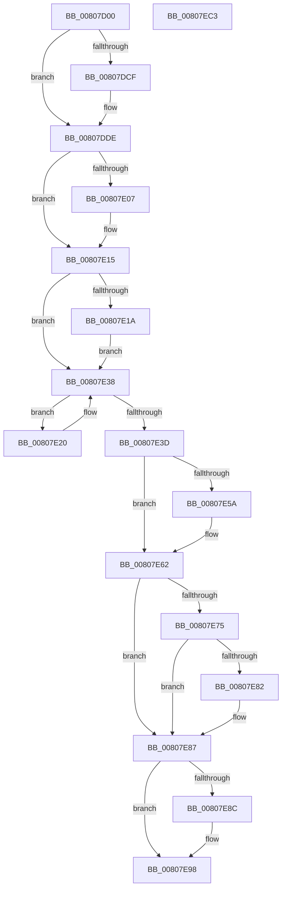

# MmDeleteShadowMapping

- RVA: `0x00807D00`–`0x00807EC4` (길이 `452` bytes)
- VA: `0x0000000140807D00`
- 실행 섹션: `PAGE`
- PDB 이름 있음: `예`; PDB Function 태그: `아니요`
- unwind 정보 RVA: `0x000C9838`
- 디코드: `118`개 명령, `452/452` bytes 표시
- 미해석 바이트: `0` (있으면 어셈블리에 `.byte`로 보존)

> 이 문서는 커널 이미지의 기계어와 PDB 기호를 분석해 생성했습니다. 4번과 5번은 함수 원형과 자료형을 바이너리 사용 방식에서 추정한 C 해석이며 원본 소스 복구 결과는 아닙니다.

## 1. Dependencies

- 직접 호출 지점: **16**; 고유 호출 대상: **15**
- 직접 호출자로 확인된 함수: **4**
- RIP 상대 이미지 참조: **5**

### Outgoing calls
- `0x00807D4E` → [memset](../../text/6C/memset_function_006C6C40.md) (function, `0x006C6C40`)
- `0x00807D56` → [MiGetPteAddress](../../text/43/MiGetPteAddress_function_0043E130.md) (function, `0x0043E130`)
- `0x00807D65` → [MiGetPteAddress](../../text/43/MiGetPteAddress_function_0043E130.md) (function, `0x0043E130`)
- `0x00807D80` → [MiVaToFlushVm](../../text/31/MiVaToFlushVm_function_0031AD84.md) (function, `0x0031AD84`)
- `0x00807DA0` → [MiInitializeTbFlushList](../../text/29/MiInitializeTbFlushList_function_00294F00.md) (function, `0x00294F00`)
- `0x00807DBE` → [MiInsertTbFlushEntry](../../text/29/MiInsertTbFlushEntry_function_00293670.md) (function, `0x00293670`)
- `0x00807DD9` → [KiStackAttachProcess](../../text/21/KiStackAttachProcess_function_00216820.md) (function, `0x00216820`)
- `0x00807DF6` → [KeAbPreAcquire](../../text/21/KeAbPreAcquire_function_00210230.md) (function, `0x00210230`)
- `0x00807E10` → [ExfAcquirePushLockExclusiveEx](../../text/20/ExfAcquirePushLockExclusiveEx_function_0020FC90.md) (function, `0x0020FC90`)
- `0x00807E2F` → [MiReadWriteAnyLevelShadowPte](../../text/43/MiReadWriteAnyLevelShadowPte_function_00432654.md) (function, `0x00432654`)
- `0x00807E42` → [MiFlushTbList](../../text/31/MiFlushTbList_function_00311FC0.md) (function, `0x00311FC0`)
- `0x00807E5D` → [ExfTryToWakePushLock](../../text/26/ExfTryToWakePushLock_function_00265DD0.md) (function, `0x00265DD0`)
- `0x00807E65` → [KeAbPostRelease](../../text/2E/KeAbPostRelease_function_002E1600.md) (function, `0x002E1600`)
- `0x00807E82` → [KiCheckForKernelApcDelivery](../../text/2E/KiCheckForKernelApcDelivery_function_002E2C80.md) (function, `0x002E2C80`)
- `0x00807E93` → [KiUnstackDetachProcess](../../text/21/KiUnstackDetachProcess_function_00217D30.md) (function, `0x00217D30`)
- `0x00807EA3` → [_security_check_cookie](../../text/6A/_security_check_cookie_function_006AC640.md) (function, `0x006AC640`)

### Direct callers
- [KeAllocateProcessorProfileStructures](../../text/5B/KeAllocateProcessorProfileStructures_function_005B14B0.md) at `0x005B165F`
- [KiUnshadowKernelSectionByAddress](../../text/5C/KiUnshadowKernelSectionByAddress_function_005C50B4.md) at `0x005C5115`
- [KiShadowProcessorAllocation](../../pagelk/B6/KiShadowProcessorAllocation_function_00B6AE5C.md) at `0x00B6B028`
- [KiShadowProcessorAllocation](../../pagelk/B6/KiShadowProcessorAllocation_function_00B6AE5C.md) at `0x00B6B055`
- [KiShadowProcessorAllocation](../../pagelk/B6/KiShadowProcessorAllocation_function_00B6AE5C.md) at `0x00B6B08E`
- [KiShadowProcessorAllocation](../../pagelk/B6/KiShadowProcessorAllocation_function_00B6AE5C.md) at `0x00B6B0AE`
- [KiShadowProcessorAllocation](../../pagelk/B6/KiShadowProcessorAllocation_function_00B6AE5C.md) at `0x00B6B0C0`
- [KiUnshadowProcessorAllocation](../../pagelk/B6/KiUnshadowProcessorAllocation_function_00B6B0E8.md) at `0x00B6B11B`
- [KiUnshadowProcessorAllocation](../../pagelk/B6/KiUnshadowProcessorAllocation_function_00B6B0E8.md) at `0x00B6B12E`
- [KiUnshadowProcessorAllocation](../../pagelk/B6/KiUnshadowProcessorAllocation_function_00B6B0E8.md) at `0x00B6B155`
- [KiUnshadowProcessorAllocation](../../pagelk/B6/KiUnshadowProcessorAllocation_function_00B6B0E8.md) at `0x00B6B16E`
- [KiUnshadowProcessorAllocation](../../pagelk/B6/KiUnshadowProcessorAllocation_function_00B6B0E8.md) at `0x00B6B184`

### Static image references
- `0x00807D17` → RVA `0x00E0A740` (`.data`; read)
- `0x00807DC3` → RVA `0x00FC6AB0` (`ALMOSTRO`; read)
- `0x00807DE6` → RVA `0x00E2EE70` (`.data`; read)
- `0x00807E20` → RVA `0x00010880` (`.rdata`; read)
- `0x00807E4B` → RVA `0x00E2EE70` (`.data`; read/write)

## 2. Other-region calls and transfers

- 다른 실행 섹션으로 향하는 call: **16**
  - `0x00807D4E` → [memset](../../text/6C/memset_function_006C6C40.md) (`PAGE` → `.text`)
  - `0x00807D56` → [MiGetPteAddress](../../text/43/MiGetPteAddress_function_0043E130.md) (`PAGE` → `.text`)
  - `0x00807D65` → [MiGetPteAddress](../../text/43/MiGetPteAddress_function_0043E130.md) (`PAGE` → `.text`)
  - `0x00807D80` → [MiVaToFlushVm](../../text/31/MiVaToFlushVm_function_0031AD84.md) (`PAGE` → `.text`)
  - `0x00807DA0` → [MiInitializeTbFlushList](../../text/29/MiInitializeTbFlushList_function_00294F00.md) (`PAGE` → `.text`)
  - `0x00807DBE` → [MiInsertTbFlushEntry](../../text/29/MiInsertTbFlushEntry_function_00293670.md) (`PAGE` → `.text`)
  - `0x00807DD9` → [KiStackAttachProcess](../../text/21/KiStackAttachProcess_function_00216820.md) (`PAGE` → `.text`)
  - `0x00807DF6` → [KeAbPreAcquire](../../text/21/KeAbPreAcquire_function_00210230.md) (`PAGE` → `.text`)
  - `0x00807E10` → [ExfAcquirePushLockExclusiveEx](../../text/20/ExfAcquirePushLockExclusiveEx_function_0020FC90.md) (`PAGE` → `.text`)
  - `0x00807E2F` → [MiReadWriteAnyLevelShadowPte](../../text/43/MiReadWriteAnyLevelShadowPte_function_00432654.md) (`PAGE` → `.text`)
  - `0x00807E42` → [MiFlushTbList](../../text/31/MiFlushTbList_function_00311FC0.md) (`PAGE` → `.text`)
  - `0x00807E5D` → [ExfTryToWakePushLock](../../text/26/ExfTryToWakePushLock_function_00265DD0.md) (`PAGE` → `.text`)
  - `0x00807E65` → [KeAbPostRelease](../../text/2E/KeAbPostRelease_function_002E1600.md) (`PAGE` → `.text`)
  - `0x00807E82` → [KiCheckForKernelApcDelivery](../../text/2E/KiCheckForKernelApcDelivery_function_002E2C80.md) (`PAGE` → `.text`)
  - `0x00807E93` → [KiUnstackDetachProcess](../../text/21/KiUnstackDetachProcess_function_00217D30.md) (`PAGE` → `.text`)
  - `0x00807EA3` → [_security_check_cookie](../../text/6A/_security_check_cookie_function_006AC640.md) (`PAGE` → `.text`)
- 별도 외부 분기/꼬리 이동을 확인하지 못했습니다.

## 3. Assembly (complete function range)

```asm
00807D00  48 89 5C 24 18                  mov qword ptr [rsp + 0x18], rbx
00807D05  55                              push rbp
00807D06  56                              push rsi
00807D07  57                              push rdi
00807D08  41 54                           push r12
00807D0A  41 55                           push r13
00807D0C  41 56                           push r14
00807D0E  41 57                           push r15
00807D10  48 81 EC 40 01 00 00            sub rsp, 0x140
00807D17  48 8B 05 22 2A 60 00            mov rax, qword ptr [rip + 0x602a22]
00807D1E  48 33 C4                        xor rax, rsp
00807D21  48 89 84 24 30 01 00 00         mov qword ptr [rsp + 0x130], rax
00807D29  0F 57 C0                        xorps xmm0, xmm0
00807D2C  48 8B FA                        mov rdi, rdx
00807D2F  48 8B D9                        mov rbx, rcx
00807D32  33 D2                           xor edx, edx
00807D34  48 8D 4C 24 60                  lea rcx, [rsp + 0x60]
00807D39  41 B8 C8 00 00 00               mov r8d, 0xc8
00807D3F  0F 11 44 24 30                  movups xmmword ptr [rsp + 0x30], xmm0
00807D44  0F 11 44 24 40                  movups xmmword ptr [rsp + 0x40], xmm0
00807D49  0F 11 44 24 50                  movups xmmword ptr [rsp + 0x50], xmm0
00807D4E  E8 ED EE EB FF                  call 0x1406c6c40
00807D53  48 8B CB                        mov rcx, rbx
00807D56  E8 D5 63 C3 FF                  call 0x14043e130
00807D5B  48 8D 4B FF                     lea rcx, [rbx - 1]
00807D5F  48 8B E8                        mov rbp, rax
00807D62  48 03 CF                        add rcx, rdi
00807D65  E8 C6 63 C3 FF                  call 0x14043e130
00807D6A  65 48 8B 34 25 88 01 00 00      mov rsi, qword ptr gs:[0x188]
00807D73  48 8B CB                        mov rcx, rbx
00807D76  4C 8B F0                        mov r14, rax
00807D79  4C 8B BE B8 00 00 00            mov r15, qword ptr [rsi + 0xb8]
00807D80  E8 FF 2F B1 FF                  call 0x14031ad84
00807D85  41 BD 01 00 00 00               mov r13d, 1
00807D8B  48 8D 4C 24 60                  lea rcx, [rsp + 0x60]
00807D90  48 8B D0                        mov rdx, rax
00807D93  44 89 6C 24 20                  mov dword ptr [rsp + 0x20], r13d
00807D98  45 8D 4D 07                     lea r9d, [r13 + 7]
00807D9C  45 8D 45 13                     lea r8d, [r13 + 0x13]
00807DA0  E8 5B D1 A8 FF                  call 0x140294f00
00807DA5  48 C1 EF 0C                     shr rdi, 0xc
00807DA9  48 8D 4C 24 60                  lea rcx, [rsp + 0x60]
00807DAE  48 81 E3 00 F0 FF FF            and rbx, 0xfffffffffffff000
00807DB5  4C 8B C7                        mov r8, rdi
00807DB8  48 8B D3                        mov rdx, rbx
00807DBB  45 33 C9                        xor r9d, r9d
00807DBE  E8 AD B8 A8 FF                  call 0x140293670
00807DC3  48 8B 3D E6 EC 7B 00            mov rdi, qword ptr [rip + 0x7bece6]
00807DCA  4C 3B FF                        cmp r15, rdi
00807DCD  74 0F                           je 0x140807dde
00807DCF  4C 8D 44 24 30                  lea r8, [rsp + 0x30]
00807DD4  33 D2                           xor edx, edx
00807DD6  48 8B CF                        mov rcx, rdi
00807DD9  E8 42 EA A0 FF                  call 0x140216820
00807DDE  66 44 29 AE E6 01 00 00         sub word ptr [rsi + 0x1e6], r13w
00807DE6  4C 8D 25 83 70 62 00            lea r12, [rip + 0x627083]
00807DED  49 8B CC                        mov rcx, r12
00807DF0  45 33 C0                        xor r8d, r8d
00807DF3  33 D2                           xor edx, edx
00807DF5  90                              nop
00807DF6  E8 35 84 A0 FF                  call 0x140210230
00807DFB  F0 49 0F BA 2C 24 00            lock bts qword ptr [r12], 0
00807E02  48 8B D8                        mov rbx, rax
00807E05  73 0E                           jae 0x140807e15
00807E07  4D 8B C4                        mov r8, r12
00807E0A  48 8B D0                        mov rdx, rax
00807E0D  49 8B CC                        mov rcx, r12
00807E10  E8 7B 7E A0 FF                  call 0x14020fc90
00807E15  48 85 DB                        test rbx, rbx
00807E18  74 1E                           je 0x140807e38
00807E1A  44 88 6B 0A                     mov byte ptr [rbx + 0xa], r13b
00807E1E  EB 18                           jmp 0x140807e38
00807E20  4C 8B 0D 59 8A 80 FF            mov r9, qword ptr [rip - 0x7f75a7]
00807E27  45 8B C5                        mov r8d, r13d
00807E2A  33 D2                           xor edx, edx
00807E2C  48 8B CD                        mov rcx, rbp
00807E2F  E8 20 A8 C2 FF                  call 0x140432654
00807E34  48 83 C5 08                     add rbp, 8
00807E38  49 3B EE                        cmp rbp, r14
00807E3B  76 E3                           jbe 0x140807e20
00807E3D  48 8D 4C 24 60                  lea rcx, [rsp + 0x60]
00807E42  E8 79 A1 B0 FF                  call 0x140311fc0
00807E47  48 83 C8 FF                     or rax, 0xffffffffffffffff
00807E4B  F0 48 0F C1 05 1C 70 62 00      lock xadd qword ptr [rip + 0x62701c], rax
00807E54  24 06                           and al, 6
00807E56  3C 02                           cmp al, 2
00807E58  75 08                           jne 0x140807e62
00807E5A  49 8B CC                        mov rcx, r12
00807E5D  E8 6E DF A5 FF                  call 0x140265dd0
00807E62  49 8B CC                        mov rcx, r12
00807E65  E8 96 97 AD FF                  call 0x1402e1600
00807E6A  90                              nop
00807E6B  66 44 01 AE E6 01 00 00         add word ptr [rsi + 0x1e6], r13w
00807E73  75 12                           jne 0x140807e87
00807E75  48 8D 86 98 00 00 00            lea rax, [rsi + 0x98]
00807E7C  90                              nop
00807E7D  48 39 00                        cmp qword ptr [rax], rax
00807E80  74 05                           je 0x140807e87
00807E82  E8 F9 AD AD FF                  call 0x1402e2c80
00807E87  4C 3B FF                        cmp r15, rdi
00807E8A  74 0C                           je 0x140807e98
00807E8C  33 D2                           xor edx, edx
00807E8E  48 8D 4C 24 30                  lea rcx, [rsp + 0x30]
00807E93  E8 98 FE A0 FF                  call 0x140217d30
00807E98  48 8B 8C 24 30 01 00 00         mov rcx, qword ptr [rsp + 0x130]
00807EA0  48 33 CC                        xor rcx, rsp
00807EA3  E8 98 47 EA FF                  call 0x1406ac640
00807EA8  48 8B 9C 24 90 01 00 00         mov rbx, qword ptr [rsp + 0x190]
00807EB0  48 81 C4 40 01 00 00            add rsp, 0x140
00807EB7  41 5F                           pop r15
00807EB9  41 5E                           pop r14
00807EBB  41 5D                           pop r13
00807EBD  41 5C                           pop r12
00807EBF  5F                              pop rdi
00807EC0  5E                              pop rsi
00807EC1  5D                              pop rbp
00807EC2  C3                              ret
00807EC3  CC                              int3
```

## 4. C-style interpretation (structured pseudocode)

```c
__int64 __fastcall MmDeleteShadowMapping(__int64 a1, __int64 a2)
{
    __int64 result;
    __int64 v_rbp;
    __int64 v_rbx;
    __int64 v_rdi;
    __int64 v_rsp;
    unsigned __int64 v_stack_m118;
    unsigned __int64 v_stack_m128;
    unsigned __int64 v_stack_m138;
    unsigned __int64 v_stack_m148;
    unsigned int v_stack_m158;
    unsigned __int64 v_stack_m48;
    unsigned __int64 v_stack_p18;

    v_stack_p18 = v_rbx;
    v_rsp = (v_rsp) - (320);
    result = (*(unsigned __int64 *)(v_rip + 6302242)) ^ (v_rsp);
    v_stack_m48 = result;
    a2 = 0;
    v_stack_m148 = v_xmm0;
    v_stack_m138 = v_xmm0;
    v_stack_m128 = v_xmm0;
    result = memset(v_stack_m118, a2, 200, a4);
    result = MiGetPteAddress(a1, a2, 200, a4);
    a1 = (a1 - 1) + (0);
    result = MiGetPteAddress(a1, a2, 200, a4);
    result = MiVaToFlushVm(a1, a2, 200, a4);
    v_stack_m158 = 1;
    result = MiInitializeTbFlushList(v_stack_m118, result, 1 + 19, 1 + 7);
    v_rdi = (a2) >> (12);
    v_rbx = (a1) & (0xFFFFFFFFFFFFF000ULL);
    a4 = 0;
    result = MiInsertTbFlushEntry(v_stack_m118, v_rbx, v_rdi, a4);
    if ((*(unsigned __int64 *)(*(unsigned __int64 *)(gs_base + (0 + 392)) + 184)) != (*(unsigned __int64 *)(v_rip + 8121574))) {
        a3 = v_stack_m148;
        a2 = 0;
        a1 = *(unsigned __int64 *)(v_rip + 8121574);
        result = KiStackAttachProcess(a1, a2, a3, a4);
    }
    a3 = 0;
    a2 = 0;
    result = KeAbPreAcquire(v_rip + 6451331, a2, a3, a4);
    if (!(condition_is_above_or_equal)) {
        a3 = v_rip + 6451331;
        a2 = result;
        a1 = v_rip + 6451331;
        result = ExfAcquirePushLockExclusiveEx(a1, a2, a3, a4);
    }
    if (result == 0) goto loc_00807E38;
    *(unsigned __int8 *)(result + 10) = 1;
    goto loc_00807E38;
loc_00807E20:
    a2 = 0;
    result = MiReadWriteAnyLevelShadowPte(result, a2, 1, *(unsigned __int64 *)(v_rip - 8353191));
    v_rbp = (result) + (8);
loc_00807E38:
    if (v_rbp <= result) goto loc_00807E20;
    result = MiFlushTbList(v_stack_m118, a2, 1, *(unsigned __int64 *)(v_rip - 8353191));
    result = (result) | (-1);
    result = (unsigned __int8)((result) & (6));
    if (((unsigned __int8)(result)) == 2) {
        a1 = v_rip + 6451331;
        result = ExfTryToWakePushLock(a1, a2, 1, *(unsigned __int64 *)(v_rip - 8353191));
    }
    result = KeAbPostRelease(v_rip + 6451331, a2, 1, *(unsigned __int64 *)(v_rip - 8353191));
    if (((unsigned __int8)(result)) != 2) goto loc_00807E87;
    result = *(unsigned __int64 *)(gs_base + (0 + 392)) + 152;
    if ((*(unsigned __int64 *)(*(unsigned __int64 *)(gs_base + (0 + 392)) + 152)) != (*(unsigned __int64 *)(gs_base + (0 + 392)) + 152)) {
        result = KiCheckForKernelApcDelivery(v_rip + 6451331, a2, 1, *(unsigned __int64 *)(v_rip - 8353191));
    }
    if ((*(unsigned __int64 *)(*(unsigned __int64 *)(gs_base + (0 + 392)) + 184)) != (*(unsigned __int64 *)(v_rip + 8121574))) {
        a2 = 0;
        a1 = v_stack_m148;
        result = KiUnstackDetachProcess(a1, a2, 1, *(unsigned __int64 *)(v_rip - 8353191));
    }
    a1 = (v_stack_m48) ^ (v_rsp);
    result = _security_check_cookie(a1, a2, 1, *(unsigned __int64 *)(v_rip - 8353191));
    v_rsp = (v_rsp) + (320);
    return result;
}
```

## 5. (Beta) C Style

```c
int64_t MmDeleteShadowMapping(void *Arg1, int64_t Arg2)
{
    uint8_t *arg1 = (uint8_t *)Arg1;

    int64_t result;
    int64_t local_rbp;
    int64_t local_rbx;
    int64_t local_rdi;
    int64_t local_rsp;
    uint64_t v_stack_m118;
    uint64_t v_stack_m128;
    uint64_t v_stack_m138;
    uint64_t v_stack_m148;
    uint32_t v_stack_m158;
    uint64_t v_stack_m48;
    uint64_t v_stack_p18;

    v_stack_p18 = local_rbx;
    local_rsp = (local_rsp) - (320);
    result = (*(uint64_t *)(v_rip + 0x602A22)) ^ (local_rsp);
    v_stack_m48 = result;
    Arg2 = 0;
    v_stack_m148 = v_xmm0;
    v_stack_m138 = v_xmm0;
    v_stack_m128 = v_xmm0;
    result = memset(v_stack_m118, Arg2, 200, a4);
    result = MiGetPteAddress(Arg1, Arg2, 200, a4);
    Arg1 = (Arg1 - 1) + (0);
    result = MiGetPteAddress(Arg1, Arg2, 200, a4);
    result = MiVaToFlushVm(Arg1, Arg2, 200, a4);
    v_stack_m158 = 1;
    result = MiInitializeTbFlushList(v_stack_m118, result, 1 + 19, 1 + 7);
    local_rdi = (Arg2) >> (12);
    local_rbx = (Arg1) & (0xFFFFFFFFFFFFF000ULL);
    a4 = 0;
    result = MiInsertTbFlushEntry(v_stack_m118, local_rbx, local_rdi, a4);
    if ((*(uint64_t *)(*(uint64_t *)(gs_base + (0 + 0x188)) + 0xB8)) != (*(uint64_t *)(v_rip + 0x7BECE6))) {
        a3 = v_stack_m148;
        Arg2 = 0;
        Arg1 = *(uint64_t *)(v_rip + 0x7BECE6);
        result = KiStackAttachProcess(Arg1, Arg2, a3, a4);
    }
    a3 = 0;
    Arg2 = 0;
    result = KeAbPreAcquire(v_rip + 6451331, Arg2, a3, a4);
    if (!(condition_is_above_or_equal)) {
        a3 = v_rip + 6451331;
        Arg2 = result;
        Arg1 = v_rip + 6451331;
        result = ExfAcquirePushLockExclusiveEx(Arg1, Arg2, a3, a4);
    }
    if (result == 0) goto loc_00807E38;
    *(uint8_t *)(result + 0xA) = 1;
    goto loc_00807E38;
loc_00807E20:
    Arg2 = 0;
    result = MiReadWriteAnyLevelShadowPte(result, Arg2, 1, *(uint64_t *)(v_rip - 0x7F75A7));
    local_rbp = (result) + (8);
loc_00807E38:
    if (local_rbp <= result) goto loc_00807E20;
    result = MiFlushTbList(v_stack_m118, Arg2, 1, *(uint64_t *)(v_rip - 0x7F75A7));
    result = (result) | (-1);
    result = (uint8_t)((result) & (6));
    if (((uint8_t)(result)) == 2) {
        Arg1 = v_rip + 6451331;
        result = ExfTryToWakePushLock(Arg1, Arg2, 1, *(uint64_t *)(v_rip - 0x7F75A7));
    }
    result = KeAbPostRelease(v_rip + 6451331, Arg2, 1, *(uint64_t *)(v_rip - 0x7F75A7));
    if (((uint8_t)(result)) != 2) goto loc_00807E87;
    result = *(uint64_t *)(gs_base + (0 + 0x188)) + 152;
    if ((*(uint64_t *)(*(uint64_t *)(gs_base + (0 + 0x188)) + 0x98)) != (*(uint64_t *)(gs_base + (0 + 0x188)) + 152)) {
        result = KiCheckForKernelApcDelivery(v_rip + 6451331, Arg2, 1, *(uint64_t *)(v_rip - 0x7F75A7));
    }
    if ((*(uint64_t *)(*(uint64_t *)(gs_base + (0 + 0x188)) + 0xB8)) != (*(uint64_t *)(v_rip + 0x7BECE6))) {
        Arg2 = 0;
        Arg1 = v_stack_m148;
        result = KiUnstackDetachProcess(Arg1, Arg2, 1, *(uint64_t *)(v_rip - 0x7F75A7));
    }
    Arg1 = (v_stack_m48) ^ (local_rsp);
    result = _security_check_cookie(Arg1, Arg2, 1, *(uint64_t *)(v_rip - 0x7F75A7));
    local_rsp = (local_rsp) + (320);
    return result;
}
```

### 관측된 메모리 오프셋

구조체 형식이 확인되지 않은 접근은 인자 기준의 오프셋으로만 기록했습니다.

| 기준 인자 | 오프셋 표현 | 폭 (bit) | 접근 |
|---|---:|---:|---|
| `Arg1` | `- 0x1` | `64` | `R` |

## 6. Execution-region graph

[열기: 2D/3D 그래프와 함수 탐색 컨트롤 패널](../../../control-panel.html?section=page&rva=0x00807D00&view=graph)

- 2D 그래프는 위에서 아래로 흐르고, 3D 그래프는 빈 공간을 드래그해 회전합니다. Shift+드래그는 이동, 휠은 확대·축소, 함수 노드 선택은 대상 보고서 이동입니다.

### Static fallback


