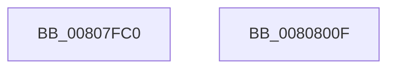

# MmFreeIsrStack

- RVA: `0x00807FC0`–`0x00808010` (길이 `80` bytes)
- VA: `0x0000000140807FC0`
- 실행 섹션: `PAGE`
- PDB 이름 있음: `예`; PDB Function 태그: `아니요`
- unwind 정보 RVA: `0x0005CF00`
- 디코드: `20`개 명령, `80/80` bytes 표시
- 미해석 바이트: `0` (있으면 어셈블리에 `.byte`로 보존)

> 이 문서는 커널 이미지의 기계어와 PDB 기호를 분석해 생성했습니다. 4번과 5번은 함수 원형과 자료형을 바이너리 사용 방식에서 추정한 C 해석이며 원본 소스 복구 결과는 아닙니다.

## 1. Dependencies

- 직접 호출 지점: **4**; 고유 호출 대상: **4**
- 직접 호출자로 확인된 함수: **1**
- RIP 상대 이미지 참조: **2**

### Outgoing calls
- `0x00807FD5` → [KasanMarkAddressValid](../../text/40/KasanMarkAddressValid_function_0040DD40.md) (function, `0x0040DD40`)
- `0x00807FE3` → [MmFreeIndependentPages](../../text/2A/MmFreeIndependentPages_function_002A2510.md) (function, `0x002A2510`)
- `0x00807FEF` → [MiGetPteAddress](../../text/43/MiGetPteAddress_function_0043E130.md) (function, `0x0043E130`)
- `0x00808004` → [MiReleasePtes](../../text/24/MiReleasePtes_function_00247240.md) (function, `0x00247240`)

### Direct callers
- [KiFreeProcessorStacks](../../text/5B/KiFreeProcessorStacks_function_005B7F84.md) at `0x005B7FD5`
- [KiFreeProcessorStacks](../../text/5B/KiFreeProcessorStacks_function_005B7F84.md) at `0x005B7FE3`
- [KiFreeProcessorStacks](../../text/5B/KiFreeProcessorStacks_function_005B7F84.md) at `0x005B7FF7`

### Static image references
- `0x00807FC6` → RVA `0x00FC505C` (`ALMOSTRO`; read)
- `0x00807FF7` → RVA `0x00E37668` (`.data`; read)

## 2. Other-region calls and transfers

- 다른 실행 섹션으로 향하는 call: **4**
  - `0x00807FD5` → [KasanMarkAddressValid](../../text/40/KasanMarkAddressValid_function_0040DD40.md) (`PAGE` → `.text`)
  - `0x00807FE3` → [MmFreeIndependentPages](../../text/2A/MmFreeIndependentPages_function_002A2510.md) (`PAGE` → `.text`)
  - `0x00807FEF` → [MiGetPteAddress](../../text/43/MiGetPteAddress_function_0043E130.md) (`PAGE` → `.text`)
  - `0x00808004` → [MiReleasePtes](../../text/24/MiReleasePtes_function_00247240.md) (`PAGE` → `.text`)
- 별도 외부 분기/꼬리 이동을 확인하지 못했습니다.

## 3. Assembly (complete function range)

```asm
00807FC0  40 53                           push rbx
00807FC2  48 83 EC 20                     sub rsp, 0x20
00807FC6  8B 15 90 D0 7B 00               mov edx, dword ptr [rip + 0x7bd090]
00807FCC  48 8B D9                        mov rbx, rcx
00807FCF  48 2B DA                        sub rbx, rdx
00807FD2  48 8B CB                        mov rcx, rbx
00807FD5  E8 66 5D C0 FF                  call 0x14040dd40
00807FDA  8B 15 7C D0 7B 00               mov edx, dword ptr [rip + 0x7bd07c]
00807FE0  48 8B CB                        mov rcx, rbx
00807FE3  E8 28 A5 A9 FF                  call 0x1402a2510
00807FE8  48 8D 8B 00 F0 FF FF            lea rcx, [rbx - 0x1000]
00807FEF  E8 3C 61 C3 FF                  call 0x14043e130
00807FF4  48 8B D0                        mov rdx, rax
00807FF7  48 8D 0D 6A F6 62 00            lea rcx, [rip + 0x62f66a]
00807FFE  41 B8 01 00 00 00               mov r8d, 1
00808004  E8 37 F2 A3 FF                  call 0x140247240
00808009  48 83 C4 20                     add rsp, 0x20
0080800D  5B                              pop rbx
0080800E  C3                              ret
0080800F  CC                              int3
```

## 4. C-style interpretation (structured pseudocode)

```c
__int64 __fastcall MmFreeIsrStack(__int64 a1)
{
    __int64 result;
    __int64 v_rbx;
    __int64 v_rsp;

    v_rsp = (v_rsp) - (32);
    v_rbx = (a1) - ((unsigned int)(*(unsigned int *)(v_rip + 8114320)));
    result = KasanMarkAddressValid(v_rbx, (unsigned int)(*(unsigned int *)(v_rip + 8114320)), a3, a4);
    result = MmFreeIndependentPages(v_rbx, (unsigned int)(*(unsigned int *)(v_rip + 8114300)), a3, a4);
    result = MiGetPteAddress(v_rbx - 4096, (unsigned int)(*(unsigned int *)(v_rip + 8114300)), a3, a4);
    result = MiReleasePtes(v_rip + 6485610, result, 1, a4);
    v_rsp = (v_rsp) + (32);
    return result;
}
```

## 5. (Beta) C Style

```c
int64_t MmFreeIsrStack(void *Arg1)
{
    uint8_t *arg1 = (uint8_t *)Arg1;

    int64_t result;
    int64_t local_rbx;
    int64_t local_rsp;

    local_rsp = (local_rsp) - (32);
    local_rbx = (Arg1) - ((uint32_t)(*(uint32_t *)(v_rip + 0x7BD090)));
    result = KasanMarkAddressValid(local_rbx, (uint32_t)(*(uint32_t *)(v_rip + 0x7BD090)), a3, a4);
    result = MmFreeIndependentPages(local_rbx, (uint32_t)(*(uint32_t *)(v_rip + 0x7BD07C)), a3, a4);
    result = MiGetPteAddress(local_rbx - 4096, (uint32_t)(*(uint32_t *)(v_rip + 0x7BD07C)), a3, a4);
    result = MiReleasePtes(v_rip + 6485610, result, 1, a4);
    local_rsp = (local_rsp) + (32);
    return result;
}
```

### 관측된 메모리 오프셋

구조체 형식이 확인되지 않은 접근은 인자 기준의 오프셋으로만 기록했습니다.

| 기준 인자 | 오프셋 표현 | 폭 (bit) | 접근 |
|---|---:|---:|---|
| `Arg1` | `- 0x1000` | `64` | `R` |

## 6. Execution-region graph

[열기: 2D/3D 그래프와 함수 탐색 컨트롤 패널](../../../control-panel.html?section=page&rva=0x00807FC0&view=graph)

- 2D 그래프는 위에서 아래로 흐르고, 3D 그래프는 빈 공간을 드래그해 회전합니다. Shift+드래그는 이동, 휠은 확대·축소, 함수 노드 선택은 대상 보고서 이동입니다.

### Static fallback


