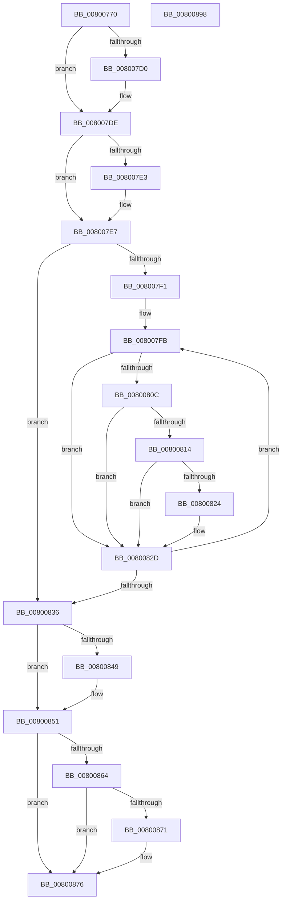

# MmGetPageFileForCrashDump

- RVA: `0x00800770`–`0x00800899` (길이 `297` bytes)
- VA: `0x0000000140800770`
- 실행 섹션: `PAGE`
- PDB 이름 있음: `예`; PDB Function 태그: `아니요`
- unwind 정보 RVA: `0x0005FEF8`
- 디코드: `82`개 명령, `297/297` bytes 표시
- 미해석 바이트: `0` (있으면 어셈블리에 `.byte`로 보존)

> 이 문서는 커널 이미지의 기계어와 PDB 기호를 분석해 생성했습니다. 4번과 5번은 함수 원형과 자료형을 바이너리 사용 방식에서 추정한 C 해석이며 원본 소스 복구 결과는 아닙니다.

## 1. Dependencies

- 직접 호출 지점: **5**; 고유 호출 대상: **5**
- 직접 호출자로 확인된 함수: **1**
- RIP 상대 이미지 참조: **4**

### Outgoing calls
- `0x008007C0` → [KeAbPreAcquire](../../text/21/KeAbPreAcquire_function_00210230.md) (function, `0x00210230`)
- `0x008007D9` → [ExfAcquirePushLockExclusiveEx](../../text/20/ExfAcquirePushLockExclusiveEx_function_0020FC90.md) (function, `0x0020FC90`)
- `0x0080084C` → [ExfTryToWakePushLock](../../text/26/ExfTryToWakePushLock_function_00265DD0.md) (function, `0x00265DD0`)
- `0x00800854` → [KeAbPostRelease](../../text/2E/KeAbPostRelease_function_002E1600.md) (function, `0x002E1600`)
- `0x00800871` → [KiCheckForKernelApcDelivery](../../text/2E/KiCheckForKernelApcDelivery_function_002E2C80.md) (function, `0x002E2C80`)

### Direct callers
- [IoConfigureCrashDump](../../text/59/IoConfigureCrashDump_function_00591CB4.md) at `0x00591D57`

### Static image references
- `0x00800790` → RVA `0x00E39140` (`.data`; read)
- `0x008007E7` → RVA `0x00E3D558` (`.data`; read)
- `0x008007F1` → RVA `0x00E3D560` (`.data`; read)
- `0x0080083A` → RVA `0x00E39140` (`.data`; read/write)

## 2. Other-region calls and transfers

- 다른 실행 섹션으로 향하는 call: **5**
  - `0x008007C0` → [KeAbPreAcquire](../../text/21/KeAbPreAcquire_function_00210230.md) (`PAGE` → `.text`)
  - `0x008007D9` → [ExfAcquirePushLockExclusiveEx](../../text/20/ExfAcquirePushLockExclusiveEx_function_0020FC90.md) (`PAGE` → `.text`)
  - `0x0080084C` → [ExfTryToWakePushLock](../../text/26/ExfTryToWakePushLock_function_00265DD0.md) (`PAGE` → `.text`)
  - `0x00800854` → [KeAbPostRelease](../../text/2E/KeAbPostRelease_function_002E1600.md) (`PAGE` → `.text`)
  - `0x00800871` → [KiCheckForKernelApcDelivery](../../text/2E/KiCheckForKernelApcDelivery_function_002E2C80.md) (`PAGE` → `.text`)
- 별도 외부 분기/꼬리 이동을 확인하지 못했습니다.

## 3. Assembly (complete function range)

```asm
00800770  48 8B C4                        mov rax, rsp
00800773  48 89 58 08                     mov qword ptr [rax + 8], rbx
00800777  48 89 68 10                     mov qword ptr [rax + 0x10], rbp
0080077B  48 89 70 18                     mov qword ptr [rax + 0x18], rsi
0080077F  48 89 78 20                     mov qword ptr [rax + 0x20], rdi
00800783  41 54                           push r12
00800785  41 56                           push r14
00800787  41 57                           push r15
00800789  48 83 EC 20                     sub rsp, 0x20
0080078D  0F 57 C0                        xorps xmm0, xmm0
00800790  4C 8D 3D A9 89 63 00            lea r15, [rip + 0x6389a9]
00800797  0F 11 01                        movups xmmword ptr [rcx], xmm0
0080079A  65 48 8B 1C 25 88 01 00 00      mov rbx, qword ptr gs:[0x188]
008007A3  48 8B E9                        mov rbp, rcx
008007A6  33 F6                           xor esi, esi
008007A8  45 33 C0                        xor r8d, r8d
008007AB  33 D2                           xor edx, edx
008007AD  49 8B CF                        mov rcx, r15
008007B0  45 33 F6                        xor r14d, r14d
008007B3  44 8D 66 01                     lea r12d, [rsi + 1]
008007B7  66 44 29 A3 E6 01 00 00         sub word ptr [rbx + 0x1e6], r12w
008007BF  90                              nop
008007C0  E8 6B FA A0 FF                  call 0x140210230
008007C5  F0 49 0F BA 2F 00               lock bts qword ptr [r15], 0
008007CB  48 8B F8                        mov rdi, rax
008007CE  73 0E                           jae 0x1408007de
008007D0  4D 8B C7                        mov r8, r15
008007D3  48 8B D0                        mov rdx, rax
008007D6  49 8B CF                        mov rcx, r15
008007D9  E8 B2 F4 A0 FF                  call 0x14020fc90
008007DE  48 85 FF                        test rdi, rdi
008007E1  74 04                           je 0x1408007e7
008007E3  44 88 67 0A                     mov byte ptr [rdi + 0xa], r12b
008007E7  8B 05 6B CD 63 00               mov eax, dword ptr [rip + 0x63cd6b]
008007ED  85 C0                           test eax, eax
008007EF  74 45                           je 0x140800836
008007F1  4C 8D 05 68 CD 63 00            lea r8, [rip + 0x63cd68]
008007F8  44 8B C8                        mov r9d, eax
008007FB  49 8B 10                        mov rdx, qword ptr [r8]
008007FE  B9 50 08 00 00                  mov ecx, 0x850
00800803  66 85 8A AC 00 00 00            test word ptr [rdx + 0xac], cx
0080080A  75 21                           jne 0x14080082d
0080080C  8B 42 08                        mov eax, dword ptr [rdx + 8]
0080080F  49 3B C6                        cmp rax, r14
00800812  76 19                           jbe 0x14080082d
00800814  48 8B B2 C0 00 00 00            mov rsi, qword ptr [rdx + 0xc0]
0080081B  44 8B 72 08                     mov r14d, dword ptr [rdx + 8]
0080081F  48 85 ED                        test rbp, rbp
00800822  74 09                           je 0x14080082d
00800824  0F 10 42 40                     movups xmm0, xmmword ptr [rdx + 0x40]
00800828  F3 0F 7F 45 00                  movdqu xmmword ptr [rbp], xmm0
0080082D  49 83 C0 08                     add r8, 8
00800831  4D 2B CC                        sub r9, r12
00800834  75 C5                           jne 0x1408007fb
00800836  48 83 C8 FF                     or rax, 0xffffffffffffffff
0080083A  F0 48 0F C1 05 FD 88 63 00      lock xadd qword ptr [rip + 0x6388fd], rax
00800843  24 06                           and al, 6
00800845  3C 02                           cmp al, 2
00800847  75 08                           jne 0x140800851
00800849  49 8B CF                        mov rcx, r15
0080084C  E8 7F 55 A6 FF                  call 0x140265dd0
00800851  49 8B CF                        mov rcx, r15
00800854  E8 A7 0D AE FF                  call 0x1402e1600
00800859  90                              nop
0080085A  66 44 01 A3 E6 01 00 00         add word ptr [rbx + 0x1e6], r12w
00800862  75 12                           jne 0x140800876
00800864  48 8D 8B 98 00 00 00            lea rcx, [rbx + 0x98]
0080086B  90                              nop
0080086C  48 39 09                        cmp qword ptr [rcx], rcx
0080086F  74 05                           je 0x140800876
00800871  E8 0A 24 AE FF                  call 0x1402e2c80
00800876  48 8B 5C 24 40                  mov rbx, qword ptr [rsp + 0x40]
0080087B  48 8B C6                        mov rax, rsi
0080087E  48 8B 74 24 50                  mov rsi, qword ptr [rsp + 0x50]
00800883  48 8B 6C 24 48                  mov rbp, qword ptr [rsp + 0x48]
00800888  48 8B 7C 24 58                  mov rdi, qword ptr [rsp + 0x58]
0080088D  48 83 C4 20                     add rsp, 0x20
00800891  41 5F                           pop r15
00800893  41 5E                           pop r14
00800895  41 5C                           pop r12
00800897  C3                              ret
00800898  CC                              int3
```

## 4. C-style interpretation (structured pseudocode)

```c
__int64 __fastcall MmGetPageFileForCrashDump(__int64 a1, int a2, int a3)
{
    __int64 result;
    __int64 v_r14;
    __int64 v_rsi;
    __int64 v_rsp;
    unsigned __int64 v_stack_p10;
    unsigned __int64 v_stack_p18;
    unsigned __int64 v_stack_p20;
    unsigned __int64 v_stack_p8;

    *(unsigned __int64 *)(v_rsp + 8) = v_rbx;
    *(unsigned __int64 *)(v_rsp + 16) = v_rbp;
    *(unsigned __int64 *)(v_rsp + 24) = v_rsi;
    *(unsigned __int64 *)(v_rsp + 32) = v_rdi;
    v_rsp = (v_rsp) - (32);
    *(unsigned __int64 *)(a1) = v_xmm0;
    v_rsi = 0;
    a3 = 0;
    a2 = 0;
    v_r14 = 0;
    result = KeAbPreAcquire(v_rip + 6523305, a2, a3, a4);
    if (!(condition_is_above_or_equal)) {
        a3 = v_rip + 6523305;
        a2 = result;
        a1 = v_rip + 6523305;
        result = ExfAcquirePushLockExclusiveEx(a1, a2, a3, a4);
    }
    if (result != 0) {
        *(unsigned __int8 *)(result + 10) = (unsigned __int8)(v_rsi + 1);
    }
    if ((unsigned int)((unsigned int)(*(unsigned int *)(v_rip + 6540651))) == 0) goto loc_00800836;
loc_008007FB:
    if (((*(unsigned __int16 *)(*(unsigned __int64 *)(v_rip + 6540648) + 172)) & ((unsigned __int16)((unsigned int)(0x850ULL)))) != 0) goto loc_0080082D;
    if (((unsigned int)(*(unsigned int *)(*(unsigned __int64 *)(v_rip + 6540648) + 8))) <= 0) goto loc_0080082D;
    if (a1 != 0) {
        *(unsigned __int64 *)(a1) = v_xmm0;
    }
    a3 = (v_rip + 6540648) + (8);
    a4 = ((unsigned int)((unsigned int)((unsigned int)(*(unsigned int *)(v_rip + 6540651))))) - (v_rsi + 1);
    if (condition_is_not_equal) goto loc_008007FB;
loc_00800836:
    result = ((unsigned int)(*(unsigned int *)(*(unsigned __int64 *)(v_rip + 6540648) + 8))) | (-1);
    result = (unsigned __int8)((result) & (6));
    if (((unsigned __int8)(result)) == 2) {
        a1 = v_rip + 6523305;
        result = ExfTryToWakePushLock(a1, *(unsigned __int64 *)(v_rip + 6540648), a3, a4);
    }
    result = KeAbPostRelease(v_rip + 6523305, *(unsigned __int64 *)(v_rip + 6540648), a3, a4);
    if (((unsigned __int8)(result)) != 2) goto loc_00800876;
    if ((*(unsigned __int64 *)(*(unsigned __int64 *)(gs_base + (0 + 392)) + 152)) != (*(unsigned __int64 *)(gs_base + (0 + 392)) + 152)) {
        result = KiCheckForKernelApcDelivery(*(unsigned __int64 *)(gs_base + (0 + 392)) + 152, *(unsigned __int64 *)(v_rip + 6540648), a3, a4);
    }
    v_rsp = (v_rsp) + (32);
    return *(unsigned __int64 *)(*(unsigned __int64 *)(v_rip + 6540648) + 192);
}
```

## 5. (Beta) C Style

```c
int64_t MmGetPageFileForCrashDump(void *Arg1, int32_t Arg2, int32_t Arg3)
{
    uint8_t *arg1 = (uint8_t *)Arg1;

    int64_t result;
    int64_t local_r14;
    int64_t local_rsi;
    int64_t local_rsp;
    uint64_t v_stack_p10;
    uint64_t v_stack_p18;
    uint64_t v_stack_p20;
    uint64_t v_stack_p8;

    *(uint64_t *)(local_rsp + 0x8) = local_rbx;
    *(uint64_t *)(local_rsp + 0x10) = local_rbp;
    *(uint64_t *)(local_rsp + 0x18) = local_rsi;
    *(uint64_t *)(local_rsp + 0x20) = local_rdi;
    local_rsp = (local_rsp) - (32);
    *(uint64_t *)(arg1) = v_xmm0;
    local_rsi = 0;
    Arg3 = 0;
    Arg2 = 0;
    local_r14 = 0;
    result = KeAbPreAcquire(v_rip + 6523305, Arg2, Arg3, a4);
    if (!(condition_is_above_or_equal)) {
        Arg3 = v_rip + 6523305;
        Arg2 = result;
        Arg1 = v_rip + 6523305;
        result = ExfAcquirePushLockExclusiveEx(Arg1, Arg2, Arg3, a4);
    }
    if (result != 0) {
        *(uint8_t *)(result + 0xA) = (uint8_t)(local_rsi + 1);
    }
    if ((uint32_t)((uint32_t)(*(uint32_t *)(v_rip + 0x63CD6B))) == 0) goto loc_00800836;
loc_008007FB:
    if (((*(uint16_t *)(*(uint64_t *)(v_rip + 0x63CD68) + 0xAC)) & ((uint16_t)((uint32_t)(0x850ULL)))) != 0) goto loc_0080082D;
    if (((uint32_t)(*(uint32_t *)(*(uint64_t *)(v_rip + 0x63CD68) + 0x8))) <= 0) goto loc_0080082D;
    if (Arg1 != NULL) {
        *(uint64_t *)(arg1) = v_xmm0;
    }
    Arg3 = (v_rip + 6540648) + (8);
    a4 = ((uint32_t)((uint32_t)((uint32_t)(*(uint32_t *)(v_rip + 0x63CD6B))))) - (local_rsi + 1);
    if (condition_is_not_equal) goto loc_008007FB;
loc_00800836:
    result = ((uint32_t)(*(uint32_t *)(*(uint64_t *)(v_rip + 0x63CD68) + 0x8))) | (-1);
    result = (uint8_t)((result) & (6));
    if (((uint8_t)(result)) == 2) {
        Arg1 = v_rip + 6523305;
        result = ExfTryToWakePushLock(Arg1, *(uint64_t *)(v_rip + 0x63CD68), Arg3, a4);
    }
    result = KeAbPostRelease(v_rip + 6523305, *(uint64_t *)(v_rip + 0x63CD68), Arg3, a4);
    if (((uint8_t)(result)) != 2) goto loc_00800876;
    if ((*(uint64_t *)(*(uint64_t *)(gs_base + (0 + 0x188)) + 0x98)) != (*(uint64_t *)(gs_base + (0 + 0x188)) + 152)) {
        result = KiCheckForKernelApcDelivery(*(uint64_t *)(gs_base + (0 + 0x188)) + 152, *(uint64_t *)(v_rip + 0x63CD68), Arg3, a4);
    }
    local_rsp = (local_rsp) + (32);
    return *(uint64_t *)(*(uint64_t *)(v_rip + 0x63CD68) + 0xC0);
}
```

### 관측된 메모리 오프셋

구조체 형식이 확인되지 않은 접근은 인자 기준의 오프셋으로만 기록했습니다.

| 기준 인자 | 오프셋 표현 | 폭 (bit) | 접근 |
|---|---:|---:|---|
| `Arg1` | `+ 0x0` | `128` | `R` |

## 6. Execution-region graph

[열기: 2D/3D 그래프와 함수 탐색 컨트롤 패널](../../../control-panel.html?section=page&rva=0x00800770&view=graph)

- 2D 그래프는 위에서 아래로 흐르고, 3D 그래프는 빈 공간을 드래그해 회전합니다. Shift+드래그는 이동, 휠은 확대·축소, 함수 노드 선택은 대상 보고서 이동입니다.

### Static fallback


