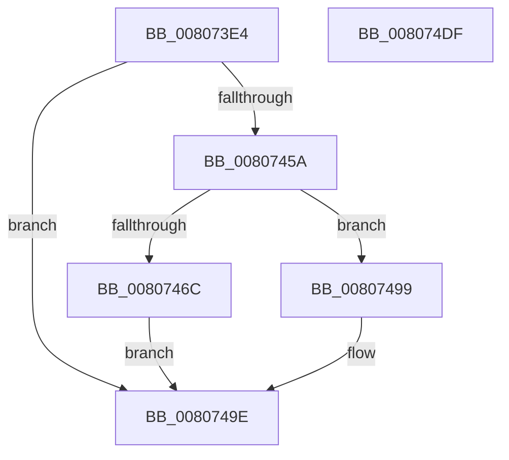

# MmInsertSecureImageActivePatch

- RVA: `0x008073E4`–`0x008074E0` (길이 `252` bytes)
- VA: `0x00000001408073E4`
- 실행 섹션: `PAGE`
- PDB 이름 있음: `예`; PDB Function 태그: `아니요`
- unwind 정보 RVA: `0x0008C11C`
- 디코드: `72`개 명령, `252/252` bytes 표시
- 미해석 바이트: `0` (있으면 어셈블리에 `.byte`로 보존)

> 이 문서는 커널 이미지의 기계어와 PDB 기호를 분석해 생성했습니다. 4번과 5번은 함수 원형과 자료형을 바이너리 사용 방식에서 추정한 C 해석이며 원본 소스 복구 결과는 아닙니다.

## 1. Dependencies

- 직접 호출 지점: **8**; 고유 호출 대상: **8**
- 직접 호출자로 확인된 함수: **1**
- RIP 상대 이미지 참조: **1**

### Outgoing calls
- `0x00807418` → [RtlInitUnicodeString](../../text/42/RtlInitUnicodeString_function_0042A780.md) (function, `0x0042A780`)
- `0x00807447` → [MiFindHotPatchRecord](../A6/MiFindHotPatchRecord_function_00A6E618.md) (function, `0x00A6E618`)
- `0x0080745F` → [MiAllocateSecureImageActivePatch](MiAllocateSecureImageActivePatch_function_00801890.md) (function, `0x00801890`)
- `0x0080747F` → [MmAcquireLoadLock](../../text/4D/MmAcquireLoadLock_function_004DC2A0.md) (function, `0x004DC2A0`)
- `0x0080748A` → [MiInsertSecureImageActivePatch](MiInsertSecureImageActivePatch_function_0080448C.md) (function, `0x0080448C`)
- `0x00807492` → [MmReleaseLoadLock](../../text/4D/MmReleaseLoadLock_function_004D36D0.md) (function, `0x004D36D0`)
- `0x008074B2` → [MiLogInsertSecureImageActivePatch](MiLogInsertSecureImageActivePatch_function_00806300.md) (function, `0x00806300`)
- `0x008074BC` → [RtlFreeAnsiString](../9C/RtlFreeAnsiString_function_009C0800.md) (function, `0x009C0800`)

### Direct callers
- [sub_006F88AE](../../text/6F/Unknown_function_006F88AE.md) at `0x006F904E`

### Static image references
- `0x0080742A` → RVA `0x00E37578` (`.data`; read)

## 2. Other-region calls and transfers

- 다른 실행 섹션으로 향하는 call: **3**
  - `0x00807418` → [RtlInitUnicodeString](../../text/42/RtlInitUnicodeString_function_0042A780.md) (`PAGE` → `.text`)
  - `0x0080747F` → [MmAcquireLoadLock](../../text/4D/MmAcquireLoadLock_function_004DC2A0.md) (`PAGE` → `.text`)
  - `0x00807492` → [MmReleaseLoadLock](../../text/4D/MmReleaseLoadLock_function_004D36D0.md) (`PAGE` → `.text`)
- 별도 외부 분기/꼬리 이동을 확인하지 못했습니다.

## 3. Assembly (complete function range)

```asm
008073E4  48 8B C4                        mov rax, rsp
008073E7  48 89 58 08                     mov qword ptr [rax + 8], rbx
008073EB  48 89 68 10                     mov qword ptr [rax + 0x10], rbp
008073EF  48 89 70 18                     mov qword ptr [rax + 0x18], rsi
008073F3  57                              push rdi
008073F4  41 54                           push r12
008073F6  41 55                           push r13
008073F8  41 56                           push r14
008073FA  41 57                           push r15
008073FC  48 83 EC 60                     sub rsp, 0x60
00807400  8B EA                           mov ebp, edx
00807402  44 8B F1                        mov r14d, ecx
00807405  0F 57 C0                        xorps xmm0, xmm0
00807408  48 8D 48 C0                     lea rcx, [rax - 0x40]
0080740C  33 D2                           xor edx, edx
0080740E  45 8B F9                        mov r15d, r9d
00807411  0F 11 40 C0                     movups xmmword ptr [rax - 0x40], xmm0
00807415  45 8B E0                        mov r12d, r8d
00807418  E8 63 33 C2 FF                  call 0x14042a780
0080741D  48 8D 44 24 48                  lea rax, [rsp + 0x48]
00807422  44 8B CD                        mov r9d, ebp
00807425  48 89 44 24 30                  mov qword ptr [rsp + 0x30], rax
0080742A  48 8D 0D 47 01 63 00            lea rcx, [rip + 0x630147]
00807431  48 8D 44 24 40                  lea rax, [rsp + 0x40]
00807436  45 8B C6                        mov r8d, r14d
00807439  48 89 44 24 28                  mov qword ptr [rsp + 0x28], rax
0080743E  33 D2                           xor edx, edx
00807440  66 C7 44 24 20 64 86            mov word ptr [rsp + 0x20], 0x8664
00807447  E8 CC 71 26 00                  call 0x140a6e618
0080744C  44 8B AC 24 B0 00 00 00         mov r13d, dword ptr [rsp + 0xb0]
00807454  8B F0                           mov esi, eax
00807456  85 C0                           test eax, eax
00807458  78 44                           js 0x14080749e
0080745A  48 8D 4C 24 48                  lea rcx, [rsp + 0x48]
0080745F  E8 2C A4 FF FF                  call 0x140801890
00807464  48 8B F8                        mov rdi, rax
00807467  48 85 C0                        test rax, rax
0080746A  74 2D                           je 0x140807499
0080746C  44 89 70 18                     mov dword ptr [rax + 0x18], r14d
00807470  89 68 1C                        mov dword ptr [rax + 0x1c], ebp
00807473  44 89 78 20                     mov dword ptr [rax + 0x20], r15d
00807477  44 89 68 24                     mov dword ptr [rax + 0x24], r13d
0080747B  44 89 60 28                     mov dword ptr [rax + 0x28], r12d
0080747F  E8 1C 4E CD FF                  call 0x1404dc2a0
00807484  48 8B CF                        mov rcx, rdi
00807487  48 8B D8                        mov rbx, rax
0080748A  E8 FD CF FF FF                  call 0x14080448c
0080748F  48 8B CB                        mov rcx, rbx
00807492  E8 39 C2 CC FF                  call 0x1404d36d0
00807497  EB 05                           jmp 0x14080749e
00807499  BE 9A 00 00 C0                  mov esi, 0xc000009a
0080749E  89 74 24 28                     mov dword ptr [rsp + 0x28], esi
008074A2  45 8B CD                        mov r9d, r13d
008074A5  45 8B C7                        mov r8d, r15d
008074A8  44 89 64 24 20                  mov dword ptr [rsp + 0x20], r12d
008074AD  8B D5                           mov edx, ebp
008074AF  41 8B CE                        mov ecx, r14d
008074B2  E8 49 EE FF FF                  call 0x140806300
008074B7  48 8D 4C 24 48                  lea rcx, [rsp + 0x48]
008074BC  E8 3F 93 1B 00                  call 0x1409c0800
008074C1  4C 8D 5C 24 60                  lea r11, [rsp + 0x60]
008074C6  49 8B 5B 30                     mov rbx, qword ptr [r11 + 0x30]
008074CA  49 8B 6B 38                     mov rbp, qword ptr [r11 + 0x38]
008074CE  49 8B 73 40                     mov rsi, qword ptr [r11 + 0x40]
008074D2  49 8B E3                        mov rsp, r11
008074D5  41 5F                           pop r15
008074D7  41 5E                           pop r14
008074D9  41 5D                           pop r13
008074DB  41 5C                           pop r12
008074DD  5F                              pop rdi
008074DE  C3                              ret
008074DF  CC                              int3
```

## 4. C-style interpretation (structured pseudocode)

```c
__int64 __fastcall MmInsertSecureImageActivePatch(int a1, int a2, int a3, int a4, unsigned int a5)
{
    __int64 result;
    __int64 v_rsp;
    unsigned __int64 v_stack_m28;
    unsigned __int64 v_stack_m40;
    unsigned __int64 v_stack_m48;
    unsigned __int64 v_stack_m58;
    unsigned __int64 v_stack_m60;
    unsigned __int16 v_stack_m68;

    *(unsigned __int64 *)(v_rsp + 8) = v_rbx;
    *(unsigned __int64 *)(v_rsp + 16) = v_rbp;
    *(unsigned __int64 *)(v_rsp + 24) = v_rsi;
    v_rsp = (v_rsp) - (96);
    a2 = 0;
    *(unsigned __int64 *)(v_rsp - 64) = v_xmm0;
    result = RtlInitUnicodeString(v_rsp - 64, a2, a3, a4);
    v_stack_m58 = v_stack_m40;
    v_stack_m60 = v_stack_m48;
    a2 = 0;
    v_stack_m68 = 0x8664ULL;
    result = MiFindHotPatchRecord(v_rip + 6488391, a2, (unsigned int)((unsigned int)((unsigned int)(a1))), (unsigned int)((unsigned int)((unsigned int)(a2))));
    if (sign_flag) goto loc_0080749E;
    result = MiAllocateSecureImageActivePatch(v_stack_m40, a2, (unsigned int)((unsigned int)((unsigned int)(a1))), (unsigned int)((unsigned int)((unsigned int)(a2))));
    if (result == 0) goto loc_00807499;
    *(unsigned int *)(result + 24) = (unsigned int)((unsigned int)(a1));
    *(unsigned int *)(result + 28) = (unsigned int)((unsigned int)(a2));
    *(unsigned int *)(result + 32) = (unsigned int)((unsigned int)(a4));
    *(unsigned int *)(result + 36) = (unsigned int)((unsigned int)(a5));
    *(unsigned int *)(result + 40) = (unsigned int)((unsigned int)(a3));
    result = MmAcquireLoadLock(v_stack_m40, a2, (unsigned int)((unsigned int)((unsigned int)(a1))), (unsigned int)((unsigned int)((unsigned int)(a2))));
    result = MiInsertSecureImageActivePatch(result, a2, (unsigned int)((unsigned int)((unsigned int)(a1))), (unsigned int)((unsigned int)((unsigned int)(a2))));
    result = MmReleaseLoadLock(result, a2, (unsigned int)((unsigned int)((unsigned int)(a1))), (unsigned int)((unsigned int)((unsigned int)(a2))));
    goto loc_0080749E;
loc_00807499:
loc_0080749E:
    v_stack_m60 = (unsigned int)((unsigned int)(0xC000009AULL));
    v_stack_m68 = (unsigned int)((unsigned int)(a3));
    result = MiLogInsertSecureImageActivePatch((unsigned int)((unsigned int)((unsigned int)(a1))), (unsigned int)((unsigned int)((unsigned int)(a2))), (unsigned int)((unsigned int)((unsigned int)(a4))), (unsigned int)((unsigned int)((unsigned int)(a5))));
    result = RtlFreeAnsiString(v_stack_m40, (unsigned int)((unsigned int)((unsigned int)(a2))), (unsigned int)((unsigned int)((unsigned int)(a4))), (unsigned int)((unsigned int)((unsigned int)(a5))));
    return result;
}
```

## 5. (Beta) C Style

```c
int64_t MmInsertSecureImageActivePatch(int32_t Arg1, int32_t Arg2, int32_t Arg3, int32_t Arg4, uint32_t Arg5)
{
    int64_t result;
    int64_t local_rsp;
    uint64_t v_stack_m28;
    uint64_t v_stack_m40;
    uint64_t v_stack_m48;
    uint64_t v_stack_m58;
    uint64_t v_stack_m60;
    uint16_t v_stack_m68;

    *(uint64_t *)(local_rsp + 0x8) = local_rbx;
    *(uint64_t *)(local_rsp + 0x10) = local_rbp;
    *(uint64_t *)(local_rsp + 0x18) = local_rsi;
    local_rsp = (local_rsp) - (96);
    Arg2 = 0;
    *(uint64_t *)(local_rsp - 0x40) = v_xmm0;
    result = RtlInitUnicodeString(local_rsp - 64, Arg2, Arg3, Arg4);
    v_stack_m58 = v_stack_m40;
    v_stack_m60 = v_stack_m48;
    Arg2 = 0;
    v_stack_m68 = 0x8664ULL;
    result = MiFindHotPatchRecord(v_rip + 6488391, Arg2, (uint32_t)((uint32_t)((uint32_t)(Arg1))), (uint32_t)((uint32_t)((uint32_t)(Arg2))));
    if (sign_flag) goto loc_0080749E;
    result = MiAllocateSecureImageActivePatch(v_stack_m40, Arg2, (uint32_t)((uint32_t)((uint32_t)(Arg1))), (uint32_t)((uint32_t)((uint32_t)(Arg2))));
    if (result == 0) goto loc_00807499;
    *(uint32_t *)(result + 0x18) = (uint32_t)((uint32_t)(Arg1));
    *(uint32_t *)(result + 0x1C) = (uint32_t)((uint32_t)(Arg2));
    *(uint32_t *)(result + 0x20) = (uint32_t)((uint32_t)(Arg4));
    *(uint32_t *)(result + 0x24) = (uint32_t)((uint32_t)(Arg5));
    *(uint32_t *)(result + 0x28) = (uint32_t)((uint32_t)(Arg3));
    result = MmAcquireLoadLock(v_stack_m40, Arg2, (uint32_t)((uint32_t)((uint32_t)(Arg1))), (uint32_t)((uint32_t)((uint32_t)(Arg2))));
    result = MiInsertSecureImageActivePatch(result, Arg2, (uint32_t)((uint32_t)((uint32_t)(Arg1))), (uint32_t)((uint32_t)((uint32_t)(Arg2))));
    result = MmReleaseLoadLock(result, Arg2, (uint32_t)((uint32_t)((uint32_t)(Arg1))), (uint32_t)((uint32_t)((uint32_t)(Arg2))));
    goto loc_0080749E;
loc_00807499:
loc_0080749E:
    v_stack_m60 = (uint32_t)((uint32_t)(0xC000009AULL));
    v_stack_m68 = (uint32_t)((uint32_t)(Arg3));
    result = MiLogInsertSecureImageActivePatch((uint32_t)((uint32_t)((uint32_t)(Arg1))), (uint32_t)((uint32_t)((uint32_t)(Arg2))), (uint32_t)((uint32_t)((uint32_t)(Arg4))), (uint32_t)((uint32_t)((uint32_t)(Arg5))));
    result = RtlFreeAnsiString(v_stack_m40, (uint32_t)((uint32_t)((uint32_t)(Arg2))), (uint32_t)((uint32_t)((uint32_t)(Arg4))), (uint32_t)((uint32_t)((uint32_t)(Arg5))));
    return result;
}
```

## 6. Execution-region graph

[열기: 2D/3D 그래프와 함수 탐색 컨트롤 패널](../../../control-panel.html?section=page&rva=0x008073E4&view=graph)

- 2D 그래프는 위에서 아래로 흐르고, 3D 그래프는 빈 공간을 드래그해 회전합니다. Shift+드래그는 이동, 휠은 확대·축소, 함수 노드 선택은 대상 보고서 이동입니다.

### Static fallback


