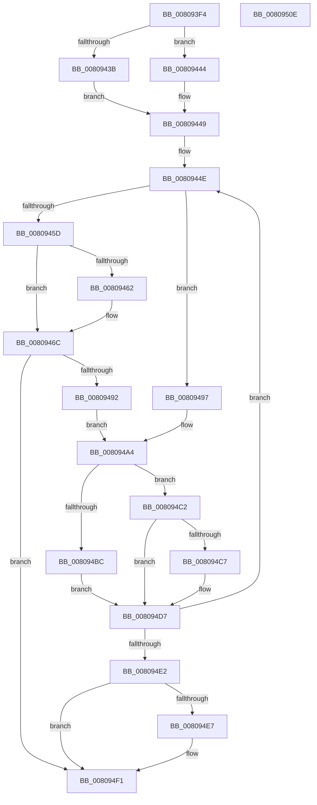

# MmLogSystemShareablePfnInfo

- RVA: `0x008093F4`–`0x0080950F` (길이 `283` bytes)
- VA: `0x00000001408093F4`
- 실행 섹션: `PAGE`
- PDB 이름 있음: `예`; PDB Function 태그: `아니요`
- unwind 정보 RVA: `0x00075C18`
- 디코드: `89`개 명령, `283/283` bytes 표시
- 미해석 바이트: `0` (있으면 어셈블리에 `.byte`로 보존)

> 이 문서는 커널 이미지의 기계어와 PDB 기호를 분석해 생성했습니다. 4번과 5번은 함수 원형과 자료형을 바이너리 사용 방식에서 추정한 C 해석이며 원본 소스 복구 결과는 아닙니다.

## 1. Dependencies

- 직접 호출 지점: **9**; 고유 호출 대상: **7**
- 직접 호출자로 확인된 함수: **1**
- RIP 상대 이미지 참조: **0**

### Outgoing calls
- `0x0080941F` → [MiGetAnyMultiplexedVm](../../text/44/MiGetAnyMultiplexedVm_function_00448BD0.md) (function, `0x00448BD0`)
- `0x0080942E` → [MiGetAggregateWorkingSetSize](../../text/69/MiGetAggregateWorkingSetSize_function_00695560.md) (function, `0x00695560`)
- `0x00809450` → [MiGetAnyMultiplexedVm](../../text/44/MiGetAnyMultiplexedVm_function_00448BD0.md) (function, `0x00448BD0`)
- `0x00809467` → [ExFreePoolWithTag](../../poolcode/B8/ExFreePoolWithTag_function_00B82870.md) (function, `0x00B82870`)
- `0x00809485` → [MiAllocatePool](../../text/35/MiAllocatePool_function_0035B540.md) (function, `0x0035B540`)
- `0x0080949F` → [memset](../../text/6C/memset_function_006C6C40.md) (function, `0x006C6C40`)
- `0x008094AF` → [MiGetWorkingSetInfoEx](../../text/29/MiGetWorkingSetInfoEx_function_0029E640.md) (function, `0x0029E640`)
- `0x008094D2` → [EtwLogPfnInfoRundown](../7B/EtwLogPfnInfoRundown_function_007BFDF0.md) (function, `0x007BFDF0`)
- `0x008094EC` → [ExFreePoolWithTag](../../poolcode/B8/ExFreePoolWithTag_function_00B82870.md) (function, `0x00B82870`)

### Direct callers
- [EtwpKernelTraceRundown](../9E/EtwpKernelTraceRundown_function_009E4080.md) at `0x009E42E5`
- [EtwpKernelTraceRundown](../9E/EtwpKernelTraceRundown_function_009E4080.md) at `0x009E441A`

### Static image references
- 디코드된 RIP-relative 메모리 참조가 없습니다.

## 2. Other-region calls and transfers

- 다른 실행 섹션으로 향하는 call: **8**
  - `0x0080941F` → [MiGetAnyMultiplexedVm](../../text/44/MiGetAnyMultiplexedVm_function_00448BD0.md) (`PAGE` → `.text`)
  - `0x0080942E` → [MiGetAggregateWorkingSetSize](../../text/69/MiGetAggregateWorkingSetSize_function_00695560.md) (`PAGE` → `.text`)
  - `0x00809450` → [MiGetAnyMultiplexedVm](../../text/44/MiGetAnyMultiplexedVm_function_00448BD0.md) (`PAGE` → `.text`)
  - `0x00809467` → [ExFreePoolWithTag](../../poolcode/B8/ExFreePoolWithTag_function_00B82870.md) (`PAGE` → `POOLCODE`)
  - `0x00809485` → [MiAllocatePool](../../text/35/MiAllocatePool_function_0035B540.md) (`PAGE` → `.text`)
  - `0x0080949F` → [memset](../../text/6C/memset_function_006C6C40.md) (`PAGE` → `.text`)
  - `0x008094AF` → [MiGetWorkingSetInfoEx](../../text/29/MiGetWorkingSetInfoEx_function_0029E640.md) (`PAGE` → `.text`)
  - `0x008094EC` → [ExFreePoolWithTag](../../poolcode/B8/ExFreePoolWithTag_function_00B82870.md) (`PAGE` → `POOLCODE`)
- 별도 외부 분기/꼬리 이동을 확인하지 못했습니다.

## 3. Assembly (complete function range)

```asm
008093F4  48 89 5C 24 08                  mov qword ptr [rsp + 8], rbx
008093F9  48 89 6C 24 10                  mov qword ptr [rsp + 0x10], rbp
008093FE  48 89 74 24 18                  mov qword ptr [rsp + 0x18], rsi
00809403  57                              push rdi
00809404  41 54                           push r12
00809406  41 55                           push r13
00809408  41 56                           push r14
0080940A  41 57                           push r15
0080940C  48 83 EC 20                     sub rsp, 0x20
00809410  4C 8B E9                        mov r13, rcx
00809413  44 8B E2                        mov r12d, edx
00809416  33 C9                           xor ecx, ecx
00809418  33 DB                           xor ebx, ebx
0080941A  45 33 F6                        xor r14d, r14d
0080941D  33 ED                           xor ebp, ebp
0080941F  E8 AC F7 C3 FF                  call 0x140448bd0
00809424  48 8B C8                        mov rcx, rax
00809427  4C 8B 88 98 00 00 00            mov r9, qword ptr [rax + 0x98]
0080942E  E8 2D C1 E8 FF                  call 0x140695560
00809433  48 8B F8                        mov rdi, rax
00809436  49 3B C1                        cmp rax, r9
00809439  76 09                           jbe 0x140809444
0080943B  49 2B F9                        sub rdi, r9
0080943E  48 83 C7 40                     add rdi, 0x40
00809442  EB 05                           jmp 0x140809449
00809444  BF 40 00 00 00                  mov edi, 0x40
00809449  BE 01 00 00 00                  mov esi, 1
0080944E  8B CE                           mov ecx, esi
00809450  E8 7B F7 C3 FF                  call 0x140448bd0
00809455  4C 8B F8                        mov r15, rax
00809458  4C 3B F7                        cmp r14, rdi
0080945B  73 3A                           jae 0x140809497
0080945D  48 85 DB                        test rbx, rbx
00809460  74 0A                           je 0x14080946c
00809462  33 D2                           xor edx, edx
00809464  48 8B CB                        mov rcx, rbx
00809467  E8 04 94 37 00                  call 0x140b82870
0080946C  48 8B EF                        mov rbp, rdi
0080946F  41 B8 45 74 77 4D               mov r8d, 0x4d777445
00809475  48 C1 E5 05                     shl rbp, 5
00809479  B9 40 00 00 00                  mov ecx, 0x40
0080947E  48 83 C5 10                     add rbp, 0x10
00809482  48 8B D5                        mov rdx, rbp
00809485  E8 B6 20 B5 FF                  call 0x14035b540
0080948A  48 8B D8                        mov rbx, rax
0080948D  48 85 C0                        test rax, rax
00809490  74 5F                           je 0x1408094f1
00809492  4C 8B F7                        mov r14, rdi
00809495  EB 0D                           jmp 0x1408094a4
00809497  4C 8B C5                        mov r8, rbp
0080949A  33 D2                           xor edx, edx
0080949C  48 8B CB                        mov rcx, rbx
0080949F  E8 9C D7 EB FF                  call 0x1406c6c40
008094A4  4C 8B CD                        mov r9, rbp
008094A7  4C 8B C3                        mov r8, rbx
008094AA  33 D2                           xor edx, edx
008094AC  49 8B CF                        mov rcx, r15
008094AF  E8 8C 51 A9 FF                  call 0x14029e640
008094B4  48 8B 4B 08                     mov rcx, qword ptr [rbx + 8]
008094B8  85 C0                           test eax, eax
008094BA  79 06                           jns 0x1408094c2
008094BC  48 8D 79 40                     lea rdi, [rcx + 0x40]
008094C0  EB 15                           jmp 0x1408094d7
008094C2  48 85 C9                        test rcx, rcx
008094C5  74 10                           je 0x1408094d7
008094C7  4C 8B CB                        mov r9, rbx
008094CA  45 8B C4                        mov r8d, r12d
008094CD  49 8B D5                        mov rdx, r13
008094D0  33 C9                           xor ecx, ecx
008094D2  E8 19 69 FB FF                  call 0x1407bfdf0
008094D7  FF C6                           inc esi
008094D9  83 FE 04                        cmp esi, 4
008094DC  0F 8E 6C FF FF FF               jle 0x14080944e
008094E2  48 85 DB                        test rbx, rbx
008094E5  74 0A                           je 0x1408094f1
008094E7  33 D2                           xor edx, edx
008094E9  48 8B CB                        mov rcx, rbx
008094EC  E8 7F 93 37 00                  call 0x140b82870
008094F1  48 8B 5C 24 50                  mov rbx, qword ptr [rsp + 0x50]
008094F6  48 8B 6C 24 58                  mov rbp, qword ptr [rsp + 0x58]
008094FB  48 8B 74 24 60                  mov rsi, qword ptr [rsp + 0x60]
00809500  48 83 C4 20                     add rsp, 0x20
00809504  41 5F                           pop r15
00809506  41 5E                           pop r14
00809508  41 5D                           pop r13
0080950A  41 5C                           pop r12
0080950C  5F                              pop rdi
0080950D  C3                              ret
0080950E  CC                              int3
```

## 4. C-style interpretation (structured pseudocode)

```c
__int64 __fastcall MmLogSystemShareablePfnInfo(__int64 a1, int a2)
{
    __int64 result;
    __int64 v_r14;
    __int64 v_rbp;
    __int64 v_rbx;
    __int64 v_rdi;
    __int64 v_rsi;
    __int64 v_rsp;
    unsigned __int64 v_stack_p10;
    unsigned __int64 v_stack_p18;
    unsigned __int64 v_stack_p8;

    v_stack_p8 = v_rbx;
    v_stack_p10 = v_rbp;
    v_stack_p18 = v_rsi;
    v_rsp = (v_rsp) - (32);
    a1 = 0;
    v_rbx = 0;
    v_r14 = 0;
    v_rbp = 0;
    result = MiGetAnyMultiplexedVm(a1, a2, a3, a4);
    result = MiGetAggregateWorkingSetSize(result, a2, a3, *(unsigned __int64 *)(result + 152));
    if (result <= (*(unsigned __int64 *)(result + 152))) goto loc_00809444;
    v_rdi = (result) - (*(unsigned __int64 *)(result + 152));
    v_rdi = (v_rdi) + (64);
    goto loc_00809449;
loc_00809444:
loc_00809449:
loc_0080944E:
    result = MiGetAnyMultiplexedVm(1, a2, a3, *(unsigned __int64 *)(result + 152));
    if (0 >= 64) goto loc_00809497;
    if (0 != 0) {
        a2 = 0;
        a1 = 0;
        result = ExFreePoolWithTag(a1, a2, a3, *(unsigned __int64 *)(result + 152));
    }
    v_rbp = (64) << (5);
    v_rbp = (v_rbp) + (16);
    result = MiAllocatePool(64, v_rbp, (unsigned int)(0x4D777445ULL), *(unsigned __int64 *)(result + 152));
    if (result == 0) goto loc_008094F1;
    goto loc_008094A4;
loc_00809497:
    a2 = 0;
    result = memset(result, a2, v_rbp, *(unsigned __int64 *)(result + 152));
loc_008094A4:
    a2 = 0;
    result = MiGetWorkingSetInfoEx(result, a2, result, v_rbp);
    if (!sign_flag) goto loc_008094C2;
    goto loc_008094D7;
loc_008094C2:
    if (*(unsigned __int64 *)(result + 8) != 0) {
        a4 = result;
        a3 = (unsigned int)((unsigned int)(a2));
        a2 = a1;
        a1 = 0;
        result = EtwLogPfnInfoRundown(a1, a2, a3, a4);
    }
    v_rsi = (unsigned int)((1) + 1);
    if (((unsigned int)(v_rsi)) <= 4) goto loc_0080944E;
    if (result != 0) {
        a2 = 0;
        a1 = result;
        result = ExFreePoolWithTag(a1, a2, a3, a4);
    }
    v_rsp = (v_rsp) + (32);
    return result;
}
```

## 5. (Beta) C Style

```c
int64_t MmLogSystemShareablePfnInfo(int64_t Arg1, int32_t Arg2)
{
    int64_t result;
    int64_t local_r14;
    int64_t local_rbp;
    int64_t local_rbx;
    int64_t local_rdi;
    int64_t local_rsi;
    int64_t local_rsp;
    uint64_t v_stack_p10;
    uint64_t v_stack_p18;
    uint64_t v_stack_p8;

    v_stack_p8 = local_rbx;
    v_stack_p10 = local_rbp;
    v_stack_p18 = local_rsi;
    local_rsp = (local_rsp) - (32);
    Arg1 = 0;
    local_rbx = 0;
    local_r14 = 0;
    local_rbp = 0;
    result = MiGetAnyMultiplexedVm(Arg1, Arg2, a3, a4);
    result = MiGetAggregateWorkingSetSize(result, Arg2, a3, *(uint64_t *)(result + 0x98));
    if (result <= (*(uint64_t *)(result + 0x98))) goto loc_00809444;
    local_rdi = (result) - (*(uint64_t *)(result + 0x98));
    local_rdi = (local_rdi) + (64);
    goto loc_00809449;
loc_00809444:
loc_00809449:
loc_0080944E:
    result = MiGetAnyMultiplexedVm(1, Arg2, a3, *(uint64_t *)(result + 0x98));
    if (0 >= 64) goto loc_00809497;
    if (0 != 0) {
        Arg2 = 0;
        Arg1 = 0;
        result = ExFreePoolWithTag(Arg1, Arg2, a3, *(uint64_t *)(result + 0x98));
    }
    local_rbp = (64) << (5);
    local_rbp = (local_rbp) + (16);
    result = MiAllocatePool(64, local_rbp, (uint32_t)(0x4D777445ULL), *(uint64_t *)(result + 0x98));
    if (result == 0) goto loc_008094F1;
    goto loc_008094A4;
loc_00809497:
    Arg2 = 0;
    result = memset(result, Arg2, local_rbp, *(uint64_t *)(result + 0x98));
loc_008094A4:
    Arg2 = 0;
    result = MiGetWorkingSetInfoEx(result, Arg2, result, local_rbp);
    if (!sign_flag) goto loc_008094C2;
    goto loc_008094D7;
loc_008094C2:
    if (*(uint64_t *)(result + 0x8) != 0) {
        a4 = result;
        a3 = (uint32_t)((uint32_t)(Arg2));
        Arg2 = Arg1;
        Arg1 = 0;
        result = EtwLogPfnInfoRundown(Arg1, Arg2, a3, a4);
    }
    local_rsi = (uint32_t)((1) + 1);
    if (((uint32_t)(local_rsi)) <= 4) goto loc_0080944E;
    if (result != 0) {
        Arg2 = 0;
        Arg1 = result;
        result = ExFreePoolWithTag(Arg1, Arg2, a3, a4);
    }
    local_rsp = (local_rsp) + (32);
    return result;
}
```

## 6. Execution-region graph

[열기: 2D/3D 그래프와 함수 탐색 컨트롤 패널](../../../control-panel.html?section=page&rva=0x008093F4&view=graph)

- 2D 그래프는 위에서 아래로 흐르고, 3D 그래프는 빈 공간을 드래그해 회전합니다. Shift+드래그는 이동, 휠은 확대·축소, 함수 노드 선택은 대상 보고서 이동입니다.

### Static fallback


