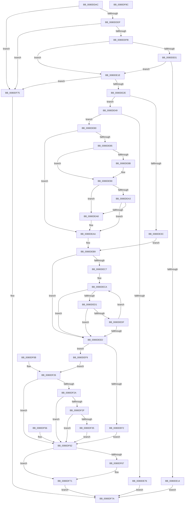

# MmManagePartitionCharges

- RVA: `0x0080DDAC`–`0x0080DF8D` (길이 `481` bytes)
- VA: `0x000000014080DDAC`
- 실행 섹션: `PAGE`
- PDB 이름 있음: `예`; PDB Function 태그: `아니요`
- unwind 정보 RVA: `0x000D9194`
- 디코드: `143`개 명령, `481/481` bytes 표시
- 미해석 바이트: `0` (있으면 어셈블리에 `.byte`로 보존)

> 이 문서는 커널 이미지의 기계어와 PDB 기호를 분석해 생성했습니다. 4번과 5번은 함수 원형과 자료형을 바이너리 사용 방식에서 추정한 C 해석이며 원본 소스 복구 결과는 아닙니다.

## 1. Dependencies

- 직접 호출 지점: **8**; 고유 호출 대상: **7**
- 직접 호출자로 확인된 함수: **1**
- RIP 상대 이미지 참조: **1**

### Outgoing calls
- `0x0080DE0B` → [SeSinglePrivilegeCheck](../87/SeSinglePrivilegeCheck_function_00871E20.md) (function, `0x00871E20`)
- `0x0080DE64` → [MiAllocatePool](../../text/35/MiAllocatePool_function_0035B540.md) (function, `0x0035B540`)
- `0x0080DE8B` → [ExRaiseDatatypeMisalignment](../89/ExRaiseDatatypeMisalignment_function_00899FD0.md) (function, `0x00899FD0`)
- `0x0080DEB3` → [memcpy](../../text/6C/memcpy_function_006C6840.md) (function, `0x006C6840`)
- `0x0080DF02` → [MiManagePartitionCharges](../../text/69/MiManagePartitionCharges_function_006915C8.md) (function, `0x006915C8`)
- `0x0080DF41` → [ProbeForWrite](../8E/ProbeForWrite_function_008E91C0.md) (function, `0x008E91C0`)
- `0x0080DF4F` → [memcpy](../../text/6C/memcpy_function_006C6840.md) (function, `0x006C6840`)
- `0x0080DF6C` → [ExFreePoolWithTag](../../poolcode/B8/ExFreePoolWithTag_function_00B82870.md) (function, `0x00B82870`)

### Direct callers
- [sub_00B2095C](../B2/Unknown_function_00B2095C.md) at `0x00B209F1`

### Static image references
- `0x0080DE04` → RVA `0x00FD9AD0` (`PAGEDATA`; read)

## 2. Other-region calls and transfers

- 다른 실행 섹션으로 향하는 call: **5**
  - `0x0080DE64` → [MiAllocatePool](../../text/35/MiAllocatePool_function_0035B540.md) (`PAGE` → `.text`)
  - `0x0080DEB3` → [memcpy](../../text/6C/memcpy_function_006C6840.md) (`PAGE` → `.text`)
  - `0x0080DF02` → [MiManagePartitionCharges](../../text/69/MiManagePartitionCharges_function_006915C8.md) (`PAGE` → `.text`)
  - `0x0080DF4F` → [memcpy](../../text/6C/memcpy_function_006C6840.md) (`PAGE` → `.text`)
  - `0x0080DF6C` → [ExFreePoolWithTag](../../poolcode/B8/ExFreePoolWithTag_function_00B82870.md) (`PAGE` → `POOLCODE`)
- 별도 외부 분기/꼬리 이동을 확인하지 못했습니다.

## 3. Assembly (complete function range)

```asm
0080DDAC  48 89 5C 24 18                  mov qword ptr [rsp + 0x18], rbx
0080DDB1  44 88 4C 24 20                  mov byte ptr [rsp + 0x20], r9b
0080DDB6  48 89 54 24 10                  mov qword ptr [rsp + 0x10], rdx
0080DDBB  56                              push rsi
0080DDBC  57                              push rdi
0080DDBD  41 54                           push r12
0080DDBF  41 56                           push r14
0080DDC1  41 57                           push r15
0080DDC3  48 83 EC 30                     sub rsp, 0x30
0080DDC7  45 8A E1                        mov r12b, r9b
0080DDCA  49 8B F8                        mov rdi, r8
0080DDCD  4C 8B FA                        mov r15, rdx
0080DDD0  48 8B 19                        mov rbx, qword ptr [rcx]
0080DDD3  44 8B 12                        mov r10d, dword ptr [rdx]
0080DDD6  45 85 D2                        test r10d, r10d
0080DDD9  0F 84 96 01 00 00               je 0x14080df75
0080DDDF  41 8D 42 FF                     lea eax, [r10 - 1]
0080DDE3  41 85 C2                        test r10d, eax
0080DDE6  0F 94 C1                        sete cl
0080DDE9  41 F7 C2 FC FF FF FF            test r10d, 0xfffffffc
0080DDF0  0F 94 C0                        sete al
0080DDF3  84 C8                           test al, cl
0080DDF5  0F 84 7A 01 00 00               je 0x14080df75
0080DDFB  41 F6 C2 02                     test r10b, 2
0080DDFF  74 1D                           je 0x14080de1e
0080DE01  41 8A D1                        mov dl, r9b
0080DE04  48 8B 0D C5 BC 7C 00            mov rcx, qword ptr [rip + 0x7cbcc5]
0080DE0B  E8 10 40 06 00                  call 0x140871e20
0080DE10  84 C0                           test al, al
0080DE12  75 0A                           jne 0x14080de1e
0080DE14  B8 61 00 00 C0                  mov eax, 0xc0000061
0080DE19  E9 5C 01 00 00                  jmp 0x14080df7a
0080DE1E  41 8B 4F 04                     mov ecx, dword ptr [r15 + 4]
0080DE22  8D 41 FF                        lea eax, [rcx - 1]
0080DE25  83 F8 1E                        cmp eax, 0x1e
0080DE28  0F 87 47 01 00 00               ja 0x14080df75
0080DE2E  48 83 C7 08                     add rdi, 8
0080DE32  48 89 7C 24 20                  mov qword ptr [rsp + 0x20], rdi
0080DE37  45 84 E4                        test r12b, r12b
0080DE3A  75 0D                           jne 0x14080de49
0080DE3C  48 8B F7                        mov rsi, rdi
0080DE3F  48 89 7C 24 60                  mov qword ptr [rsp + 0x60], rdi
0080DE44  45 33 F6                        xor r14d, r14d
0080DE47  EB 70                           jmp 0x14080deb9
0080DE49  4C 8D 34 89                     lea r14, [rcx + rcx*4]
0080DE4D  49 C1 E6 03                     shl r14, 3
0080DE51  4C 89 74 24 28                  mov qword ptr [rsp + 0x28], r14
0080DE56  41 B8 4D 69 48 61               mov r8d, 0x6148694d
0080DE5C  49 8B D6                        mov rdx, r14
0080DE5F  B9 40 00 00 00                  mov ecx, 0x40
0080DE64  E8 D7 D6 B4 FF                  call 0x14035b540
0080DE69  48 8B F0                        mov rsi, rax
0080DE6C  48 89 44 24 60                  mov qword ptr [rsp + 0x60], rax
0080DE71  48 85 C0                        test rax, rax
0080DE74  75 0A                           jne 0x14080de80
0080DE76  B8 9A 00 00 C0                  mov eax, 0xc000009a
0080DE7B  E9 FA 00 00 00                  jmp 0x14080df7a
0080DE80  4D 85 F6                        test r14, r14
0080DE83  74 25                           je 0x14080deaa
0080DE85  40 F6 C7 07                     test dil, 7
0080DE89  74 05                           je 0x14080de90
0080DE8B  E8 40 C1 08 00                  call 0x140899fd0
0080DE90  49 8D 04 3E                     lea rax, [r14 + rdi]
0080DE94  48 B9 00 00 FF FF FF 7F 00 00   movabs rcx, 0x7fffffff0000
0080DE9E  48 3B C1                        cmp rax, rcx
0080DEA1  77 05                           ja 0x14080dea8
0080DEA3  48 3B C7                        cmp rax, rdi
0080DEA6  73 02                           jae 0x14080deaa
0080DEA8  8A 01                           mov al, byte ptr [rcx]
0080DEAA  4D 8B C6                        mov r8, r14
0080DEAD  48 8B D7                        mov rdx, rdi
0080DEB0  48 8B CE                        mov rcx, rsi
0080DEB3  E8 88 89 EB FF                  call 0x1406c6840
0080DEB8  90                              nop
0080DEB9  45 33 C9                        xor r9d, r9d
0080DEBC  33 C0                           xor eax, eax
0080DEBE  45 8B 47 04                     mov r8d, dword ptr [r15 + 4]
0080DEC2  45 85 C0                        test r8d, r8d
0080DEC5  74 26                           je 0x14080deed
0080DEC7  48 8B D6                        mov rdx, rsi
0080DECA  8B 0A                           mov ecx, dword ptr [rdx]
0080DECC  83 F9 02                        cmp ecx, 2
0080DECF  7D 1C                           jge 0x14080deed
0080DED1  41 BA 01 00 00 00               mov r10d, 1
0080DED7  41 D3 E2                        shl r10d, cl
0080DEDA  45 85 D1                        test r9d, r10d
0080DEDD  75 0E                           jne 0x14080deed
0080DEDF  45 0B CA                        or r9d, r10d
0080DEE2  FF C0                           inc eax
0080DEE4  48 83 C2 28                     add rdx, 0x28
0080DEE8  41 3B C0                        cmp eax, r8d
0080DEEB  72 DD                           jb 0x14080deca
0080DEED  41 3B C0                        cmp eax, r8d
0080DEF0  73 07                           jae 0x14080def9
0080DEF2  BB 0D 00 00 C0                  mov ebx, 0xc000000d
0080DEF7  EB 69                           jmp 0x14080df62
0080DEF9  4C 8B CE                        mov r9, rsi
0080DEFC  41 8B 17                        mov edx, dword ptr [r15]
0080DEFF  48 8B CB                        mov rcx, rbx
0080DF02  E8 C1 36 E8 FF                  call 0x1406915c8
0080DF07  8B D8                           mov ebx, eax
0080DF09  EB 1B                           jmp 0x14080df26
0080DF0B  8B D8                           mov ebx, eax
0080DF0D  44 8A 64 24 78                  mov r12b, byte ptr [rsp + 0x78]
0080DF12  4C 8B 7C 24 68                  mov r15, qword ptr [rsp + 0x68]
0080DF17  48 8B 7C 24 20                  mov rdi, qword ptr [rsp + 0x20]
0080DF1C  4C 8B 74 24 28                  mov r14, qword ptr [rsp + 0x28]
0080DF21  48 8B 74 24 60                  mov rsi, qword ptr [rsp + 0x60]
0080DF26  85 DB                           test ebx, ebx
0080DF28  78 38                           js 0x14080df62
0080DF2A  45 84 E4                        test r12b, r12b
0080DF2D  74 33                           je 0x14080df62
0080DF2F  41 83 3F 01                     cmp dword ptr [r15], 1
0080DF33  75 2D                           jne 0x14080df62
0080DF35  41 B8 08 00 00 00               mov r8d, 8
0080DF3B  49 8B D6                        mov rdx, r14
0080DF3E  48 8B CF                        mov rcx, rdi
0080DF41  E8 7A B2 0D 00                  call 0x1408e91c0
0080DF46  4D 8B C6                        mov r8, r14
0080DF49  48 8B D6                        mov rdx, rsi
0080DF4C  48 8B CF                        mov rcx, rdi
0080DF4F  E8 EC 88 EB FF                  call 0x1406c6840
0080DF54  EB 0C                           jmp 0x14080df62
0080DF56  8B D8                           mov ebx, eax
0080DF58  48 8B 7C 24 20                  mov rdi, qword ptr [rsp + 0x20]
0080DF5D  48 8B 74 24 60                  mov rsi, qword ptr [rsp + 0x60]
0080DF62  48 3B F7                        cmp rsi, rdi
0080DF65  74 0A                           je 0x14080df71
0080DF67  33 D2                           xor edx, edx
0080DF69  48 8B CE                        mov rcx, rsi
0080DF6C  E8 FF 48 37 00                  call 0x140b82870
0080DF71  8B C3                           mov eax, ebx
0080DF73  EB 05                           jmp 0x14080df7a
0080DF75  B8 0D 00 00 C0                  mov eax, 0xc000000d
0080DF7A  48 8B 5C 24 70                  mov rbx, qword ptr [rsp + 0x70]
0080DF7F  48 83 C4 30                     add rsp, 0x30
0080DF83  41 5F                           pop r15
0080DF85  41 5E                           pop r14
0080DF87  41 5C                           pop r12
0080DF89  5F                              pop rdi
0080DF8A  5E                              pop rsi
0080DF8B  C3                              ret
0080DF8C  CC                              int3
```

## 4. C-style interpretation (structured pseudocode)

```c
__int64 __fastcall MmManagePartitionCharges(__int64 a1, __int64 a2, __int64 a3, int a4)
{
    __int64 result;
    __int64 v_r10;
    __int64 v_r14;
    __int64 v_rdi;
    __int64 v_rsp;
    unsigned __int64 v_stack_m30;
    unsigned __int64 v_stack_m38;
    unsigned __int64 v_stack_p10;
    unsigned __int64 v_stack_p18;
    unsigned __int8 v_stack_p20;
    unsigned __int64 v_stack_p8;

    v_stack_p18 = v_rbx;
    v_stack_p20 = (unsigned __int8)(a4);
    v_stack_p10 = a2;
    v_rsp = (v_rsp) - (48);
    if ((unsigned int)((unsigned int)(*(unsigned int *)(a2))) == 0) goto loc_0080DF75;
    a1 = ((((unsigned int)((unsigned int)(*(unsigned int *)(a2)))) & ((unsigned int)((unsigned int)(*(unsigned int *)(a2)) - 1))) == 0) ? 1 : 0;
    result = ((((unsigned int)((unsigned int)(*(unsigned int *)(a2)))) & (0xFFFFFFFCULL)) == 0) ? 1 : 0;
    if ((((unsigned __int8)(result)) & ((unsigned __int8)(a1))) == 0) goto loc_0080DF75;
    if ((((unsigned __int8)((unsigned int)(*(unsigned int *)(a2)))) & (2)) == 0) goto loc_0080DE1E;
    result = SeSinglePrivilegeCheck(*(unsigned __int64 *)(v_rip + 8174789), (unsigned __int8)(a4), a3, a4);
    if ((unsigned __int8)(result) != 0) goto loc_0080DE1E;
    goto loc_0080DF7A;
loc_0080DE1E:
    if (((unsigned int)((unsigned int)(*(unsigned int *)(a2 + 4)) - 1)) > 30) goto loc_0080DF75;
    v_rdi = (a3) + (8);
    v_stack_m38 = v_rdi;
    if ((unsigned __int8)((unsigned __int8)(a4)) != 0) goto loc_0080DE49;
    v_stack_p8 = v_rdi;
    v_r14 = 0;
    goto loc_0080DEB9;
loc_0080DE49:
    v_r14 = ((unsigned int)(*(unsigned int *)(a2 + 4)) + (unsigned int)(*(unsigned int *)(a2 + 4)) * 4) << (3);
    v_stack_m30 = v_r14;
    result = MiAllocatePool(64, v_r14, (unsigned int)(0x6148694DULL), a4);
    v_stack_p8 = result;
    if (result != 0) goto loc_0080DE80;
    goto loc_0080DF7A;
loc_0080DE80:
    if (v_r14 == 0) goto loc_0080DEAA;
    result = (unsigned int)(0xC000009AULL);
    if ((((unsigned __int8)(v_rdi)) & (7)) != 0) {
        result = ExRaiseDatatypeMisalignment(64, v_r14, (unsigned int)(0x6148694DULL), a4);
    }
    if ((v_r14 + v_rdi * 1) > 64) goto loc_0080DEA8;
    result = v_r14 + v_rdi * 1;
    if ((v_r14 + v_rdi * 1) < v_rdi) {
        result = *(unsigned __int8 *)(64);
    }
    result = memcpy(result, v_rdi, v_r14, a4);
loc_0080DEB9:
    a4 = 0;
    result = 0;
    if ((unsigned int)((unsigned int)(*(unsigned int *)(a2 + 4))) == 0) goto loc_0080DEED;
loc_0080DECA:
    if (((unsigned int)((unsigned int)(*(unsigned int *)(0)))) >= 2) goto loc_0080DEED;
    v_r10 = (unsigned int)((1) << ((unsigned __int8)((unsigned int)(*(unsigned int *)(0)))));
    if (((0) & ((unsigned int)(v_r10))) != 0) goto loc_0080DEED;
    a4 = (unsigned int)((a4) | ((unsigned int)(v_r10)));
    result = (unsigned int)((result) + 1);
    a2 = (0) + (40);
    if (((unsigned int)(result)) < ((unsigned int)((unsigned int)(*(unsigned int *)(a2 + 4))))) goto loc_0080DECA;
loc_0080DEED:
    if (((unsigned int)(result)) >= ((unsigned int)((unsigned int)(*(unsigned int *)(a2 + 4))))) goto loc_0080DEF9;
    goto loc_0080DF62;
loc_0080DEF9:
    result = MiManagePartitionCharges((unsigned int)(0xC000000DULL), (unsigned int)(*(unsigned int *)(a2)), (unsigned int)(*(unsigned int *)(a2 + 4)), result);
    goto loc_0080DF26;
loc_0080DF26:
    if (sign_flag) goto loc_0080DF62;
    if ((unsigned __int8)((unsigned __int8)(a4)) == 0) goto loc_0080DF62;
    if ((*(unsigned int *)(a2)) != 1) goto loc_0080DF62;
    result = ProbeForWrite(v_rdi, v_r14, 8, result);
    result = memcpy(v_rdi, result, v_r14, result);
    goto loc_0080DF62;
loc_0080DF62:
    if (result != v_rdi) {
        a2 = 0;
        a1 = result;
        result = ExFreePoolWithTag(a1, a2, v_r14, result);
    }
    goto loc_0080DF7A;
loc_0080DF75:
loc_0080DF7A:
    v_rsp = (v_rsp) + (48);
    return (unsigned int)(0xC000000DULL);
}
```

## 5. (Beta) C Style

```c
int64_t MmManagePartitionCharges(void *Arg1, void *Arg2, int64_t Arg3, int32_t Arg4)
{
    uint8_t *arg1 = (uint8_t *)Arg1;
    uint8_t *arg2 = (uint8_t *)Arg2;

    int64_t result;
    int64_t local_r10;
    int64_t local_r14;
    int64_t local_rdi;
    int64_t local_rsp;
    uint64_t v_stack_m30;
    uint64_t v_stack_m38;
    uint64_t v_stack_p10;
    uint64_t v_stack_p18;
    uint8_t v_stack_p20;
    uint64_t v_stack_p8;

    v_stack_p18 = local_rbx;
    v_stack_p20 = (uint8_t)(Arg4);
    v_stack_p10 = Arg2;
    local_rsp = (local_rsp) - (48);
    if ((uint32_t)((uint32_t)(*(uint32_t *)(arg2))) == 0) goto loc_0080DF75;
    Arg1 = ((((uint32_t)((uint32_t)(*(uint32_t *)(arg2)))) & ((uint32_t)((uint32_t)(*(uint32_t *)(arg2)) - 1))) == 0) ? 1 : 0;
    result = ((((uint32_t)((uint32_t)(*(uint32_t *)(arg2)))) & (0xFFFFFFFCULL)) == 0) ? 1 : 0;
    if ((((uint8_t)(result)) & ((uint8_t)(Arg1))) == 0) goto loc_0080DF75;
    if ((((uint8_t)((uint32_t)(*(uint32_t *)(arg2)))) & (2)) == 0) goto loc_0080DE1E;
    result = SeSinglePrivilegeCheck(*(uint64_t *)(v_rip + 0x7CBCC5), (uint8_t)(Arg4), Arg3, Arg4);
    if ((uint8_t)(result) != 0) goto loc_0080DE1E;
    goto loc_0080DF7A;
loc_0080DE1E:
    if (((uint32_t)((uint32_t)(*(uint32_t *)(arg2 + 0x4)) - 1)) > 30) goto loc_0080DF75;
    local_rdi = (Arg3) + (8);
    v_stack_m38 = local_rdi;
    if ((uint8_t)((uint8_t)(Arg4)) != 0) goto loc_0080DE49;
    v_stack_p8 = local_rdi;
    local_r14 = 0;
    goto loc_0080DEB9;
loc_0080DE49:
    local_r14 = ((uint32_t)(*(uint32_t *)(arg2 + 0x4)) + (uint32_t)(*(uint32_t *)(arg2 + 0x4)) * 4) << (3);
    v_stack_m30 = local_r14;
    result = MiAllocatePool(64, local_r14, (uint32_t)(0x6148694DULL), Arg4);
    v_stack_p8 = result;
    if (result != 0) goto loc_0080DE80;
    goto loc_0080DF7A;
loc_0080DE80:
    if (local_r14 == 0) goto loc_0080DEAA;
    result = (uint32_t)(0xC000009AULL);
    if ((((uint8_t)(local_rdi)) & (7)) != 0) {
        result = ExRaiseDatatypeMisalignment(64, local_r14, (uint32_t)(0x6148694DULL), Arg4);
    }
    if ((local_r14 + local_rdi * 1) > 64) goto loc_0080DEA8;
    result = local_r14 + local_rdi * 1;
    if ((local_r14 + local_rdi * 1) < local_rdi) {
        result = *(uint8_t *)(64);
    }
    result = memcpy(result, local_rdi, local_r14, Arg4);
loc_0080DEB9:
    Arg4 = 0;
    result = 0;
    if ((uint32_t)((uint32_t)(*(uint32_t *)(arg2 + 0x4))) == 0) goto loc_0080DEED;
loc_0080DECA:
    if (((uint32_t)((uint32_t)(*(uint32_t *)(0)))) >= 2) goto loc_0080DEED;
    local_r10 = (uint32_t)((1) << ((uint8_t)((uint32_t)(*(uint32_t *)(0)))));
    if (((0) & ((uint32_t)(local_r10))) != 0) goto loc_0080DEED;
    Arg4 = (uint32_t)((Arg4) | ((uint32_t)(local_r10)));
    result = (uint32_t)((result) + 1);
    Arg2 = (0) + (40);
    if (((uint32_t)(result)) < ((uint32_t)((uint32_t)(*(uint32_t *)(arg2 + 0x4))))) goto loc_0080DECA;
loc_0080DEED:
    if (((uint32_t)(result)) >= ((uint32_t)((uint32_t)(*(uint32_t *)(arg2 + 0x4))))) goto loc_0080DEF9;
    goto loc_0080DF62;
loc_0080DEF9:
    result = MiManagePartitionCharges((uint32_t)(0xC000000DULL), (uint32_t)(*(uint32_t *)(arg2)), (uint32_t)(*(uint32_t *)(arg2 + 0x4)), result);
    goto loc_0080DF26;
loc_0080DF26:
    if (sign_flag) goto loc_0080DF62;
    if ((uint8_t)((uint8_t)(Arg4)) == 0) goto loc_0080DF62;
    if ((*(uint32_t *)(arg2)) != 1) goto loc_0080DF62;
    result = ProbeForWrite(local_rdi, local_r14, 8, result);
    result = memcpy(local_rdi, result, local_r14, result);
    goto loc_0080DF62;
loc_0080DF62:
    if (result != local_rdi) {
        Arg2 = 0;
        Arg1 = result;
        result = ExFreePoolWithTag(Arg1, Arg2, local_r14, result);
    }
    goto loc_0080DF7A;
loc_0080DF75:
loc_0080DF7A:
    local_rsp = (local_rsp) + (48);
    return (uint32_t)(0xC000000DULL);
}
```

### 관측된 메모리 오프셋

구조체 형식이 확인되지 않은 접근은 인자 기준의 오프셋으로만 기록했습니다.

| 기준 인자 | 오프셋 표현 | 폭 (bit) | 접근 |
|---|---:|---:|---|
| `Arg1` | `+ 0x0` | `64` | `R` |
| `Arg2` | `+ 0x0` | `32` | `R` |
| `Arg2` | `+ 0x4` | `32` | `R` |

## 6. Execution-region graph

[열기: 2D/3D 그래프와 함수 탐색 컨트롤 패널](../../../control-panel.html?section=page&rva=0x0080DDAC&view=graph)

- 2D 그래프는 위에서 아래로 흐르고, 3D 그래프는 빈 공간을 드래그해 회전합니다. Shift+드래그는 이동, 휠은 확대·축소, 함수 노드 선택은 대상 보고서 이동입니다.

### Static fallback


