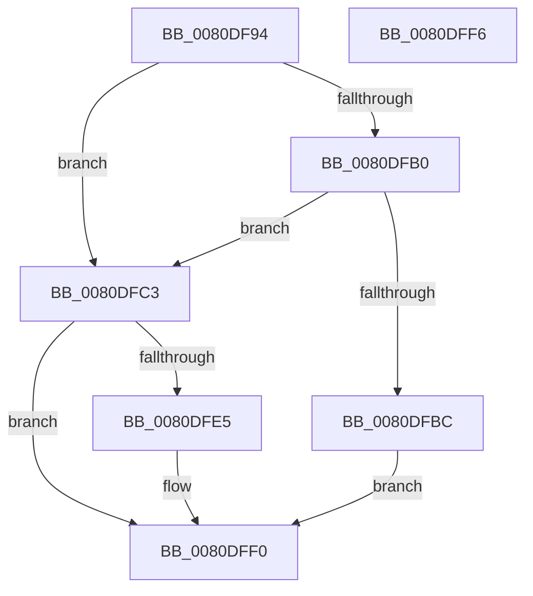

# MmManagePartitionCombineMemory

- RVA: `0x0080DF94`–`0x0080DFF7` (길이 `99` bytes)
- VA: `0x000000014080DF94`
- 실행 섹션: `PAGE`
- PDB 이름 있음: `예`; PDB Function 태그: `아니요`
- unwind 정보 RVA: `0x00064C80`
- 디코드: `30`개 명령, `99/99` bytes 표시
- 미해석 바이트: `0` (있으면 어셈블리에 `.byte`로 보존)

> 이 문서는 커널 이미지의 기계어와 PDB 기호를 분석해 생성했습니다. 4번과 5번은 함수 원형과 자료형을 바이너리 사용 방식에서 추정한 C 해석이며 원본 소스 복구 결과는 아닙니다.

## 1. Dependencies

- 직접 호출 지점: **1**; 고유 호출 대상: **1**
- 직접 호출자로 확인된 함수: **1**
- RIP 상대 이미지 참조: **1**

### Outgoing calls
- `0x0080DFDC` → [MiCombineIdenticalPages](../AB/MiCombineIdenticalPages_function_00AB2324.md) (function, `0x00AB2324`)

### Direct callers
- [NtManagePartition](../90/NtManagePartition_function_00902FC0.md) at `0x009032B9`

### Static image references
- `0x0080DFB0` → RVA `0x00E38D00` (`.data`; read)

## 2. Other-region calls and transfers

- 다른 실행 섹션으로 향하는 call: **0**
- 별도 외부 분기/꼬리 이동을 확인하지 못했습니다.

## 3. Assembly (complete function range)

```asm
0080DF94  40 53                           push rbx
0080DF96  48 83 EC 30                     sub rsp, 0x30
0080DF9A  48 83 64 24 40 00               and qword ptr [rsp + 0x40], 0
0080DFA0  4D 8B D0                        mov r10, r8
0080DFA3  8B 42 08                        mov eax, dword ptr [rdx + 8]
0080DFA6  48 8B DA                        mov rbx, rdx
0080DFA9  48 8B 09                        mov rcx, qword ptr [rcx]
0080DFAC  A8 01                           test al, 1
0080DFAE  74 13                           je 0x14080dfc3
0080DFB0  48 8D 05 49 AD 62 00            lea rax, [rip + 0x62ad49]
0080DFB7  48 3B C8                        cmp rcx, rax
0080DFBA  74 07                           je 0x14080dfc3
0080DFBC  B8 EF 00 00 C0                  mov eax, 0xc00000ef
0080DFC1  EB 2D                           jmp 0x14080dff0
0080DFC3  45 8B 40 08                     mov r8d, dword ptr [r8 + 8]
0080DFC7  48 8D 44 24 40                  lea rax, [rsp + 0x40]
0080DFCC  49 8B 12                        mov rdx, qword ptr [r10]
0080DFCF  48 89 44 24 28                  mov qword ptr [rsp + 0x28], rax
0080DFD4  44 88 4C 24 20                  mov byte ptr [rsp + 0x20], r9b
0080DFD9  45 33 C9                        xor r9d, r9d
0080DFDC  E8 43 43 2A 00                  call 0x140ab2324
0080DFE1  85 C0                           test eax, eax
0080DFE3  78 0B                           js 0x14080dff0
0080DFE5  48 8B 44 24 40                  mov rax, qword ptr [rsp + 0x40]
0080DFEA  48 89 43 10                     mov qword ptr [rbx + 0x10], rax
0080DFEE  33 C0                           xor eax, eax
0080DFF0  48 83 C4 30                     add rsp, 0x30
0080DFF4  5B                              pop rbx
0080DFF5  C3                              ret
0080DFF6  CC                              int3
```

## 4. C-style interpretation (structured pseudocode)

```c
__int64 __fastcall MmManagePartitionCombineMemory(__int64 a1, __int64 a2, __int64 a3, int a4)
{
    __int64 result;
    __int64 v_rsp;
    unsigned __int64 v_stack_m10;
    unsigned __int8 v_stack_m18;
    unsigned __int64 v_stack_p8;

    v_rsp = (v_rsp) - (48);
    if ((((unsigned __int8)((unsigned int)(*(unsigned int *)(a2 + 8)))) & (1)) == 0) goto loc_0080DFC3;
    if ((*(unsigned __int64 *)(a1)) == (v_rip + 6466889)) goto loc_0080DFC3;
    goto loc_0080DFF0;
loc_0080DFC3:
    v_stack_m10 = v_stack_p8;
    v_stack_m18 = (unsigned __int8)(a4);
    a4 = 0;
    result = MiCombineIdenticalPages(*(unsigned __int64 *)(a1), *(unsigned __int64 *)(a3), (unsigned int)(*(unsigned int *)(a3 + 8)), a4);
    if (!(sign_flag)) {
        result = v_stack_p8;
        *(unsigned __int64 *)(a2 + 16) = result;
        result = 0;
    }
    v_rsp = (v_rsp) + (48);
    return result;
}
```

## 5. (Beta) C Style

```c
int64_t MmManagePartitionCombineMemory(void *Arg1, void *Arg2, void *Arg3, int32_t Arg4)
{
    uint8_t *arg1 = (uint8_t *)Arg1;
    uint8_t *arg2 = (uint8_t *)Arg2;
    uint8_t *arg3 = (uint8_t *)Arg3;

    int64_t result;
    int64_t local_rsp;
    uint64_t v_stack_m10;
    uint8_t v_stack_m18;
    uint64_t v_stack_p8;

    local_rsp = (local_rsp) - (48);
    if ((((uint8_t)((uint32_t)(*(uint32_t *)(arg2 + 0x8)))) & (1)) == 0) goto loc_0080DFC3;
    if ((*(uint64_t *)(arg1)) == (v_rip + 6466889)) goto loc_0080DFC3;
    goto loc_0080DFF0;
loc_0080DFC3:
    v_stack_m10 = v_stack_p8;
    v_stack_m18 = (uint8_t)(Arg4);
    Arg4 = 0;
    result = MiCombineIdenticalPages(*(uint64_t *)(arg1), *(uint64_t *)(arg3), (uint32_t)(*(uint32_t *)(arg3 + 0x8)), Arg4);
    if (!(sign_flag)) {
        result = v_stack_p8;
        *(uint64_t *)(arg2 + 0x10) = result;
        result = 0;
    }
    local_rsp = (local_rsp) + (48);
    return result;
}
```

### 관측된 메모리 오프셋

구조체 형식이 확인되지 않은 접근은 인자 기준의 오프셋으로만 기록했습니다.

| 기준 인자 | 오프셋 표현 | 폭 (bit) | 접근 |
|---|---:|---:|---|
| `Arg1` | `+ 0x0` | `64` | `R` |
| `Arg2` | `+ 0x8` | `32` | `R` |
| `Arg2` | `+ 0x10` | `64` | `W` |
| `Arg3` | `+ 0x0` | `64` | `R` |
| `Arg3` | `+ 0x8` | `32` | `R` |

## 6. Execution-region graph

[열기: 2D/3D 그래프와 함수 탐색 컨트롤 패널](../../../control-panel.html?section=page&rva=0x0080DF94&view=graph)

- 2D 그래프는 위에서 아래로 흐르고, 3D 그래프는 빈 공간을 드래그해 회전합니다. Shift+드래그는 이동, 휠은 확대·축소, 함수 노드 선택은 대상 보고서 이동입니다.

### Static fallback


