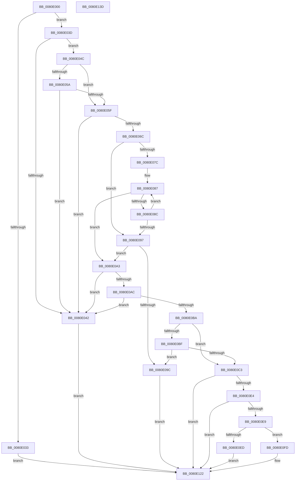

# MmManagePartitionCreateLargePages

- RVA: `0x0080E000`–`0x0080E13E` (길이 `318` bytes)
- VA: `0x000000014080E000`
- 실행 섹션: `PAGE`
- PDB 이름 있음: `예`; PDB Function 태그: `아니요`
- unwind 정보 RVA: `0x00084C9C`
- 디코드: `99`개 명령, `318/318` bytes 표시
- 미해석 바이트: `0` (있으면 어셈블리에 `.byte`로 보존)

> 이 문서는 커널 이미지의 기계어와 PDB 기호를 분석해 생성했습니다. 4번과 5번은 함수 원형과 자료형을 바이너리 사용 방식에서 추정한 C 해석이며 원본 소스 복구 결과는 아닙니다.

## 1. Dependencies

- 직접 호출 지점: **4**; 고유 호출 대상: **4**
- 직접 호출자로 확인된 함수: **1**
- RIP 상대 이미지 참조: **3**

### Outgoing calls
- `0x0080E028` → [SeSinglePrivilegeCheck](../87/SeSinglePrivilegeCheck_function_00871E20.md) (function, `0x00871E20`)
- `0x0080E070` → [MiGetLargestPageIndex](../../text/49/MiGetLargestPageIndex_function_0049F730.md) (function, `0x0049F730`)
- `0x0080E0CB` → [MiDefragmentAllSlabAllocators](../../text/68/MiDefragmentAllSlabAllocators_function_0068D43C.md) (function, `0x0068D43C`)
- `0x0080E114` → [MiRebuildLargePage](../../text/3B/MiRebuildLargePage_function_003BBAEC.md) (function, `0x003BBAEC`)

### Direct callers
- [sub_00B2095C](../B2/Unknown_function_00B2095C.md) at `0x00B20A34`

### Static image references
- `0x0080E01E` → RVA `0x00FD9AD0` (`PAGEDATA`; read)
- `0x0080E04C` → RVA `0x00FC5000` (`ALMOSTRO`; read)
- `0x0080E07C` → RVA `0x00011C60` (`.rdata`; read)

## 2. Other-region calls and transfers

- 다른 실행 섹션으로 향하는 call: **3**
  - `0x0080E070` → [MiGetLargestPageIndex](../../text/49/MiGetLargestPageIndex_function_0049F730.md) (`PAGE` → `.text`)
  - `0x0080E0CB` → [MiDefragmentAllSlabAllocators](../../text/68/MiDefragmentAllSlabAllocators_function_0068D43C.md) (`PAGE` → `.text`)
  - `0x0080E114` → [MiRebuildLargePage](../../text/3B/MiRebuildLargePage_function_003BBAEC.md) (`PAGE` → `.text`)
- 별도 외부 분기/꼬리 이동을 확인하지 못했습니다.

## 3. Assembly (complete function range)

```asm
0080E000  48 89 5C 24 08                  mov qword ptr [rsp + 8], rbx
0080E005  48 89 6C 24 10                  mov qword ptr [rsp + 0x10], rbp
0080E00A  48 89 74 24 18                  mov qword ptr [rsp + 0x18], rsi
0080E00F  57                              push rdi
0080E010  41 56                           push r14
0080E012  41 57                           push r15
0080E014  48 83 EC 30                     sub rsp, 0x30
0080E018  48 8B EA                        mov rbp, rdx
0080E01B  4C 8B F9                        mov r15, rcx
0080E01E  48 8B 0D AB BA 7C 00            mov rcx, qword ptr [rip + 0x7cbaab]
0080E025  41 8A D0                        mov dl, r8b
0080E028  E8 F3 3D 06 00                  call 0x140871e20
0080E02D  33 FF                           xor edi, edi
0080E02F  84 C0                           test al, al
0080E031  75 0A                           jne 0x14080e03d
0080E033  BF 61 00 00 C0                  mov edi, 0xc0000061
0080E038  E9 E5 00 00 00                  jmp 0x14080e122
0080E03D  39 7D 00                        cmp dword ptr [rbp], edi
0080E040  74 0A                           je 0x14080e04c
0080E042  BF 0D 00 00 C0                  mov edi, 0xc000000d
0080E047  E9 D6 00 00 00                  jmp 0x14080e122
0080E04C  0F B7 05 AD 6F 7B 00            movzx eax, word ptr [rip + 0x7b6fad]
0080E053  8B 5D 04                        mov ebx, dword ptr [rbp + 4]
0080E056  3B D8                           cmp ebx, eax
0080E058  72 05                           jb 0x14080e05f
0080E05A  83 FB FF                        cmp ebx, -1
0080E05D  75 E3                           jne 0x14080e042
0080E05F  4C 8B 75 08                     mov r14, qword ptr [rbp + 8]
0080E063  49 F7 C6 FF 0F 00 00            test r14, 0xfff
0080E06A  75 D6                           jne 0x14080e042
0080E06C  49 C1 EE 0C                     shr r14, 0xc
0080E070  E8 BB 16 C9 FF                  call 0x14049f730
0080E075  8B F0                           mov esi, eax
0080E077  83 F8 03                        cmp eax, 3
0080E07A  73 1B                           jae 0x14080e097
0080E07C  48 8D 05 DD 3B 80 FF            lea rax, [rip - 0x7fc423]
0080E083  48 8D 04 F0                     lea rax, [rax + rsi*8]
0080E087  4C 39 30                        cmp qword ptr [rax], r14
0080E08A  74 17                           je 0x14080e0a3
0080E08C  FF C6                           inc esi
0080E08E  48 83 C0 08                     add rax, 8
0080E092  83 FE 03                        cmp esi, 3
0080E095  72 F0                           jb 0x14080e087
0080E097  83 FE 03                        cmp esi, 3
0080E09A  75 07                           jne 0x14080e0a3
0080E09C  BF BB 00 00 C0                  mov edi, 0xc00000bb
0080E0A1  EB 7F                           jmp 0x14080e122
0080E0A3  4C 8B 4D 10                     mov r9, qword ptr [rbp + 0x10]
0080E0A7  4D 85 C9                        test r9, r9
0080E0AA  74 96                           je 0x14080e042
0080E0AC  33 D2                           xor edx, edx
0080E0AE  48 83 C8 FF                     or rax, 0xffffffffffffffff
0080E0B2  49 F7 F6                        div r14
0080E0B5  4C 3B C8                        cmp r9, rax
0080E0B8  73 88                           jae 0x14080e042
0080E0BA  83 FB FF                        cmp ebx, -1
0080E0BD  75 04                           jne 0x14080e0c3
0080E0BF  85 F6                           test esi, esi
0080E0C1  75 D9                           jne 0x14080e09c
0080E0C3  49 8B 0F                        mov rcx, qword ptr [r15]
0080E0C6  44 8B C6                        mov r8d, esi
0080E0C9  8B D3                           mov edx, ebx
0080E0CB  E8 6C F3 E7 FF                  call 0x14068d43c
0080E0D0  48 8B 55 18                     mov rdx, qword ptr [rbp + 0x18]
0080E0D4  4C 8B 4D 10                     mov r9, qword ptr [rbp + 0x10]
0080E0D8  48 03 D0                        add rdx, rax
0080E0DB  48 89 55 18                     mov qword ptr [rbp + 0x18], rdx
0080E0DF  49 3B D1                        cmp rdx, r9
0080E0E2  73 3E                           jae 0x14080e122
0080E0E4  83 FB FF                        cmp ebx, -1
0080E0E7  74 39                           je 0x14080e122
0080E0E9  85 F6                           test esi, esi
0080E0EB  75 10                           jne 0x14080e0fd
0080E0ED  48 F7 DA                        neg rdx
0080E0F0  BF BB 00 00 C0                  mov edi, 0xc00000bb
0080E0F5  1B C0                           sbb eax, eax
0080E0F7  F7 D0                           not eax
0080E0F9  23 F8                           and edi, eax
0080E0FB  EB 25                           jmp 0x14080e122
0080E0FD  49 8B 0F                        mov rcx, qword ptr [r15]
0080E100  4C 2B CA                        sub r9, rdx
0080E103  4D 0F AF CE                     imul r9, r14
0080E107  44 8B C6                        mov r8d, esi
0080E10A  C7 44 24 20 01 00 00 00         mov dword ptr [rsp + 0x20], 1
0080E112  8B D3                           mov edx, ebx
0080E114  E8 D3 D9 BA FF                  call 0x1403bbaec
0080E119  33 D2                           xor edx, edx
0080E11B  49 F7 F6                        div r14
0080E11E  48 01 45 18                     add qword ptr [rbp + 0x18], rax
0080E122  48 8B 5C 24 50                  mov rbx, qword ptr [rsp + 0x50]
0080E127  8B C7                           mov eax, edi
0080E129  48 8B 6C 24 58                  mov rbp, qword ptr [rsp + 0x58]
0080E12E  48 8B 74 24 60                  mov rsi, qword ptr [rsp + 0x60]
0080E133  48 83 C4 30                     add rsp, 0x30
0080E137  41 5F                           pop r15
0080E139  41 5E                           pop r14
0080E13B  5F                              pop rdi
0080E13C  C3                              ret
0080E13D  CC                              int3
```

## 4. C-style interpretation (structured pseudocode)

```c
__int64 __fastcall MmManagePartitionCreateLargePages(__int64 a1, __int64 a2, unsigned __int8 a3)
{
    __int64 result;
    __int64 v_r14;
    __int64 v_rdi;
    __int64 v_rsi;
    __int64 v_rsp;
    unsigned int v_stack_m28;
    unsigned __int64 v_stack_p10;
    unsigned __int64 v_stack_p18;
    unsigned __int64 v_stack_p8;

    v_stack_p8 = v_rbx;
    v_stack_p10 = v_rbp;
    v_stack_p18 = v_rsi;
    v_rsp = (v_rsp) - (48);
    result = SeSinglePrivilegeCheck(*(unsigned __int64 *)(v_rip + 8174251), a3, a3, a4);
    v_rdi = 0;
    if ((unsigned __int8)(result) != 0) goto loc_0080E03D;
    goto loc_0080E122;
loc_0080E03D:
    if ((*(unsigned int *)(a2)) == ((unsigned int)((unsigned int)(0xC0000061ULL)))) goto loc_0080E04C;
loc_0080E042:
    goto loc_0080E122;
loc_0080E04C:
    if (((unsigned int)((unsigned int)(*(unsigned int *)(a2 + 4)))) < ((unsigned int)(*(unsigned __int16 *)(v_rip + 8089517)))) goto loc_0080E05F;
    if (((unsigned int)((unsigned int)(*(unsigned int *)(a2 + 4)))) != -1) goto loc_0080E042;
loc_0080E05F:
    if (((*(unsigned __int64 *)(a2 + 8)) & (0xFFFULL)) != 0) goto loc_0080E042;
    v_r14 = (*(unsigned __int64 *)(a2 + 8)) >> (12);
    result = MiGetLargestPageIndex(*(unsigned __int64 *)(v_rip + 8174251), a3, a3, a4);
    if (((unsigned int)(result)) >= 3) goto loc_0080E097;
loc_0080E087:
    if ((*(unsigned __int64 *)(v_rip - 8373283 + (unsigned int)((unsigned int)(result)) * 8)) == v_r14) goto loc_0080E0A3;
    v_rsi = (unsigned int)(((unsigned int)((unsigned int)(result))) + 1);
    result = (v_rip - 8373283 + (unsigned int)((unsigned int)(result)) * 8) + (8);
    if (((unsigned int)(v_rsi)) < 3) goto loc_0080E087;
loc_0080E097:
    if (((unsigned int)(v_rsi)) != 3) goto loc_0080E0A3;
loc_0080E09C:
    goto loc_0080E122;
loc_0080E0A3:
    if (*(unsigned __int64 *)(a2 + 16) == 0) goto loc_0080E042;
    a2 = 0;
    result = (result) | (-1);
    if ((*(unsigned __int64 *)(a2 + 16)) >= result) goto loc_0080E042;
    if (((unsigned int)((unsigned int)(*(unsigned int *)(a2 + 4)))) != -1) goto loc_0080E0C3;
    if ((unsigned int)(v_rsi) != 0) goto loc_0080E09C;
loc_0080E0C3:
    result = MiDefragmentAllSlabAllocators(*(unsigned __int64 *)(a1), (unsigned int)((unsigned int)((unsigned int)(*(unsigned int *)(a2 + 4)))), (unsigned int)((unsigned int)(v_rsi)), *(unsigned __int64 *)(a2 + 16));
    a2 = (*(unsigned __int64 *)(a2 + 24)) + (result);
    *(unsigned __int64 *)(a2 + 24) = a2;
    if (a2 >= (*(unsigned __int64 *)(a2 + 16))) goto loc_0080E122;
    if (((unsigned int)((unsigned int)(*(unsigned int *)(a2 + 4)))) == -1) goto loc_0080E122;
    if ((unsigned int)(v_rsi) != 0) goto loc_0080E0FD;
    a2 = -(a2);
    result = (unsigned int)(~(result));
    v_rdi = (unsigned int)(((unsigned int)(0xC00000BBULL)) & ((unsigned int)(result)));
    goto loc_0080E122;
loc_0080E0FD:
    a4 = (*(unsigned __int64 *)(a2 + 16)) - (a2);
    a4 = (a4) * (v_r14);
    v_stack_m28 = 1;
    result = MiRebuildLargePage(*(unsigned __int64 *)(a1), (unsigned int)((unsigned int)((unsigned int)(*(unsigned int *)(a2 + 4)))), (unsigned int)((unsigned int)(v_rsi)), a4);
    a2 = 0;
loc_0080E122:
    v_rsp = (v_rsp) + (48);
    return (unsigned int)((unsigned int)(v_rdi));
}
```

## 5. (Beta) C Style

```c
int64_t MmManagePartitionCreateLargePages(void *Arg1, void *Arg2, uint8_t Arg3)
{
    uint8_t *arg1 = (uint8_t *)Arg1;
    uint8_t *arg2 = (uint8_t *)Arg2;

    int64_t result;
    int64_t local_r14;
    int64_t local_rdi;
    int64_t local_rsi;
    int64_t local_rsp;
    uint32_t v_stack_m28;
    uint64_t v_stack_p10;
    uint64_t v_stack_p18;
    uint64_t v_stack_p8;

    v_stack_p8 = local_rbx;
    v_stack_p10 = local_rbp;
    v_stack_p18 = local_rsi;
    local_rsp = (local_rsp) - (48);
    result = SeSinglePrivilegeCheck(*(uint64_t *)(v_rip + 0x7CBAAB), Arg3, Arg3, a4);
    local_rdi = 0;
    if ((uint8_t)(result) != 0) goto loc_0080E03D;
    goto loc_0080E122;
loc_0080E03D:
    if ((*(uint32_t *)(arg2)) == ((uint32_t)((uint32_t)(0xC0000061ULL)))) goto loc_0080E04C;
loc_0080E042:
    goto loc_0080E122;
loc_0080E04C:
    if (((uint32_t)((uint32_t)(*(uint32_t *)(arg2 + 0x4)))) < ((uint32_t)(*(uint16_t *)(v_rip + 0x7B6FAD)))) goto loc_0080E05F;
    if (((uint32_t)((uint32_t)(*(uint32_t *)(arg2 + 0x4)))) != -1) goto loc_0080E042;
loc_0080E05F:
    if (((*(uint64_t *)(arg2 + 0x8)) & (0xFFFULL)) != 0) goto loc_0080E042;
    local_r14 = (*(uint64_t *)(arg2 + 0x8)) >> (12);
    result = MiGetLargestPageIndex(*(uint64_t *)(v_rip + 0x7CBAAB), Arg3, Arg3, a4);
    if (((uint32_t)(result)) >= 3) goto loc_0080E097;
loc_0080E087:
    if ((*(uint64_t *)(v_rip - 0x7FC423 + (uint32_t)((uint32_t)(result)) * 8)) == local_r14) goto loc_0080E0A3;
    local_rsi = (uint32_t)(((uint32_t)((uint32_t)(result))) + 1);
    result = (v_rip - 8373283 + (uint32_t)((uint32_t)(result)) * 8) + (8);
    if (((uint32_t)(local_rsi)) < 3) goto loc_0080E087;
loc_0080E097:
    if (((uint32_t)(local_rsi)) != 3) goto loc_0080E0A3;
loc_0080E09C:
    goto loc_0080E122;
loc_0080E0A3:
    if (*(uint64_t *)(arg2 + 0x10) == 0) goto loc_0080E042;
    Arg2 = 0;
    result = (result) | (-1);
    if ((*(uint64_t *)(arg2 + 0x10)) >= result) goto loc_0080E042;
    if (((uint32_t)((uint32_t)(*(uint32_t *)(arg2 + 0x4)))) != -1) goto loc_0080E0C3;
    if ((uint32_t)(local_rsi) != 0) goto loc_0080E09C;
loc_0080E0C3:
    result = MiDefragmentAllSlabAllocators(*(uint64_t *)(arg1), (uint32_t)((uint32_t)((uint32_t)(*(uint32_t *)(arg2 + 0x4)))), (uint32_t)((uint32_t)(local_rsi)), *(uint64_t *)(arg2 + 0x10));
    Arg2 = (*(uint64_t *)(arg2 + 0x18)) + (result);
    *(void **)(arg2 + 0x18) = Arg2;
    if (Arg2 >= (*(uint64_t *)(arg2 + 0x10))) goto loc_0080E122;
    if (((uint32_t)((uint32_t)(*(uint32_t *)(arg2 + 0x4)))) == -1) goto loc_0080E122;
    if ((uint32_t)(local_rsi) != 0) goto loc_0080E0FD;
    Arg2 = -(Arg2);
    result = (uint32_t)(~(result));
    local_rdi = (uint32_t)(((uint32_t)(0xC00000BBULL)) & ((uint32_t)(result)));
    goto loc_0080E122;
loc_0080E0FD:
    a4 = (*(uint64_t *)(arg2 + 0x10)) - (Arg2);
    a4 = (a4) * (local_r14);
    v_stack_m28 = 1;
    result = MiRebuildLargePage(*(uint64_t *)(arg1), (uint32_t)((uint32_t)((uint32_t)(*(uint32_t *)(arg2 + 0x4)))), (uint32_t)((uint32_t)(local_rsi)), a4);
    Arg2 = 0;
loc_0080E122:
    local_rsp = (local_rsp) + (48);
    return (uint32_t)((uint32_t)(local_rdi));
}
```

### 관측된 메모리 오프셋

구조체 형식이 확인되지 않은 접근은 인자 기준의 오프셋으로만 기록했습니다.

| 기준 인자 | 오프셋 표현 | 폭 (bit) | 접근 |
|---|---:|---:|---|
| `Arg1` | `+ 0x0` | `64` | `R` |
| `Arg2` | `+ 0x0` | `32` | `R` |
| `Arg2` | `+ 0x4` | `32` | `R` |
| `Arg2` | `+ 0x8` | `64` | `R` |
| `Arg2` | `+ 0x10` | `64` | `R` |
| `Arg2` | `+ 0x18` | `64` | `R` |
| `Arg2` | `+ 0x18` | `64` | `R/W` |
| `Arg2` | `+ 0x18` | `64` | `W` |

## 6. Execution-region graph

[열기: 2D/3D 그래프와 함수 탐색 컨트롤 패널](../../../control-panel.html?section=page&rva=0x0080E000&view=graph)

- 2D 그래프는 위에서 아래로 흐르고, 3D 그래프는 빈 공간을 드래그해 회전합니다. Shift+드래그는 이동, 휠은 확대·축소, 함수 노드 선택은 대상 보고서 이동입니다.

### Static fallback


