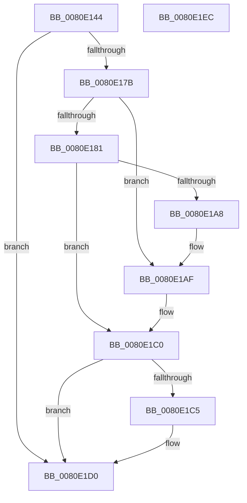

# MmManagePartitionInitialAddMemory

- RVA: `0x0080E144`–`0x0080E1ED` (길이 `169` bytes)
- VA: `0x000000014080E144`
- 실행 섹션: `PAGE`
- PDB 이름 있음: `예`; PDB Function 태그: `아니요`
- unwind 정보 RVA: `0x000BB528`
- 디코드: `57`개 명령, `169/169` bytes 표시
- 미해석 바이트: `0` (있으면 어셈블리에 `.byte`로 보존)

> 이 문서는 커널 이미지의 기계어와 PDB 기호를 분석해 생성했습니다. 4번과 5번은 함수 원형과 자료형을 바이너리 사용 방식에서 추정한 C 해석이며 원본 소스 복구 결과는 아닙니다.

## 1. Dependencies

- 직접 호출 지점: **4**; 고유 호출 대상: **4**
- 직접 호출자로 확인된 함수: **1**
- RIP 상대 이미지 참조: **0**

### Outgoing calls
- `0x0080E170` → [MiValidatePartitionInitialAddMemory](../../text/69/MiValidatePartitionInitialAddMemory_function_0069238C.md) (function, `0x0069238C`)
- `0x0080E198` → [MiSpecialPurposeMemoryChangePrepare](MiSpecialPurposeMemoryChangePrepare_function_0080FED0.md) (function, `0x0080FED0`)
- `0x0080E1B9` → [MiHotAddPartitionMemory](MiHotAddPartitionMemory_function_0080D5B4.md) (function, `0x0080D5B4`)
- `0x0080E1CB` → [MiSpecialPurposeMemoryTypeDereference](../81/MiSpecialPurposeMemoryTypeDereference_function_00810154.md) (function, `0x00810154`)

### Direct callers
- [NtManagePartition](../90/NtManagePartition_function_00902FC0.md) at `0x009032A9`

### Static image references
- 디코드된 RIP-relative 메모리 참조가 없습니다.

## 2. Other-region calls and transfers

- 다른 실행 섹션으로 향하는 call: **1**
  - `0x0080E170` → [MiValidatePartitionInitialAddMemory](../../text/69/MiValidatePartitionInitialAddMemory_function_0069238C.md) (`PAGE` → `.text`)
- 별도 외부 분기/꼬리 이동을 확인하지 못했습니다.

## 3. Assembly (complete function range)

```asm
0080E144  48 89 5C 24 10                  mov qword ptr [rsp + 0x10], rbx
0080E149  48 89 6C 24 18                  mov qword ptr [rsp + 0x18], rbp
0080E14E  56                              push rsi
0080E14F  57                              push rdi
0080E150  41 55                           push r13
0080E152  41 56                           push r14
0080E154  41 57                           push r15
0080E156  48 83 EC 20                     sub rsp, 0x20
0080E15A  48 8B 29                        mov rbp, qword ptr [rcx]
0080E15D  33 DB                           xor ebx, ebx
0080E15F  44 8B 32                        mov r14d, dword ptr [rdx]
0080E162  4D 8B E8                        mov r13, r8
0080E165  48 89 5C 24 50                  mov qword ptr [rsp + 0x50], rbx
0080E16A  48 8B FA                        mov rdi, rdx
0080E16D  45 33 FF                        xor r15d, r15d
0080E170  E8 17 42 E8 FF                  call 0x14069238c
0080E175  8B F0                           mov esi, eax
0080E177  85 C0                           test eax, eax
0080E179  78 55                           js 0x14080e1d0
0080E17B  41 F6 C6 10                     test r14b, 0x10
0080E17F  74 2E                           je 0x14080e1af
0080E181  41 8B C6                        mov eax, r14d
0080E184  48 8D 57 10                     lea rdx, [rdi + 0x10]
0080E188  83 E0 EF                        and eax, 0xffffffef
0080E18B  4C 8D 44 24 50                  lea r8, [rsp + 0x50]
0080E190  83 C8 01                        or eax, 1
0080E193  48 8B CD                        mov rcx, rbp
0080E196  89 07                           mov dword ptr [rdi], eax
0080E198  E8 33 1D 00 00                  call 0x14080fed0
0080E19D  48 8B 5C 24 50                  mov rbx, qword ptr [rsp + 0x50]
0080E1A2  8B F0                           mov esi, eax
0080E1A4  85 C0                           test eax, eax
0080E1A6  78 18                           js 0x14080e1c0
0080E1A8  4C 8B FD                        mov r15, rbp
0080E1AB  48 8B 6B 40                     mov rbp, qword ptr [rbx + 0x40]
0080E1AF  49 8D 55 30                     lea rdx, [r13 + 0x30]
0080E1B3  4C 8B C7                        mov r8, rdi
0080E1B6  48 8B CD                        mov rcx, rbp
0080E1B9  E8 F6 F3 FF FF                  call 0x14080d5b4
0080E1BE  8B F0                           mov esi, eax
0080E1C0  48 85 DB                        test rbx, rbx
0080E1C3  74 0B                           je 0x14080e1d0
0080E1C5  48 8B D3                        mov rdx, rbx
0080E1C8  49 8B CF                        mov rcx, r15
0080E1CB  E8 84 1F 00 00                  call 0x140810154
0080E1D0  48 8B 5C 24 58                  mov rbx, qword ptr [rsp + 0x58]
0080E1D5  8B C6                           mov eax, esi
0080E1D7  48 8B 6C 24 60                  mov rbp, qword ptr [rsp + 0x60]
0080E1DC  44 89 37                        mov dword ptr [rdi], r14d
0080E1DF  48 83 C4 20                     add rsp, 0x20
0080E1E3  41 5F                           pop r15
0080E1E5  41 5E                           pop r14
0080E1E7  41 5D                           pop r13
0080E1E9  5F                              pop rdi
0080E1EA  5E                              pop rsi
0080E1EB  C3                              ret
0080E1EC  CC                              int3
```

## 4. C-style interpretation (structured pseudocode)

```c
__int64 __fastcall MmManagePartitionInitialAddMemory(__int64 a1, __int64 a2, __int64 a3)
{
    __int64 result;
    __int64 v_r15;
    __int64 v_rbx;
    __int64 v_rsp;
    unsigned __int64 v_stack_p10;
    unsigned __int64 v_stack_p18;
    unsigned __int64 v_stack_p8;

    v_stack_p10 = v_rbx;
    v_stack_p18 = v_rbp;
    v_rsp = (v_rsp) - (32);
    v_rbx = 0;
    v_stack_p8 = 0;
    v_r15 = 0;
    result = MiValidatePartitionInitialAddMemory(a1, a2, a3, a4);
    if (sign_flag) goto loc_0080E1D0;
    if ((((unsigned __int8)((unsigned int)(*(unsigned int *)(a2)))) & (16)) == 0) goto loc_0080E1AF;
    result = (unsigned int)(((unsigned int)((unsigned int)((unsigned int)(*(unsigned int *)(a2))))) & (0xFFFFFFEFULL));
    result = (unsigned int)((result) | (1));
    *(unsigned int *)(a2) = (unsigned int)(result);
    result = MiSpecialPurposeMemoryChangePrepare(*(unsigned __int64 *)(a1), a2 + 16, v_stack_p8, a4);
    if (sign_flag) goto loc_0080E1C0;
loc_0080E1AF:
    result = MiHotAddPartitionMemory(*(unsigned __int64 *)(v_stack_p8 + 64), a3 + 48, a2, a4);
loc_0080E1C0:
    if (v_stack_p8 != 0) {
        a2 = v_stack_p8;
        a1 = *(unsigned __int64 *)(a1);
        result = MiSpecialPurposeMemoryTypeDereference(a1, a2, a2, a4);
    }
    *(unsigned int *)(a2) = (unsigned int)((unsigned int)(*(unsigned int *)(a2)));
    v_rsp = (v_rsp) + (32);
    return (unsigned int)((unsigned int)((unsigned int)((unsigned int)(result))));
}
```

## 5. (Beta) C Style

```c
int64_t MmManagePartitionInitialAddMemory(void *Arg1, void *Arg2, void *Arg3)
{
    uint8_t *arg1 = (uint8_t *)Arg1;
    uint8_t *arg2 = (uint8_t *)Arg2;
    uint8_t *arg3 = (uint8_t *)Arg3;

    int64_t result;
    int64_t local_r15;
    int64_t local_rbx;
    int64_t local_rsp;
    uint64_t v_stack_p10;
    uint64_t v_stack_p18;
    uint64_t v_stack_p8;

    v_stack_p10 = local_rbx;
    v_stack_p18 = local_rbp;
    local_rsp = (local_rsp) - (32);
    local_rbx = 0;
    v_stack_p8 = 0;
    local_r15 = 0;
    result = MiValidatePartitionInitialAddMemory(Arg1, Arg2, Arg3, a4);
    if (sign_flag) goto loc_0080E1D0;
    if ((((uint8_t)((uint32_t)(*(uint32_t *)(arg2)))) & (16)) == 0) goto loc_0080E1AF;
    result = (uint32_t)(((uint32_t)((uint32_t)((uint32_t)(*(uint32_t *)(arg2))))) & (0xFFFFFFEFULL));
    result = (uint32_t)((result) | (1));
    *(uint32_t *)(arg2) = (uint32_t)(result);
    result = MiSpecialPurposeMemoryChangePrepare(*(uint64_t *)(arg1), Arg2 + 16, v_stack_p8, a4);
    if (sign_flag) goto loc_0080E1C0;
loc_0080E1AF:
    result = MiHotAddPartitionMemory(*(uint64_t *)(v_stack_p8 + 0x40), Arg3 + 48, Arg2, a4);
loc_0080E1C0:
    if (v_stack_p8 != 0) {
        Arg2 = v_stack_p8;
        Arg1 = *(uint64_t *)(arg1);
        result = MiSpecialPurposeMemoryTypeDereference(Arg1, Arg2, Arg2, a4);
    }
    *(uint32_t *)(arg2) = (uint32_t)((uint32_t)(*(uint32_t *)(arg2)));
    local_rsp = (local_rsp) + (32);
    return (uint32_t)((uint32_t)((uint32_t)((uint32_t)(result))));
}
```

### 관측된 메모리 오프셋

구조체 형식이 확인되지 않은 접근은 인자 기준의 오프셋으로만 기록했습니다.

| 기준 인자 | 오프셋 표현 | 폭 (bit) | 접근 |
|---|---:|---:|---|
| `Arg1` | `+ 0x0` | `64` | `R` |
| `Arg2` | `+ 0x0` | `32` | `R` |
| `Arg2` | `+ 0x0` | `32` | `W` |
| `Arg2` | `+ 0x10` | `64` | `R` |
| `Arg3` | `+ 0x30` | `64` | `R` |

## 6. Execution-region graph

[열기: 2D/3D 그래프와 함수 탐색 컨트롤 패널](../../../control-panel.html?section=page&rva=0x0080E144&view=graph)

- 2D 그래프는 위에서 아래로 흐르고, 3D 그래프는 빈 공간을 드래그해 회전합니다. Shift+드래그는 이동, 휠은 확대·축소, 함수 노드 선택은 대상 보고서 이동입니다.

### Static fallback


