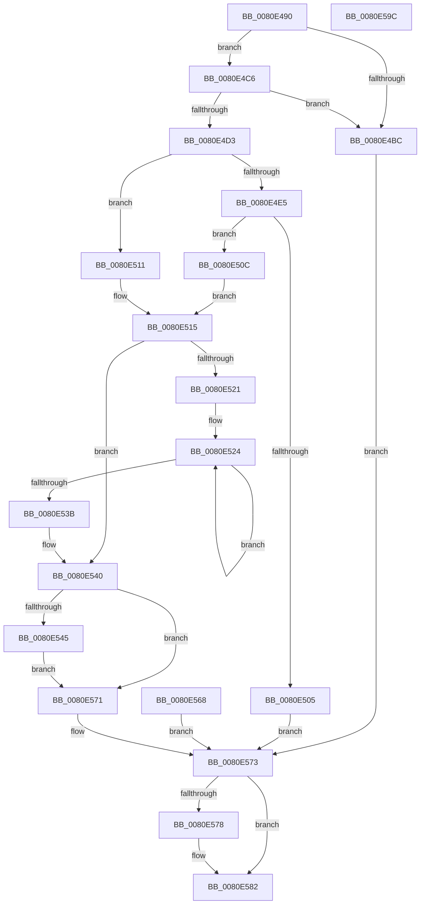

# MmManagePartitionNodeInformation

- RVA: `0x0080E490`–`0x0080E59D` (길이 `269` bytes)
- VA: `0x000000014080E490`
- 실행 섹션: `PAGE`
- PDB 이름 있음: `예`; PDB Function 태그: `아니요`
- unwind 정보 RVA: `0x000D9160`
- 디코드: `85`개 명령, `269/269` bytes 표시
- 미해석 바이트: `0` (있으면 어셈블리에 `.byte`로 보존)

> 이 문서는 커널 이미지의 기계어와 PDB 기호를 분석해 생성했습니다. 4번과 5번은 함수 원형과 자료형을 바이너리 사용 방식에서 추정한 C 해석이며 원본 소스 복구 결과는 아닙니다.

## 1. Dependencies

- 직접 호출 지점: **5**; 고유 호출 대상: **5**
- 직접 호출자로 확인된 함수: **1**
- RIP 상대 이미지 참조: **1**

### Outgoing calls
- `0x0080E4F3` → [MiAllocatePool](../../text/35/MiAllocatePool_function_0035B540.md) (function, `0x0035B540`)
- `0x0080E52C` → [MiGetPartitionNodeInformation](../../text/3B/MiGetPartitionNodeInformation_function_003B8D48.md) (function, `0x003B8D48`)
- `0x0080E552` → [ProbeForWrite](../8E/ProbeForWrite_function_008E91C0.md) (function, `0x008E91C0`)
- `0x0080E561` → [memcpy](../../text/6C/memcpy_function_006C6840.md) (function, `0x006C6840`)
- `0x0080E57D` → [ExFreePoolWithTag](../../poolcode/B8/ExFreePoolWithTag_function_00B82870.md) (function, `0x00B82870`)

### Direct callers
- [NtManagePartition](../90/NtManagePartition_function_00902FC0.md) at `0x00903310`

### Static image references
- `0x0080E4C8` → RVA `0x00FC5000` (`ALMOSTRO`; read)

## 2. Other-region calls and transfers

- 다른 실행 섹션으로 향하는 call: **4**
  - `0x0080E4F3` → [MiAllocatePool](../../text/35/MiAllocatePool_function_0035B540.md) (`PAGE` → `.text`)
  - `0x0080E52C` → [MiGetPartitionNodeInformation](../../text/3B/MiGetPartitionNodeInformation_function_003B8D48.md) (`PAGE` → `.text`)
  - `0x0080E561` → [memcpy](../../text/6C/memcpy_function_006C6840.md) (`PAGE` → `.text`)
  - `0x0080E57D` → [ExFreePoolWithTag](../../poolcode/B8/ExFreePoolWithTag_function_00B82870.md) (`PAGE` → `POOLCODE`)
- 별도 외부 분기/꼬리 이동을 확인하지 못했습니다.

## 3. Assembly (complete function range)

```asm
0080E490  48 89 5C 24 08                  mov qword ptr [rsp + 8], rbx
0080E495  48 89 74 24 18                  mov qword ptr [rsp + 0x18], rsi
0080E49A  57                              push rdi
0080E49B  41 54                           push r12
0080E49D  41 55                           push r13
0080E49F  41 56                           push r14
0080E4A1  41 57                           push r15
0080E4A3  48 83 EC 30                     sub rsp, 0x30
0080E4A7  45 8A E8                        mov r13b, r8b
0080E4AA  48 8B F2                        mov rsi, rdx
0080E4AD  48 8B D9                        mov rbx, rcx
0080E4B0  33 FF                           xor edi, edi
0080E4B2  48 89 7C 24 68                  mov qword ptr [rsp + 0x68], rdi
0080E4B7  39 7A 04                        cmp dword ptr [rdx + 4], edi
0080E4BA  74 0A                           je 0x14080e4c6
0080E4BC  BB 0D 00 00 C0                  mov ebx, 0xc000000d
0080E4C1  E9 AD 00 00 00                  jmp 0x14080e573
0080E4C6  8B 0A                           mov ecx, dword ptr [rdx]
0080E4C8  0F B7 05 31 6B 7B 00            movzx eax, word ptr [rip + 0x7b6b31]
0080E4CF  3B C8                           cmp ecx, eax
0080E4D1  75 E9                           jne 0x14080e4bc
0080E4D3  4C 8D 34 C9                     lea r14, [rcx + rcx*8]
0080E4D7  49 C1 E6 03                     shl r14, 3
0080E4DB  4C 89 74 24 20                  mov qword ptr [rsp + 0x20], r14
0080E4E0  45 84 ED                        test r13b, r13b
0080E4E3  74 2C                           je 0x14080e511
0080E4E5  41 B8 4D 69 4E 69               mov r8d, 0x694e694d
0080E4EB  49 8B D6                        mov rdx, r14
0080E4EE  B9 40 00 00 00                  mov ecx, 0x40
0080E4F3  E8 48 D0 B4 FF                  call 0x14035b540
0080E4F8  48 8B F8                        mov rdi, rax
0080E4FB  48 89 44 24 68                  mov qword ptr [rsp + 0x68], rax
0080E500  48 85 C0                        test rax, rax
0080E503  75 07                           jne 0x14080e50c
0080E505  BB 9A 00 00 C0                  mov ebx, 0xc000009a
0080E50A  EB 67                           jmp 0x14080e573
0080E50C  4C 8B F8                        mov r15, rax
0080E50F  EB 04                           jmp 0x14080e515
0080E511  4C 8B 7A 08                     mov r15, qword ptr [rdx + 8]
0080E515  48 8B 03                        mov rax, qword ptr [rbx]
0080E518  4D 8B E7                        mov r12, r15
0080E51B  33 DB                           xor ebx, ebx
0080E51D  39 1E                           cmp dword ptr [rsi], ebx
0080E51F  76 1F                           jbe 0x14080e540
0080E521  4C 8B F0                        mov r14, rax
0080E524  4D 8B C4                        mov r8, r12
0080E527  8B D3                           mov edx, ebx
0080E529  49 8B CE                        mov rcx, r14
0080E52C  E8 17 A8 BA FF                  call 0x1403b8d48
0080E531  49 83 C4 48                     add r12, 0x48
0080E535  FF C3                           inc ebx
0080E537  3B 1E                           cmp ebx, dword ptr [rsi]
0080E539  72 E9                           jb 0x14080e524
0080E53B  4C 8B 74 24 20                  mov r14, qword ptr [rsp + 0x20]
0080E540  45 84 ED                        test r13b, r13b
0080E543  74 2C                           je 0x14080e571
0080E545  41 B8 08 00 00 00               mov r8d, 8
0080E54B  49 8B D6                        mov rdx, r14
0080E54E  48 8B 4E 08                     mov rcx, qword ptr [rsi + 8]
0080E552  E8 69 AC 0D 00                  call 0x1408e91c0
0080E557  4D 8B C6                        mov r8, r14
0080E55A  49 8B D7                        mov rdx, r15
0080E55D  48 8B 4E 08                     mov rcx, qword ptr [rsi + 8]
0080E561  E8 DA 82 EB FF                  call 0x1406c6840
0080E566  EB 09                           jmp 0x14080e571
0080E568  8B D8                           mov ebx, eax
0080E56A  48 8B 7C 24 68                  mov rdi, qword ptr [rsp + 0x68]
0080E56F  EB 02                           jmp 0x14080e573
0080E571  33 DB                           xor ebx, ebx
0080E573  48 85 FF                        test rdi, rdi
0080E576  74 0A                           je 0x14080e582
0080E578  33 D2                           xor edx, edx
0080E57A  48 8B CF                        mov rcx, rdi
0080E57D  E8 EE 42 37 00                  call 0x140b82870
0080E582  8B C3                           mov eax, ebx
0080E584  48 8B 5C 24 60                  mov rbx, qword ptr [rsp + 0x60]
0080E589  48 8B 74 24 70                  mov rsi, qword ptr [rsp + 0x70]
0080E58E  48 83 C4 30                     add rsp, 0x30
0080E592  41 5F                           pop r15
0080E594  41 5E                           pop r14
0080E596  41 5D                           pop r13
0080E598  41 5C                           pop r12
0080E59A  5F                              pop rdi
0080E59B  C3                              ret
0080E59C  CC                              int3
```

## 4. C-style interpretation (structured pseudocode)

```c
__int64 __fastcall MmManagePartitionNodeInformation(__int64 a1, __int64 a2, unsigned __int8 a3)
{
    __int64 result;
    __int64 v_r12;
    __int64 v_r14;
    __int64 v_rbx;
    __int64 v_rdi;
    __int64 v_rsp;
    unsigned __int64 v_stack_m38;
    unsigned __int64 v_stack_p10;
    unsigned __int64 v_stack_p18;
    unsigned __int64 v_stack_p8;

    v_stack_p8 = v_rbx;
    v_stack_p18 = v_rsi;
    v_rsp = (v_rsp) - (48);
    v_rdi = 0;
    v_stack_p10 = 0;
    if ((*(unsigned int *)(a2 + 4)) == 0) goto loc_0080E4C6;
loc_0080E4BC:
    goto loc_0080E573;
loc_0080E4C6:
    if (((unsigned int)((unsigned int)(*(unsigned int *)(a2)))) != ((unsigned int)(*(unsigned __int16 *)(v_rip + 8088369)))) goto loc_0080E4BC;
    v_r14 = ((unsigned int)(*(unsigned int *)(a2)) + (unsigned int)(*(unsigned int *)(a2)) * 8) << (3);
    v_stack_m38 = v_r14;
    if (a3 == 0) goto loc_0080E511;
    result = MiAllocatePool(64, v_r14, (unsigned int)(0x694E694DULL), a4);
    v_stack_p10 = result;
    if (result != 0) goto loc_0080E50C;
    goto loc_0080E573;
loc_0080E50C:
    goto loc_0080E515;
loc_0080E511:
loc_0080E515:
    v_rbx = 0;
    if ((*(unsigned int *)(a2)) <= 0) goto loc_0080E540;
loc_0080E524:
    result = MiGetPartitionNodeInformation(*(unsigned __int64 *)((unsigned int)(0xC000009AULL)), 0, *(unsigned __int64 *)(v_r14 + 8), a4);
    v_r12 = (*(unsigned __int64 *)(v_r14 + 8)) + (72);
    v_rbx = (unsigned int)((v_rbx) + 1);
    if (((unsigned int)(v_rbx)) < (*(unsigned int *)(a2))) goto loc_0080E524;
loc_0080E540:
    if (a3 == 0) goto loc_0080E571;
    result = ProbeForWrite(*(unsigned __int64 *)(a2 + 8), v_stack_m38, 8, a4);
    result = memcpy(*(unsigned __int64 *)(a2 + 8), *(unsigned __int64 *)(v_r14 + 8), v_stack_m38, a4);
    goto loc_0080E571;
loc_0080E571:
    v_rbx = 0;
loc_0080E573:
    if (result != 0) {
        a2 = 0;
        a1 = result;
        result = ExFreePoolWithTag(a1, a2, v_stack_m38, a4);
    }
    v_rsp = (v_rsp) + (48);
    return 0;
}
```

## 5. (Beta) C Style

```c
int64_t MmManagePartitionNodeInformation(void *Arg1, void *Arg2, uint8_t Arg3)
{
    uint8_t *arg1 = (uint8_t *)Arg1;
    uint8_t *arg2 = (uint8_t *)Arg2;

    int64_t result;
    int64_t local_r12;
    int64_t local_r14;
    int64_t local_rbx;
    int64_t local_rdi;
    int64_t local_rsp;
    uint64_t v_stack_m38;
    uint64_t v_stack_p10;
    uint64_t v_stack_p18;
    uint64_t v_stack_p8;

    v_stack_p8 = local_rbx;
    v_stack_p18 = local_rsi;
    local_rsp = (local_rsp) - (48);
    local_rdi = 0;
    v_stack_p10 = 0;
    if ((*(uint32_t *)(arg2 + 0x4)) == 0) goto loc_0080E4C6;
loc_0080E4BC:
    goto loc_0080E573;
loc_0080E4C6:
    if (((uint32_t)((uint32_t)(*(uint32_t *)(arg2)))) != ((uint32_t)(*(uint16_t *)(v_rip + 0x7B6B31)))) goto loc_0080E4BC;
    local_r14 = ((uint32_t)(*(uint32_t *)(arg2)) + (uint32_t)(*(uint32_t *)(arg2)) * 8) << (3);
    v_stack_m38 = local_r14;
    if (Arg3 == 0) goto loc_0080E511;
    result = MiAllocatePool(64, local_r14, (uint32_t)(0x694E694DULL), a4);
    v_stack_p10 = result;
    if (result != 0) goto loc_0080E50C;
    goto loc_0080E573;
loc_0080E50C:
    goto loc_0080E515;
loc_0080E511:
loc_0080E515:
    local_rbx = 0;
    if ((*(uint32_t *)(arg2)) <= 0) goto loc_0080E540;
loc_0080E524:
    result = MiGetPartitionNodeInformation(*(uint64_t *)((uint32_t)(0xC000009AULL)), 0, *(uint64_t *)(local_r14 + 0x8), a4);
    local_r12 = (*(uint64_t *)(local_r14 + 0x8)) + (72);
    local_rbx = (uint32_t)((local_rbx) + 1);
    if (((uint32_t)(local_rbx)) < (*(uint32_t *)(arg2))) goto loc_0080E524;
loc_0080E540:
    if (Arg3 == 0) goto loc_0080E571;
    result = ProbeForWrite(*(uint64_t *)(arg2 + 0x8), v_stack_m38, 8, a4);
    result = memcpy(*(uint64_t *)(arg2 + 0x8), *(uint64_t *)(local_r14 + 0x8), v_stack_m38, a4);
    goto loc_0080E571;
loc_0080E571:
    local_rbx = 0;
loc_0080E573:
    if (result != 0) {
        Arg2 = 0;
        Arg1 = result;
        result = ExFreePoolWithTag(Arg1, Arg2, v_stack_m38, a4);
    }
    local_rsp = (local_rsp) + (48);
    return 0;
}
```

### 관측된 메모리 오프셋

구조체 형식이 확인되지 않은 접근은 인자 기준의 오프셋으로만 기록했습니다.

| 기준 인자 | 오프셋 표현 | 폭 (bit) | 접근 |
|---|---:|---:|---|
| `Arg1` | `+ 0x0` | `64` | `R` |
| `Arg2` | `+ 0x0` | `32` | `R` |
| `Arg2` | `+ 0x4` | `32` | `R` |
| `Arg2` | `+ 0x8` | `64` | `R` |

## 6. Execution-region graph

[열기: 2D/3D 그래프와 함수 탐색 컨트롤 패널](../../../control-panel.html?section=page&rva=0x0080E490&view=graph)

- 2D 그래프는 위에서 아래로 흐르고, 3D 그래프는 빈 공간을 드래그해 회전합니다. Shift+드래그는 이동, 휠은 확대·축소, 함수 노드 선택은 대상 보고서 이동입니다.

### Static fallback


