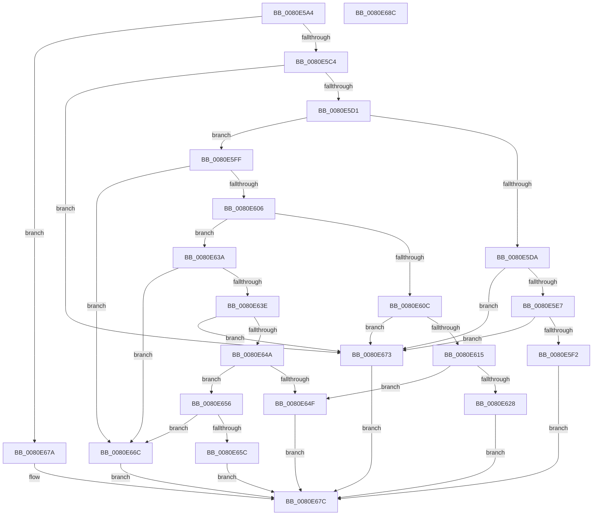

# MmManagePartitionUpdateAttributes

- RVA: `0x0080E5A4`–`0x0080E68D` (길이 `233` bytes)
- VA: `0x000000014080E5A4`
- 실행 섹션: `PAGE`
- PDB 이름 있음: `예`; PDB Function 태그: `아니요`
- unwind 정보 RVA: `0x00060BC4`
- 디코드: `68`개 명령, `233/233` bytes 표시
- 미해석 바이트: `0` (있으면 어셈블리에 `.byte`로 보존)

> 이 문서는 커널 이미지의 기계어와 PDB 기호를 분석해 생성했습니다. 4번과 5번은 함수 원형과 자료형을 바이너리 사용 방식에서 추정한 C 해석이며 원본 소스 복구 결과는 아닙니다.

## 1. Dependencies

- 직접 호출 지점: **3**; 고유 호출 대상: **3**
- 직접 호출자로 확인된 함수: **1**
- RIP 상대 이미지 참조: **2**

### Outgoing calls
- `0x0080E5F8` → [MiUpdateSpecialPurposeMemoryCacheEligibility](../81/MiUpdateSpecialPurposeMemoryCacheEligibility_function_00810270.md) (function, `0x00810270`)
- `0x0080E61F` → [SeSinglePrivilegeCheck](../87/SeSinglePrivilegeCheck_function_00871E20.md) (function, `0x00871E20`)
- `0x0080E633` → [MiUpdateSlabContextSlabSize](../../text/68/MiUpdateSlabContextSlabSize_function_0068F2A4.md) (function, `0x0068F2A4`)

### Direct callers
- [sub_00B2095C](../B2/Unknown_function_00B2095C.md) at `0x00B209C5`

### Static image references
- `0x0080E615` → RVA `0x00FD9AD0` (`PAGEDATA`; read)
- `0x0080E63E` → RVA `0x00E38D00` (`.data`; read)

## 2. Other-region calls and transfers

- 다른 실행 섹션으로 향하는 call: **1**
  - `0x0080E633` → [MiUpdateSlabContextSlabSize](../../text/68/MiUpdateSlabContextSlabSize_function_0068F2A4.md) (`PAGE` → `.text`)
- 별도 외부 분기/꼬리 이동을 확인하지 못했습니다.

## 3. Assembly (complete function range)

```asm
0080E5A4  48 89 5C 24 08                  mov qword ptr [rsp + 8], rbx
0080E5A9  48 89 74 24 10                  mov qword ptr [rsp + 0x10], rsi
0080E5AE  57                              push rdi
0080E5AF  48 83 EC 20                     sub rsp, 0x20
0080E5B3  4C 8B 12                        mov r10, qword ptr [rdx]
0080E5B6  33 DB                           xor ebx, ebx
0080E5B8  41 8B F1                        mov esi, r9d
0080E5BB  4D 85 D2                        test r10, r10
0080E5BE  0F 84 B6 00 00 00               je 0x14080e67a
0080E5C4  49 F7 C2 F0 FF FF FF            test r10, -0x10
0080E5CB  0F 85 A2 00 00 00               jne 0x14080e673
0080E5D1  48 8B 39                        mov rdi, qword ptr [rcx]
0080E5D4  41 F6 C2 04                     test r10b, 4
0080E5D8  74 25                           je 0x14080e5ff
0080E5DA  49 F7 C2 FB FF FF FF            test r10, -5
0080E5E1  0F 85 8C 00 00 00               jne 0x14080e673
0080E5E7  8B 47 04                        mov eax, dword ptr [rdi + 4]
0080E5EA  84 C0                           test al, al
0080E5EC  0F 89 81 00 00 00               jns 0x14080e673
0080E5F2  41 8B D1                        mov edx, r9d
0080E5F5  48 8B CF                        mov rcx, rdi
0080E5F8  E8 73 1C 00 00                  call 0x140810270
0080E5FD  EB 7D                           jmp 0x14080e67c
0080E5FF  8B 47 04                        mov eax, dword ptr [rdi + 4]
0080E602  84 C0                           test al, al
0080E604  78 66                           js 0x14080e66c
0080E606  41 F6 C2 08                     test r10b, 8
0080E60A  74 2E                           je 0x14080e63a
0080E60C  49 F7 C2 F7 FF FF FF            test r10, -9
0080E613  75 5E                           jne 0x14080e673
0080E615  48 8B 0D B4 B4 7C 00            mov rcx, qword ptr [rip + 0x7cb4b4]
0080E61C  41 8A D0                        mov dl, r8b
0080E61F  E8 FC 37 06 00                  call 0x140871e20
0080E624  84 C0                           test al, al
0080E626  74 27                           je 0x14080e64f
0080E628  85 F6                           test esi, esi
0080E62A  48 8B CF                        mov rcx, rdi
0080E62D  0F 94 C3                        sete bl
0080E630  44 8B C3                        mov r8d, ebx
0080E633  E8 6C 0C E8 FF                  call 0x14068f2a4
0080E638  EB 42                           jmp 0x14080e67c
0080E63A  85 F6                           test esi, esi
0080E63C  74 2E                           je 0x14080e66c
0080E63E  48 8D 05 BB A6 62 00            lea rax, [rip + 0x62a6bb]
0080E645  48 3B F8                        cmp rdi, rax
0080E648  74 29                           je 0x14080e673
0080E64A  45 84 C0                        test r8b, r8b
0080E64D  74 07                           je 0x14080e656
0080E64F  B8 61 00 00 C0                  mov eax, 0xc0000061
0080E654  EB 26                           jmp 0x14080e67c
0080E656  41 F6 C2 01                     test r10b, 1
0080E65A  75 10                           jne 0x14080e66c
0080E65C  41 80 E2 02                     and r10b, 2
0080E660  41 F6 DA                        neg r10b
0080E663  1B C0                           sbb eax, eax
0080E665  25 BB 00 00 C0                  and eax, 0xc00000bb
0080E66A  EB 10                           jmp 0x14080e67c
0080E66C  B8 BB 00 00 C0                  mov eax, 0xc00000bb
0080E671  EB 09                           jmp 0x14080e67c
0080E673  B8 0D 00 00 C0                  mov eax, 0xc000000d
0080E678  EB 02                           jmp 0x14080e67c
0080E67A  33 C0                           xor eax, eax
0080E67C  48 8B 5C 24 30                  mov rbx, qword ptr [rsp + 0x30]
0080E681  48 8B 74 24 38                  mov rsi, qword ptr [rsp + 0x38]
0080E686  48 83 C4 20                     add rsp, 0x20
0080E68A  5F                              pop rdi
0080E68B  C3                              ret
0080E68C  CC                              int3
```

## 4. C-style interpretation (structured pseudocode)

```c
__int64 __fastcall MmManagePartitionUpdateAttributes(__int64 a1, __int64 a2, unsigned __int8 a3, int a4)
{
    __int64 result;
    __int64 v_r10;
    __int64 v_rbx;
    __int64 v_rsp;
    unsigned __int64 v_stack_p10;
    unsigned __int64 v_stack_p8;

    v_stack_p8 = v_rbx;
    v_stack_p10 = v_rsi;
    v_rsp = (v_rsp) - (32);
    v_rbx = 0;
    if (*(unsigned __int64 *)(a2) == 0) goto loc_0080E67A;
    if (((*(unsigned __int64 *)(a2)) & (-16)) != 0) goto loc_0080E673;
    if ((((unsigned __int8)(*(unsigned __int64 *)(a2))) & (4)) == 0) goto loc_0080E5FF;
    if (((*(unsigned __int64 *)(a2)) & (-5)) != 0) goto loc_0080E673;
    if (!sign_flag) goto loc_0080E673;
    result = MiUpdateSpecialPurposeMemoryCacheEligibility(*(unsigned __int64 *)(a1), (unsigned int)(a4), a3, a4);
    goto loc_0080E67C;
loc_0080E5FF:
    if (sign_flag) goto loc_0080E66C;
    if ((((unsigned __int8)(*(unsigned __int64 *)(a2))) & (8)) == 0) goto loc_0080E63A;
    if (((*(unsigned __int64 *)(a2)) & (-9)) != 0) goto loc_0080E673;
    result = SeSinglePrivilegeCheck(*(unsigned __int64 *)(v_rip + 8172724), a3, a3, a4);
    if ((unsigned __int8)(result) == 0) goto loc_0080E64F;
    v_rbx = ((unsigned int)((unsigned int)(a4)) == 0) ? 1 : 0;
    result = MiUpdateSlabContextSlabSize(*(unsigned __int64 *)(a1), a3, (unsigned int)((unsigned int)(v_rbx)), a4);
    goto loc_0080E67C;
loc_0080E63A:
    if ((unsigned int)((unsigned int)(a4)) == 0) goto loc_0080E66C;
    if ((*(unsigned __int64 *)(a1)) == (v_rip + 6465211)) goto loc_0080E673;
    if ((unsigned __int8)((unsigned int)((unsigned int)(v_rbx))) == 0) goto loc_0080E656;
loc_0080E64F:
    goto loc_0080E67C;
loc_0080E656:
    if ((((unsigned __int8)(*(unsigned __int64 *)(a2))) & (1)) != 0) goto loc_0080E66C;
    v_r10 = (unsigned __int8)((*(unsigned __int64 *)(a2)) & (2));
    v_r10 = (unsigned __int8)(-(v_r10));
    result = (unsigned int)(((unsigned int)(0xC0000061ULL)) & (0xC00000BBULL));
    goto loc_0080E67C;
loc_0080E66C:
    goto loc_0080E67C;
loc_0080E673:
    goto loc_0080E67C;
loc_0080E67A:
    result = 0;
loc_0080E67C:
    v_rsp = (v_rsp) + (32);
    return result;
}
```

## 5. (Beta) C Style

```c
int64_t MmManagePartitionUpdateAttributes(void *Arg1, void *Arg2, uint8_t Arg3, int32_t Arg4)
{
    uint8_t *arg1 = (uint8_t *)Arg1;
    uint8_t *arg2 = (uint8_t *)Arg2;

    int64_t result;
    int64_t local_r10;
    int64_t local_rbx;
    int64_t local_rsp;
    uint64_t v_stack_p10;
    uint64_t v_stack_p8;

    v_stack_p8 = local_rbx;
    v_stack_p10 = local_rsi;
    local_rsp = (local_rsp) - (32);
    local_rbx = 0;
    if (*(uint64_t *)(arg2) == 0) goto loc_0080E67A;
    if (((*(uint64_t *)(arg2)) & (-16)) != 0) goto loc_0080E673;
    if ((((uint8_t)(*(uint64_t *)(arg2))) & (4)) == 0) goto loc_0080E5FF;
    if (((*(uint64_t *)(arg2)) & (-5)) != 0) goto loc_0080E673;
    if (!sign_flag) goto loc_0080E673;
    result = MiUpdateSpecialPurposeMemoryCacheEligibility(*(uint64_t *)(arg1), (uint32_t)(Arg4), Arg3, Arg4);
    goto loc_0080E67C;
loc_0080E5FF:
    if (sign_flag) goto loc_0080E66C;
    if ((((uint8_t)(*(uint64_t *)(arg2))) & (8)) == 0) goto loc_0080E63A;
    if (((*(uint64_t *)(arg2)) & (-9)) != 0) goto loc_0080E673;
    result = SeSinglePrivilegeCheck(*(uint64_t *)(v_rip + 0x7CB4B4), Arg3, Arg3, Arg4);
    if ((uint8_t)(result) == 0) goto loc_0080E64F;
    local_rbx = ((uint32_t)((uint32_t)(Arg4)) == 0) ? 1 : 0;
    result = MiUpdateSlabContextSlabSize(*(uint64_t *)(arg1), Arg3, (uint32_t)((uint32_t)(local_rbx)), Arg4);
    goto loc_0080E67C;
loc_0080E63A:
    if ((uint32_t)((uint32_t)(Arg4)) == 0) goto loc_0080E66C;
    if ((*(uint64_t *)(arg1)) == (v_rip + 6465211)) goto loc_0080E673;
    if ((uint8_t)((uint32_t)((uint32_t)(local_rbx))) == 0) goto loc_0080E656;
loc_0080E64F:
    goto loc_0080E67C;
loc_0080E656:
    if ((((uint8_t)(*(uint64_t *)(arg2))) & (1)) != 0) goto loc_0080E66C;
    local_r10 = (uint8_t)((*(uint64_t *)(arg2)) & (2));
    local_r10 = (uint8_t)(-(local_r10));
    result = (uint32_t)(((uint32_t)(0xC0000061ULL)) & (0xC00000BBULL));
    goto loc_0080E67C;
loc_0080E66C:
    goto loc_0080E67C;
loc_0080E673:
    goto loc_0080E67C;
loc_0080E67A:
    result = 0;
loc_0080E67C:
    local_rsp = (local_rsp) + (32);
    return result;
}
```

### 관측된 메모리 오프셋

구조체 형식이 확인되지 않은 접근은 인자 기준의 오프셋으로만 기록했습니다.

| 기준 인자 | 오프셋 표현 | 폭 (bit) | 접근 |
|---|---:|---:|---|
| `Arg1` | `+ 0x0` | `64` | `R` |
| `Arg2` | `+ 0x0` | `64` | `R` |

## 6. Execution-region graph

[열기: 2D/3D 그래프와 함수 탐색 컨트롤 패널](../../../control-panel.html?section=page&rva=0x0080E5A4&view=graph)

- 2D 그래프는 위에서 아래로 흐르고, 3D 그래프는 빈 공간을 드래그해 회전합니다. Shift+드래그는 이동, 휠은 확대·축소, 함수 노드 선택은 대상 보고서 이동입니다.

### Static fallback


