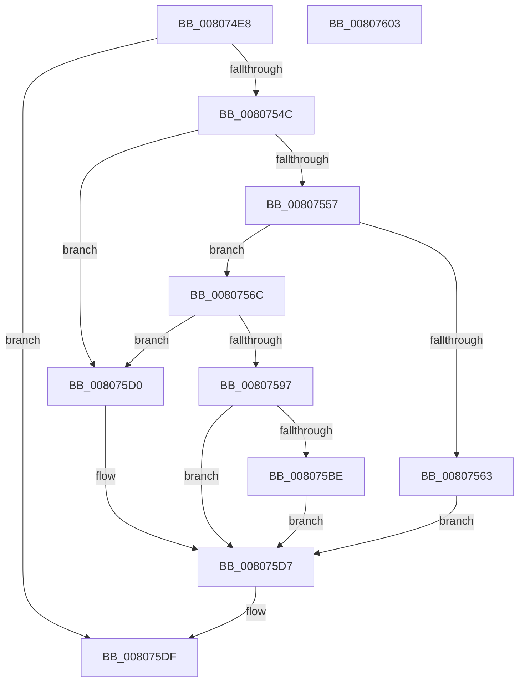

# MmPrepareImagePagesForHotPatch

- RVA: `0x008074E8`–`0x00807604` (길이 `284` bytes)
- VA: `0x00000001408074E8`
- 실행 섹션: `PAGE`
- PDB 이름 있음: `예`; PDB Function 태그: `아니요`
- unwind 정보 RVA: `0x000D8670`
- 디코드: `80`개 명령, `284/284` bytes 표시
- 미해석 바이트: `0` (있으면 어셈블리에 `.byte`로 보존)

> 이 문서는 커널 이미지의 기계어와 PDB 기호를 분석해 생성했습니다. 4번과 5번은 함수 원형과 자료형을 바이너리 사용 방식에서 추정한 C 해석이며 원본 소스 복구 결과는 아닙니다.

## 1. Dependencies

- 직접 호출 지점: **8**; 고유 호출 대상: **7**
- 직접 호출자로 확인된 함수: **1**
- RIP 상대 이미지 참조: **0**

### Outgoing calls
- `0x0080751B` → [memset](../../text/6C/memset_function_006C6C40.md) (function, `0x006C6C40`)
- `0x0080752D` → [MiInitializeImageHotPatchContext](../AD/MiInitializeImageHotPatchContext_function_00ADA2DC.md) (function, `0x00ADA2DC`)
- `0x0080753B` → [MiObtainReferencedVadEx](../../text/31/MiObtainReferencedVadEx_function_00316690.md) (function, `0x00316690`)
- `0x0080755A` → [MiImageVadHotPatchEligible](MiImageVadHotPatchEligible_function_00803FB8.md) (function, `0x00803FB8`)
- `0x008075A3` → [MiInitializeImageHotPatchContext](../AD/MiInitializeImageHotPatchContext_function_00ADA2DC.md) (function, `0x00ADA2DC`)
- `0x008075B2` → [MiPrepareImagePagesForHotPatch](../../text/68/MiPrepareImagePagesForHotPatch_function_00683800.md) (function, `0x00683800`)
- `0x008075DA` → [MiUnlockAndDereferenceVad](../../text/31/MiUnlockAndDereferenceVad_function_00316E60.md) (function, `0x00316E60`)
- `0x008075E3` → [MiReleaseHotPatchResources](../AC/MiReleaseHotPatchResources_function_00ACCD60.md) (function, `0x00ACCD60`)

### Direct callers
- [sub_006F88AE](../../text/6F/Unknown_function_006F88AE.md) at `0x006F8E6C`

### Static image references
- 디코드된 RIP-relative 메모리 참조가 없습니다.

## 2. Other-region calls and transfers

- 다른 실행 섹션으로 향하는 call: **4**
  - `0x0080751B` → [memset](../../text/6C/memset_function_006C6C40.md) (`PAGE` → `.text`)
  - `0x0080753B` → [MiObtainReferencedVadEx](../../text/31/MiObtainReferencedVadEx_function_00316690.md) (`PAGE` → `.text`)
  - `0x008075B2` → [MiPrepareImagePagesForHotPatch](../../text/68/MiPrepareImagePagesForHotPatch_function_00683800.md) (`PAGE` → `.text`)
  - `0x008075DA` → [MiUnlockAndDereferenceVad](../../text/31/MiUnlockAndDereferenceVad_function_00316E60.md) (`PAGE` → `.text`)
- 별도 외부 분기/꼬리 이동을 확인하지 못했습니다.

## 3. Assembly (complete function range)

```asm
008074E8  48 89 5C 24 08                  mov qword ptr [rsp + 8], rbx
008074ED  48 89 74 24 10                  mov qword ptr [rsp + 0x10], rsi
008074F2  55                              push rbp
008074F3  57                              push rdi
008074F4  41 56                           push r14
008074F6  48 8D 6C 24 B9                  lea rbp, [rsp - 0x47]
008074FB  48 81 EC C0 00 00 00            sub rsp, 0xc0
00807502  83 65 77 00                     and dword ptr [rbp + 0x77], 0
00807506  4D 8B F0                        mov r14, r8
00807509  48 8B F2                        mov rsi, rdx
0080750C  48 8B F9                        mov rdi, rcx
0080750F  33 D2                           xor edx, edx
00807511  48 8D 4D A7                     lea rcx, [rbp - 0x59]
00807515  41 B8 A0 00 00 00               mov r8d, 0xa0
0080751B  E8 20 F7 EB FF                  call 0x1406c6c40
00807520  49 83 26 00                     and qword ptr [r14], 0
00807524  48 8D 4D A7                     lea rcx, [rbp - 0x59]
00807528  33 D2                           xor edx, edx
0080752A  45 33 C0                        xor r8d, r8d
0080752D  E8 AA 2D 2D 00                  call 0x140ada2dc
00807532  4C 8D 45 77                     lea r8, [rbp + 0x77]
00807536  33 D2                           xor edx, edx
00807538  48 8B CF                        mov rcx, rdi
0080753B  E8 50 F1 B0 FF                  call 0x140316690
00807540  48 8B D8                        mov rbx, rax
00807543  48 85 C0                        test rax, rax
00807546  0F 84 93 00 00 00               je 0x1408075df
0080754C  8B 48 30                        mov ecx, dword ptr [rax + 0x30]
0080754F  80 E1 70                        and cl, 0x70
00807552  80 F9 20                        cmp cl, 0x20
00807555  75 79                           jne 0x1408075d0
00807557  48 8B C8                        mov rcx, rax
0080755A  E8 59 CA FF FF                  call 0x140803fb8
0080755F  85 C0                           test eax, eax
00807561  75 09                           jne 0x14080756c
00807563  C7 45 77 BB 00 00 C0            mov dword ptr [rbp + 0x77], 0xc00000bb
0080756A  EB 6B                           jmp 0x1408075d7
0080756C  8B 43 1C                        mov eax, dword ptr [rbx + 0x1c]
0080756F  0F B6 4B 21                     movzx ecx, byte ptr [rbx + 0x21]
00807573  48 C1 E1 20                     shl rcx, 0x20
00807577  48 0B C8                        or rcx, rax
0080757A  48 8B C6                        mov rax, rsi
0080757D  48 C1 E0 0C                     shl rax, 0xc
00807581  48 FF C8                        dec rax
00807584  48 C1 E1 0C                     shl rcx, 0xc
00807588  48 03 C7                        add rax, rdi
0080758B  48 81 C9 FF 0F 00 00            or rcx, 0xfff
00807592  48 3B C8                        cmp rcx, rax
00807595  72 39                           jb 0x1408075d0
00807597  BA 64 86 00 00                  mov edx, 0x8664
0080759C  48 8D 4D A7                     lea rcx, [rbp - 0x59]
008075A0  4C 8B C3                        mov r8, rbx
008075A3  E8 34 2D 2D 00                  call 0x140ada2dc
008075A8  4C 8B C6                        mov r8, rsi
008075AB  48 8D 4D A7                     lea rcx, [rbp - 0x59]
008075AF  48 8B D7                        mov rdx, rdi
008075B2  E8 49 C2 E7 FF                  call 0x140683800
008075B7  89 45 77                        mov dword ptr [rbp + 0x77], eax
008075BA  85 C0                           test eax, eax
008075BC  78 19                           js 0x1408075d7
008075BE  48 8B 45 DF                     mov rax, qword ptr [rbp - 0x21]
008075C2  48 83 65 DF 00                  and qword ptr [rbp - 0x21], 0
008075C7  83 65 77 00                     and dword ptr [rbp + 0x77], 0
008075CB  49 89 06                        mov qword ptr [r14], rax
008075CE  EB 07                           jmp 0x1408075d7
008075D0  C7 45 77 18 00 00 C0            mov dword ptr [rbp + 0x77], 0xc0000018
008075D7  48 8B CB                        mov rcx, rbx
008075DA  E8 81 F8 B0 FF                  call 0x140316e60
008075DF  48 8D 4D A7                     lea rcx, [rbp - 0x59]
008075E3  E8 78 57 2C 00                  call 0x140accd60
008075E8  8B 45 77                        mov eax, dword ptr [rbp + 0x77]
008075EB  4C 8D 9C 24 C0 00 00 00         lea r11, [rsp + 0xc0]
008075F3  49 8B 5B 20                     mov rbx, qword ptr [r11 + 0x20]
008075F7  49 8B 73 28                     mov rsi, qword ptr [r11 + 0x28]
008075FB  49 8B E3                        mov rsp, r11
008075FE  41 5E                           pop r14
00807600  5F                              pop rdi
00807601  5D                              pop rbp
00807602  C3                              ret
00807603  CC                              int3
```

## 4. C-style interpretation (structured pseudocode)

```c
__int64 __fastcall MmPrepareImagePagesForHotPatch(__int64 a1, __int64 a2, __int64 a3)
{
    __int64 result;
    __int64 v_rsp;
    unsigned __int64 v_stack_m18;
    unsigned __int64 v_stack_m5F;
    unsigned __int64 v_stack_m80;
    unsigned __int64 v_stack_mB8;
    unsigned __int64 v_stack_p10;
    unsigned int v_stack_p18;
    unsigned __int64 v_stack_p8;

    v_stack_p8 = v_rbx;
    v_stack_p10 = v_rsi;
    v_rsp = (v_rsp) - (192);
    a2 = 0;
    result = memset(v_stack_mB8, a2, 160, a4);
    a2 = 0;
    a3 = 0;
    result = MiInitializeImageHotPatchContext(v_stack_mB8, a2, a3, a4);
    a2 = 0;
    result = MiObtainReferencedVadEx(a1, a2, v_stack_p18, a4);
    if (result == 0) goto loc_008075DF;
    a1 = (unsigned __int8)(((unsigned int)(*(unsigned int *)(result + 48))) & (112));
    if (((unsigned __int8)(a1)) != 32) goto loc_008075D0;
    result = MiImageVadHotPatchEligible(result, a2, v_stack_p18, a4);
    if ((unsigned int)(result) != 0) goto loc_0080756C;
    v_stack_p18 = 0xC00000BBULL;
    goto loc_008075D7;
loc_0080756C:
    a1 = (*(unsigned __int8 *)(result + 33)) << (32);
    a1 = (a1) | ((unsigned int)(*(unsigned int *)(result + 28)));
    result = (0) << (12);
    result = (result) - 1;
    a1 = (a1) << (12);
    result = (result) + (a1);
    a1 = (a1) | (0xFFFULL);
    if (a1 < result) goto loc_008075D0;
    result = MiInitializeImageHotPatchContext(v_stack_mB8, (unsigned int)(0x8664ULL), result, a4);
    result = MiPrepareImagePagesForHotPatch(v_stack_mB8, a1, 0, a4);
    v_stack_p18 = (unsigned int)(result);
    if (sign_flag) goto loc_008075D7;
    *(unsigned __int64 *)(a3) = v_stack_m80;
    goto loc_008075D7;
loc_008075D0:
    v_stack_p18 = 0xC0000018ULL;
loc_008075D7:
    result = MiUnlockAndDereferenceVad(result, a1, 0, a4);
loc_008075DF:
    result = MiReleaseHotPatchResources(v_stack_mB8, a1, 0, a4);
    return (unsigned int)(v_stack_p18);
}
```

## 5. (Beta) C Style

```c
int64_t MmPrepareImagePagesForHotPatch(int64_t Arg1, int64_t Arg2, void *Arg3)
{
    uint8_t *arg3 = (uint8_t *)Arg3;

    int64_t result;
    int64_t local_rsp;
    uint64_t v_stack_m18;
    uint64_t v_stack_m5F;
    uint64_t v_stack_m80;
    uint64_t v_stack_mB8;
    uint64_t v_stack_p10;
    uint32_t v_stack_p18;
    uint64_t v_stack_p8;

    v_stack_p8 = local_rbx;
    v_stack_p10 = local_rsi;
    local_rsp = (local_rsp) - (192);
    Arg2 = 0;
    result = memset(v_stack_mB8, Arg2, 160, a4);
    Arg2 = 0;
    Arg3 = 0;
    result = MiInitializeImageHotPatchContext(v_stack_mB8, Arg2, Arg3, a4);
    Arg2 = 0;
    result = MiObtainReferencedVadEx(Arg1, Arg2, v_stack_p18, a4);
    if (result == 0) goto loc_008075DF;
    Arg1 = (uint8_t)(((uint32_t)(*(uint32_t *)(result + 0x30))) & (112));
    if (((uint8_t)(Arg1)) != 32) goto loc_008075D0;
    result = MiImageVadHotPatchEligible(result, Arg2, v_stack_p18, a4);
    if ((uint32_t)(result) != 0) goto loc_0080756C;
    v_stack_p18 = 0xC00000BBULL;
    goto loc_008075D7;
loc_0080756C:
    Arg1 = (*(uint8_t *)(result + 0x21)) << (32);
    Arg1 = (Arg1) | ((uint32_t)(*(uint32_t *)(result + 0x1C)));
    result = (0) << (12);
    result = (result) - 1;
    Arg1 = (Arg1) << (12);
    result = (result) + (Arg1);
    Arg1 = (Arg1) | (0xFFFULL);
    if (Arg1 < result) goto loc_008075D0;
    result = MiInitializeImageHotPatchContext(v_stack_mB8, (uint32_t)(0x8664ULL), result, a4);
    result = MiPrepareImagePagesForHotPatch(v_stack_mB8, Arg1, 0, a4);
    v_stack_p18 = (uint32_t)(result);
    if (sign_flag) goto loc_008075D7;
    *(uint64_t *)(arg3) = v_stack_m80;
    goto loc_008075D7;
loc_008075D0:
    v_stack_p18 = 0xC0000018ULL;
loc_008075D7:
    result = MiUnlockAndDereferenceVad(result, Arg1, 0, a4);
loc_008075DF:
    result = MiReleaseHotPatchResources(v_stack_mB8, Arg1, 0, a4);
    return (uint32_t)(v_stack_p18);
}
```

### 관측된 메모리 오프셋

구조체 형식이 확인되지 않은 접근은 인자 기준의 오프셋으로만 기록했습니다.

| 기준 인자 | 오프셋 표현 | 폭 (bit) | 접근 |
|---|---:|---:|---|
| `Arg3` | `+ 0x0` | `64` | `R/W` |
| `Arg3` | `+ 0x0` | `64` | `W` |

## 6. Execution-region graph

[열기: 2D/3D 그래프와 함수 탐색 컨트롤 패널](../../../control-panel.html?section=page&rva=0x008074E8&view=graph)

- 2D 그래프는 위에서 아래로 흐르고, 3D 그래프는 빈 공간을 드래그해 회전합니다. Shift+드래그는 이동, 휠은 확대·축소, 함수 노드 선택은 대상 보고서 이동입니다.

### Static fallback


