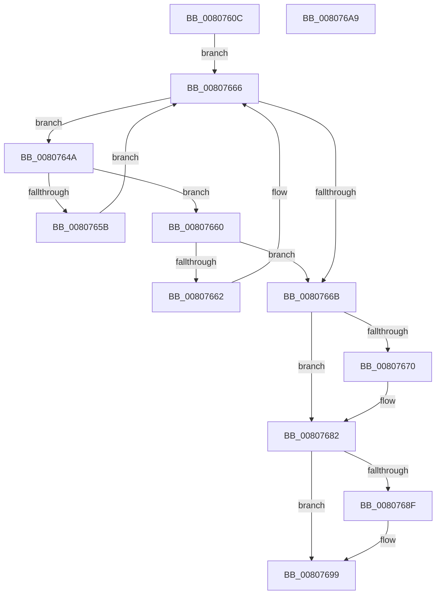

# MmRemoveSecureImageActivePatch

- RVA: `0x0080760C`–`0x008076AA` (길이 `158` bytes)
- VA: `0x000000014080760C`
- 실행 섹션: `PAGE`
- PDB 이름 있음: `예`; PDB Function 태그: `아니요`
- unwind 정보 RVA: `0x000D0050`
- 디코드: `47`개 명령, `158/158` bytes 표시
- 미해석 바이트: `0` (있으면 어셈블리에 `.byte`로 보존)

> 이 문서는 커널 이미지의 기계어와 PDB 기호를 분석해 생성했습니다. 4번과 5번은 함수 원형과 자료형을 바이너리 사용 방식에서 추정한 C 해석이며 원본 소스 복구 결과는 아닙니다.

## 1. Dependencies

- 직접 호출 지점: **6**; 고유 호출 대상: **6**
- 직접 호출자로 확인된 함수: **1**
- RIP 상대 이미지 참조: **1**

### Outgoing calls
- `0x0080762A` → [memset](../../text/6C/memset_function_006C6C40.md) (function, `0x006C6C40`)
- `0x00807639` → [MmAcquireLoadLock](../../text/4D/MmAcquireLoadLock_function_004DC2A0.md) (function, `0x004DC2A0`)
- `0x00807652` → [MiCompareHotPatchNodes](MiCompareHotPatchNodes_function_00803114.md) (function, `0x00803114`)
- `0x0080767D` → [RtlAvlRemoveNode](../../text/29/RtlAvlRemoveNode_function_00296650.md) (function, `0x00296650`)
- `0x00807685` → [MmReleaseLoadLock](../../text/4D/MmReleaseLoadLock_function_004D36D0.md) (function, `0x004D36D0`)
- `0x00807694` → [ExFreePoolWithTag](../../poolcode/B8/ExFreePoolWithTag_function_00B82870.md) (function, `0x00B82870`)

### Direct callers
- [sub_006F88AE](../../text/6F/Unknown_function_006F88AE.md) at `0x006F902E`

### Static image references
- `0x0080763E` → RVA `0x00E37588` (`.data`; read)

## 2. Other-region calls and transfers

- 다른 실행 섹션으로 향하는 call: **5**
  - `0x0080762A` → [memset](../../text/6C/memset_function_006C6C40.md) (`PAGE` → `.text`)
  - `0x00807639` → [MmAcquireLoadLock](../../text/4D/MmAcquireLoadLock_function_004DC2A0.md) (`PAGE` → `.text`)
  - `0x0080767D` → [RtlAvlRemoveNode](../../text/29/RtlAvlRemoveNode_function_00296650.md) (`PAGE` → `.text`)
  - `0x00807685` → [MmReleaseLoadLock](../../text/4D/MmReleaseLoadLock_function_004D36D0.md) (`PAGE` → `.text`)
  - `0x00807694` → [ExFreePoolWithTag](../../poolcode/B8/ExFreePoolWithTag_function_00B82870.md) (`PAGE` → `POOLCODE`)
- 별도 외부 분기/꼬리 이동을 확인하지 못했습니다.

## 3. Assembly (complete function range)

```asm
0080760C  48 89 5C 24 08                  mov qword ptr [rsp + 8], rbx
00807611  48 89 74 24 10                  mov qword ptr [rsp + 0x10], rsi
00807616  57                              push rdi
00807617  48 83 EC 60                     sub rsp, 0x60
0080761B  8B FA                           mov edi, edx
0080761D  8B D9                           mov ebx, ecx
0080761F  33 D2                           xor edx, edx
00807621  48 8D 4C 24 20                  lea rcx, [rsp + 0x20]
00807626  44 8D 42 40                     lea r8d, [rdx + 0x40]
0080762A  E8 11 F6 EB FF                  call 0x1406c6c40
0080762F  33 F6                           xor esi, esi
00807631  89 5C 24 38                     mov dword ptr [rsp + 0x38], ebx
00807635  89 7C 24 3C                     mov dword ptr [rsp + 0x3c], edi
00807639  E8 62 4C CD FF                  call 0x1404dc2a0
0080763E  48 8B 1D 43 FF 62 00            mov rbx, qword ptr [rip + 0x62ff43]
00807645  48 8B F8                        mov rdi, rax
00807648  EB 1C                           jmp 0x140807666
0080764A  48 8B D3                        mov rdx, rbx
0080764D  48 8D 4C 24 20                  lea rcx, [rsp + 0x20]
00807652  E8 BD BA FF FF                  call 0x140803114
00807657  85 C0                           test eax, eax
00807659  79 05                           jns 0x140807660
0080765B  48 8B 1B                        mov rbx, qword ptr [rbx]
0080765E  EB 06                           jmp 0x140807666
00807660  7E 09                           jle 0x14080766b
00807662  48 8B 5B 08                     mov rbx, qword ptr [rbx + 8]
00807666  48 85 DB                        test rbx, rbx
00807669  75 DF                           jne 0x14080764a
0080766B  48 85 DB                        test rbx, rbx
0080766E  74 12                           je 0x140807682
00807670  48 8B D3                        mov rdx, rbx
00807673  48 8D 0D 0E FF 62 00            lea rcx, [rip + 0x62ff0e]
0080767A  48 8B F3                        mov rsi, rbx
0080767D  E8 CE EF A8 FF                  call 0x140296650
00807682  48 8B CF                        mov rcx, rdi
00807685  E8 46 C0 CC FF                  call 0x1404d36d0
0080768A  48 85 F6                        test rsi, rsi
0080768D  74 0A                           je 0x140807699
0080768F  33 D2                           xor edx, edx
00807691  48 8B CE                        mov rcx, rsi
00807694  E8 D7 B1 37 00                  call 0x140b82870
00807699  48 8B 5C 24 70                  mov rbx, qword ptr [rsp + 0x70]
0080769E  48 8B 74 24 78                  mov rsi, qword ptr [rsp + 0x78]
008076A3  48 83 C4 60                     add rsp, 0x60
008076A7  5F                              pop rdi
008076A8  C3                              ret
008076A9  CC                              int3
```

## 4. C-style interpretation (structured pseudocode)

```c
__int64 __fastcall MmRemoveSecureImageActivePatch(int a1, int a2)
{
    __int64 result;
    __int64 v_rsi;
    __int64 v_rsp;
    unsigned int v_stack_m2C;
    unsigned int v_stack_m30;
    unsigned __int64 v_stack_m48;
    unsigned __int64 v_stack_p10;
    unsigned __int64 v_stack_p8;

    v_stack_p8 = v_rbx;
    v_stack_p10 = v_rsi;
    v_rsp = (v_rsp) - (96);
    a2 = 0;
    result = memset(v_stack_m48, a2, a2 + 64, a4);
    v_rsi = 0;
    v_stack_m30 = (unsigned int)((unsigned int)(a1));
    v_stack_m2C = (unsigned int)((unsigned int)(a2));
    result = MmAcquireLoadLock(v_stack_m48, a2, a2 + 64, a4);
    goto loc_00807666;
loc_0080764A:
    result = MiCompareHotPatchNodes(v_stack_m48, *(unsigned __int64 *)(v_rip + 6487875), a2 + 64, a4);
    if (!sign_flag) goto loc_00807660;
    goto loc_00807666;
loc_00807660:
    if (condition_is_less_or_equal) goto loc_0080766B;
loc_00807666:
    if (*(unsigned __int64 *)(*(unsigned __int64 *)(*(unsigned __int64 *)(v_rip + 6487875)) + 8) != 0) goto loc_0080764A;
loc_0080766B:
    if (*(unsigned __int64 *)(*(unsigned __int64 *)(*(unsigned __int64 *)(v_rip + 6487875)) + 8) != 0) {
        a2 = *(unsigned __int64 *)(*(unsigned __int64 *)(*(unsigned __int64 *)(v_rip + 6487875)) + 8);
        a1 = v_rip + 6487822;
        v_rsi = *(unsigned __int64 *)(*(unsigned __int64 *)(*(unsigned __int64 *)(v_rip + 6487875)) + 8);
        result = RtlAvlRemoveNode(a1, a2, a2 + 64, a4);
    }
    result = MmReleaseLoadLock(result, a2, a2 + 64, a4);
    if (v_rsi != 0) {
        a2 = 0;
        a1 = v_rsi;
        result = ExFreePoolWithTag(a1, a2, a2 + 64, a4);
    }
    v_rsp = (v_rsp) + (96);
    return result;
}
```

## 5. (Beta) C Style

```c
int64_t MmRemoveSecureImageActivePatch(int32_t Arg1, int32_t Arg2)
{
    int64_t result;
    int64_t local_rsi;
    int64_t local_rsp;
    uint32_t v_stack_m2C;
    uint32_t v_stack_m30;
    uint64_t v_stack_m48;
    uint64_t v_stack_p10;
    uint64_t v_stack_p8;

    v_stack_p8 = local_rbx;
    v_stack_p10 = local_rsi;
    local_rsp = (local_rsp) - (96);
    Arg2 = 0;
    result = memset(v_stack_m48, Arg2, Arg2 + 64, a4);
    local_rsi = 0;
    v_stack_m30 = (uint32_t)((uint32_t)(Arg1));
    v_stack_m2C = (uint32_t)((uint32_t)(Arg2));
    result = MmAcquireLoadLock(v_stack_m48, Arg2, Arg2 + 64, a4);
    goto loc_00807666;
loc_0080764A:
    result = MiCompareHotPatchNodes(v_stack_m48, *(uint64_t *)(v_rip + 0x62FF43), Arg2 + 64, a4);
    if (!sign_flag) goto loc_00807660;
    goto loc_00807666;
loc_00807660:
    if (condition_is_less_or_equal) goto loc_0080766B;
loc_00807666:
    if (*(uint64_t *)(*(uint64_t *)(*(uint64_t *)(v_rip + 0x62FF43)) + 0x8) != 0) goto loc_0080764A;
loc_0080766B:
    if (*(uint64_t *)(*(uint64_t *)(*(uint64_t *)(v_rip + 0x62FF43)) + 0x8) != 0) {
        Arg2 = *(uint64_t *)(*(uint64_t *)(*(uint64_t *)(v_rip + 0x62FF43)) + 0x8);
        Arg1 = v_rip + 6487822;
        local_rsi = *(uint64_t *)(*(uint64_t *)(*(uint64_t *)(v_rip + 0x62FF43)) + 0x8);
        result = RtlAvlRemoveNode(Arg1, Arg2, Arg2 + 64, a4);
    }
    result = MmReleaseLoadLock(result, Arg2, Arg2 + 64, a4);
    if (local_rsi != 0) {
        Arg2 = 0;
        Arg1 = local_rsi;
        result = ExFreePoolWithTag(Arg1, Arg2, Arg2 + 64, a4);
    }
    local_rsp = (local_rsp) + (96);
    return result;
}
```

## 6. Execution-region graph

[열기: 2D/3D 그래프와 함수 탐색 컨트롤 패널](../../../control-panel.html?section=page&rva=0x0080760C&view=graph)

- 2D 그래프는 위에서 아래로 흐르고, 3D 그래프는 빈 공간을 드래그해 회전합니다. Shift+드래그는 이동, 휠은 확대·축소, 함수 노드 선택은 대상 보고서 이동입니다.

### Static fallback


