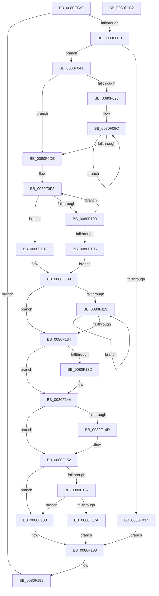

# MmScrubMemory

- RVA: `0x0080EFA0`–`0x0080F1B3` (길이 `531` bytes)
- VA: `0x000000014080EFA0`
- 실행 섹션: `PAGE`
- PDB 이름 있음: `예`; PDB Function 태그: `아니요`
- unwind 정보 RVA: `0x000D9318`
- 디코드: `139`개 명령, `531/531` bytes 표시
- 미해석 바이트: `0` (있으면 어셈블리에 `.byte`로 보존)

> 이 문서는 커널 이미지의 기계어와 PDB 기호를 분석해 생성했습니다. 4번과 5번은 함수 원형과 자료형을 바이너리 사용 방식에서 추정한 C 해석이며 원본 소스 복구 결과는 아닙니다.

## 1. Dependencies

- 직접 호출 지점: **12**; 고유 호출 대상: **10**
- 직접 호출자로 확인된 함수: **1**
- RIP 상대 이미지 참조: **6**

### Outgoing calls
- `0x0080F000` → [ObpReferenceObjectByHandleWithTag](../86/ObpReferenceObjectByHandleWithTag_function_00869650.md) (function, `0x00869650`)
- `0x0080F02A` → [MiAllocatePool](../../text/35/MiAllocatePool_function_0035B540.md) (function, `0x0035B540`)
- `0x0080F049` → [KeInitializeGate](../../text/49/KeInitializeGate_function_004953F8.md) (function, `0x004953F8`)
- `0x0080F065` → [MiReferenceNonPagedMemoryProcessList](MiReferenceNonPagedMemoryProcessList_function_0080EAF8.md) (function, `0x0080EAF8`)
- `0x0080F085` → [MiReferencePageRuns](../../text/37/MiReferencePageRuns_function_00379540.md) (function, `0x00379540`)
- `0x0080F0C8` → [ExQueueWorkItemToPartition](../../text/35/ExQueueWorkItemToPartition_function_00356E2C.md) (function, `0x00356E2C`)
- `0x0080F0E9` → [KeWaitForGate](../../text/2C/KeWaitForGate_function_002CA794.md) (function, `0x002CA794`)
- `0x0080F126` → [ObfDereferenceObjectWithTag](../../text/2F/ObfDereferenceObjectWithTag_function_002F78E0.md) (function, `0x002F78E0`)
- `0x0080F13F` → [ExFreePoolWithTag](../../poolcode/B8/ExFreePoolWithTag_function_00B82870.md) (function, `0x00B82870`)
- `0x0080F14D` → [MiDereferencePageRuns](../../text/3B/MiDereferencePageRuns_function_003BD388.md) (function, `0x003BD388`)
- `0x0080F157` → [ExFreePoolWithTag](../../poolcode/B8/ExFreePoolWithTag_function_00B82870.md) (function, `0x00B82870`)
- `0x0080F192` → [ObfDereferenceObjectWithTag](../../text/2F/ObfDereferenceObjectWithTag_function_002F78E0.md) (function, `0x002F78E0`)

### Direct callers
- [NtSetSystemInformation](../AF/NtSetSystemInformation_function_00AF4A60.md) at `0x00AF5C60`

### Static image references
- `0x0080EFDD` → RVA `0x00FC6B80` (`ALMOSTRO`; read)
- `0x0080F00D` → RVA `0x00FC5000` (`ALMOSTRO`; read)
- `0x0080F04E` → RVA `0x00E38D00` (`.data`; read)
- `0x0080F09F` → RVA `0x0080EE00` (`MiScrubMemoryWorker`; read)
- `0x0080F0C1` → RVA `0x00E38DB8` (`.data`; read)
- `0x0080F17A` → RVA `0x00E302A0` (`.data`; read/write)

## 2. Other-region calls and transfers

- 다른 실행 섹션으로 향하는 call: **10**
  - `0x0080F02A` → [MiAllocatePool](../../text/35/MiAllocatePool_function_0035B540.md) (`PAGE` → `.text`)
  - `0x0080F049` → [KeInitializeGate](../../text/49/KeInitializeGate_function_004953F8.md) (`PAGE` → `.text`)
  - `0x0080F085` → [MiReferencePageRuns](../../text/37/MiReferencePageRuns_function_00379540.md) (`PAGE` → `.text`)
  - `0x0080F0C8` → [ExQueueWorkItemToPartition](../../text/35/ExQueueWorkItemToPartition_function_00356E2C.md) (`PAGE` → `.text`)
  - `0x0080F0E9` → [KeWaitForGate](../../text/2C/KeWaitForGate_function_002CA794.md) (`PAGE` → `.text`)
  - `0x0080F126` → [ObfDereferenceObjectWithTag](../../text/2F/ObfDereferenceObjectWithTag_function_002F78E0.md) (`PAGE` → `.text`)
  - `0x0080F13F` → [ExFreePoolWithTag](../../poolcode/B8/ExFreePoolWithTag_function_00B82870.md) (`PAGE` → `POOLCODE`)
  - `0x0080F14D` → [MiDereferencePageRuns](../../text/3B/MiDereferencePageRuns_function_003BD388.md) (`PAGE` → `.text`)
  - `0x0080F157` → [ExFreePoolWithTag](../../poolcode/B8/ExFreePoolWithTag_function_00B82870.md) (`PAGE` → `POOLCODE`)
  - `0x0080F192` → [ObfDereferenceObjectWithTag](../../text/2F/ObfDereferenceObjectWithTag_function_002F78E0.md) (`PAGE` → `.text`)
- 별도 외부 분기/꼬리 이동을 확인하지 못했습니다.

## 3. Assembly (complete function range)

```asm
0080EFA0  4C 8B DC                        mov r11, rsp
0080EFA3  49 89 5B 10                     mov qword ptr [r11 + 0x10], rbx
0080EFA7  49 89 6B 18                     mov qword ptr [r11 + 0x18], rbp
0080EFAB  49 89 4B 08                     mov qword ptr [r11 + 8], rcx
0080EFAF  56                              push rsi
0080EFB0  57                              push rdi
0080EFB1  41 54                           push r12
0080EFB3  41 56                           push r14
0080EFB5  41 57                           push r15
0080EFB7  48 83 EC 40                     sub rsp, 0x40
0080EFBB  49 83 20 00                     and qword ptr [r8], 0
0080EFBF  49 8B E8                        mov rbp, r8
0080EFC2  65 48 8B 04 25 88 01 00 00      mov rax, qword ptr gs:[0x188]
0080EFCB  48 8B CA                        mov rcx, rdx
0080EFCE  49 83 63 D0 00                  and qword ptr [r11 - 0x30], 0
0080EFD3  BA 01 00 00 00                  mov edx, 1
0080EFD8  49 83 63 C8 00                  and qword ptr [r11 - 0x38], 0
0080EFDD  4C 8B 05 9C 7B 7B 00            mov r8, qword ptr [rip + 0x7b7b9c]
0080EFE4  44 8A 88 32 02 00 00            mov r9b, byte ptr [rax + 0x232]
0080EFEB  49 8D 43 08                     lea rax, [r11 + 8]
0080EFEF  49 83 63 08 00                  and qword ptr [r11 + 8], 0
0080EFF4  49 89 43 C0                     mov qword ptr [r11 - 0x40], rax
0080EFF8  C7 44 24 20 4D 6D 50 72         mov dword ptr [rsp + 0x20], 0x72506d4d
0080F000  E8 4B A6 05 00                  call 0x140869650
0080F005  85 C0                           test eax, eax
0080F007  0F 88 8C 01 00 00               js 0x14080f199
0080F00D  0F B7 3D EC 5F 7B 00            movzx edi, word ptr [rip + 0x7b5fec]
0080F014  B9 40 00 00 00                  mov ecx, 0x40
0080F019  48 69 D7 C8 00 00 00            imul rdx, rdi, 0xc8
0080F020  41 B8 4D 45 63 63               mov r8d, 0x6363454d
0080F026  48 83 C2 58                     add rdx, 0x58
0080F02A  E8 11 C5 B4 FF                  call 0x14035b540
0080F02F  48 8B F0                        mov rsi, rax
0080F032  48 85 C0                        test rax, rax
0080F035  75 0A                           jne 0x14080f041
0080F037  BF 9A 00 00 C0                  mov edi, 0xc000009a
0080F03C  E9 47 01 00 00                  jmp 0x14080f188
0080F041  33 D2                           xor edx, edx
0080F043  89 38                           mov dword ptr [rax], edi
0080F045  48 8D 48 08                     lea rcx, [rax + 8]
0080F049  E8 AA 63 C8 FF                  call 0x1404953f8
0080F04E  48 8D 05 AB 9C 62 00            lea rax, [rip + 0x629cab]
0080F055  48 8B CE                        mov rcx, rsi
0080F058  48 89 46 30                     mov qword ptr [rsi + 0x30], rax
0080F05C  48 8B 44 24 70                  mov rax, qword ptr [rsp + 0x70]
0080F061  48 89 46 20                     mov qword ptr [rsi + 0x20], rax
0080F065  E8 8E FA FF FF                  call 0x14080eaf8
0080F06A  65 48 8B 04 25 88 01 00 00      mov rax, qword ptr gs:[0x188]
0080F073  BA 01 00 00 00                  mov edx, 1
0080F078  48 8B 4E 30                     mov rcx, qword ptr [rsi + 0x30]
0080F07C  48 83 66 28 00                  and qword ptr [rsi + 0x28], 0
0080F081  48 89 46 38                     mov qword ptr [rsi + 0x38], rax
0080F085  E8 B6 A4 B6 FF                  call 0x140379540
0080F08A  33 DB                           xor ebx, ebx
0080F08C  48 89 46 50                     mov qword ptr [rsi + 0x50], rax
0080F090  4C 8D 7E 58                     lea r15, [rsi + 0x58]
0080F094  85 FF                           test edi, edi
0080F096  74 46                           je 0x14080f0de
0080F098  4D 8D 77 28                     lea r14, [r15 + 0x28]
0080F09C  49 89 37                        mov qword ptr [r15], rsi
0080F09F  48 8D 05 5A FD FF FF            lea rax, [rip - 0x2a6]
0080F0A6  41 89 5E E0                     mov dword ptr [r14 - 0x20], ebx
0080F0AA  49 8D 4E E8                     lea rcx, [r14 - 0x18]
0080F0AE  48 83 21 00                     and qword ptr [rcx], 0
0080F0B2  44 8B C3                        mov r8d, ebx
0080F0B5  49 89 46 F8                     mov qword ptr [r14 - 8], rax
0080F0B9  BA 04 00 00 00                  mov edx, 4
0080F0BE  4D 89 3E                        mov qword ptr [r14], r15
0080F0C1  4C 8B 0D F0 9C 62 00            mov r9, qword ptr [rip + 0x629cf0]
0080F0C8  E8 5F 7D B4 FF                  call 0x140356e2c
0080F0CD  B8 C8 00 00 00                  mov eax, 0xc8
0080F0D2  FF C3                           inc ebx
0080F0D4  4C 03 F8                        add r15, rax
0080F0D7  4C 03 F0                        add r14, rax
0080F0DA  3B DF                           cmp ebx, edi
0080F0DC  72 BE                           jb 0x14080f09c
0080F0DE  45 33 C0                        xor r8d, r8d
0080F0E1  48 8D 4E 08                     lea rcx, [rsi + 8]
0080F0E5  33 D2                           xor edx, edx
0080F0E7  33 FF                           xor edi, edi
0080F0E9  E8 A6 B6 AB FF                  call 0x1402ca794
0080F0EE  49 83 C7 0C                     add r15, 0xc
0080F0F2  4D 8D BF 38 FF FF FF            lea r15, [r15 - 0xc8]
0080F0F9  41 8B 07                        mov eax, dword ptr [r15]
0080F0FC  85 C0                           test eax, eax
0080F0FE  78 07                           js 0x14080f107
0080F100  83 C3 FF                        add ebx, -1
0080F103  75 ED                           jne 0x14080f0f2
0080F105  EB 02                           jmp 0x14080f109
0080F107  8B F8                           mov edi, eax
0080F109  48 8B 46 28                     mov rax, qword ptr [rsi + 0x28]
0080F10D  33 DB                           xor ebx, ebx
0080F10F  48 89 45 00                     mov qword ptr [rbp], rax
0080F113  48 39 5E 40                     cmp qword ptr [rsi + 0x40], rbx
0080F117  76 1B                           jbe 0x14080f134
0080F119  48 8B 4E 48                     mov rcx, qword ptr [rsi + 0x48]
0080F11D  BA 4D 6D 50 72                  mov edx, 0x72506d4d
0080F122  48 8B 0C D9                     mov rcx, qword ptr [rcx + rbx*8]
0080F126  E8 B5 87 AE FF                  call 0x1402f78e0
0080F12B  48 FF C3                        inc rbx
0080F12E  48 3B 5E 40                     cmp rbx, qword ptr [rsi + 0x40]
0080F132  72 E5                           jb 0x14080f119
0080F134  48 8B 4E 48                     mov rcx, qword ptr [rsi + 0x48]
0080F138  48 85 C9                        test rcx, rcx
0080F13B  74 07                           je 0x14080f144
0080F13D  33 D2                           xor edx, edx
0080F13F  E8 2C 37 37 00                  call 0x140b82870
0080F144  48 8B 4E 50                     mov rcx, qword ptr [rsi + 0x50]
0080F148  48 85 C9                        test rcx, rcx
0080F14B  74 05                           je 0x14080f152
0080F14D  E8 36 E2 BA FF                  call 0x1403bd388
0080F152  33 D2                           xor edx, edx
0080F154  48 8B CE                        mov rcx, rsi
0080F157  E8 14 37 37 00                  call 0x140b82870
0080F15C  48 8B 44 24 70                  mov rax, qword ptr [rsp + 0x70]
0080F161  83 78 04 00                     cmp dword ptr [rax + 4], 0
0080F165  75 1C                           jne 0x14080f183
0080F167  65 48 8B 04 25 88 01 00 00      mov rax, qword ptr gs:[0x188]
0080F170  8B 80 A0 05 00 00               mov eax, dword ptr [rax + 0x5a0]
0080F176  A8 01                           test al, 1
0080F178  75 09                           jne 0x14080f183
0080F17A  F0 FF 05 1F 11 62 00            lock inc dword ptr [rip + 0x62111f]
0080F181  EB 05                           jmp 0x14080f188
0080F183  BF 40 02 00 C0                  mov edi, 0xc0000240
0080F188  48 8B 4C 24 70                  mov rcx, qword ptr [rsp + 0x70]
0080F18D  BA 4D 6D 50 72                  mov edx, 0x72506d4d
0080F192  E8 49 87 AE FF                  call 0x1402f78e0
0080F197  8B C7                           mov eax, edi
0080F199  4C 8D 5C 24 40                  lea r11, [rsp + 0x40]
0080F19E  49 8B 5B 38                     mov rbx, qword ptr [r11 + 0x38]
0080F1A2  49 8B 6B 40                     mov rbp, qword ptr [r11 + 0x40]
0080F1A6  49 8B E3                        mov rsp, r11
0080F1A9  41 5F                           pop r15
0080F1AB  41 5E                           pop r14
0080F1AD  41 5C                           pop r12
0080F1AF  5F                              pop rdi
0080F1B0  5E                              pop rsi
0080F1B1  C3                              ret
0080F1B2  CC                              int3
```

## 4. C-style interpretation (structured pseudocode)

```c
__int64 __fastcall MmScrubMemory(__int64 a1, __int64 a2, __int64 a3)
{
    __int64 result;
    __int64 v_r14;
    __int64 v_r15;
    __int64 v_rbx;
    __int64 v_rdi;
    __int64 v_rsp;
    unsigned __int64 v_stack_m28;
    unsigned int v_stack_m48;
    unsigned __int64 v_stack_p8;

    *(unsigned __int64 *)(v_rsp + 16) = v_rbx;
    *(unsigned __int64 *)(v_rsp + 24) = v_rbp;
    *(unsigned __int64 *)(v_rsp + 8) = a1;
    v_rsp = (v_rsp) - (64);
    *(unsigned __int64 *)(v_rsp - 64) = v_rsp + 8;
    v_stack_m48 = 0x72506D4DULL;
    result = ObpReferenceObjectByHandleWithTag(a2, 1, *(unsigned __int64 *)(v_rip + 8092572), *(unsigned __int8 *)(*(unsigned __int64 *)(gs_base + (0 + 392)) + 562));
    if (sign_flag) goto loc_0080F199;
    a2 = (1) * (*(unsigned __int16 *)(v_rip + 8085484));
    a2 = (a2) + (88);
    result = MiAllocatePool(64, a2, (unsigned int)(0x6363454DULL), *(unsigned __int8 *)(*(unsigned __int64 *)(gs_base + (0 + 392)) + 562));
    if (result != 0) goto loc_0080F041;
    goto loc_0080F188;
loc_0080F041:
    a2 = 0;
    *(unsigned int *)(result) = (unsigned int)((unsigned int)(0xC000009AULL));
    result = KeInitializeGate(result + 8, a2, (unsigned int)(0x6363454DULL), *(unsigned __int8 *)(*(unsigned __int64 *)(gs_base + (0 + 392)) + 562));
    *(unsigned __int64 *)(result + 48) = v_rip + 6462635;
    *(unsigned __int64 *)(result + 32) = v_stack_p8;
    result = MiReferenceNonPagedMemoryProcessList(result, a2, (unsigned int)(0x6363454DULL), *(unsigned __int8 *)(*(unsigned __int64 *)(gs_base + (0 + 392)) + 562));
    *(unsigned __int64 *)(result + 56) = *(unsigned __int64 *)(gs_base + (0 + 392));
    result = MiReferencePageRuns(*(unsigned __int64 *)(result + 48), 1, (unsigned int)(0x6363454DULL), *(unsigned __int8 *)(*(unsigned __int64 *)(gs_base + (0 + 392)) + 562));
    v_rbx = 0;
    *(unsigned __int64 *)(result + 80) = result;
    if ((unsigned int)((unsigned int)(0xC000009AULL)) == 0) goto loc_0080F0DE;
loc_0080F09C:
    *(unsigned __int64 *)(result + 88) = result;
    *(unsigned int *)(result + 88 + 40 - 32) = 0;
    *(unsigned __int64 *)(result + 88 + 40 - 8) = v_rip - 678;
    *(unsigned __int64 *)(result + 88 + 40) = result + 88;
    result = ExQueueWorkItemToPartition(result + 88 + 40 - 24, 4, 0, *(unsigned __int64 *)(v_rip + 6462704));
    v_rbx = (unsigned int)((v_rbx) + 1);
    v_r15 = (result + 88) + (200);
    v_r14 = (result + 88 + 40) + (200);
    if (((unsigned int)(v_rbx)) < ((unsigned int)((unsigned int)(0xC000009AULL)))) goto loc_0080F09C;
loc_0080F0DE:
    a3 = 0;
    a2 = 0;
    v_rdi = 0;
    result = KeWaitForGate(result + 8, a2, a3, *(unsigned __int64 *)(v_rip + 6462704));
    v_r15 = (v_r15) + (12);
loc_0080F0F2:
    if (sign_flag) goto loc_0080F107;
    v_rbx = (unsigned int)((v_rbx) + (-1));
    if (condition_is_not_equal) goto loc_0080F0F2;
    goto loc_0080F109;
loc_0080F107:
loc_0080F109:
    v_rbx = 0;
    *(unsigned __int64 *)(a3) = *(unsigned __int64 *)(result + 40);
    if ((*(unsigned __int64 *)(result + 64)) <= 0) goto loc_0080F134;
loc_0080F119:
    result = ObfDereferenceObjectWithTag(*(unsigned __int64 *)(*(unsigned __int64 *)(result + 72) + v_rbx * 8), (unsigned int)(0x72506D4DULL), a3, *(unsigned __int64 *)(v_rip + 6462704));
    v_rbx = (v_rbx) + 1;
    if (v_rbx < (*(unsigned __int64 *)(result + 64))) goto loc_0080F119;
loc_0080F134:
    if (*(unsigned __int64 *)(result + 72) != 0) {
        a2 = 0;
        result = ExFreePoolWithTag(*(unsigned __int64 *)(result + 72), a2, a3, *(unsigned __int64 *)(v_rip + 6462704));
    }
    if (*(unsigned __int64 *)(result + 80) != 0) {
        result = MiDereferencePageRuns(*(unsigned __int64 *)(result + 80), a2, a3, *(unsigned __int64 *)(v_rip + 6462704));
    }
    a2 = 0;
    result = ExFreePoolWithTag(result, a2, a3, *(unsigned __int64 *)(v_rip + 6462704));
    if ((*(unsigned int *)(v_stack_p8 + 4)) != 0) goto loc_0080F183;
    if ((((unsigned __int8)((unsigned int)(*(unsigned int *)(*(unsigned __int64 *)(gs_base + (0 + 392)) + 1440)))) & (1)) != 0) goto loc_0080F183;
    goto loc_0080F188;
loc_0080F183:
loc_0080F188:
    result = ObfDereferenceObjectWithTag(v_stack_p8, (unsigned int)(0x72506D4DULL), a3, *(unsigned __int64 *)(v_rip + 6462704));
loc_0080F199:
    return (unsigned int)((unsigned int)((unsigned int)(0xC0000240ULL)));
}
```

## 5. (Beta) C Style

```c
int64_t MmScrubMemory(int64_t Arg1, int64_t Arg2, void *Arg3)
{
    uint8_t *arg3 = (uint8_t *)Arg3;

    int64_t result;
    int64_t local_r14;
    int64_t local_r15;
    int64_t local_rbx;
    int64_t local_rdi;
    int64_t local_rsp;
    uint64_t v_stack_m28;
    uint32_t v_stack_m48;
    uint64_t v_stack_p8;

    *(uint64_t *)(local_rsp + 0x10) = local_rbx;
    *(uint64_t *)(local_rsp + 0x18) = local_rbp;
    *(uint64_t *)(local_rsp + 0x8) = Arg1;
    local_rsp = (local_rsp) - (64);
    *(uint64_t *)(local_rsp - 0x40) = local_rsp + 8;
    v_stack_m48 = 0x72506D4DULL;
    result = ObpReferenceObjectByHandleWithTag(Arg2, 1, *(uint64_t *)(v_rip + 0x7B7B9C), *(uint8_t *)(*(uint64_t *)(gs_base + (0 + 0x188)) + 0x232));
    if (sign_flag) goto loc_0080F199;
    Arg2 = (1) * (*(uint16_t *)(v_rip + 0x7B5FEC));
    Arg2 = (Arg2) + (88);
    result = MiAllocatePool(64, Arg2, (uint32_t)(0x6363454DULL), *(uint8_t *)(*(uint64_t *)(gs_base + (0 + 0x188)) + 0x232));
    if (result != 0) goto loc_0080F041;
    goto loc_0080F188;
loc_0080F041:
    Arg2 = 0;
    *(uint32_t *)(result) = (uint32_t)((uint32_t)(0xC000009AULL));
    result = KeInitializeGate(result + 8, Arg2, (uint32_t)(0x6363454DULL), *(uint8_t *)(*(uint64_t *)(gs_base + (0 + 0x188)) + 0x232));
    *(uint64_t *)(result + 0x30) = v_rip + 6462635;
    *(uint64_t *)(result + 0x20) = v_stack_p8;
    result = MiReferenceNonPagedMemoryProcessList(result, Arg2, (uint32_t)(0x6363454DULL), *(uint8_t *)(*(uint64_t *)(gs_base + (0 + 0x188)) + 0x232));
    *(uint64_t *)(result + 0x38) = *(uint64_t *)(gs_base + (0 + 0x188));
    result = MiReferencePageRuns(*(uint64_t *)(result + 0x30), 1, (uint32_t)(0x6363454DULL), *(uint8_t *)(*(uint64_t *)(gs_base + (0 + 0x188)) + 0x232));
    local_rbx = 0;
    *(uint64_t *)(result + 0x50) = result;
    if ((uint32_t)((uint32_t)(0xC000009AULL)) == 0) goto loc_0080F0DE;
loc_0080F09C:
    *(uint64_t *)(result + 0x58) = result;
    *(uint32_t *)(result + 0x58 + 0x28 - 0x20) = 0;
    *(uint64_t *)(result + 0x58 + 0x28 - 0x8) = v_rip - 678;
    *(uint64_t *)(result + 0x58 + 0x28) = result + 88;
    result = ExQueueWorkItemToPartition(result + 88 + 40 - 24, 4, 0, *(uint64_t *)(v_rip + 0x629CF0));
    local_rbx = (uint32_t)((local_rbx) + 1);
    local_r15 = (result + 88) + (200);
    local_r14 = (result + 88 + 40) + (200);
    if (((uint32_t)(local_rbx)) < ((uint32_t)((uint32_t)(0xC000009AULL)))) goto loc_0080F09C;
loc_0080F0DE:
    Arg3 = 0;
    Arg2 = 0;
    local_rdi = 0;
    result = KeWaitForGate(result + 8, Arg2, Arg3, *(uint64_t *)(v_rip + 0x629CF0));
    local_r15 = (local_r15) + (12);
loc_0080F0F2:
    if (sign_flag) goto loc_0080F107;
    local_rbx = (uint32_t)((local_rbx) + (-1));
    if (condition_is_not_equal) goto loc_0080F0F2;
    goto loc_0080F109;
loc_0080F107:
loc_0080F109:
    local_rbx = 0;
    *(uint64_t *)(arg3) = *(uint64_t *)(result + 0x28);
    if ((*(uint64_t *)(result + 0x40)) <= 0) goto loc_0080F134;
loc_0080F119:
    result = ObfDereferenceObjectWithTag(*(uint64_t *)(*(uint64_t *)(result + 0x48) + local_rbx * 8), (uint32_t)(0x72506D4DULL), Arg3, *(uint64_t *)(v_rip + 0x629CF0));
    local_rbx = (local_rbx) + 1;
    if (local_rbx < (*(uint64_t *)(result + 0x40))) goto loc_0080F119;
loc_0080F134:
    if (*(uint64_t *)(result + 0x48) != 0) {
        Arg2 = 0;
        result = ExFreePoolWithTag(*(uint64_t *)(result + 0x48), Arg2, Arg3, *(uint64_t *)(v_rip + 0x629CF0));
    }
    if (*(uint64_t *)(result + 0x50) != 0) {
        result = MiDereferencePageRuns(*(uint64_t *)(result + 0x50), Arg2, Arg3, *(uint64_t *)(v_rip + 0x629CF0));
    }
    Arg2 = 0;
    result = ExFreePoolWithTag(result, Arg2, Arg3, *(uint64_t *)(v_rip + 0x629CF0));
    if ((*(uint32_t *)(v_stack_p8 + 0x4)) != 0) goto loc_0080F183;
    if ((((uint8_t)((uint32_t)(*(uint32_t *)(*(uint64_t *)(gs_base + (0 + 0x188)) + 0x5A0)))) & (1)) != 0) goto loc_0080F183;
    goto loc_0080F188;
loc_0080F183:
loc_0080F188:
    result = ObfDereferenceObjectWithTag(v_stack_p8, (uint32_t)(0x72506D4DULL), Arg3, *(uint64_t *)(v_rip + 0x629CF0));
loc_0080F199:
    return (uint32_t)((uint32_t)((uint32_t)(0xC0000240ULL)));
}
```

### 관측된 메모리 오프셋

구조체 형식이 확인되지 않은 접근은 인자 기준의 오프셋으로만 기록했습니다.

| 기준 인자 | 오프셋 표현 | 폭 (bit) | 접근 |
|---|---:|---:|---|
| `Arg3` | `+ 0x0` | `64` | `R/W` |
| `Arg3` | `+ 0x0` | `64` | `W` |

## 6. Execution-region graph

[열기: 2D/3D 그래프와 함수 탐색 컨트롤 패널](../../../control-panel.html?section=page&rva=0x0080EFA0&view=graph)

- 2D 그래프는 위에서 아래로 흐르고, 3D 그래프는 빈 공간을 드래그해 회전합니다. Shift+드래그는 이동, 휠은 확대·축소, 함수 노드 선택은 대상 보고서 이동입니다.

### Static fallback


