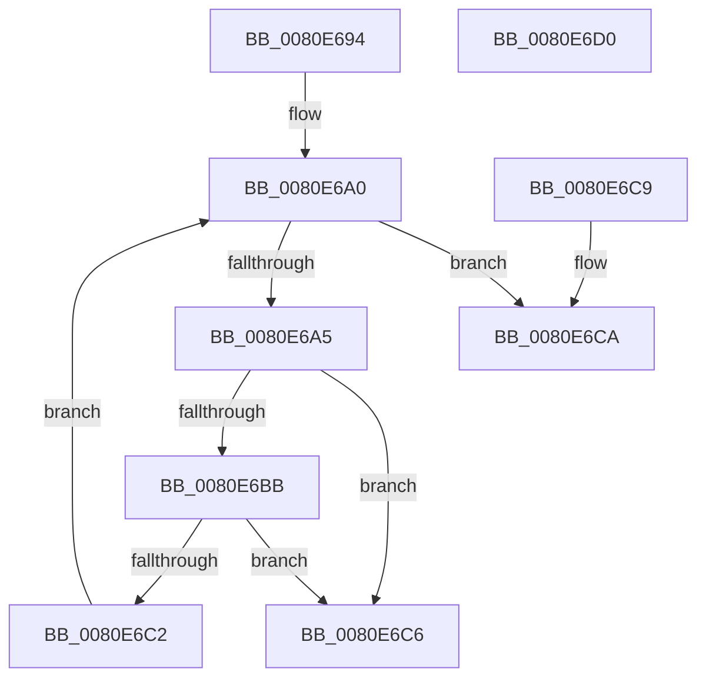

# MmStoreCheckPagefiles

- RVA: `0x0080E694`–`0x0080E6D1` (길이 `61` bytes)
- VA: `0x000000014080E694`
- 실행 섹션: `PAGE`
- PDB 이름 있음: `예`; PDB Function 태그: `아니요`
- unwind 정보 RVA: `0x000DB714`
- 디코드: `19`개 명령, `61/61` bytes 표시
- 미해석 바이트: `0` (있으면 어셈블리에 `.byte`로 보존)

> 이 문서는 커널 이미지의 기계어와 PDB 기호를 분석해 생성했습니다. 4번과 5번은 함수 원형과 자료형을 바이너리 사용 방식에서 추정한 C 해석이며 원본 소스 복구 결과는 아닙니다.

## 1. Dependencies

- 직접 호출 지점: **0**; 고유 호출 대상: **0**
- 직접 호출자로 확인된 함수: **2**
- RIP 상대 이미지 참조: **0**

### Outgoing calls
- 직접 디코드된 call 명령이 없습니다.

### Direct callers
- [SmFirstTimeInit](../../text/4E/SmFirstTimeInit_function_004EA944.md) at `0x004EAA3D`
- [MmStoreRegister](MmStoreRegister_function_0080E6D8.md) at `0x0080E71C`

### Static image references
- 디코드된 RIP-relative 메모리 참조가 없습니다.

## 2. Other-region calls and transfers

- 다른 실행 섹션으로 향하는 call: **0**
- 별도 외부 분기/꼬리 이동을 확인하지 못했습니다.

## 3. Assembly (complete function range)

```asm
0080E694  4C 8B 01                        mov r8, qword ptr [rcx]
0080E697  33 D2                           xor edx, edx
0080E699  45 8B 88 58 48 00 00            mov r9d, dword ptr [r8 + 0x4858]
0080E6A0  41 3B D1                        cmp edx, r9d
0080E6A3  73 25                           jae 0x14080e6ca
0080E6A5  49 8B 8C D0 60 48 00 00         mov rcx, qword ptr [r8 + rdx*8 + 0x4860]
0080E6AD  0F B7 81 AC 00 00 00            movzx eax, word ptr [rcx + 0xac]
0080E6B4  66 0F BA E0 0A                  bt ax, 0xa
0080E6B9  72 0B                           jb 0x14080e6c6
0080E6BB  66 0F BA E0 0B                  bt ax, 0xb
0080E6C0  72 04                           jb 0x14080e6c6
0080E6C2  FF C2                           inc edx
0080E6C4  EB DA                           jmp 0x14080e6a0
0080E6C6  33 C0                           xor eax, eax
0080E6C8  C3                              ret
0080E6C9  CC                              int3
0080E6CA  B8 01 00 00 00                  mov eax, 1
0080E6CF  C3                              ret
0080E6D0  CC                              int3
```

## 4. C-style interpretation (structured pseudocode)

```c
__int64 __fastcall MmStoreCheckPagefiles(__int64 a1, int a2)
{
    __int64 result;

    a2 = 0;
loc_0080E6A0:
    if (0 >= ((unsigned int)((unsigned int)(*(unsigned int *)(*(unsigned __int64 *)(a1) + 18520))))) goto loc_0080E6CA;
    if (0 < ((unsigned int)((unsigned int)(*(unsigned int *)(*(unsigned __int64 *)(a1) + 18520))))) goto loc_0080E6C6;
    if (0 < ((unsigned int)((unsigned int)(*(unsigned int *)(*(unsigned __int64 *)(a1) + 18520))))) goto loc_0080E6C6;
    a2 = (unsigned int)((a2) + 1);
    goto loc_0080E6A0;
loc_0080E6C6:
    result = 0;
    return result;
loc_0080E6CA:
    return 1;
}
```

## 5. (Beta) C Style

```c
int64_t MmStoreCheckPagefiles(void *Arg1, int32_t Arg2)
{
    uint8_t *arg1 = (uint8_t *)Arg1;

    int64_t result;

    Arg2 = 0;
loc_0080E6A0:
    if (0 >= ((uint32_t)((uint32_t)(*(uint32_t *)(*(uint64_t *)(arg1) + 0x4858))))) goto loc_0080E6CA;
    if (0 < ((uint32_t)((uint32_t)(*(uint32_t *)(*(uint64_t *)(arg1) + 0x4858))))) goto loc_0080E6C6;
    if (0 < ((uint32_t)((uint32_t)(*(uint32_t *)(*(uint64_t *)(arg1) + 0x4858))))) goto loc_0080E6C6;
    Arg2 = (uint32_t)((Arg2) + 1);
    goto loc_0080E6A0;
loc_0080E6C6:
    result = 0;
    return result;
loc_0080E6CA:
    return 1;
}
```

### 관측된 메모리 오프셋

구조체 형식이 확인되지 않은 접근은 인자 기준의 오프셋으로만 기록했습니다.

| 기준 인자 | 오프셋 표현 | 폭 (bit) | 접근 |
|---|---:|---:|---|
| `Arg1` | `+ 0x0` | `64` | `R` |

## 6. Execution-region graph

[열기: 2D/3D 그래프와 함수 탐색 컨트롤 패널](../../../control-panel.html?section=page&rva=0x0080E694&view=graph)

- 2D 그래프는 위에서 아래로 흐르고, 3D 그래프는 빈 공간을 드래그해 회전합니다. Shift+드래그는 이동, 휠은 확대·축소, 함수 노드 선택은 대상 보고서 이동입니다.

### Static fallback


