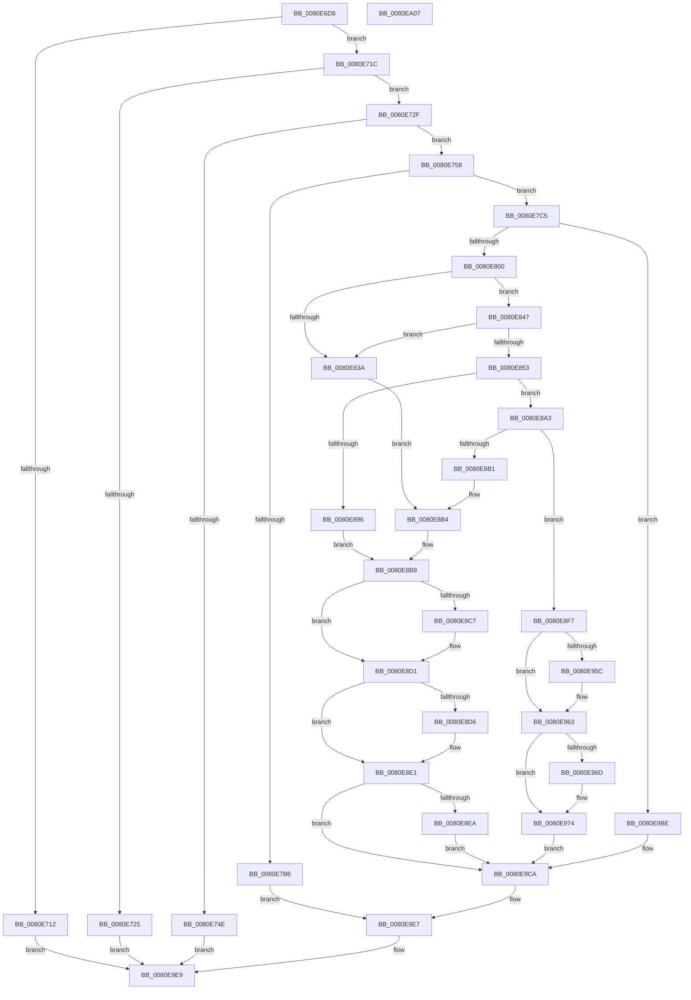

# MmStoreRegister

- RVA: `0x0080E6D8`–`0x0080EA08` (길이 `816` bytes)
- VA: `0x000000014080E6D8`
- 실행 섹션: `PAGE`
- PDB 이름 있음: `예`; PDB Function 태그: `아니요`
- unwind 정보 RVA: `0x000D9238`
- 디코드: `201`개 명령, `816/816` bytes 표시
- 미해석 바이트: `0` (있으면 어셈블리에 `.byte`로 보존)

> 이 문서는 커널 이미지의 기계어와 PDB 기호를 분석해 생성했습니다. 4번과 5번은 함수 원형과 자료형을 바이너리 사용 방식에서 추정한 C 해석이며 원본 소스 복구 결과는 아닙니다.

## 1. Dependencies

- 직접 호출 지점: **21**; 고유 호출 대상: **17**
- 직접 호출자로 확인된 함수: **1**
- RIP 상대 이미지 참조: **3**

### Outgoing calls
- `0x0080E71C` → [MmStoreCheckPagefiles](MmStoreCheckPagefiles_function_0080E694.md) (function, `0x0080E694`)
- `0x0080E741` → [MiAllocatePool](../../text/35/MiAllocatePool_function_0035B540.md) (function, `0x0035B540`)
- `0x0080E764` → [KeInitializeEvent](../../text/40/KeInitializeEvent_function_0040DD10.md) (function, `0x0040DD10`)
- `0x0080E7AB` → [PsCreateSystemThreadEx](../9E/PsCreateSystemThreadEx_function_009ED120.md) (function, `0x009ED120`)
- `0x0080E7BB` → [ExFreePoolWithTag](../../poolcode/B8/ExFreePoolWithTag_function_00B82870.md) (function, `0x00B82870`)
- `0x0080E7EF` → [MiAllocatePool](../../text/35/MiAllocatePool_function_0035B540.md) (function, `0x0035B540`)
- `0x0080E813` → [RtlClearAllBits](../../text/45/RtlClearAllBits_function_00450230.md) (function, `0x00450230`)
- `0x0080E82D` → [MiAllocatePool](../../text/35/MiAllocatePool_function_0035B540.md) (function, `0x0035B540`)
- `0x0080E84A` → [MiStoreChargeReservedPages](../../text/69/MiStoreChargeReservedPages_function_006926A0.md) (function, `0x006926A0`)
- `0x0080E889` → [MiCreatePagefile](../7F/MiCreatePagefile_function_007FEC30.md) (function, `0x007FEC30`)
- `0x0080E8A6` → [MiInsertPageFileInList](../7F/MiInsertPageFileInList_function_007FFF80.md) (function, `0x007FFF80`)
- `0x0080E8BD` → [ExFreePoolWithTag](../../poolcode/B8/ExFreePoolWithTag_function_00B82870.md) (function, `0x00B82870`)
- `0x0080E8CC` → [ExFreePoolWithTag](../../poolcode/B8/ExFreePoolWithTag_function_00B82870.md) (function, `0x00B82870`)
- `0x0080E8DC` → [MiDeletePagefile](../7F/MiDeletePagefile_function_007FFB88.md) (function, `0x007FFB88`)
- `0x0080E8ED` → [MiStoreReleaseReservedPageCharges](../../text/69/MiStoreReleaseReservedPageCharges_function_00693054.md) (function, `0x00693054`)
- `0x0080E92E` → [ObpReferenceObjectByHandleWithTag](../86/ObpReferenceObjectByHandleWithTag_function_00869650.md) (function, `0x00869650`)
- `0x0080E974` → [KeQueryMaximumGroupCount](../../text/48/KeQueryMaximumGroupCount_function_0048B760.md) (function, `0x0048B760`)
- `0x0080E99F` → [memset](../../text/6C/memset_function_006C6C40.md) (function, `0x006C6C40`)
- `0x0080E9B7` → [MiMoveModifiedPagesToCompressList](../../text/69/MiMoveModifiedPagesToCompressList_function_006925D8.md) (function, `0x006925D8`)
- `0x0080E9D3` → [KeSetEvent](../../text/33/KeSetEvent_function_0033F310.md) (function, `0x0033F310`)
- `0x0080E9E2` → [ObCloseHandle](../8A/ObCloseHandle_function_008A1870.md) (function, `0x008A1870`)

### Direct callers
- [SmFirstTimeInit](../../text/4E/SmFirstTimeInit_function_004EA944.md) at `0x004EAD92`

### Static image references
- `0x0080E79A` → RVA `0x003A42D0` (`MiStoreEvictThread`; read)
- `0x0080E7C5` → RVA `0x00FC520C` (`ALMOSTRO`; read)
- `0x0080E8F7` → RVA `0x00FC6AC8` (`ALMOSTRO`; read)

## 2. Other-region calls and transfers

- 다른 실행 섹션으로 향하는 call: **14**
  - `0x0080E741` → [MiAllocatePool](../../text/35/MiAllocatePool_function_0035B540.md) (`PAGE` → `.text`)
  - `0x0080E764` → [KeInitializeEvent](../../text/40/KeInitializeEvent_function_0040DD10.md) (`PAGE` → `.text`)
  - `0x0080E7BB` → [ExFreePoolWithTag](../../poolcode/B8/ExFreePoolWithTag_function_00B82870.md) (`PAGE` → `POOLCODE`)
  - `0x0080E7EF` → [MiAllocatePool](../../text/35/MiAllocatePool_function_0035B540.md) (`PAGE` → `.text`)
  - `0x0080E813` → [RtlClearAllBits](../../text/45/RtlClearAllBits_function_00450230.md) (`PAGE` → `.text`)
  - `0x0080E82D` → [MiAllocatePool](../../text/35/MiAllocatePool_function_0035B540.md) (`PAGE` → `.text`)
  - `0x0080E84A` → [MiStoreChargeReservedPages](../../text/69/MiStoreChargeReservedPages_function_006926A0.md) (`PAGE` → `.text`)
  - `0x0080E8BD` → [ExFreePoolWithTag](../../poolcode/B8/ExFreePoolWithTag_function_00B82870.md) (`PAGE` → `POOLCODE`)
  - `0x0080E8CC` → [ExFreePoolWithTag](../../poolcode/B8/ExFreePoolWithTag_function_00B82870.md) (`PAGE` → `POOLCODE`)
  - `0x0080E8ED` → [MiStoreReleaseReservedPageCharges](../../text/69/MiStoreReleaseReservedPageCharges_function_00693054.md) (`PAGE` → `.text`)
  - `0x0080E974` → [KeQueryMaximumGroupCount](../../text/48/KeQueryMaximumGroupCount_function_0048B760.md) (`PAGE` → `.text`)
  - `0x0080E99F` → [memset](../../text/6C/memset_function_006C6C40.md) (`PAGE` → `.text`)
  - `0x0080E9B7` → [MiMoveModifiedPagesToCompressList](../../text/69/MiMoveModifiedPagesToCompressList_function_006925D8.md) (`PAGE` → `.text`)
  - `0x0080E9D3` → [KeSetEvent](../../text/33/KeSetEvent_function_0033F310.md) (`PAGE` → `.text`)
- 별도 외부 분기/꼬리 이동을 확인하지 못했습니다.

## 3. Assembly (complete function range)

```asm
0080E6D8  48 8B C4                        mov rax, rsp
0080E6DB  48 89 58 10                     mov qword ptr [rax + 0x10], rbx
0080E6DF  48 89 68 18                     mov qword ptr [rax + 0x18], rbp
0080E6E3  48 89 70 20                     mov qword ptr [rax + 0x20], rsi
0080E6E7  57                              push rdi
0080E6E8  41 54                           push r12
0080E6EA  41 55                           push r13
0080E6EC  41 56                           push r14
0080E6EE  41 57                           push r15
0080E6F0  48 83 EC 50                     sub rsp, 0x50
0080E6F4  48 8B 39                        mov rdi, qword ptr [rcx]
0080E6F7  45 33 E4                        xor r12d, r12d
0080E6FA  4C 89 60 08                     mov qword ptr [rax + 8], r12
0080E6FE  4D 8B E9                        mov r13, r9
0080E701  C7 87 B8 04 00 00 01 00 00 00   mov dword ptr [rdi + 0x4b8], 1
0080E70B  8B 47 04                        mov eax, dword ptr [rdi + 4]
0080E70E  84 C0                           test al, al
0080E710  79 0A                           jns 0x14080e71c
0080E712  B8 BB 00 00 C0                  mov eax, 0xc00000bb
0080E717  E9 CD 02 00 00                  jmp 0x14080e9e9
0080E71C  E8 73 FF FF FF                  call 0x14080e694
0080E721  85 C0                           test eax, eax
0080E723  75 0A                           jne 0x14080e72f
0080E725  B8 47 01 00 C0                  mov eax, 0xc0000147
0080E72A  E9 BA 02 00 00                  jmp 0x14080e9e9
0080E72F  BA 28 00 00 00                  mov edx, 0x28
0080E734  41 B8 4D 6D 54 70               mov r8d, 0x70546d4d
0080E73A  44 8D 7A 18                     lea r15d, [rdx + 0x18]
0080E73E  41 8B CF                        mov ecx, r15d
0080E741  E8 FA CD B4 FF                  call 0x14035b540
0080E746  48 8B F0                        mov rsi, rax
0080E749  48 85 C0                        test rax, rax
0080E74C  75 0A                           jne 0x14080e758
0080E74E  B8 9A 00 00 C0                  mov eax, 0xc000009a
0080E753  E9 91 02 00 00                  jmp 0x14080e9e9
0080E758  48 8D 48 08                     lea rcx, [rax + 8]
0080E75C  48 89 38                        mov qword ptr [rax], rdi
0080E75F  45 33 C0                        xor r8d, r8d
0080E762  33 D2                           xor edx, edx
0080E764  E8 A7 F5 BF FF                  call 0x14040dd10
0080E769  4C 89 64 24 40                  mov qword ptr [rsp + 0x40], r12
0080E76E  48 8D 8C 24 80 00 00 00         lea rcx, [rsp + 0x80]
0080E776  44 89 66 20                     mov dword ptr [rsi + 0x20], r12d
0080E77A  45 33 C0                        xor r8d, r8d
0080E77D  48 8B 87 B8 00 00 00            mov rax, qword ptr [rdi + 0xb8]
0080E784  BA FF FF 1F 00                  mov edx, 0x1fffff
0080E789  4C 89 64 24 38                  mov qword ptr [rsp + 0x38], r12
0080E78E  48 89 74 24 30                  mov qword ptr [rsp + 0x30], rsi
0080E793  4C 8B 88 80 00 00 00            mov r9, qword ptr [rax + 0x80]
0080E79A  48 8D 05 2F 5B B9 FF            lea rax, [rip - 0x46a4d1]
0080E7A1  48 89 44 24 28                  mov qword ptr [rsp + 0x28], rax
0080E7A6  4C 89 64 24 20                  mov qword ptr [rsp + 0x20], r12
0080E7AB  E8 70 E9 1D 00                  call 0x1409ed120
0080E7B0  8B D8                           mov ebx, eax
0080E7B2  85 C0                           test eax, eax
0080E7B4  79 0F                           jns 0x14080e7c5
0080E7B6  33 D2                           xor edx, edx
0080E7B8  48 8B CE                        mov rcx, rsi
0080E7BB  E8 B0 40 37 00                  call 0x140b82870
0080E7C0  E9 22 02 00 00                  jmp 0x14080e9e7
0080E7C5  8B 15 41 6A 7B 00               mov edx, dword ptr [rip + 0x7b6a41]
0080E7CB  41 B8 4D 6D 20 20               mov r8d, 0x20206d4d
0080E7D1  8B C2                           mov eax, edx
0080E7D3  49 8B EC                        mov rbp, r12
0080E7D6  24 3F                           and al, 0x3f
0080E7D8  45 8B F4                        mov r14d, r12d
0080E7DB  F6 D8                           neg al
0080E7DD  1B C9                           sbb ecx, ecx
0080E7DF  C1 EA 06                        shr edx, 6
0080E7E2  F7 D9                           neg ecx
0080E7E4  83 C1 02                        add ecx, 2
0080E7E7  03 D1                           add edx, ecx
0080E7E9  49 8B CF                        mov rcx, r15
0080E7EC  C1 E2 03                        shl edx, 3
0080E7EF  E8 4C CD B4 FF                  call 0x14035b540
0080E7F4  4C 8B F8                        mov r15, rax
0080E7F7  48 85 C0                        test rax, rax
0080E7FA  0F 84 BE 01 00 00               je 0x14080e9be
0080E800  8B 15 06 6A 7B 00               mov edx, dword ptr [rip + 0x7b6a06]
0080E806  48 8B C8                        mov rcx, rax
0080E809  89 10                           mov dword ptr [rax], edx
0080E80B  48 8D 50 10                     lea rdx, [rax + 0x10]
0080E80F  48 89 50 08                     mov qword ptr [rax + 8], rdx
0080E813  E8 18 1A C4 FF                  call 0x140450230
0080E818  8B 15 EE 69 7B 00               mov edx, dword ptr [rip + 0x7b69ee]
0080E81E  B9 40 00 00 00                  mov ecx, 0x40
0080E823  48 C1 E2 06                     shl rdx, 6
0080E827  41 B8 4D 69 53 69               mov r8d, 0x6953694d
0080E82D  E8 0E CD B4 FF                  call 0x14035b540
0080E832  4C 8B E0                        mov r12, rax
0080E835  48 85 C0                        test rax, rax
0080E838  75 0D                           jne 0x14080e847
0080E83A  41 BD 01 00 00 00               mov r13d, 1
0080E840  BB 9A 00 00 C0                  mov ebx, 0xc000009a
0080E845  EB 6D                           jmp 0x14080e8b4
0080E847  48 8B CF                        mov rcx, rdi
0080E84A  E8 51 3E E8 FF                  call 0x1406926a0
0080E84F  85 C0                           test eax, eax
0080E851  74 E7                           je 0x14080e83a
0080E853  C7 44 24 38 02 00 00 00         mov dword ptr [rsp + 0x38], 2
0080E85B  41 B9 00 00 04 00               mov r9d, 0x40000
0080E861  21 6C 24 30                     and dword ptr [rsp + 0x30], ebp
0080E865  BB 01 00 00 00                  mov ebx, 1
0080E86A  48 21 6C 24 28                  and qword ptr [rsp + 0x28], rbp
0080E86F  45 33 C0                        xor r8d, r8d
0080E872  33 D2                           xor edx, edx
0080E874  44 89 4C 24 20                  mov dword ptr [rsp + 0x20], r9d
0080E879  48 8B CF                        mov rcx, rdi
0080E87C  C7 87 BC 04 00 00 FE FF FF FF   mov dword ptr [rdi + 0x4bc], 0xfffffffe
0080E886  44 8B F3                        mov r14d, ebx
0080E889  E8 A2 03 FF FF                  call 0x1407fec30
0080E88E  48 8B E8                        mov rbp, rax
0080E891  48 85 C0                        test rax, rax
0080E894  75 0D                           jne 0x14080e8a3
0080E896  89 5E 20                        mov dword ptr [rsi + 0x20], ebx
0080E899  45 8B EE                        mov r13d, r14d
0080E89C  BB 9A 00 00 C0                  mov ebx, 0xc000009a
0080E8A1  EB 15                           jmp 0x14080e8b8
0080E8A3  48 8B CD                        mov rcx, rbp
0080E8A6  E8 D5 16 FF FF                  call 0x1407fff80
0080E8AB  8B D8                           mov ebx, eax
0080E8AD  85 C0                           test eax, eax
0080E8AF  79 46                           jns 0x14080e8f7
0080E8B1  45 8B EE                        mov r13d, r14d
0080E8B4  44 89 6E 20                     mov dword ptr [rsi + 0x20], r13d
0080E8B8  33 D2                           xor edx, edx
0080E8BA  49 8B CF                        mov rcx, r15
0080E8BD  E8 AE 3F 37 00                  call 0x140b82870
0080E8C2  4D 85 E4                        test r12, r12
0080E8C5  74 0A                           je 0x14080e8d1
0080E8C7  33 D2                           xor edx, edx
0080E8C9  49 8B CC                        mov rcx, r12
0080E8CC  E8 9F 3F 37 00                  call 0x140b82870
0080E8D1  48 85 ED                        test rbp, rbp
0080E8D4  74 0B                           je 0x14080e8e1
0080E8D6  41 8B D5                        mov edx, r13d
0080E8D9  48 8B CD                        mov rcx, rbp
0080E8DC  E8 A7 12 FF FF                  call 0x1407ffb88
0080E8E1  45 85 F6                        test r14d, r14d
0080E8E4  0F 84 E0 00 00 00               je 0x14080e9ca
0080E8EA  48 8B CF                        mov rcx, rdi
0080E8ED  E8 62 47 E8 FF                  call 0x140693054
0080E8F2  E9 D3 00 00 00                  jmp 0x14080e9ca
0080E8F7  4C 8B 05 CA 81 7B 00            mov r8, qword ptr [rip + 0x7b81ca]
0080E8FE  48 8D 87 28 05 00 00            lea rax, [rdi + 0x528]
0080E905  48 8B 8C 24 80 00 00 00         mov rcx, qword ptr [rsp + 0x80]
0080E90D  33 DB                           xor ebx, ebx
0080E90F  48 89 5C 24 38                  mov qword ptr [rsp + 0x38], rbx
0080E914  45 33 C9                        xor r9d, r9d
0080E917  48 89 5C 24 30                  mov qword ptr [rsp + 0x30], rbx
0080E91C  BA FF FF 1F 00                  mov edx, 0x1fffff
0080E921  48 89 44 24 28                  mov qword ptr [rsp + 0x28], rax
0080E926  C7 44 24 20 4D 6D 50 66         mov dword ptr [rsp + 0x20], 0x66506d4d
0080E92E  E8 1D AD 05 00                  call 0x140869650
0080E933  4C 89 BF 88 05 00 00            mov qword ptr [rdi + 0x588], r15
0080E93A  4C 89 A7 90 05 00 00            mov qword ptr [rdi + 0x590], r12
0080E941  C7 87 B8 04 00 00 FE 00 00 00   mov dword ptr [rdi + 0x4b8], 0xfe
0080E94B  4C 89 AF A0 06 00 00            mov qword ptr [rdi + 0x6a0], r13
0080E952  44 84 B4 24 A0 00 00 00         test byte ptr [rsp + 0xa0], r14b
0080E95A  74 07                           je 0x14080e963
0080E95C  44 09 B7 AC 06 00 00            or dword ptr [rdi + 0x6ac], r14d
0080E963  F6 84 24 A0 00 00 00 02         test byte ptr [rsp + 0xa0], 2
0080E96B  74 07                           je 0x14080e974
0080E96D  83 8F AC 06 00 00 02            or dword ptr [rdi + 0x6ac], 2
0080E974  E8 E7 CD C7 FF                  call 0x14048b760
0080E979  44 0F B7 C0                     movzx r8d, ax
0080E97D  48 8D 8F A0 05 00 00            lea rcx, [rdi + 0x5a0]
0080E984  49 C1 E0 03                     shl r8, 3
0080E988  33 D2                           xor edx, edx
0080E98A  66 44 89 B7 98 05 00 00         mov word ptr [rdi + 0x598], r14w
0080E992  66 89 87 9A 05 00 00            mov word ptr [rdi + 0x59a], ax
0080E999  89 9F 9C 05 00 00               mov dword ptr [rdi + 0x59c], ebx
0080E99F  E8 9C 82 EB FF                  call 0x1406c6c40
0080E9A4  0F B7 85 AC 00 00 00            movzx eax, word ptr [rbp + 0xac]
0080E9AB  48 8B CF                        mov rcx, rdi
0080E9AE  83 E0 0F                        and eax, 0xf
0080E9B1  89 87 B4 04 00 00               mov dword ptr [rdi + 0x4b4], eax
0080E9B7  E8 1C 3C E8 FF                  call 0x1406925d8
0080E9BC  EB 0C                           jmp 0x14080e9ca
0080E9BE  C7 46 20 01 00 00 00            mov dword ptr [rsi + 0x20], 1
0080E9C5  BB 9A 00 00 C0                  mov ebx, 0xc000009a
0080E9CA  48 8D 4E 08                     lea rcx, [rsi + 8]
0080E9CE  45 33 C0                        xor r8d, r8d
0080E9D1  33 D2                           xor edx, edx
0080E9D3  E8 38 09 B3 FF                  call 0x14033f310
0080E9D8  48 8B 8C 24 80 00 00 00         mov rcx, qword ptr [rsp + 0x80]
0080E9E0  33 D2                           xor edx, edx
0080E9E2  E8 89 2E 09 00                  call 0x1408a1870
0080E9E7  8B C3                           mov eax, ebx
0080E9E9  4C 8D 5C 24 50                  lea r11, [rsp + 0x50]
0080E9EE  49 8B 5B 38                     mov rbx, qword ptr [r11 + 0x38]
0080E9F2  49 8B 6B 40                     mov rbp, qword ptr [r11 + 0x40]
0080E9F6  49 8B 73 48                     mov rsi, qword ptr [r11 + 0x48]
0080E9FA  49 8B E3                        mov rsp, r11
0080E9FD  41 5F                           pop r15
0080E9FF  41 5E                           pop r14
0080EA01  41 5D                           pop r13
0080EA03  41 5C                           pop r12
0080EA05  5F                              pop rdi
0080EA06  C3                              ret
0080EA07  CC                              int3
```

## 4. C-style interpretation (structured pseudocode)

```c
__int64 __fastcall MmStoreRegister(__int64 a1, __int64 a2, __int64 a3, __int64 a4, unsigned __int8 a5)
{
    __int64 result;
    __int64 v_r12;
    __int64 v_rbx;
    __int64 v_rsp;
    unsigned __int64 v_stack_m28;
    unsigned __int64 v_stack_m38;
    unsigned __int64 v_stack_m40;
    unsigned __int64 v_stack_m48;
    unsigned __int64 v_stack_m50;
    unsigned __int64 v_stack_m58;
    unsigned __int8 v_stack_p28;
    unsigned __int64 v_stack_p8;

    *(unsigned __int64 *)(v_rsp + 16) = v_rbx;
    *(unsigned __int64 *)(v_rsp + 24) = v_rbp;
    *(unsigned __int64 *)(v_rsp + 32) = v_rsi;
    v_rsp = (v_rsp) - (80);
    v_r12 = 0;
    *(unsigned __int64 *)(v_rsp + 8) = 0;
    *(unsigned int *)(*(unsigned __int64 *)(a1) + 1208) = 1;
    if (!sign_flag) goto loc_0080E71C;
    goto loc_0080E9E9;
loc_0080E71C:
    result = MmStoreCheckPagefiles(a1, a2, a3, a4);
    if ((unsigned int)(result) != 0) goto loc_0080E72F;
    goto loc_0080E9E9;
loc_0080E72F:
    result = MiAllocatePool((unsigned int)((unsigned int)(40 + 24)), 40, (unsigned int)(0x70546D4DULL), a4);
    if (result != 0) goto loc_0080E758;
    goto loc_0080E9E9;
loc_0080E758:
    *(unsigned __int64 *)((unsigned int)(0xC000009AULL)) = *(unsigned __int64 *)(a1);
    a3 = 0;
    a2 = 0;
    result = KeInitializeEvent((unsigned int)(0xC000009AULL) + 8, a2, a3, a4);
    v_stack_m38 = 0;
    *(unsigned int *)(result + 32) = 0;
    a3 = 0;
    v_stack_m40 = 0;
    v_stack_m48 = result;
    v_stack_m50 = v_rip - 4629713;
    v_stack_m58 = 0;
    result = PsCreateSystemThreadEx(v_stack_p8, (unsigned int)(0x1FFFFFULL), a3, *(unsigned __int64 *)(*(unsigned __int64 *)(*(unsigned __int64 *)(a1) + 184) + 128));
    if (!sign_flag) goto loc_0080E7C5;
    a2 = 0;
    result = ExFreePoolWithTag(result, a2, a3, *(unsigned __int64 *)(*(unsigned __int64 *)(*(unsigned __int64 *)(a1) + 184) + 128));
    goto loc_0080E9E7;
loc_0080E7C5:
    result = (unsigned __int8)(((unsigned int)((unsigned int)((unsigned int)(*(unsigned int *)(v_rip + 8088129))))) & (63));
    result = (unsigned __int8)(-(result));
    a2 = (unsigned int)(((unsigned int)(*(unsigned int *)(v_rip + 8088129))) >> (6));
    a1 = (unsigned int)(-(result));
    a1 = (unsigned int)((a1) + (2));
    a2 = (unsigned int)((a2) + ((unsigned int)(a1)));
    a2 = (unsigned int)((a2) << (3));
    result = MiAllocatePool(40 + 24, a2, (unsigned int)(0x20206D4DULL), *(unsigned __int64 *)(*(unsigned __int64 *)(*(unsigned __int64 *)(a1) + 184) + 128));
    if (result == 0) goto loc_0080E9BE;
    *(unsigned int *)(result) = (unsigned int)((unsigned int)(*(unsigned int *)(v_rip + 8088070)));
    *(unsigned __int64 *)(result + 8) = result + 16;
    result = RtlClearAllBits(result, result + 16, (unsigned int)(0x20206D4DULL), *(unsigned __int64 *)(*(unsigned __int64 *)(*(unsigned __int64 *)(a1) + 184) + 128));
    a2 = ((unsigned int)(*(unsigned int *)(v_rip + 8088046))) << (6);
    result = MiAllocatePool(64, a2, (unsigned int)(0x6953694DULL), *(unsigned __int64 *)(*(unsigned __int64 *)(*(unsigned __int64 *)(a1) + 184) + 128));
    if (result != 0) goto loc_0080E847;
loc_0080E83A:
    goto loc_0080E8B4;
loc_0080E847:
    result = MiStoreChargeReservedPages(*(unsigned __int64 *)(a1), a2, (unsigned int)(0x6953694DULL), *(unsigned __int64 *)(*(unsigned __int64 *)(*(unsigned __int64 *)(a1) + 184) + 128));
    if ((unsigned int)(result) == 0) goto loc_0080E83A;
    v_stack_m40 = 2;
    a3 = 0;
    a2 = 0;
    v_stack_m58 = (unsigned int)((unsigned int)(0x40000ULL));
    *(unsigned int *)(*(unsigned __int64 *)(a1) + 1212) = 0xFFFFFFFEULL;
    result = MiCreatePagefile(*(unsigned __int64 *)(a1), a2, a3, (unsigned int)(0x40000ULL));
    if (result != 0) goto loc_0080E8A3;
    *(unsigned int *)(result + 32) = 1;
    goto loc_0080E8B8;
loc_0080E8A3:
    result = MiInsertPageFileInList(result, a2, a3, (unsigned int)(0x40000ULL));
    if (!sign_flag) goto loc_0080E8F7;
loc_0080E8B4:
    *(unsigned int *)(result + 32) = 1;
loc_0080E8B8:
    a2 = 0;
    result = ExFreePoolWithTag(result, a2, a3, (unsigned int)(0x40000ULL));
    if (result != 0) {
        a2 = 0;
        a1 = result;
        result = ExFreePoolWithTag(a1, a2, a3, (unsigned int)(0x40000ULL));
    }
    if (result != 0) {
        a2 = 1;
        a1 = result;
        result = MiDeletePagefile(a1, a2, a3, (unsigned int)(0x40000ULL));
    }
    if (1 == 0) goto loc_0080E9CA;
    result = MiStoreReleaseReservedPageCharges(*(unsigned __int64 *)(a1), a2, a3, (unsigned int)(0x40000ULL));
    goto loc_0080E9CA;
loc_0080E8F7:
    v_rbx = 0;
    v_stack_m40 = 0;
    a4 = 0;
    v_stack_m48 = 0;
    v_stack_m50 = *(unsigned __int64 *)(a1) + 1320;
    v_stack_m58 = 0x66506D4DULL;
    result = ObpReferenceObjectByHandleWithTag(v_stack_p8, (unsigned int)(0x1FFFFFULL), *(unsigned __int64 *)(v_rip + 8094154), a4);
    *(unsigned __int64 *)(*(unsigned __int64 *)(a1) + 1416) = result;
    *(unsigned __int64 *)(*(unsigned __int64 *)(a1) + 1424) = result;
    *(unsigned int *)(*(unsigned __int64 *)(a1) + 1208) = 254;
    *(unsigned __int64 *)(*(unsigned __int64 *)(a1) + 1696) = 1;
    if (((v_stack_p28) & (1)) != 0) {
    }
    if (((a5) & (2)) != 0) {
    }
    result = KeQueryMaximumGroupCount(v_stack_p8, (unsigned int)(0x1FFFFFULL), *(unsigned __int64 *)(v_rip + 8094154), a4);
    a3 = ((unsigned __int16)(result)) << (3);
    a2 = 0;
    *(unsigned __int16 *)(*(unsigned __int64 *)(a1) + 1432) = 1;
    *(unsigned __int16 *)(*(unsigned __int64 *)(a1) + 1434) = (unsigned __int16)(result);
    *(unsigned int *)(*(unsigned __int64 *)(a1) + 1436) = 0;
    result = memset(*(unsigned __int64 *)(a1) + 1440, a2, a3, a4);
    result = (unsigned int)((*(unsigned __int16 *)(result + 172)) & (15));
    *(unsigned int *)(*(unsigned __int64 *)(a1) + 1204) = (unsigned int)(result);
    result = MiMoveModifiedPagesToCompressList(*(unsigned __int64 *)(a1), a2, a3, a4);
    goto loc_0080E9CA;
loc_0080E9BE:
    *(unsigned int *)(result + 32) = 1;
loc_0080E9CA:
    a3 = 0;
    a2 = 0;
    result = KeSetEvent(result + 8, a2, a3, a4);
    a2 = 0;
    result = ObCloseHandle(v_stack_p8, a2, a3, a4);
loc_0080E9E7:
loc_0080E9E9:
    return (unsigned int)((unsigned int)((unsigned int)(0xC000009AULL)));
}
```

## 5. (Beta) C Style

```c
int64_t MmStoreRegister(void *Arg1, int64_t Arg2, int64_t Arg3, int64_t Arg4, uint8_t Arg5)
{
    uint8_t *arg1 = (uint8_t *)Arg1;

    int64_t result;
    int64_t local_r12;
    int64_t local_rbx;
    int64_t local_rsp;
    uint64_t v_stack_m28;
    uint64_t v_stack_m38;
    uint64_t v_stack_m40;
    uint64_t v_stack_m48;
    uint64_t v_stack_m50;
    uint64_t v_stack_m58;
    uint8_t v_stack_p28;
    uint64_t v_stack_p8;

    *(uint64_t *)(local_rsp + 0x10) = local_rbx;
    *(uint64_t *)(local_rsp + 0x18) = local_rbp;
    *(uint64_t *)(local_rsp + 0x20) = local_rsi;
    local_rsp = (local_rsp) - (80);
    local_r12 = 0;
    *(uint64_t *)(local_rsp + 0x8) = 0;
    *(uint32_t *)(*(uint64_t *)(arg1) + 0x4B8) = 1;
    if (!sign_flag) goto loc_0080E71C;
    goto loc_0080E9E9;
loc_0080E71C:
    result = MmStoreCheckPagefiles(Arg1, Arg2, Arg3, Arg4);
    if ((uint32_t)(result) != 0) goto loc_0080E72F;
    goto loc_0080E9E9;
loc_0080E72F:
    result = MiAllocatePool((uint32_t)((uint32_t)(40 + 24)), 40, (uint32_t)(0x70546D4DULL), Arg4);
    if (result != 0) goto loc_0080E758;
    goto loc_0080E9E9;
loc_0080E758:
    *(uint64_t *)((uint32_t)(0xC000009AULL)) = *(uint64_t *)(arg1);
    Arg3 = 0;
    Arg2 = 0;
    result = KeInitializeEvent((uint32_t)(0xC000009AULL) + 8, Arg2, Arg3, Arg4);
    v_stack_m38 = 0;
    *(uint32_t *)(result + 0x20) = 0;
    Arg3 = 0;
    v_stack_m40 = 0;
    v_stack_m48 = result;
    v_stack_m50 = v_rip - 4629713;
    v_stack_m58 = 0;
    result = PsCreateSystemThreadEx(v_stack_p8, (uint32_t)(0x1FFFFFULL), Arg3, *(uint64_t *)(*(uint64_t *)(*(uint64_t *)(arg1) + 0xB8) + 0x80));
    if (!sign_flag) goto loc_0080E7C5;
    Arg2 = 0;
    result = ExFreePoolWithTag(result, Arg2, Arg3, *(uint64_t *)(*(uint64_t *)(*(uint64_t *)(arg1) + 0xB8) + 0x80));
    goto loc_0080E9E7;
loc_0080E7C5:
    result = (uint8_t)(((uint32_t)((uint32_t)((uint32_t)(*(uint32_t *)(v_rip + 0x7B6A41))))) & (63));
    result = (uint8_t)(-(result));
    Arg2 = (uint32_t)(((uint32_t)(*(uint32_t *)(v_rip + 0x7B6A41))) >> (6));
    Arg1 = (uint32_t)(-(result));
    Arg1 = (uint32_t)((Arg1) + (2));
    Arg2 = (uint32_t)((Arg2) + ((uint32_t)(Arg1)));
    Arg2 = (uint32_t)((Arg2) << (3));
    result = MiAllocatePool(40 + 24, Arg2, (uint32_t)(0x20206D4DULL), *(uint64_t *)(*(uint64_t *)(*(uint64_t *)(arg1) + 0xB8) + 0x80));
    if (result == 0) goto loc_0080E9BE;
    *(uint32_t *)(result) = (uint32_t)((uint32_t)(*(uint32_t *)(v_rip + 0x7B6A06)));
    *(uint64_t *)(result + 0x8) = result + 16;
    result = RtlClearAllBits(result, result + 16, (uint32_t)(0x20206D4DULL), *(uint64_t *)(*(uint64_t *)(*(uint64_t *)(arg1) + 0xB8) + 0x80));
    Arg2 = ((uint32_t)(*(uint32_t *)(v_rip + 0x7B69EE))) << (6);
    result = MiAllocatePool(64, Arg2, (uint32_t)(0x6953694DULL), *(uint64_t *)(*(uint64_t *)(*(uint64_t *)(arg1) + 0xB8) + 0x80));
    if (result != 0) goto loc_0080E847;
loc_0080E83A:
    goto loc_0080E8B4;
loc_0080E847:
    result = MiStoreChargeReservedPages(*(uint64_t *)(arg1), Arg2, (uint32_t)(0x6953694DULL), *(uint64_t *)(*(uint64_t *)(*(uint64_t *)(arg1) + 0xB8) + 0x80));
    if ((uint32_t)(result) == 0) goto loc_0080E83A;
    v_stack_m40 = 2;
    Arg3 = 0;
    Arg2 = 0;
    v_stack_m58 = (uint32_t)((uint32_t)(0x40000ULL));
    *(uint32_t *)(*(uint64_t *)(arg1) + 0x4BC) = 0xFFFFFFFEULL;
    result = MiCreatePagefile(*(uint64_t *)(arg1), Arg2, Arg3, (uint32_t)(0x40000ULL));
    if (result != 0) goto loc_0080E8A3;
    *(uint32_t *)(result + 0x20) = 1;
    goto loc_0080E8B8;
loc_0080E8A3:
    result = MiInsertPageFileInList(result, Arg2, Arg3, (uint32_t)(0x40000ULL));
    if (!sign_flag) goto loc_0080E8F7;
loc_0080E8B4:
    *(uint32_t *)(result + 0x20) = 1;
loc_0080E8B8:
    Arg2 = 0;
    result = ExFreePoolWithTag(result, Arg2, Arg3, (uint32_t)(0x40000ULL));
    if (result != 0) {
        Arg2 = 0;
        Arg1 = result;
        result = ExFreePoolWithTag(Arg1, Arg2, Arg3, (uint32_t)(0x40000ULL));
    }
    if (result != 0) {
        Arg2 = 1;
        Arg1 = result;
        result = MiDeletePagefile(Arg1, Arg2, Arg3, (uint32_t)(0x40000ULL));
    }
    if (1 == 0) goto loc_0080E9CA;
    result = MiStoreReleaseReservedPageCharges(*(uint64_t *)(arg1), Arg2, Arg3, (uint32_t)(0x40000ULL));
    goto loc_0080E9CA;
loc_0080E8F7:
    local_rbx = 0;
    v_stack_m40 = 0;
    Arg4 = 0;
    v_stack_m48 = 0;
    v_stack_m50 = *(uint64_t *)(arg1) + 1320;
    v_stack_m58 = 0x66506D4DULL;
    result = ObpReferenceObjectByHandleWithTag(v_stack_p8, (uint32_t)(0x1FFFFFULL), *(uint64_t *)(v_rip + 0x7B81CA), Arg4);
    *(uint64_t *)(*(uint64_t *)(arg1) + 0x588) = result;
    *(uint64_t *)(*(uint64_t *)(arg1) + 0x590) = result;
    *(uint32_t *)(*(uint64_t *)(arg1) + 0x4B8) = 254;
    *(uint64_t *)(*(uint64_t *)(arg1) + 0x6A0) = 1;
    if (((v_stack_p28) & (1)) != 0) {
    }
    if (((Arg5) & (2)) != 0) {
    }
    result = KeQueryMaximumGroupCount(v_stack_p8, (uint32_t)(0x1FFFFFULL), *(uint64_t *)(v_rip + 0x7B81CA), Arg4);
    Arg3 = ((uint16_t)(result)) << (3);
    Arg2 = 0;
    *(uint16_t *)(*(uint64_t *)(arg1) + 0x598) = 1;
    *(uint16_t *)(*(uint64_t *)(arg1) + 0x59A) = (uint16_t)(result);
    *(uint32_t *)(*(uint64_t *)(arg1) + 0x59C) = 0;
    result = memset(*(uint64_t *)(arg1) + 1440, Arg2, Arg3, Arg4);
    result = (uint32_t)((*(uint16_t *)(result + 0xAC)) & (15));
    *(uint32_t *)(*(uint64_t *)(arg1) + 0x4B4) = (uint32_t)(result);
    result = MiMoveModifiedPagesToCompressList(*(uint64_t *)(arg1), Arg2, Arg3, Arg4);
    goto loc_0080E9CA;
loc_0080E9BE:
    *(uint32_t *)(result + 0x20) = 1;
loc_0080E9CA:
    Arg3 = 0;
    Arg2 = 0;
    result = KeSetEvent(result + 8, Arg2, Arg3, Arg4);
    Arg2 = 0;
    result = ObCloseHandle(v_stack_p8, Arg2, Arg3, Arg4);
loc_0080E9E7:
loc_0080E9E9:
    return (uint32_t)((uint32_t)((uint32_t)(0xC000009AULL)));
}
```

### 관측된 메모리 오프셋

구조체 형식이 확인되지 않은 접근은 인자 기준의 오프셋으로만 기록했습니다.

| 기준 인자 | 오프셋 표현 | 폭 (bit) | 접근 |
|---|---:|---:|---|
| `Arg1` | `+ 0x0` | `64` | `R` |

## 6. Execution-region graph

[열기: 2D/3D 그래프와 함수 탐색 컨트롤 패널](../../../control-panel.html?section=page&rva=0x0080E6D8&view=graph)

- 2D 그래프는 위에서 아래로 흐르고, 3D 그래프는 빈 공간을 드래그해 회전합니다. Shift+드래그는 이동, 휠은 확대·축소, 함수 노드 선택은 대상 보고서 이동입니다.

### Static fallback


