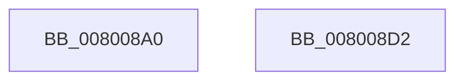

# NtCreatePagingFile

- RVA: `0x008008A0`–`0x008008D3` (길이 `51` bytes)
- VA: `0x00000001408008A0`
- 실행 섹션: `PAGE`
- PDB 이름 있음: `예`; PDB Function 태그: `아니요`
- unwind 정보 RVA: `0x0005D2F4`
- 디코드: `11`개 명령, `51/51` bytes 표시
- 미해석 바이트: `0` (있으면 어셈블리에 `.byte`로 보존)

> 이 문서는 커널 이미지의 기계어와 PDB 기호를 분석해 생성했습니다. 4번과 5번은 함수 원형과 자료형을 바이너리 사용 방식에서 추정한 C 해석이며 원본 소스 복구 결과는 아닙니다.

## 1. Dependencies

- 직접 호출 지점: **1**; 고유 호출 대상: **1**
- 직접 호출자로 확인된 함수: **0**
- RIP 상대 이미지 참조: **1**

### Outgoing calls
- `0x008008C8` → [MiCreatePagingFile](../7F/MiCreatePagingFile_function_007FEFF4.md) (function, `0x007FEFF4`)

### Direct callers
- 이 함수 시작 RVA로 연결되는 직접 call은 확인되지 않았습니다. 간접 호출은 완전히 역산할 수 없습니다.

### Static image references
- `0x008008B7` → RVA `0x00E38D00` (`.data`; read)

## 2. Other-region calls and transfers

- 다른 실행 섹션으로 향하는 call: **0**
- 별도 외부 분기/꼬리 이동을 확인하지 못했습니다.

## 3. Assembly (complete function range)

```asm
008008A0  48 83 EC 38                     sub rsp, 0x38
008008A4  65 48 8B 04 25 88 01 00 00      mov rax, qword ptr gs:[0x188]
008008AD  45 8B D1                        mov r10d, r9d
008008B0  44 8A 88 32 02 00 00            mov r9b, byte ptr [rax + 0x232]
008008B7  48 8D 05 42 84 63 00            lea rax, [rip + 0x638442]
008008BE  48 89 44 24 28                  mov qword ptr [rsp + 0x28], rax
008008C3  44 89 54 24 20                  mov dword ptr [rsp + 0x20], r10d
008008C8  E8 27 E7 FF FF                  call 0x1407feff4
008008CD  48 83 C4 38                     add rsp, 0x38
008008D1  C3                              ret
008008D2  CC                              int3
```

## 4. C-style interpretation (structured pseudocode)

```c
__int64 __fastcall NtCreatePagingFile(__int64 a1, __int64 a2, __int64 a3, int a4)
{
    __int64 result;
    __int64 v_rsp;
    unsigned __int64 v_stack_m10;
    unsigned int v_stack_m18;

    v_rsp = (v_rsp) - (56);
    v_stack_m10 = v_rip + 6521922;
    v_stack_m18 = (unsigned int)((unsigned int)(a4));
    result = MiCreatePagingFile(a1, a2, a3, *(unsigned __int8 *)(*(unsigned __int64 *)(gs_base + (0 + 392)) + 562));
    v_rsp = (v_rsp) + (56);
    return result;
}
```

## 5. (Beta) C Style

```c
int64_t NtCreatePagingFile(int64_t Arg1, int64_t Arg2, int64_t Arg3, int32_t Arg4)
{
    int64_t result;
    int64_t local_rsp;
    uint64_t v_stack_m10;
    uint32_t v_stack_m18;

    local_rsp = (local_rsp) - (56);
    v_stack_m10 = v_rip + 6521922;
    v_stack_m18 = (uint32_t)((uint32_t)(Arg4));
    result = MiCreatePagingFile(Arg1, Arg2, Arg3, *(uint8_t *)(*(uint64_t *)(gs_base + (0 + 0x188)) + 0x232));
    local_rsp = (local_rsp) + (56);
    return result;
}
```

## 6. Execution-region graph

[열기: 2D/3D 그래프와 함수 탐색 컨트롤 패널](../../../control-panel.html?section=page&rva=0x008008A0&view=graph)

- 2D 그래프는 위에서 아래로 흐르고, 3D 그래프는 빈 공간을 드래그해 회전합니다. Shift+드래그는 이동, 휠은 확대·축소, 함수 노드 선택은 대상 보고서 이동입니다.

### Static fallback


