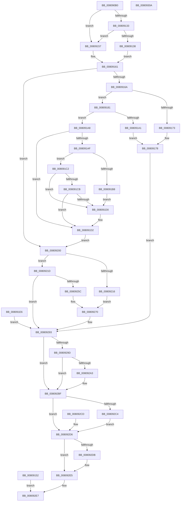

# NtInitializeEnclave

- RVA: `0x008090B0`–`0x0080930B` (길이 `603` bytes)
- VA: `0x00000001408090B0`
- 실행 섹션: `PAGE`
- PDB 이름 있음: `예`; PDB Function 태그: `아니요`
- unwind 정보 RVA: `0x000D8A08`
- 디코드: `156`개 명령, `603/603` bytes 표시
- 미해석 바이트: `0` (있으면 어셈블리에 `.byte`로 보존)

> 이 문서는 커널 이미지의 기계어와 PDB 기호를 분석해 생성했습니다. 4번과 5번은 함수 원형과 자료형을 바이너리 사용 방식에서 추정한 C 해석이며 원본 소스 복구 결과는 아닙니다.

## 1. Dependencies

- 직접 호출 지점: **9**; 고유 호출 대상: **9**
- 직접 호출자로 확인된 함수: **0**
- RIP 상대 이미지 참조: **2**

### Outgoing calls
- `0x0080918F` → [MiAllocatePool](../../text/35/MiAllocatePool_function_0035B540.md) (function, `0x0035B540`)
- `0x008091DB` → [memcpy](../../text/6C/memcpy_function_006C6840.md) (function, `0x006C6840`)
- `0x0080924D` → [ObpReferenceObjectByHandleWithTag](../86/ObpReferenceObjectByHandleWithTag_function_00869650.md) (function, `0x00869650`)
- `0x0080926B` → [KiStackAttachProcess](../../text/21/KiStackAttachProcess_function_00216820.md) (function, `0x00216820`)
- `0x00809288` → [MiInitializeEnclave](MiInitializeEnclave_function_008089D8.md) (function, `0x008089D8`)
- `0x008092AD` → [KiUnstackDetachProcess](../../text/21/KiUnstackDetachProcess_function_00217D30.md) (function, `0x00217D30`)
- `0x008092BA` → [ObfDereferenceObjectWithTag](../../text/2F/ObfDereferenceObjectWithTag_function_002F78E0.md) (function, `0x002F78E0`)
- `0x008092E0` → [ExFreePoolWithTag](../../poolcode/B8/ExFreePoolWithTag_function_00B82870.md) (function, `0x00B82870`)
- `0x008092F2` → [_security_check_cookie](../../text/6A/_security_check_cookie_function_006AC640.md) (function, `0x006AC640`)

### Direct callers
- 이 함수 시작 RVA로 연결되는 직접 call은 확인되지 않았습니다. 간접 호출은 완전히 역산할 수 없습니다.

### Static image references
- `0x008090C5` → RVA `0x00E0A740` (`.data`; read)
- `0x0080921D` → RVA `0x00FC6A98` (`ALMOSTRO`; read)

## 2. Other-region calls and transfers

- 다른 실행 섹션으로 향하는 call: **7**
  - `0x0080918F` → [MiAllocatePool](../../text/35/MiAllocatePool_function_0035B540.md) (`PAGE` → `.text`)
  - `0x008091DB` → [memcpy](../../text/6C/memcpy_function_006C6840.md) (`PAGE` → `.text`)
  - `0x0080926B` → [KiStackAttachProcess](../../text/21/KiStackAttachProcess_function_00216820.md) (`PAGE` → `.text`)
  - `0x008092AD` → [KiUnstackDetachProcess](../../text/21/KiUnstackDetachProcess_function_00217D30.md) (`PAGE` → `.text`)
  - `0x008092BA` → [ObfDereferenceObjectWithTag](../../text/2F/ObfDereferenceObjectWithTag_function_002F78E0.md) (`PAGE` → `.text`)
  - `0x008092E0` → [ExFreePoolWithTag](../../poolcode/B8/ExFreePoolWithTag_function_00B82870.md) (`PAGE` → `POOLCODE`)
  - `0x008092F2` → [_security_check_cookie](../../text/6A/_security_check_cookie_function_006AC640.md) (`PAGE` → `.text`)
- 별도 외부 분기/꼬리 이동을 확인하지 못했습니다.

## 3. Assembly (complete function range)

```asm
008090B0  4C 8B DC                        mov r11, rsp
008090B3  53                              push rbx
008090B4  56                              push rsi
008090B5  57                              push rdi
008090B6  41 54                           push r12
008090B8  41 55                           push r13
008090BA  41 56                           push r14
008090BC  41 57                           push r15
008090BE  48 81 EC C0 00 00 00            sub rsp, 0xc0
008090C5  48 8B 05 74 16 60 00            mov rax, qword ptr [rip + 0x601674]
008090CC  48 33 C4                        xor rax, rsp
008090CF  48 89 84 24 B8 00 00 00         mov qword ptr [rsp + 0xb8], rax
008090D7  45 8B E9                        mov r13d, r9d
008090DA  4D 8B F8                        mov r15, r8
008090DD  48 89 54 24 78                  mov qword ptr [rsp + 0x78], rdx
008090E2  4C 8B E1                        mov r12, rcx
008090E5  4C 8B B4 24 20 01 00 00         mov r14, qword ptr [rsp + 0x120]
008090ED  48 89 4C 24 68                  mov qword ptr [rsp + 0x68], rcx
008090F2  4C 89 74 24 70                  mov qword ptr [rsp + 0x70], r14
008090F7  0F 57 C0                        xorps xmm0, xmm0
008090FA  41 0F 11 43 90                  movups xmmword ptr [r11 - 0x70], xmm0
008090FF  41 0F 11 43 A0                  movups xmmword ptr [r11 - 0x60], xmm0
00809104  41 0F 11 43 B0                  movups xmmword ptr [r11 - 0x50], xmm0
00809109  48 83 64 24 50 00               and qword ptr [rsp + 0x50], 0
0080910F  83 64 24 48 00                  and dword ptr [rsp + 0x48], 0
00809114  33 FF                           xor edi, edi
00809116  48 89 7C 24 58                  mov qword ptr [rsp + 0x58], rdi
0080911B  65 48 8B 04 25 88 01 00 00      mov rax, qword ptr gs:[0x188]
00809124  8A 90 32 02 00 00               mov dl, byte ptr [rax + 0x232]
0080912A  88 54 24 40                     mov byte ptr [rsp + 0x40], dl
0080912E  4D 85 F6                        test r14, r14
00809131  74 24                           je 0x140809157
00809133  80 FA 01                        cmp dl, 1
00809136  75 1F                           jne 0x140809157
00809138  48 BB 00 00 FF FF FF 7F 00 00   movabs rbx, 0x7fffffff0000
00809142  48 8B CB                        mov rcx, rbx
00809145  4C 3B F3                        cmp r14, rbx
00809148  49 0F 42 CE                     cmovb rcx, r14
0080914C  8B 01                           mov eax, dword ptr [rcx]
0080914E  89 01                           mov dword ptr [rcx], eax
00809150  EB 0F                           jmp 0x140809161
00809152  E9 90 01 00 00                  jmp 0x1408092e7
00809157  48 BB 00 00 FF FF FF 7F 00 00   movabs rbx, 0x7fffffff0000
00809161  45 85 C9                        test r9d, r9d
00809164  0F 84 96 00 00 00               je 0x140809200
0080916A  41 81 FD 00 10 00 00            cmp r13d, 0x1000
00809171  76 0E                           jbe 0x140809181
00809173  BB 04 00 00 C0                  mov ebx, 0xc0000004
00809178  89 5C 24 44                     mov dword ptr [rsp + 0x44], ebx
0080917C  E9 12 01 00 00                  jmp 0x140809293
00809181  41 B8 4D 6D 45 44               mov r8d, 0x44456d4d
00809187  49 8B D5                        mov rdx, r13
0080918A  B9 00 01 00 00                  mov ecx, 0x100
0080918F  E8 AC 23 B5 FF                  call 0x14035b540
00809194  48 8B F8                        mov rdi, rax
00809197  48 89 44 24 58                  mov qword ptr [rsp + 0x58], rax
0080919C  48 85 C0                        test rax, rax
0080919F  75 07                           jne 0x1408091a8
008091A1  BB 9A 00 00 C0                  mov ebx, 0xc000009a
008091A6  EB D0                           jmp 0x140809178
008091A8  80 7C 24 40 01                  cmp byte ptr [rsp + 0x40], 1
008091AD  75 23                           jne 0x1408091d2
008091AF  49 81 FD 00 00 01 00            cmp r13, 0x10000
008091B6  73 0A                           jae 0x1408091c2
008091B8  4C 3B FB                        cmp r15, rbx
008091BB  49 0F 42 DF                     cmovb rbx, r15
008091BF  90                              nop
008091C0  EB 0E                           jmp 0x1408091d0
008091C2  4B 8D 04 2F                     lea rax, [r15 + r13]
008091C6  48 3B C3                        cmp rax, rbx
008091C9  77 05                           ja 0x1408091d0
008091CB  49 3B C7                        cmp rax, r15
008091CE  73 02                           jae 0x1408091d2
008091D0  8A 03                           mov al, byte ptr [rbx]
008091D2  4D 8B C5                        mov r8, r13
008091D5  49 8B D7                        mov rdx, r15
008091D8  48 8B CF                        mov rcx, rdi
008091DB  E8 60 D6 EB FF                  call 0x1406c6840
008091E0  8A 54 24 40                     mov dl, byte ptr [rsp + 0x40]
008091E4  EB 1A                           jmp 0x140809200
008091E6  8B D8                           mov ebx, eax
008091E8  89 44 24 44                     mov dword ptr [rsp + 0x44], eax
008091EC  48 8B 7C 24 58                  mov rdi, qword ptr [rsp + 0x58]
008091F1  4C 8B 64 24 68                  mov r12, qword ptr [rsp + 0x68]
008091F6  4C 8B 74 24 70                  mov r14, qword ptr [rsp + 0x70]
008091FB  E9 93 00 00 00                  jmp 0x140809293
00809200  65 48 8B 04 25 88 01 00 00      mov rax, qword ptr gs:[0x188]
00809209  48 8B B0 B8 00 00 00            mov rsi, qword ptr [rax + 0xb8]
00809210  49 83 FC FF                     cmp r12, -1
00809214  75 07                           jne 0x14080921d
00809216  48 89 74 24 50                  mov qword ptr [rsp + 0x50], rsi
0080921B  EB 53                           jmp 0x140809270
0080921D  4C 8B 05 74 D8 7B 00            mov r8, qword ptr [rip + 0x7bd874]
00809224  48 83 64 24 38 00               and qword ptr [rsp + 0x38], 0
0080922A  48 83 64 24 30 00               and qword ptr [rsp + 0x30], 0
00809230  48 8D 44 24 50                  lea rax, [rsp + 0x50]
00809235  48 89 44 24 28                  mov qword ptr [rsp + 0x28], rax
0080923A  C7 44 24 20 4D 6D 56 6D         mov dword ptr [rsp + 0x20], 0x6d566d4d
00809242  44 8A CA                        mov r9b, dl
00809245  BA 08 00 00 00                  mov edx, 8
0080924A  49 8B CC                        mov rcx, r12
0080924D  E8 FE 03 06 00                  call 0x140869650
00809252  8B D8                           mov ebx, eax
00809254  89 44 24 44                     mov dword ptr [rsp + 0x44], eax
00809258  85 C0                           test eax, eax
0080925A  78 37                           js 0x140809293
0080925C  4C 8D 84 24 88 00 00 00         lea r8, [rsp + 0x88]
00809264  33 D2                           xor edx, edx
00809266  48 8B 4C 24 50                  mov rcx, qword ptr [rsp + 0x50]
0080926B  E8 B0 D5 A0 FF                  call 0x140216820
00809270  48 8D 44 24 48                  lea rax, [rsp + 0x48]
00809275  48 89 44 24 20                  mov qword ptr [rsp + 0x20], rax
0080927A  45 8B CD                        mov r9d, r13d
0080927D  4C 8B C7                        mov r8, rdi
00809280  48 8B 54 24 78                  mov rdx, qword ptr [rsp + 0x78]
00809285  48 8B CE                        mov rcx, rsi
00809288  E8 4B F7 FF FF                  call 0x1408089d8
0080928D  8B D8                           mov ebx, eax
0080928F  89 44 24 44                     mov dword ptr [rsp + 0x44], eax
00809293  48 8B 74 24 50                  mov rsi, qword ptr [rsp + 0x50]
00809298  48 85 F6                        test rsi, rsi
0080929B  74 22                           je 0x1408092bf
0080929D  49 83 FC FF                     cmp r12, -1
008092A1  74 1C                           je 0x1408092bf
008092A3  33 D2                           xor edx, edx
008092A5  48 8D 8C 24 88 00 00 00         lea rcx, [rsp + 0x88]
008092AD  E8 7E EA A0 FF                  call 0x140217d30
008092B2  BA 4D 6D 56 6D                  mov edx, 0x6d566d4d
008092B7  48 8B CE                        mov rcx, rsi
008092BA  E8 21 E6 AE FF                  call 0x1402f78e0
008092BF  4D 85 F6                        test r14, r14
008092C2  74 12                           je 0x1408092d6
008092C4  8B 44 24 48                     mov eax, dword ptr [rsp + 0x48]
008092C8  41 89 06                        mov dword ptr [r14], eax
008092CB  EB 09                           jmp 0x1408092d6
008092CD  8B 5C 24 44                     mov ebx, dword ptr [rsp + 0x44]
008092D1  48 8B 7C 24 58                  mov rdi, qword ptr [rsp + 0x58]
008092D6  48 85 FF                        test rdi, rdi
008092D9  74 0A                           je 0x1408092e5
008092DB  33 D2                           xor edx, edx
008092DD  48 8B CF                        mov rcx, rdi
008092E0  E8 8B 95 37 00                  call 0x140b82870
008092E5  8B C3                           mov eax, ebx
008092E7  48 8B 8C 24 B8 00 00 00         mov rcx, qword ptr [rsp + 0xb8]
008092EF  48 33 CC                        xor rcx, rsp
008092F2  E8 49 33 EA FF                  call 0x1406ac640
008092F7  48 81 C4 C0 00 00 00            add rsp, 0xc0
008092FE  41 5F                           pop r15
00809300  41 5E                           pop r14
00809302  41 5D                           pop r13
00809304  41 5C                           pop r12
00809306  5F                              pop rdi
00809307  5E                              pop rsi
00809308  5B                              pop rbx
00809309  C3                              ret
0080930A  CC                              int3
```

## 4. C-style interpretation (structured pseudocode)

```c
__int64 __fastcall NtInitializeEnclave(__int64 a1, __int64 a2, __int64 a3, int a4, __int64 a5)
{
    __int64 result;
    __int64 v_rbx;
    __int64 v_rdi;
    __int64 v_rsp;
    unsigned __int64 v_stack_m40;
    unsigned __int64 v_stack_m70;
    unsigned __int64 v_stack_m80;
    unsigned __int64 v_stack_m88;
    unsigned __int64 v_stack_m90;
    unsigned __int64 v_stack_mA0;
    unsigned __int64 v_stack_mA8;
    unsigned int v_stack_mB0;
    unsigned int v_stack_mB4;
    unsigned __int8 v_stack_mB8;
    unsigned __int64 v_stack_mC0;
    unsigned __int64 v_stack_mC8;
    unsigned __int64 v_stack_mD0;
    unsigned int v_stack_mD8;

    v_rsp = (v_rsp) - (192);
    result = (*(unsigned __int64 *)(v_rip + 6297204)) ^ (v_rsp);
    v_stack_m40 = result;
    v_stack_m80 = a2;
    v_stack_m90 = a1;
    v_stack_m88 = a5;
    *(unsigned __int64 *)(v_rsp - 112) = v_xmm0;
    *(unsigned __int64 *)(v_rsp - 96) = v_xmm0;
    *(unsigned __int64 *)(v_rsp - 80) = v_xmm0;
    v_rdi = 0;
    v_stack_mA0 = 0;
    v_stack_mB8 = (unsigned __int8)(*(unsigned __int8 *)(*(unsigned __int64 *)(gs_base + (0 + 392)) + 562));
    if (a5 == 0) goto loc_00809157;
    if (((unsigned __int8)(*(unsigned __int8 *)(*(unsigned __int64 *)(gs_base + (0 + 392)) + 562))) != 1) goto loc_00809157;
    a1 = v_rbx;
    if (a5 < v_rbx) { a1 = a5; }
    *(unsigned int *)(a1) = (unsigned int)((unsigned int)(*(unsigned int *)(a1)));
    goto loc_00809161;
loc_00809157:
loc_00809161:
    if (a4 == 0) goto loc_00809200;
    if (((unsigned int)((unsigned int)(a4))) <= 0x1000ULL) goto loc_00809181;
loc_00809178:
    v_stack_mB4 = (unsigned int)((unsigned int)(0xC0000004ULL));
    goto loc_00809293;
loc_00809181:
    result = MiAllocatePool(256, (unsigned int)(a4), (unsigned int)(0x44456D4DULL), a4);
    v_stack_mA0 = result;
    if (result != 0) goto loc_008091A8;
    goto loc_00809178;
loc_008091A8:
    if (v_stack_mB8 != 1) goto loc_008091D2;
    if (((unsigned int)(a4)) >= 0x10000ULL) goto loc_008091C2;
    v_rbx = (unsigned int)(0xC000009AULL);
    if (a3 < ((unsigned int)(0xC000009AULL))) { v_rbx = a3; }
    goto loc_008091D0;
loc_008091C2:
    if ((a3 + (unsigned int)(a4) * 1) > v_rbx) goto loc_008091D0;
    result = a3 + (unsigned int)(a4) * 1;
    if ((a3 + (unsigned int)(a4) * 1) < a3) {
        result = *(unsigned __int8 *)(v_rbx);
    }
    result = memcpy(result, a3, (unsigned int)(a4), a4);
    goto loc_00809200;
loc_00809200:
    if (a1 != -1) goto loc_0080921D;
    v_stack_mA8 = *(unsigned __int64 *)(*(unsigned __int64 *)(gs_base + (0 + 392)) + 184);
    goto loc_00809270;
loc_0080921D:
    v_stack_mD0 = v_stack_mA8;
    v_stack_mD8 = 0x6D566D4DULL;
    result = ObpReferenceObjectByHandleWithTag(a1, 8, *(unsigned __int64 *)(v_rip + 8116340), (unsigned __int8)(v_stack_mB8));
    v_stack_mB4 = (unsigned int)(result);
    if (sign_flag) goto loc_00809293;
    a2 = 0;
    result = KiStackAttachProcess(v_stack_mA8, a2, v_stack_m70, (unsigned __int8)(v_stack_mB8));
loc_00809270:
    v_stack_mD8 = v_stack_mB0;
    result = MiInitializeEnclave(*(unsigned __int64 *)(*(unsigned __int64 *)(gs_base + (0 + 392)) + 184), v_stack_m80, result, (unsigned int)((unsigned int)((unsigned int)(a4))));
    v_stack_mB4 = (unsigned int)(result);
loc_00809293:
    if (v_stack_mA8 == 0) goto loc_008092BF;
    if (a1 != -1) {
        a2 = 0;
        a1 = v_stack_m70;
        result = KiUnstackDetachProcess(a1, a2, result, (unsigned int)((unsigned int)((unsigned int)(a4))));
        a2 = 0x6D566D4DULL;
        a1 = v_stack_mA8;
        result = ObfDereferenceObjectWithTag(a1, a2, result, (unsigned int)((unsigned int)((unsigned int)(a4))));
    }
    if (a5 == 0) goto loc_008092D6;
    *(unsigned int *)(a5) = (unsigned int)((unsigned int)(v_stack_mB0));
    goto loc_008092D6;
loc_008092D6:
    result = (unsigned int)(v_stack_mB0);
    if (result != 0) {
        a2 = 0;
        a1 = result;
        result = ExFreePoolWithTag(a1, a2, result, (unsigned int)((unsigned int)((unsigned int)(a4))));
    }
loc_008092E7:
    a1 = (v_stack_m40) ^ (v_rsp);
    result = _security_check_cookie(a1, a2, result, (unsigned int)((unsigned int)((unsigned int)(a4))));
    v_rsp = (v_rsp) + (192);
    return result;
}
```

## 5. (Beta) C Style

```c
int64_t NtInitializeEnclave(int64_t Arg1, int64_t Arg2, void *Arg3, int32_t Arg4, int64_t Arg5)
{
    uint8_t *arg3 = (uint8_t *)Arg3;

    int64_t result;
    int64_t local_rbx;
    int64_t local_rdi;
    int64_t local_rsp;
    uint64_t v_stack_m40;
    uint64_t v_stack_m70;
    uint64_t v_stack_m80;
    uint64_t v_stack_m88;
    uint64_t v_stack_m90;
    uint64_t v_stack_mA0;
    uint64_t v_stack_mA8;
    uint32_t v_stack_mB0;
    uint32_t v_stack_mB4;
    uint8_t v_stack_mB8;
    uint64_t v_stack_mC0;
    uint64_t v_stack_mC8;
    uint64_t v_stack_mD0;
    uint32_t v_stack_mD8;

    local_rsp = (local_rsp) - (192);
    result = (*(uint64_t *)(v_rip + 0x601674)) ^ (local_rsp);
    v_stack_m40 = result;
    v_stack_m80 = Arg2;
    v_stack_m90 = Arg1;
    v_stack_m88 = Arg5;
    *(uint64_t *)(local_rsp - 0x70) = v_xmm0;
    *(uint64_t *)(local_rsp - 0x60) = v_xmm0;
    *(uint64_t *)(local_rsp - 0x50) = v_xmm0;
    local_rdi = 0;
    v_stack_mA0 = 0;
    v_stack_mB8 = (uint8_t)(*(uint8_t *)(*(uint64_t *)(gs_base + (0 + 0x188)) + 0x232));
    if (Arg5 == 0) goto loc_00809157;
    if (((uint8_t)(*(uint8_t *)(*(uint64_t *)(gs_base + (0 + 0x188)) + 0x232))) != 1) goto loc_00809157;
    Arg1 = local_rbx;
    if (Arg5 < local_rbx) { Arg1 = Arg5; }
    *(uint32_t *)(Arg1) = (uint32_t)((uint32_t)(*(uint32_t *)(Arg1)));
    goto loc_00809161;
loc_00809157:
loc_00809161:
    if (Arg4 == 0) goto loc_00809200;
    if (((uint32_t)((uint32_t)(Arg4))) <= 0x1000ULL) goto loc_00809181;
loc_00809178:
    v_stack_mB4 = (uint32_t)((uint32_t)(0xC0000004ULL));
    goto loc_00809293;
loc_00809181:
    result = MiAllocatePool(256, (uint32_t)(Arg4), (uint32_t)(0x44456D4DULL), Arg4);
    v_stack_mA0 = result;
    if (result != 0) goto loc_008091A8;
    goto loc_00809178;
loc_008091A8:
    if (v_stack_mB8 != 1) goto loc_008091D2;
    if (((uint32_t)(Arg4)) >= 0x10000ULL) goto loc_008091C2;
    local_rbx = (uint32_t)(0xC000009AULL);
    if (Arg3 < ((uint32_t)(0xC000009AULL))) { local_rbx = Arg3; }
    goto loc_008091D0;
loc_008091C2:
    if ((Arg3 + (uint32_t)(Arg4) * 1) > local_rbx) goto loc_008091D0;
    result = Arg3 + (uint32_t)(Arg4) * 1;
    if ((Arg3 + (uint32_t)(Arg4) * 1) < Arg3) {
        result = *(uint8_t *)(local_rbx);
    }
    result = memcpy(result, Arg3, (uint32_t)(Arg4), Arg4);
    goto loc_00809200;
loc_00809200:
    if (Arg1 != -1) goto loc_0080921D;
    v_stack_mA8 = *(uint64_t *)(*(uint64_t *)(gs_base + (0 + 0x188)) + 0xB8);
    goto loc_00809270;
loc_0080921D:
    v_stack_mD0 = v_stack_mA8;
    v_stack_mD8 = 0x6D566D4DULL;
    result = ObpReferenceObjectByHandleWithTag(Arg1, 8, *(uint64_t *)(v_rip + 0x7BD874), (uint8_t)(v_stack_mB8));
    v_stack_mB4 = (uint32_t)(result);
    if (sign_flag) goto loc_00809293;
    Arg2 = 0;
    result = KiStackAttachProcess(v_stack_mA8, Arg2, v_stack_m70, (uint8_t)(v_stack_mB8));
loc_00809270:
    v_stack_mD8 = v_stack_mB0;
    result = MiInitializeEnclave(*(uint64_t *)(*(uint64_t *)(gs_base + (0 + 0x188)) + 0xB8), v_stack_m80, result, (uint32_t)((uint32_t)((uint32_t)(Arg4))));
    v_stack_mB4 = (uint32_t)(result);
loc_00809293:
    if (v_stack_mA8 == 0) goto loc_008092BF;
    if (Arg1 != -1) {
        Arg2 = 0;
        Arg1 = v_stack_m70;
        result = KiUnstackDetachProcess(Arg1, Arg2, result, (uint32_t)((uint32_t)((uint32_t)(Arg4))));
        Arg2 = 0x6D566D4DULL;
        Arg1 = v_stack_mA8;
        result = ObfDereferenceObjectWithTag(Arg1, Arg2, result, (uint32_t)((uint32_t)((uint32_t)(Arg4))));
    }
    if (Arg5 == 0) goto loc_008092D6;
    *(uint32_t *)(Arg5) = (uint32_t)((uint32_t)(v_stack_mB0));
    goto loc_008092D6;
loc_008092D6:
    result = (uint32_t)(v_stack_mB0);
    if (result != 0) {
        Arg2 = 0;
        Arg1 = result;
        result = ExFreePoolWithTag(Arg1, Arg2, result, (uint32_t)((uint32_t)((uint32_t)(Arg4))));
    }
loc_008092E7:
    Arg1 = (v_stack_m40) ^ (local_rsp);
    result = _security_check_cookie(Arg1, Arg2, result, (uint32_t)((uint32_t)((uint32_t)(Arg4))));
    local_rsp = (local_rsp) + (192);
    return result;
}
```

### 관측된 메모리 오프셋

구조체 형식이 확인되지 않은 접근은 인자 기준의 오프셋으로만 기록했습니다.

| 기준 인자 | 오프셋 표현 | 폭 (bit) | 접근 |
|---|---:|---:|---|
| `Arg3` | `+ 0x0 + r13*1` | `64` | `R` |

## 6. Execution-region graph

[열기: 2D/3D 그래프와 함수 탐색 컨트롤 패널](../../../control-panel.html?section=page&rva=0x008090B0&view=graph)

- 2D 그래프는 위에서 아래로 흐르고, 3D 그래프는 빈 공간을 드래그해 회전합니다. Shift+드래그는 이동, 휠은 확대·축소, 함수 노드 선택은 대상 보고서 이동입니다.

### Static fallback


