# NtMapUserPhysicalPagesScatter

- RVA: `0x0080B750`–`0x0080BAF1` (길이 `929` bytes)
- VA: `0x000000014080B750`
- 실행 섹션: `PAGE`
- PDB 이름 있음: `예`; PDB Function 태그: `아니요`
- unwind 정보 RVA: `0x000D8CB4`
- 디코드: `247`개 명령, `929/929` bytes 표시
- 미해석 바이트: `0` (있으면 어셈블리에 `.byte`로 보존)

> 이 문서는 커널 이미지의 기계어와 PDB 기호를 분석해 생성했습니다. 4번과 5번은 함수 원형과 자료형을 바이너리 사용 방식에서 추정한 C 해석이며 원본 소스 복구 결과는 아닙니다.

## 1. Dependencies

- 직접 호출 지점: **17**; 고유 호출 대상: **14**
- 직접 호출자로 확인된 함수: **0**
- RIP 상대 이미지 참조: **1**

### Outgoing calls
- `0x0080B792` → [memset](../../text/6C/memset_function_006C6C40.md) (function, `0x006C6C40`)
- `0x0080B7D4` → [Feature_Servicing_Mm_AweLazyFlushOptIn__private_IsEnabledDeviceUsageNoInline](../../text/68/Feature_Servicing_Mm_AweLazyFlushOptIn__private_IsEnabledDeviceUsageNoInline_function_00687974.md) (function, `0x00687974`)
- `0x0080B825` → [MiAllocatePool](../../text/35/MiAllocatePool_function_0035B540.md) (function, `0x0035B540`)
- `0x0080B84A` → [MiCaptureUlongPtrArray](MiCaptureUlongPtrArray_function_0080A664.md) (function, `0x0080A664`)
- `0x0080B895` → [MiCaptureUlongPtrArray](MiCaptureUlongPtrArray_function_0080A664.md) (function, `0x0080A664`)
- `0x0080B8B5` → [MiLockAweVadsShared](../../text/4C/MiLockAweVadsShared_function_004CEE3C.md) (function, `0x004CEE3C`)
- `0x0080B8C5` → [MiGetAweNode](../../text/4F/MiGetAweNode_function_004F600C.md) (function, `0x004F600C`)
- `0x0080B905` → [MiGetAwePageSize](../../text/46/MiGetAwePageSize_function_0046CFA8.md) (function, `0x0046CFA8`)
- `0x0080B97D` → [MiGetAweNode](../../text/4F/MiGetAweNode_function_004F600C.md) (function, `0x004F600C`)
- `0x0080B9ED` → [MiLockAwePagesShared](../../text/4B/MiLockAwePagesShared_function_004B9D2C.md) (function, `0x004B9D2C`)
- `0x0080BA29` → [MiWriteAwePtes](../../text/4C/MiWriteAwePtes_function_004C51E0.md) (function, `0x004C51E0`)
- `0x0080BA39` → [MiUnlockAwePagesShared](../../text/4C/MiUnlockAwePagesShared_function_004C66C4.md) (function, `0x004C66C4`)
- `0x0080BA6B` → [MiReferenceIncomingPhysicalPages](../../text/68/MiReferenceIncomingPhysicalPages_function_006892C0.md) (function, `0x006892C0`)
- `0x0080BA97` → [MiFreePhysicalPageChain](../../text/2A/MiFreePhysicalPageChain_function_002A9F1C.md) (function, `0x002A9F1C`)
- `0x0080BAA7` → [MiUnlockAwePagesShared](../../text/4C/MiUnlockAwePagesShared_function_004C66C4.md) (function, `0x004C66C4`)
- `0x0080BABE` → [ExFreePoolWithTag](../../poolcode/B8/ExFreePoolWithTag_function_00B82870.md) (function, `0x00B82870`)
- `0x0080BAD0` → [_security_check_cookie](../../text/6A/_security_check_cookie_function_006AC640.md) (function, `0x006AC640`)

### Direct callers
- 이 함수 시작 RVA로 연결되는 직접 call은 확인되지 않았습니다. 간접 호출은 완전히 역산할 수 없습니다.

### Static image references
- `0x0080B767` → RVA `0x00E0A740` (`.data`; read)

## 2. Other-region calls and transfers

- 다른 실행 섹션으로 향하는 call: **15**
  - `0x0080B792` → [memset](../../text/6C/memset_function_006C6C40.md) (`PAGE` → `.text`)
  - `0x0080B7D4` → [Feature_Servicing_Mm_AweLazyFlushOptIn__private_IsEnabledDeviceUsageNoInline](../../text/68/Feature_Servicing_Mm_AweLazyFlushOptIn__private_IsEnabledDeviceUsageNoInline_function_00687974.md) (`PAGE` → `.text`)
  - `0x0080B825` → [MiAllocatePool](../../text/35/MiAllocatePool_function_0035B540.md) (`PAGE` → `.text`)
  - `0x0080B8B5` → [MiLockAweVadsShared](../../text/4C/MiLockAweVadsShared_function_004CEE3C.md) (`PAGE` → `.text`)
  - `0x0080B8C5` → [MiGetAweNode](../../text/4F/MiGetAweNode_function_004F600C.md) (`PAGE` → `.text`)
  - `0x0080B905` → [MiGetAwePageSize](../../text/46/MiGetAwePageSize_function_0046CFA8.md) (`PAGE` → `.text`)
  - `0x0080B97D` → [MiGetAweNode](../../text/4F/MiGetAweNode_function_004F600C.md) (`PAGE` → `.text`)
  - `0x0080B9ED` → [MiLockAwePagesShared](../../text/4B/MiLockAwePagesShared_function_004B9D2C.md) (`PAGE` → `.text`)
  - `0x0080BA29` → [MiWriteAwePtes](../../text/4C/MiWriteAwePtes_function_004C51E0.md) (`PAGE` → `.text`)
  - `0x0080BA39` → [MiUnlockAwePagesShared](../../text/4C/MiUnlockAwePagesShared_function_004C66C4.md) (`PAGE` → `.text`)
  - `0x0080BA6B` → [MiReferenceIncomingPhysicalPages](../../text/68/MiReferenceIncomingPhysicalPages_function_006892C0.md) (`PAGE` → `.text`)
  - `0x0080BA97` → [MiFreePhysicalPageChain](../../text/2A/MiFreePhysicalPageChain_function_002A9F1C.md) (`PAGE` → `.text`)
  - `0x0080BAA7` → [MiUnlockAwePagesShared](../../text/4C/MiUnlockAwePagesShared_function_004C66C4.md) (`PAGE` → `.text`)
  - `0x0080BABE` → [ExFreePoolWithTag](../../poolcode/B8/ExFreePoolWithTag_function_00B82870.md) (`PAGE` → `POOLCODE`)
  - `0x0080BAD0` → [_security_check_cookie](../../text/6A/_security_check_cookie_function_006AC640.md) (`PAGE` → `.text`)
- 별도 외부 분기/꼬리 이동을 확인하지 못했습니다.

## 3. Assembly (complete function range)

```asm
0080B750  48 89 5C 24 20                  mov qword ptr [rsp + 0x20], rbx
0080B755  55                              push rbp
0080B756  56                              push rsi
0080B757  57                              push rdi
0080B758  41 54                           push r12
0080B75A  41 55                           push r13
0080B75C  41 56                           push r14
0080B75E  41 57                           push r15
0080B760  48 81 EC 90 20 00 00            sub rsp, 0x2090
0080B767  48 8B 05 D2 EF 5F 00            mov rax, qword ptr [rip + 0x5fefd2]
0080B76E  48 33 C4                        xor rax, rsp
0080B771  48 89 84 24 80 20 00 00         mov qword ptr [rsp + 0x2080], rax
0080B779  49 8B D8                        mov rbx, r8
0080B77C  48 8B EA                        mov rbp, rdx
0080B77F  48 8B F9                        mov rdi, rcx
0080B782  33 D2                           xor edx, edx
0080B784  41 B8 00 10 00 00               mov r8d, 0x1000
0080B78A  48 8D 8C 24 80 00 00 00         lea rcx, [rsp + 0x80]
0080B792  E8 A9 B4 EB FF                  call 0x1406c6c40
0080B797  33 C0                           xor eax, eax
0080B799  0F 57 C0                        xorps xmm0, xmm0
0080B79C  48 89 44 24 78                  mov qword ptr [rsp + 0x78], rax
0080B7A1  48 B8 FF FF FF FF FF FF 0F 00   movabs rax, 0xfffffffffffff
0080B7AB  0F 11 44 24 68                  movups xmmword ptr [rsp + 0x68], xmm0
0080B7B0  48 3B E8                        cmp rbp, rax
0080B7B3  76 0A                           jbe 0x14080b7bf
0080B7B5  B8 F0 00 00 C0                  mov eax, 0xc00000f0
0080B7BA  E9 06 03 00 00                  jmp 0x14080bac5
0080B7BF  48 83 64 24 48 00               and qword ptr [rsp + 0x48], 0
0080B7C5  48 83 64 24 40 00               and qword ptr [rsp + 0x40], 0
0080B7CB  65 4C 8B 2C 25 88 01 00 00      mov r13, qword ptr gs:[0x188]
0080B7D4  E8 9B C1 E7 FF                  call 0x140687974
0080B7D9  44 8B E0                        mov r12d, eax
0080B7DC  4C 8D 3C ED 00 00 00 00         lea r15, [rbp*8]
0080B7E4  F7 D8                           neg eax
0080B7E6  4C 8D B4 24 80 00 00 00         lea r14, [rsp + 0x80]
0080B7EE  49 8B D7                        mov rdx, r15
0080B7F1  48 1B F6                        sbb rsi, rsi
0080B7F4  48 23 F3                        and rsi, rbx
0080B7F7  48 81 FD 00 02 00 00            cmp rbp, 0x200
0080B7FE  76 3C                           jbe 0x14080b83c
0080B800  45 85 E4                        test r12d, r12d
0080B803  74 0D                           je 0x14080b812
0080B805  48 03 D2                        add rdx, rdx
0080B808  48 83 FB 01                     cmp rbx, 1
0080B80C  49 0F 46 D7                     cmovbe rdx, r15
0080B810  EB 08                           jmp 0x14080b81a
0080B812  48 85 DB                        test rbx, rbx
0080B815  74 03                           je 0x14080b81a
0080B817  48 03 D2                        add rdx, rdx
0080B81A  B9 40 00 00 00                  mov ecx, 0x40
0080B81F  41 B8 4D 6D 52 77               mov r8d, 0x77526d4d
0080B825  E8 16 FD B4 FF                  call 0x14035b540
0080B82A  4C 8B F0                        mov r14, rax
0080B82D  48 85 C0                        test rax, rax
0080B830  75 0A                           jne 0x14080b83c
0080B832  B8 9A 00 00 C0                  mov eax, 0xc000009a
0080B837  E9 89 02 00 00                  jmp 0x14080bac5
0080B83C  4C 8B C5                        mov r8, rbp
0080B83F  4C 89 74 24 50                  mov qword ptr [rsp + 0x50], r14
0080B844  48 8B D7                        mov rdx, rdi
0080B847  49 8B CE                        mov rcx, r14
0080B84A  E8 15 EE FF FF                  call 0x14080a664
0080B84F  8B F8                           mov edi, eax
0080B851  85 C0                           test eax, eax
0080B853  0F 88 22 02 00 00               js 0x14080ba7b
0080B859  48 85 ED                        test rbp, rbp
0080B85C  75 07                           jne 0x14080b865
0080B85E  33 C0                           xor eax, eax
0080B860  E9 60 02 00 00                  jmp 0x14080bac5
0080B865  45 85 E4                        test r12d, r12d
0080B868  74 08                           je 0x14080b872
0080B86A  48 83 FB 01                     cmp rbx, 1
0080B86E  76 34                           jbe 0x14080b8a4
0080B870  EB 05                           jmp 0x14080b877
0080B872  48 85 DB                        test rbx, rbx
0080B875  74 2D                           je 0x14080b8a4
0080B877  48 8D B4 24 80 10 00 00         lea rsi, [rsp + 0x1080]
0080B87F  48 81 FD 00 02 00 00            cmp rbp, 0x200
0080B886  76 04                           jbe 0x14080b88c
0080B888  4B 8D 34 37                     lea rsi, [r15 + r14]
0080B88C  4C 8B C5                        mov r8, rbp
0080B88F  48 8B D3                        mov rdx, rbx
0080B892  48 8B CE                        mov rcx, rsi
0080B895  E8 CA ED FF FF                  call 0x14080a664
0080B89A  8B F8                           mov edi, eax
0080B89C  85 C0                           test eax, eax
0080B89E  0F 88 D7 01 00 00               js 0x14080ba7b
0080B8A4  49 8B 1E                        mov rbx, qword ptr [r14]
0080B8A7  4B 8D 04 37                     lea rax, [r15 + r14]
0080B8AB  49 8B CD                        mov rcx, r13
0080B8AE  48 89 44 24 58                  mov qword ptr [rsp + 0x58], rax
0080B8B3  33 FF                           xor edi, edi
0080B8B5  E8 82 35 CC FF                  call 0x1404cee3c
0080B8BA  48 8B CB                        mov rcx, rbx
0080B8BD  48 89 44 24 48                  mov qword ptr [rsp + 0x48], rax
0080B8C2  4C 8B F8                        mov r15, rax
0080B8C5  E8 42 A7 CE FF                  call 0x1404f600c
0080B8CA  4C 8B D8                        mov r11, rax
0080B8CD  48 85 C0                        test rax, rax
0080B8D0  75 0F                           jne 0x14080b8e1
0080B8D2  4C 8B 64 24 40                  mov r12, qword ptr [rsp + 0x40]
0080B8D7  BF EF 00 00 C0                  mov edi, 0xc00000ef
0080B8DC  E9 A4 01 00 00                  jmp 0x14080ba85
0080B8E1  8B 40 28                        mov eax, dword ptr [rax + 0x28]
0080B8E4  A8 03                           test al, 3
0080B8E6  75 EA                           jne 0x14080b8d2
0080B8E8  4D 8B 43 18                     mov r8, qword ptr [r11 + 0x18]
0080B8EC  41 B9 00 00 20 04               mov r9d, 0x4200000
0080B8F2  4D 8B 7B 20                     mov r15, qword ptr [r11 + 0x20]
0080B8F6  49 8B CF                        mov rcx, r15
0080B8F9  4C 89 5C 24 40                  mov qword ptr [rsp + 0x40], r11
0080B8FE  41 8B 58 30                     mov ebx, dword ptr [r8 + 0x30]
0080B902  41 23 D9                        and ebx, r9d
0080B905  E8 9E 16 C6 FF                  call 0x14046cfa8
0080B90A  48 8B C8                        mov rcx, rax
0080B90D  48 89 44 24 60                  mov qword ptr [rsp + 0x60], rax
0080B912  49 8B C6                        mov rax, r14
0080B915  41 BB EF 00 00 C0               mov r11d, 0xc00000ef
0080B91B  48 8B 10                        mov rdx, qword ptr [rax]
0080B91E  48 83 F9 01                     cmp rcx, 1
0080B922  75 05                           jne 0x14080b929
0080B924  4C 8B CA                        mov r9, rdx
0080B927  EB 18                           jmp 0x14080b941
0080B929  48 C1 E1 0C                     shl rcx, 0xc
0080B92D  48 8D 41 FF                     lea rax, [rcx - 1]
0080B931  48 85 C2                        test rdx, rax
0080B934  0F 85 3E 01 00 00               jne 0x14080ba78
0080B93A  4C 8D 4A FF                     lea r9, [rdx - 1]
0080B93E  4C 03 C9                        add r9, rcx
0080B941  41 0F B6 48 20                  movzx ecx, byte ptr [r8 + 0x20]
0080B946  41 8B 40 18                     mov eax, dword ptr [r8 + 0x18]
0080B94A  48 C1 E1 20                     shl rcx, 0x20
0080B94E  48 0B C8                        or rcx, rax
0080B951  48 C1 E1 0C                     shl rcx, 0xc
0080B955  48 3B D1                        cmp rdx, rcx
0080B958  72 20                           jb 0x14080b97a
0080B95A  41 0F B6 48 21                  movzx ecx, byte ptr [r8 + 0x21]
0080B95F  41 8B 40 1C                     mov eax, dword ptr [r8 + 0x1c]
0080B963  48 C1 E1 20                     shl rcx, 0x20
0080B967  48 0B C8                        or rcx, rax
0080B96A  48 C1 E1 0C                     shl rcx, 0xc
0080B96E  48 81 C9 FF 0F 00 00            or rcx, 0xfff
0080B975  4C 3B C9                        cmp r9, rcx
0080B978  76 4E                           jbe 0x14080b9c8
0080B97A  48 8B CA                        mov rcx, rdx
0080B97D  E8 8A A6 CE FF                  call 0x1404f600c
0080B982  48 85 C0                        test rax, rax
0080B985  0F 84 ED 00 00 00               je 0x14080ba78
0080B98B  8B 48 28                        mov ecx, dword ptr [rax + 0x28]
0080B98E  F6 C1 03                        test cl, 3
0080B991  0F 85 E1 00 00 00               jne 0x14080ba78
0080B997  4C 39 78 20                     cmp qword ptr [rax + 0x20], r15
0080B99B  0F 85 D7 00 00 00               jne 0x14080ba78
0080B9A1  4C 8B 40 18                     mov r8, qword ptr [rax + 0x18]
0080B9A5  41 B9 00 00 20 04               mov r9d, 0x4200000
0080B9AB  41 8B 40 30                     mov eax, dword ptr [r8 + 0x30]
0080B9AF  41 23 C1                        and eax, r9d
0080B9B2  41 3B D9                        cmp ebx, r9d
0080B9B5  75 0A                           jne 0x14080b9c1
0080B9B7  41 3B C1                        cmp eax, r9d
0080B9BA  74 0C                           je 0x14080b9c8
0080B9BC  41 8B FB                        mov edi, r11d
0080B9BF  EB 07                           jmp 0x14080b9c8
0080B9C1  41 3B C1                        cmp eax, r9d
0080B9C4  41 0F 44 FB                     cmove edi, r11d
0080B9C8  48 8B 44 24 50                  mov rax, qword ptr [rsp + 0x50]
0080B9CD  48 83 C0 08                     add rax, 8
0080B9D1  48 89 44 24 50                  mov qword ptr [rsp + 0x50], rax
0080B9D6  48 3B 44 24 58                  cmp rax, qword ptr [rsp + 0x58]
0080B9DB  73 0A                           jae 0x14080b9e7
0080B9DD  48 8B 4C 24 60                  mov rcx, qword ptr [rsp + 0x60]
0080B9E2  E9 34 FF FF FF                  jmp 0x14080b91b
0080B9E7  49 8B D5                        mov rdx, r13
0080B9EA  49 8B CF                        mov rcx, r15
0080B9ED  E8 3A E3 CA FF                  call 0x1404b9d2c
0080B9F2  48 8B D8                        mov rbx, rax
0080B9F5  45 85 E4                        test r12d, r12d
0080B9F8  74 46                           je 0x14080ba40
0080B9FA  48 83 FE 01                     cmp rsi, 1
0080B9FE  77 45                           ja 0x14080ba45
0080BA00  4C 8B 64 24 40                  mov r12, qword ptr [rsp + 0x40]
0080BA05  48 8D 44 24 68                  lea rax, [rsp + 0x68]
0080BA0A  4D 8B CE                        mov r9, r14
0080BA0D  48 89 44 24 30                  mov qword ptr [rsp + 0x30], rax
0080BA12  4C 8B C5                        mov r8, rbp
0080BA15  C7 44 24 28 01 00 00 00         mov dword ptr [rsp + 0x28], 1
0080BA1D  48 8B D6                        mov rdx, rsi
0080BA20  48 83 64 24 20 00               and qword ptr [rsp + 0x20], 0
0080BA26  49 8B CC                        mov rcx, r12
0080BA29  E8 B2 97 CB FF                  call 0x1404c51e0
0080BA2E  48 85 DB                        test rbx, rbx
0080BA31  74 4D                           je 0x14080ba80
0080BA33  48 8B D3                        mov rdx, rbx
0080BA36  49 8B CD                        mov rcx, r13
0080BA39  E8 86 AC CB FF                  call 0x1404c66c4
0080BA3E  EB 40                           jmp 0x14080ba80
0080BA40  48 85 F6                        test rsi, rsi
0080BA43  74 BB                           je 0x14080ba00
0080BA45  48 83 64 24 30 00               and qword ptr [rsp + 0x30], 0
0080BA4B  48 8D 44 24 68                  lea rax, [rsp + 0x68]
0080BA50  4C 8B 64 24 40                  mov r12, qword ptr [rsp + 0x40]
0080BA55  4D 8B CE                        mov r9, r14
0080BA58  4C 89 64 24 28                  mov qword ptr [rsp + 0x28], r12
0080BA5D  4C 8B C5                        mov r8, rbp
0080BA60  48 8B D6                        mov rdx, rsi
0080BA63  48 89 44 24 20                  mov qword ptr [rsp + 0x20], rax
0080BA68  49 8B CF                        mov rcx, r15
0080BA6B  E8 50 D8 E7 FF                  call 0x1406892c0
0080BA70  8B F8                           mov edi, eax
0080BA72  85 C0                           test eax, eax
0080BA74  78 B8                           js 0x14080ba2e
0080BA76  EB 8D                           jmp 0x14080ba05
0080BA78  41 8B FB                        mov edi, r11d
0080BA7B  4C 8B 64 24 40                  mov r12, qword ptr [rsp + 0x40]
0080BA80  4C 8B 7C 24 48                  mov r15, qword ptr [rsp + 0x48]
0080BA85  48 83 7C 24 68 00               cmp qword ptr [rsp + 0x68], 0
0080BA8B  74 0F                           je 0x14080ba9c
0080BA8D  49 8B 4C 24 20                  mov rcx, qword ptr [r12 + 0x20]
0080BA92  48 8D 54 24 68                  lea rdx, [rsp + 0x68]
0080BA97  E8 80 E4 A9 FF                  call 0x1402a9f1c
0080BA9C  4D 85 FF                        test r15, r15
0080BA9F  74 0B                           je 0x14080baac
0080BAA1  49 8B D7                        mov rdx, r15
0080BAA4  49 8B CD                        mov rcx, r13
0080BAA7  E8 18 AC CB FF                  call 0x1404c66c4
0080BAAC  48 8D 84 24 80 00 00 00         lea rax, [rsp + 0x80]
0080BAB4  4C 3B F0                        cmp r14, rax
0080BAB7  74 0A                           je 0x14080bac3
0080BAB9  33 D2                           xor edx, edx
0080BABB  49 8B CE                        mov rcx, r14
0080BABE  E8 AD 6D 37 00                  call 0x140b82870
0080BAC3  8B C7                           mov eax, edi
0080BAC5  48 8B 8C 24 80 20 00 00         mov rcx, qword ptr [rsp + 0x2080]
0080BACD  48 33 CC                        xor rcx, rsp
0080BAD0  E8 6B 0B EA FF                  call 0x1406ac640
0080BAD5  48 8B 9C 24 E8 20 00 00         mov rbx, qword ptr [rsp + 0x20e8]
0080BADD  48 81 C4 90 20 00 00            add rsp, 0x2090
0080BAE4  41 5F                           pop r15
0080BAE6  41 5E                           pop r14
0080BAE8  41 5D                           pop r13
0080BAEA  41 5C                           pop r12
0080BAEC  5F                              pop rdi
0080BAED  5E                              pop rsi
0080BAEE  5D                              pop rbp
0080BAEF  C3                              ret
0080BAF0  CC                              int3
```

## 4. C-style interpretation (structured pseudocode)

```c
__int64 __fastcall NtMapUserPhysicalPagesScatter(__int64 a1, __int64 a2, __int64 a3)
{
    __int64 result;
    __int64 v_rbx;
    __int64 v_rdi;
    __int64 v_rsi;
    __int64 v_rsp;
    unsigned __int64 v_stack_m1048;
    unsigned __int64 v_stack_m2048;
    unsigned __int64 v_stack_m2050;
    unsigned __int64 v_stack_m2060;
    unsigned __int64 v_stack_m2068;
    unsigned __int64 v_stack_m2070;
    unsigned __int64 v_stack_m2078;
    unsigned __int64 v_stack_m2080;
    unsigned __int64 v_stack_m2088;
    unsigned __int64 v_stack_m2098;
    unsigned int v_stack_m20A0;
    unsigned __int64 v_stack_m20A8;
    unsigned __int64 v_stack_m48;
    unsigned __int64 v_stack_p20;

    v_stack_p20 = v_rbx;
    v_rsp = (v_rsp) - (0x2090ULL);
    result = (*(unsigned __int64 *)(v_rip + 6287314)) ^ (v_rsp);
    v_stack_m48 = result;
    a2 = 0;
    result = memset(v_stack_m2048, a2, (unsigned int)(0x1000ULL), a4);
    result = 0;
    v_stack_m2050 = 0;
    v_stack_m2060 = v_xmm0;
    if (0 <= 0) goto loc_0080B7BF;
    goto loc_0080BAC5;
loc_0080B7BF:
    result = Feature_Servicing_Mm_AweLazyFlushOptIn__private_IsEnabledDeviceUsageNoInline(v_stack_m2048, a2, (unsigned int)(0x1000ULL), a4);
    result = (unsigned int)(-(result));
    v_rsi = (v_rsi) & (a3);
    if (0 <= 512) goto loc_0080B83C;
    if ((unsigned int)((unsigned int)((unsigned int)(result))) == 0) goto loc_0080B812;
    a2 = (a2 * 8) + (a2 * 8);
    if (a3 <= 1) { a2 = a2 * 8; }
    goto loc_0080B81A;
loc_0080B812:
    if (a3 != 0) {
        a2 = (a2) + (a2);
    }
    result = MiAllocatePool(64, a2, (unsigned int)(0x77526D4DULL), a4);
    if (result != 0) goto loc_0080B83C;
    goto loc_0080BAC5;
loc_0080B83C:
    v_stack_m2078 = result;
    result = MiCaptureUlongPtrArray(result, a1, a2, a4);
    if (sign_flag) goto loc_0080BA7B;
    if (a2 != 0) goto loc_0080B865;
    result = 0;
    goto loc_0080BAC5;
loc_0080B865:
    if ((unsigned int)((unsigned int)((unsigned int)(result))) == 0) goto loc_0080B872;
    if (a3 <= 1) goto loc_0080B8A4;
    goto loc_0080B877;
loc_0080B872:
    if (a3 == 0) goto loc_0080B8A4;
loc_0080B877:
    v_rsi = v_stack_m1048;
    if (a2 >= = 512) {
        v_rsi = a2 * 8 + result * 1;
    }
    result = MiCaptureUlongPtrArray(v_rsi, a3, a2, a4);
    if (sign_flag) goto loc_0080BA7B;
loc_0080B8A4:
    v_stack_m2070 = a2 * 8 + result * 1;
    v_rdi = 0;
    result = MiLockAweVadsShared(*(unsigned __int64 *)(gs_base + (0 + 392)), a3, a2, a4);
    v_stack_m2080 = result;
    result = MiGetAweNode(*(unsigned __int64 *)(result), a3, a2, a4);
    if (result != 0) goto loc_0080B8E1;
loc_0080B8D2:
    goto loc_0080BA85;
loc_0080B8E1:
    if ((((unsigned __int8)((unsigned int)(*(unsigned int *)(result + 40)))) & (3)) != 0) goto loc_0080B8D2;
    v_stack_m2088 = result;
    v_rbx = (unsigned int)(((unsigned int)(*(unsigned int *)(*(unsigned __int64 *)(result + 24) + 48))) & ((unsigned int)((unsigned int)(0x4200000ULL))));
    result = MiGetAwePageSize(*(unsigned __int64 *)(result + 32), a3, *(unsigned __int64 *)(result + 24), (unsigned int)(0x4200000ULL));
    v_stack_m2068 = result;
loc_0080B91B:
    if (result != 1) goto loc_0080B929;
    goto loc_0080B941;
loc_0080B929:
    a1 = (result) << (12);
    if (((*(unsigned __int64 *)(result)) & (a1 - 1)) != 0) goto loc_0080BA78;
    a4 = (*(unsigned __int64 *)(result) - 1) + (a1);
loc_0080B941:
    a1 = (*(unsigned __int8 *)(*(unsigned __int64 *)(result + 24) + 32)) << (32);
    a1 = (a1) | ((unsigned int)(*(unsigned int *)(*(unsigned __int64 *)(result + 24) + 24)));
    a1 = (a1) << (12);
    if ((*(unsigned __int64 *)(result)) < a1) goto loc_0080B97A;
    a1 = (*(unsigned __int8 *)(*(unsigned __int64 *)(result + 24) + 33)) << (32);
    a1 = (a1) | ((unsigned int)(*(unsigned int *)(*(unsigned __int64 *)(result + 24) + 28)));
    a1 = (a1) << (12);
    a1 = (a1) | (0xFFFULL);
    if (a4 <= a1) goto loc_0080B9C8;
loc_0080B97A:
    result = MiGetAweNode(*(unsigned __int64 *)(result), *(unsigned __int64 *)(result), *(unsigned __int64 *)(result + 24), a4);
    if (result == 0) goto loc_0080BA78;
    if ((((unsigned __int8)((unsigned int)(*(unsigned int *)(result + 40)))) & (3)) != 0) goto loc_0080BA78;
    if ((*(unsigned __int64 *)(result + 32)) != (*(unsigned __int64 *)(result + 32))) goto loc_0080BA78;
    result = (unsigned int)(((unsigned int)(*(unsigned int *)(*(unsigned __int64 *)(result + 24) + 48))) & ((unsigned int)((unsigned int)(0x4200000ULL))));
    if (((unsigned int)(v_rbx)) != ((unsigned int)((unsigned int)(0x4200000ULL)))) goto loc_0080B9C1;
    if (((unsigned int)(result)) == ((unsigned int)((unsigned int)(0x4200000ULL)))) goto loc_0080B9C8;
    goto loc_0080B9C8;
loc_0080B9C1:
    v_rdi = (unsigned int)((unsigned int)((unsigned int)(0xC00000EFULL)));
    if (((unsigned int)(result)) == ((unsigned int)((unsigned int)(0x4200000ULL)))) { v_rdi = (unsigned int)((unsigned int)(0xC00000EFULL)); }
loc_0080B9C8:
    result = (v_stack_m2078) + (8);
    v_stack_m2078 = result;
    if (result >= v_stack_m2070) goto loc_0080B9E7;
    goto loc_0080B91B;
loc_0080B9E7:
    result = MiLockAwePagesShared(*(unsigned __int64 *)(result + 32), *(unsigned __int64 *)(gs_base + (0 + 392)), *(unsigned __int64 *)(result + 24), (unsigned int)(0x4200000ULL));
    if ((unsigned int)(v_stack_m2088) == 0) goto loc_0080BA40;
    if (v_rsi > 1) goto loc_0080BA45;
loc_0080BA00:
loc_0080BA05:
    v_stack_m2098 = v_stack_m2060;
    v_stack_m20A0 = 1;
    result = MiWriteAwePtes(v_stack_m2088, v_rsi, a2, result);
loc_0080BA2E:
    if (result == 0) goto loc_0080BA80;
    result = MiUnlockAwePagesShared(*(unsigned __int64 *)(gs_base + (0 + 392)), result, a2, result);
    goto loc_0080BA80;
loc_0080BA40:
    if (v_rsi == 0) goto loc_0080BA00;
loc_0080BA45:
    v_stack_m20A0 = v_stack_m2088;
    v_stack_m20A8 = v_stack_m2060;
    result = MiReferenceIncomingPhysicalPages(*(unsigned __int64 *)(result + 32), v_rsi, a2, result);
    if (sign_flag) goto loc_0080BA2E;
    goto loc_0080BA05;
loc_0080BA78:
loc_0080BA7B:
loc_0080BA80:
loc_0080BA85:
    if (v_stack_m2060 != 0) {
        a1 = *(unsigned __int64 *)(v_stack_m2088 + 32);
        a2 = v_stack_m2060;
        result = MiFreePhysicalPageChain(a1, a2, a2, result);
    }
    if (v_stack_m2080 != 0) {
        a2 = v_stack_m2080;
        a1 = *(unsigned __int64 *)(gs_base + (0 + 392));
        result = MiUnlockAwePagesShared(a1, a2, a2, result);
    }
    result = v_stack_m2048;
    if (result != v_stack_m2048) {
        a2 = 0;
        a1 = result;
        result = ExFreePoolWithTag(a1, a2, a2, result);
    }
loc_0080BAC5:
    a1 = (v_stack_m48) ^ (v_rsp);
    result = _security_check_cookie(a1, a2, a2, result);
    v_rsp = (v_rsp) + (0x2090ULL);
    return result;
}
```

## 5. (Beta) C Style

```c
int64_t NtMapUserPhysicalPagesScatter(int64_t Arg1, int64_t Arg2, int64_t Arg3)
{
    int64_t result;
    int64_t local_rbx;
    int64_t local_rdi;
    int64_t local_rsi;
    int64_t local_rsp;
    uint64_t v_stack_m1048;
    uint64_t v_stack_m2048;
    uint64_t v_stack_m2050;
    uint64_t v_stack_m2060;
    uint64_t v_stack_m2068;
    uint64_t v_stack_m2070;
    uint64_t v_stack_m2078;
    uint64_t v_stack_m2080;
    uint64_t v_stack_m2088;
    uint64_t v_stack_m2098;
    uint32_t v_stack_m20A0;
    uint64_t v_stack_m20A8;
    uint64_t v_stack_m48;
    uint64_t v_stack_p20;

    v_stack_p20 = local_rbx;
    local_rsp = (local_rsp) - (0x2090ULL);
    result = (*(uint64_t *)(v_rip + 0x5FEFD2)) ^ (local_rsp);
    v_stack_m48 = result;
    Arg2 = 0;
    result = memset(v_stack_m2048, Arg2, (uint32_t)(0x1000ULL), a4);
    result = 0;
    v_stack_m2050 = 0;
    v_stack_m2060 = v_xmm0;
    if (0 <= 0) goto loc_0080B7BF;
    goto loc_0080BAC5;
loc_0080B7BF:
    result = Feature_Servicing_Mm_AweLazyFlushOptIn__private_IsEnabledDeviceUsageNoInline(v_stack_m2048, Arg2, (uint32_t)(0x1000ULL), a4);
    result = (uint32_t)(-(result));
    local_rsi = (local_rsi) & (Arg3);
    if (0 <= 512) goto loc_0080B83C;
    if ((uint32_t)((uint32_t)((uint32_t)(result))) == 0) goto loc_0080B812;
    Arg2 = (Arg2 * 8) + (Arg2 * 8);
    if (Arg3 <= 1) { Arg2 = Arg2 * 8; }
    goto loc_0080B81A;
loc_0080B812:
    if (Arg3 != 0) {
        Arg2 = (Arg2) + (Arg2);
    }
    result = MiAllocatePool(64, Arg2, (uint32_t)(0x77526D4DULL), a4);
    if (result != 0) goto loc_0080B83C;
    goto loc_0080BAC5;
loc_0080B83C:
    v_stack_m2078 = result;
    result = MiCaptureUlongPtrArray(result, Arg1, Arg2, a4);
    if (sign_flag) goto loc_0080BA7B;
    if (Arg2 != 0) goto loc_0080B865;
    result = 0;
    goto loc_0080BAC5;
loc_0080B865:
    if ((uint32_t)((uint32_t)((uint32_t)(result))) == 0) goto loc_0080B872;
    if (Arg3 <= 1) goto loc_0080B8A4;
    goto loc_0080B877;
loc_0080B872:
    if (Arg3 == 0) goto loc_0080B8A4;
loc_0080B877:
    local_rsi = v_stack_m1048;
    if (Arg2 >= = 512) {
        local_rsi = Arg2 * 8 + result * 1;
    }
    result = MiCaptureUlongPtrArray(local_rsi, Arg3, Arg2, a4);
    if (sign_flag) goto loc_0080BA7B;
loc_0080B8A4:
    v_stack_m2070 = Arg2 * 8 + result * 1;
    local_rdi = 0;
    result = MiLockAweVadsShared(*(uint64_t *)(gs_base + (0 + 0x188)), Arg3, Arg2, a4);
    v_stack_m2080 = result;
    result = MiGetAweNode(*(uint64_t *)(result), Arg3, Arg2, a4);
    if (result != 0) goto loc_0080B8E1;
loc_0080B8D2:
    goto loc_0080BA85;
loc_0080B8E1:
    if ((((uint8_t)((uint32_t)(*(uint32_t *)(result + 0x28)))) & (3)) != 0) goto loc_0080B8D2;
    v_stack_m2088 = result;
    local_rbx = (uint32_t)(((uint32_t)(*(uint32_t *)(*(uint64_t *)(result + 0x18) + 0x30))) & ((uint32_t)((uint32_t)(0x4200000ULL))));
    result = MiGetAwePageSize(*(uint64_t *)(result + 0x20), Arg3, *(uint64_t *)(result + 0x18), (uint32_t)(0x4200000ULL));
    v_stack_m2068 = result;
loc_0080B91B:
    if (result != 1) goto loc_0080B929;
    goto loc_0080B941;
loc_0080B929:
    Arg1 = (result) << (12);
    if (((*(uint64_t *)(result)) & (Arg1 - 1)) != 0) goto loc_0080BA78;
    a4 = (*(uint64_t *)(result) - 1) + (Arg1);
loc_0080B941:
    Arg1 = (*(uint8_t *)(*(uint64_t *)(result + 0x18) + 0x20)) << (32);
    Arg1 = (Arg1) | ((uint32_t)(*(uint32_t *)(*(uint64_t *)(result + 0x18) + 0x18)));
    Arg1 = (Arg1) << (12);
    if ((*(uint64_t *)(result)) < Arg1) goto loc_0080B97A;
    Arg1 = (*(uint8_t *)(*(uint64_t *)(result + 0x18) + 0x21)) << (32);
    Arg1 = (Arg1) | ((uint32_t)(*(uint32_t *)(*(uint64_t *)(result + 0x18) + 0x1C)));
    Arg1 = (Arg1) << (12);
    Arg1 = (Arg1) | (0xFFFULL);
    if (a4 <= Arg1) goto loc_0080B9C8;
loc_0080B97A:
    result = MiGetAweNode(*(uint64_t *)(result), *(uint64_t *)(result), *(uint64_t *)(result + 0x18), a4);
    if (result == 0) goto loc_0080BA78;
    if ((((uint8_t)((uint32_t)(*(uint32_t *)(result + 0x28)))) & (3)) != 0) goto loc_0080BA78;
    if ((*(uint64_t *)(result + 0x20)) != (*(uint64_t *)(result + 0x20))) goto loc_0080BA78;
    result = (uint32_t)(((uint32_t)(*(uint32_t *)(*(uint64_t *)(result + 0x18) + 0x30))) & ((uint32_t)((uint32_t)(0x4200000ULL))));
    if (((uint32_t)(local_rbx)) != ((uint32_t)((uint32_t)(0x4200000ULL)))) goto loc_0080B9C1;
    if (((uint32_t)(result)) == ((uint32_t)((uint32_t)(0x4200000ULL)))) goto loc_0080B9C8;
    goto loc_0080B9C8;
loc_0080B9C1:
    local_rdi = (uint32_t)((uint32_t)((uint32_t)(0xC00000EFULL)));
    if (((uint32_t)(result)) == ((uint32_t)((uint32_t)(0x4200000ULL)))) { local_rdi = (uint32_t)((uint32_t)(0xC00000EFULL)); }
loc_0080B9C8:
    result = (v_stack_m2078) + (8);
    v_stack_m2078 = result;
    if (result >= v_stack_m2070) goto loc_0080B9E7;
    goto loc_0080B91B;
loc_0080B9E7:
    result = MiLockAwePagesShared(*(uint64_t *)(result + 0x20), *(uint64_t *)(gs_base + (0 + 0x188)), *(uint64_t *)(result + 0x18), (uint32_t)(0x4200000ULL));
    if ((uint32_t)(v_stack_m2088) == 0) goto loc_0080BA40;
    if (local_rsi > 1) goto loc_0080BA45;
loc_0080BA00:
loc_0080BA05:
    v_stack_m2098 = v_stack_m2060;
    v_stack_m20A0 = 1;
    result = MiWriteAwePtes(v_stack_m2088, local_rsi, Arg2, result);
loc_0080BA2E:
    if (result == 0) goto loc_0080BA80;
    result = MiUnlockAwePagesShared(*(uint64_t *)(gs_base + (0 + 0x188)), result, Arg2, result);
    goto loc_0080BA80;
loc_0080BA40:
    if (local_rsi == 0) goto loc_0080BA00;
loc_0080BA45:
    v_stack_m20A0 = v_stack_m2088;
    v_stack_m20A8 = v_stack_m2060;
    result = MiReferenceIncomingPhysicalPages(*(uint64_t *)(result + 0x20), local_rsi, Arg2, result);
    if (sign_flag) goto loc_0080BA2E;
    goto loc_0080BA05;
loc_0080BA78:
loc_0080BA7B:
loc_0080BA80:
loc_0080BA85:
    if (v_stack_m2060 != 0) {
        Arg1 = *(uint64_t *)(v_stack_m2088 + 0x20);
        Arg2 = v_stack_m2060;
        result = MiFreePhysicalPageChain(Arg1, Arg2, Arg2, result);
    }
    if (v_stack_m2080 != 0) {
        Arg2 = v_stack_m2080;
        Arg1 = *(uint64_t *)(gs_base + (0 + 0x188));
        result = MiUnlockAwePagesShared(Arg1, Arg2, Arg2, result);
    }
    result = v_stack_m2048;
    if (result != v_stack_m2048) {
        Arg2 = 0;
        Arg1 = result;
        result = ExFreePoolWithTag(Arg1, Arg2, Arg2, result);
    }
loc_0080BAC5:
    Arg1 = (v_stack_m48) ^ (local_rsp);
    result = _security_check_cookie(Arg1, Arg2, Arg2, result);
    local_rsp = (local_rsp) + (0x2090ULL);
    return result;
}
```

## 6. Execution-region graph

[열기: 2D/3D 그래프와 함수 탐색 컨트롤 패널](../../../control-panel.html?section=page&rva=0x0080B750&view=graph)

- 2D 그래프는 위에서 아래로 흐르고, 3D 그래프는 빈 공간을 드래그해 회전합니다. Shift+드래그는 이동, 휠은 확대·축소, 함수 노드 선택은 대상 보고서 이동입니다.

### Static fallback

```mermaid
flowchart TD
  bb_0080B750[BB_0080B750]
  bb_0080B7B5[BB_0080B7B5]
  bb_0080B7BF[BB_0080B7BF]
  bb_0080B800[BB_0080B800]
  bb_0080B805[BB_0080B805]
  bb_0080B812[BB_0080B812]
  bb_0080B817[BB_0080B817]
  bb_0080B81A[BB_0080B81A]
  bb_0080B832[BB_0080B832]
  bb_0080B83C[BB_0080B83C]
  bb_0080B859[BB_0080B859]
  bb_0080B85E[BB_0080B85E]
  bb_0080B865[BB_0080B865]
  bb_0080B86A[BB_0080B86A]
  bb_0080B870[BB_0080B870]
  bb_0080B872[BB_0080B872]
  bb_0080B877[BB_0080B877]
  bb_0080B888[BB_0080B888]
  bb_0080B88C[BB_0080B88C]
  bb_0080B8A4[BB_0080B8A4]
  bb_0080B8D2[BB_0080B8D2]
  bb_0080B8E1[BB_0080B8E1]
  bb_0080B8E8[BB_0080B8E8]
  bb_0080B91B[BB_0080B91B]
  bb_0080B924[BB_0080B924]
  bb_0080B929[BB_0080B929]
  bb_0080B93A[BB_0080B93A]
  bb_0080B941[BB_0080B941]
  bb_0080B95A[BB_0080B95A]
  bb_0080B97A[BB_0080B97A]
  bb_0080B98B[BB_0080B98B]
  bb_0080B997[BB_0080B997]
  bb_0080B9A1[BB_0080B9A1]
  bb_0080B9B7[BB_0080B9B7]
  bb_0080B9BC[BB_0080B9BC]
  bb_0080B9C1[BB_0080B9C1]
  bb_0080B9C8[BB_0080B9C8]
  bb_0080B9DD[BB_0080B9DD]
  bb_0080B9E7[BB_0080B9E7]
  bb_0080B9FA[BB_0080B9FA]
  bb_0080BA00[BB_0080BA00]
  bb_0080BA05[BB_0080BA05]
  bb_0080BA2E[BB_0080BA2E]
  bb_0080BA33[BB_0080BA33]
  bb_0080BA40[BB_0080BA40]
  bb_0080BA45[BB_0080BA45]
  bb_0080BA76[BB_0080BA76]
  bb_0080BA78[BB_0080BA78]
  bb_0080BA7B[BB_0080BA7B]
  bb_0080BA80[BB_0080BA80]
  bb_0080BA85[BB_0080BA85]
  bb_0080BA8D[BB_0080BA8D]
  bb_0080BA9C[BB_0080BA9C]
  bb_0080BAA1[BB_0080BAA1]
  bb_0080BAAC[BB_0080BAAC]
  bb_0080BAB9[BB_0080BAB9]
  bb_0080BAC3[BB_0080BAC3]
  bb_0080BAC5[BB_0080BAC5]
  bb_0080BAF0[BB_0080BAF0]
  bb_0080B750 -->|branch| bb_0080B7BF
  bb_0080B750 -->|fallthrough| bb_0080B7B5
  bb_0080B7B5 -->|branch| bb_0080BAC5
  bb_0080B7BF -->|branch| bb_0080B83C
  bb_0080B7BF -->|fallthrough| bb_0080B800
  bb_0080B800 -->|branch| bb_0080B812
  bb_0080B800 -->|fallthrough| bb_0080B805
  bb_0080B805 -->|branch| bb_0080B81A
  bb_0080B812 -->|branch| bb_0080B81A
  bb_0080B812 -->|fallthrough| bb_0080B817
  bb_0080B817 -->|flow| bb_0080B81A
  bb_0080B81A -->|branch| bb_0080B83C
  bb_0080B81A -->|fallthrough| bb_0080B832
  bb_0080B832 -->|branch| bb_0080BAC5
  bb_0080B83C -->|branch| bb_0080BA7B
  bb_0080B83C -->|fallthrough| bb_0080B859
  bb_0080B859 -->|branch| bb_0080B865
  bb_0080B859 -->|fallthrough| bb_0080B85E
  bb_0080B85E -->|branch| bb_0080BAC5
  bb_0080B865 -->|branch| bb_0080B872
  bb_0080B865 -->|fallthrough| bb_0080B86A
  bb_0080B86A -->|branch| bb_0080B8A4
  bb_0080B86A -->|fallthrough| bb_0080B870
  bb_0080B870 -->|branch| bb_0080B877
  bb_0080B872 -->|branch| bb_0080B8A4
  bb_0080B872 -->|fallthrough| bb_0080B877
  bb_0080B877 -->|branch| bb_0080B88C
  bb_0080B877 -->|fallthrough| bb_0080B888
  bb_0080B888 -->|flow| bb_0080B88C
  bb_0080B88C -->|branch| bb_0080BA7B
  bb_0080B88C -->|fallthrough| bb_0080B8A4
  bb_0080B8A4 -->|branch| bb_0080B8E1
  bb_0080B8A4 -->|fallthrough| bb_0080B8D2
  bb_0080B8D2 -->|branch| bb_0080BA85
  bb_0080B8E1 -->|branch| bb_0080B8D2
  bb_0080B8E1 -->|fallthrough| bb_0080B8E8
  bb_0080B8E8 -->|flow| bb_0080B91B
  bb_0080B91B -->|branch| bb_0080B929
  bb_0080B91B -->|fallthrough| bb_0080B924
  bb_0080B924 -->|branch| bb_0080B941
  bb_0080B929 -->|branch| bb_0080BA78
  bb_0080B929 -->|fallthrough| bb_0080B93A
  bb_0080B93A -->|flow| bb_0080B941
  bb_0080B941 -->|branch| bb_0080B97A
  bb_0080B941 -->|fallthrough| bb_0080B95A
  bb_0080B95A -->|branch| bb_0080B9C8
  bb_0080B95A -->|fallthrough| bb_0080B97A
  bb_0080B97A -->|branch| bb_0080BA78
  bb_0080B97A -->|fallthrough| bb_0080B98B
  bb_0080B98B -->|branch| bb_0080BA78
  bb_0080B98B -->|fallthrough| bb_0080B997
  bb_0080B997 -->|branch| bb_0080BA78
  bb_0080B997 -->|fallthrough| bb_0080B9A1
  bb_0080B9A1 -->|branch| bb_0080B9C1
  bb_0080B9A1 -->|fallthrough| bb_0080B9B7
  bb_0080B9B7 -->|branch| bb_0080B9C8
  bb_0080B9B7 -->|fallthrough| bb_0080B9BC
  bb_0080B9BC -->|branch| bb_0080B9C8
  bb_0080B9C1 -->|flow| bb_0080B9C8
  bb_0080B9C8 -->|branch| bb_0080B9E7
  bb_0080B9C8 -->|fallthrough| bb_0080B9DD
  bb_0080B9DD -->|branch| bb_0080B91B
  bb_0080B9E7 -->|branch| bb_0080BA40
  bb_0080B9E7 -->|fallthrough| bb_0080B9FA
  bb_0080B9FA -->|branch| bb_0080BA45
  bb_0080B9FA -->|fallthrough| bb_0080BA00
  bb_0080BA00 -->|flow| bb_0080BA05
  bb_0080BA05 -->|flow| bb_0080BA2E
  bb_0080BA2E -->|branch| bb_0080BA80
  bb_0080BA2E -->|fallthrough| bb_0080BA33
  bb_0080BA33 -->|branch| bb_0080BA80
  bb_0080BA40 -->|branch| bb_0080BA00
  bb_0080BA40 -->|fallthrough| bb_0080BA45
  bb_0080BA45 -->|branch| bb_0080BA2E
  bb_0080BA45 -->|fallthrough| bb_0080BA76
  bb_0080BA76 -->|branch| bb_0080BA05
  bb_0080BA78 -->|flow| bb_0080BA7B
  bb_0080BA7B -->|flow| bb_0080BA80
  bb_0080BA80 -->|flow| bb_0080BA85
  bb_0080BA85 -->|branch| bb_0080BA9C
  bb_0080BA85 -->|fallthrough| bb_0080BA8D
  bb_0080BA8D -->|flow| bb_0080BA9C
  bb_0080BA9C -->|branch| bb_0080BAAC
  bb_0080BA9C -->|fallthrough| bb_0080BAA1
  bb_0080BAA1 -->|flow| bb_0080BAAC
  bb_0080BAAC -->|branch| bb_0080BAC3
  bb_0080BAAC -->|fallthrough| bb_0080BAB9
  bb_0080BAB9 -->|flow| bb_0080BAC3
  bb_0080BAC3 -->|flow| bb_0080BAC5
```


