# NtMapUserPhysicalPages

- RVA: `0x0080B460`–`0x0080B73E` (길이 `734` bytes)
- VA: `0x000000014080B460`
- 실행 섹션: `PAGE`
- PDB 이름 있음: `예`; PDB Function 태그: `아니요`
- unwind 정보 RVA: `0x000D8C8C`
- 디코드: `200`개 명령, `734/734` bytes 표시
- 미해석 바이트: `0` (있으면 어셈블리에 `.byte`로 보존)

> 이 문서는 커널 이미지의 기계어와 PDB 기호를 분석해 생성했습니다. 4번과 5번은 함수 원형과 자료형을 바이너리 사용 방식에서 추정한 C 해석이며 원본 소스 복구 결과는 아닙니다.

## 1. Dependencies

- 직접 호출 지점: **18**; 고유 호출 대상: **16**
- 직접 호출자로 확인된 함수: **0**
- RIP 상대 이미지 참조: **1**

### Outgoing calls
- `0x0080B4CE` → [Feature_Servicing_Mm_AweLazyFlushOptIn__private_IsEnabledDeviceUsageNoInline](../../text/68/Feature_Servicing_Mm_AweLazyFlushOptIn__private_IsEnabledDeviceUsageNoInline_function_00687974.md) (function, `0x00687974`)
- `0x0080B50D` → [MiCaptureUlongPtrArray](MiCaptureUlongPtrArray_function_0080A664.md) (function, `0x0080A664`)
- `0x0080B51F` → [MiLockAweVadsShared](../../text/4C/MiLockAweVadsShared_function_004CEE3C.md) (function, `0x004CEE3C`)
- `0x0080B52F` → [MiGetAweNode](../../text/4F/MiGetAweNode_function_004F600C.md) (function, `0x004F600C`)
- `0x0080B559` → [MiAllocatePool](../../text/35/MiAllocatePool_function_0035B540.md) (function, `0x0035B540`)
- `0x0080B57B` → [MiGetAweViewPageSize](../../text/4C/MiGetAweViewPageSize_function_004C51AC.md) (function, `0x004C51AC`)
- `0x0080B58B` → [MiGetAwePageSize](../../text/46/MiGetAwePageSize_function_0046CFA8.md) (function, `0x0046CFA8`)
- `0x0080B596` → [MiPageSizeToPteLevel](../../text/41/MiPageSizeToPteLevel_function_0041F57C.md) (function, `0x0041F57C`)
- `0x0080B614` → [MiGetPteAddress](../../text/43/MiGetPteAddress_function_0043E130.md) (function, `0x0043E130`)
- `0x0080B621` → [MiGetPteAddress](../../text/43/MiGetPteAddress_function_0043E130.md) (function, `0x0043E130`)
- `0x0080B635` → [MiLockAwePagesShared](../../text/4B/MiLockAwePagesShared_function_004B9D2C.md) (function, `0x004B9D2C`)
- `0x0080B671` → [MiReferenceIncomingPhysicalPages](../../text/68/MiReferenceIncomingPhysicalPages_function_006892C0.md) (function, `0x006892C0`)
- `0x0080B69F` → [MiWriteAwePtes](../../text/4C/MiWriteAwePtes_function_004C51E0.md) (function, `0x004C51E0`)
- `0x0080B6B1` → [MiUnlockAwePagesShared](../../text/4C/MiUnlockAwePagesShared_function_004C66C4.md) (function, `0x004C66C4`)
- `0x0080B6CC` → [MiFreePhysicalPageChain](../../text/2A/MiFreePhysicalPageChain_function_002A9F1C.md) (function, `0x002A9F1C`)
- `0x0080B6DC` → [MiUnlockAwePagesShared](../../text/4C/MiUnlockAwePagesShared_function_004C66C4.md) (function, `0x004C66C4`)
- `0x0080B704` → [ExFreePoolWithTag](../../poolcode/B8/ExFreePoolWithTag_function_00B82870.md) (function, `0x00B82870`)
- `0x0080B71D` → [_security_check_cookie](../../text/6A/_security_check_cookie_function_006AC640.md) (function, `0x006AC640`)

### Direct callers
- 이 함수 시작 RVA로 연결되는 직접 call은 확인되지 않았습니다. 간접 호출은 완전히 역산할 수 없습니다.

### Static image references
- `0x0080B477` → RVA `0x00E0A740` (`.data`; read)

## 2. Other-region calls and transfers

- 다른 실행 섹션으로 향하는 call: **17**
  - `0x0080B4CE` → [Feature_Servicing_Mm_AweLazyFlushOptIn__private_IsEnabledDeviceUsageNoInline](../../text/68/Feature_Servicing_Mm_AweLazyFlushOptIn__private_IsEnabledDeviceUsageNoInline_function_00687974.md) (`PAGE` → `.text`)
  - `0x0080B51F` → [MiLockAweVadsShared](../../text/4C/MiLockAweVadsShared_function_004CEE3C.md) (`PAGE` → `.text`)
  - `0x0080B52F` → [MiGetAweNode](../../text/4F/MiGetAweNode_function_004F600C.md) (`PAGE` → `.text`)
  - `0x0080B559` → [MiAllocatePool](../../text/35/MiAllocatePool_function_0035B540.md) (`PAGE` → `.text`)
  - `0x0080B57B` → [MiGetAweViewPageSize](../../text/4C/MiGetAweViewPageSize_function_004C51AC.md) (`PAGE` → `.text`)
  - `0x0080B58B` → [MiGetAwePageSize](../../text/46/MiGetAwePageSize_function_0046CFA8.md) (`PAGE` → `.text`)
  - `0x0080B596` → [MiPageSizeToPteLevel](../../text/41/MiPageSizeToPteLevel_function_0041F57C.md) (`PAGE` → `.text`)
  - `0x0080B614` → [MiGetPteAddress](../../text/43/MiGetPteAddress_function_0043E130.md) (`PAGE` → `.text`)
  - `0x0080B621` → [MiGetPteAddress](../../text/43/MiGetPteAddress_function_0043E130.md) (`PAGE` → `.text`)
  - `0x0080B635` → [MiLockAwePagesShared](../../text/4B/MiLockAwePagesShared_function_004B9D2C.md) (`PAGE` → `.text`)
  - `0x0080B671` → [MiReferenceIncomingPhysicalPages](../../text/68/MiReferenceIncomingPhysicalPages_function_006892C0.md) (`PAGE` → `.text`)
  - `0x0080B69F` → [MiWriteAwePtes](../../text/4C/MiWriteAwePtes_function_004C51E0.md) (`PAGE` → `.text`)
  - `0x0080B6B1` → [MiUnlockAwePagesShared](../../text/4C/MiUnlockAwePagesShared_function_004C66C4.md) (`PAGE` → `.text`)
  - `0x0080B6CC` → [MiFreePhysicalPageChain](../../text/2A/MiFreePhysicalPageChain_function_002A9F1C.md) (`PAGE` → `.text`)
  - `0x0080B6DC` → [MiUnlockAwePagesShared](../../text/4C/MiUnlockAwePagesShared_function_004C66C4.md) (`PAGE` → `.text`)
  - `0x0080B704` → [ExFreePoolWithTag](../../poolcode/B8/ExFreePoolWithTag_function_00B82870.md) (`PAGE` → `POOLCODE`)
  - `0x0080B71D` → [_security_check_cookie](../../text/6A/_security_check_cookie_function_006AC640.md) (`PAGE` → `.text`)
- 별도 외부 분기/꼬리 이동을 확인하지 못했습니다.

## 3. Assembly (complete function range)

```asm
0080B460  48 89 5C 24 20                  mov qword ptr [rsp + 0x20], rbx
0080B465  55                              push rbp
0080B466  56                              push rsi
0080B467  57                              push rdi
0080B468  41 54                           push r12
0080B46A  41 55                           push r13
0080B46C  41 56                           push r14
0080B46E  41 57                           push r15
0080B470  48 81 EC 80 10 00 00            sub rsp, 0x1080
0080B477  48 8B 05 C2 F2 5F 00            mov rax, qword ptr [rip + 0x5ff2c2]
0080B47E  48 33 C4                        xor rax, rsp
0080B481  48 89 84 24 70 10 00 00         mov qword ptr [rsp + 0x1070], rax
0080B489  33 C0                           xor eax, eax
0080B48B  48 8B F1                        mov rsi, rcx
0080B48E  48 89 44 24 60                  mov qword ptr [rsp + 0x60], rax
0080B493  48 B9 FE FF FF FF FF FF 0F 00   movabs rcx, 0xffffffffffffe
0080B49D  48 8D 42 FF                     lea rax, [rdx - 1]
0080B4A1  0F 57 C0                        xorps xmm0, xmm0
0080B4A4  4D 8B E0                        mov r12, r8
0080B4A7  48 8B EA                        mov rbp, rdx
0080B4AA  0F 11 44 24 50                  movups xmmword ptr [rsp + 0x50], xmm0
0080B4AF  48 3B C1                        cmp rax, rcx
0080B4B2  0F 87 55 02 00 00               ja 0x14080b70d
0080B4B8  65 4C 8B 2C 25 88 01 00 00      mov r13, qword ptr gs:[0x188]
0080B4C1  48 81 E6 00 F0 FF FF            and rsi, 0xfffffffffffff000
0080B4C8  45 33 FF                        xor r15d, r15d
0080B4CB  45 33 F6                        xor r14d, r14d
0080B4CE  E8 A1 C4 E7 FF                  call 0x140687974
0080B4D3  85 C0                           test eax, eax
0080B4D5  75 0E                           jne 0x14080b4e5
0080B4D7  44 21 74 24 40                  and dword ptr [rsp + 0x40], r14d
0080B4DC  33 FF                           xor edi, edi
0080B4DE  4D 85 E4                        test r12, r12
0080B4E1  74 39                           je 0x14080b51c
0080B4E3  EB 11                           jmp 0x14080b4f6
0080B4E5  C7 44 24 40 01 00 00 00         mov dword ptr [rsp + 0x40], 1
0080B4ED  49 8B FC                        mov rdi, r12
0080B4F0  49 83 FC 01                     cmp r12, 1
0080B4F4  76 26                           jbe 0x14080b51c
0080B4F6  48 81 FD 00 02 00 00            cmp rbp, 0x200
0080B4FD  77 47                           ja 0x14080b546
0080B4FF  48 8D 7C 24 70                  lea rdi, [rsp + 0x70]
0080B504  4C 8B C5                        mov r8, rbp
0080B507  49 8B D4                        mov rdx, r12
0080B50A  48 8B CF                        mov rcx, rdi
0080B50D  E8 52 F1 FF FF                  call 0x14080a664
0080B512  8B D8                           mov ebx, eax
0080B514  85 C0                           test eax, eax
0080B516  0F 88 9F 01 00 00               js 0x14080b6bb
0080B51C  49 8B CD                        mov rcx, r13
0080B51F  E8 18 39 CC FF                  call 0x1404cee3c
0080B524  48 8B CE                        mov rcx, rsi
0080B527  48 89 44 24 48                  mov qword ptr [rsp + 0x48], rax
0080B52C  4C 8B F8                        mov r15, rax
0080B52F  E8 D8 AA CE FF                  call 0x1404f600c
0080B534  4C 8B F0                        mov r14, rax
0080B537  48 85 C0                        test rax, rax
0080B53A  75 34                           jne 0x14080b570
0080B53C  BB EF 00 00 C0                  mov ebx, 0xc00000ef
0080B541  E9 75 01 00 00                  jmp 0x14080b6bb
0080B546  48 8D 14 ED 00 00 00 00         lea rdx, [rbp*8]
0080B54E  B9 40 00 00 00                  mov ecx, 0x40
0080B553  41 B8 4D 6D 52 77               mov r8d, 0x77526d4d
0080B559  E8 E2 FF B4 FF                  call 0x14035b540
0080B55E  48 8B F8                        mov rdi, rax
0080B561  48 85 C0                        test rax, rax
0080B564  75 9E                           jne 0x14080b504
0080B566  B8 9A 00 00 C0                  mov eax, 0xc000009a
0080B56B  E9 A2 01 00 00                  jmp 0x14080b712
0080B570  4C 8B 58 18                     mov r11, qword ptr [rax + 0x18]
0080B574  49 8B CE                        mov rcx, r14
0080B577  48 8B 58 20                     mov rbx, qword ptr [rax + 0x20]
0080B57B  E8 2C 9C CB FF                  call 0x1404c51ac
0080B580  4C 8B C8                        mov r9, rax
0080B583  48 85 C0                        test rax, rax
0080B586  75 0B                           jne 0x14080b593
0080B588  48 8B CB                        mov rcx, rbx
0080B58B  E8 18 1A C6 FF                  call 0x14046cfa8
0080B590  4C 8B C8                        mov r9, rax
0080B593  49 8B C9                        mov rcx, r9
0080B596  E8 E1 3F C1 FF                  call 0x14041f57c
0080B59B  44 8B D0                        mov r10d, eax
0080B59E  49 83 F9 01                     cmp r9, 1
0080B5A2  74 0C                           je 0x14080b5b0
0080B5A4  48 C1 E1 0C                     shl rcx, 0xc
0080B5A8  48 FF C9                        dec rcx
0080B5AB  48 85 CE                        test rsi, rcx
0080B5AE  75 8C                           jne 0x14080b53c
0080B5B0  4C 8B C5                        mov r8, rbp
0080B5B3  4D 0F AF C1                     imul r8, r9
0080B5B7  49 C1 E0 0C                     shl r8, 0xc
0080B5BB  49 FF C8                        dec r8
0080B5BE  4C 03 C6                        add r8, rsi
0080B5C1  4C 3B C6                        cmp r8, rsi
0080B5C4  77 0A                           ja 0x14080b5d0
0080B5C6  BB F0 00 00 C0                  mov ebx, 0xc00000f0
0080B5CB  E9 EB 00 00 00                  jmp 0x14080b6bb
0080B5D0  41 0F B6 4B 20                  movzx ecx, byte ptr [r11 + 0x20]
0080B5D5  41 8B 43 18                     mov eax, dword ptr [r11 + 0x18]
0080B5D9  48 C1 E1 20                     shl rcx, 0x20
0080B5DD  48 0B C8                        or rcx, rax
0080B5E0  48 C1 E1 0C                     shl rcx, 0xc
0080B5E4  48 3B F1                        cmp rsi, rcx
0080B5E7  0F 82 4F FF FF FF               jb 0x14080b53c
0080B5ED  41 0F B6 53 21                  movzx edx, byte ptr [r11 + 0x21]
0080B5F2  41 8B 43 1C                     mov eax, dword ptr [r11 + 0x1c]
0080B5F6  48 C1 E2 20                     shl rdx, 0x20
0080B5FA  48 0B D0                        or rdx, rax
0080B5FD  48 C1 E2 0C                     shl rdx, 0xc
0080B601  48 81 CA FF 0F 00 00            or rdx, 0xfff
0080B608  4C 3B C2                        cmp r8, rdx
0080B60B  0F 87 2B FF FF FF               ja 0x14080b53c
0080B611  48 8B CE                        mov rcx, rsi
0080B614  E8 17 2B C3 FF                  call 0x14043e130
0080B619  45 85 D2                        test r10d, r10d
0080B61C  EB 0C                           jmp 0x14080b62a
0080B61E  49 8B CF                        mov rcx, r15
0080B621  E8 0A 2B C3 FF                  call 0x14043e130
0080B626  41 83 EA 01                     sub r10d, 1
0080B62A  4C 8B F8                        mov r15, rax
0080B62D  75 EF                           jne 0x14080b61e
0080B62F  49 8B D5                        mov rdx, r13
0080B632  48 8B CB                        mov rcx, rbx
0080B635  E8 F2 E6 CA FF                  call 0x1404b9d2c
0080B63A  83 7C 24 40 00                  cmp dword ptr [rsp + 0x40], 0
0080B63F  48 8B F0                        mov rsi, rax
0080B642  75 07                           jne 0x14080b64b
0080B644  48 85 FF                        test rdi, rdi
0080B647  74 33                           je 0x14080b67c
0080B649  EB 06                           jmp 0x14080b651
0080B64B  48 83 FF 01                     cmp rdi, 1
0080B64F  76 2B                           jbe 0x14080b67c
0080B651  4C 89 7C 24 30                  mov qword ptr [rsp + 0x30], r15
0080B656  48 8D 44 24 50                  lea rax, [rsp + 0x50]
0080B65B  4C 89 74 24 28                  mov qword ptr [rsp + 0x28], r14
0080B660  45 33 C9                        xor r9d, r9d
0080B663  4C 8B C5                        mov r8, rbp
0080B666  48 89 44 24 20                  mov qword ptr [rsp + 0x20], rax
0080B66B  48 8B D7                        mov rdx, rdi
0080B66E  48 8B CB                        mov rcx, rbx
0080B671  E8 4A DC E7 FF                  call 0x1406892c0
0080B676  8B D8                           mov ebx, eax
0080B678  85 C0                           test eax, eax
0080B67A  78 2A                           js 0x14080b6a6
0080B67C  48 8D 44 24 50                  lea rax, [rsp + 0x50]
0080B681  45 33 C9                        xor r9d, r9d
0080B684  48 89 44 24 30                  mov qword ptr [rsp + 0x30], rax
0080B689  4C 8B C5                        mov r8, rbp
0080B68C  C7 44 24 28 01 00 00 00         mov dword ptr [rsp + 0x28], 1
0080B694  48 8B D7                        mov rdx, rdi
0080B697  49 8B CE                        mov rcx, r14
0080B69A  4C 89 7C 24 20                  mov qword ptr [rsp + 0x20], r15
0080B69F  E8 3C 9B CB FF                  call 0x1404c51e0
0080B6A4  33 DB                           xor ebx, ebx
0080B6A6  48 85 F6                        test rsi, rsi
0080B6A9  74 0B                           je 0x14080b6b6
0080B6AB  48 8B D6                        mov rdx, rsi
0080B6AE  49 8B CD                        mov rcx, r13
0080B6B1  E8 0E B0 CB FF                  call 0x1404c66c4
0080B6B6  4C 8B 7C 24 48                  mov r15, qword ptr [rsp + 0x48]
0080B6BB  48 83 7C 24 50 00               cmp qword ptr [rsp + 0x50], 0
0080B6C1  74 0E                           je 0x14080b6d1
0080B6C3  49 8B 4E 20                     mov rcx, qword ptr [r14 + 0x20]
0080B6C7  48 8D 54 24 50                  lea rdx, [rsp + 0x50]
0080B6CC  E8 4B E8 A9 FF                  call 0x1402a9f1c
0080B6D1  4D 85 FF                        test r15, r15
0080B6D4  74 0B                           je 0x14080b6e1
0080B6D6  49 8B D7                        mov rdx, r15
0080B6D9  49 8B CD                        mov rcx, r13
0080B6DC  E8 E3 AF CB FF                  call 0x1404c66c4
0080B6E1  83 7C 24 40 00                  cmp dword ptr [rsp + 0x40], 0
0080B6E6  75 07                           jne 0x14080b6ef
0080B6E8  4D 85 E4                        test r12, r12
0080B6EB  74 1C                           je 0x14080b709
0080B6ED  EB 06                           jmp 0x14080b6f5
0080B6EF  48 83 FF 01                     cmp rdi, 1
0080B6F3  76 14                           jbe 0x14080b709
0080B6F5  48 8D 44 24 70                  lea rax, [rsp + 0x70]
0080B6FA  48 3B F8                        cmp rdi, rax
0080B6FD  74 0A                           je 0x14080b709
0080B6FF  33 D2                           xor edx, edx
0080B701  48 8B CF                        mov rcx, rdi
0080B704  E8 67 71 37 00                  call 0x140b82870
0080B709  8B C3                           mov eax, ebx
0080B70B  EB 05                           jmp 0x14080b712
0080B70D  B8 F0 00 00 C0                  mov eax, 0xc00000f0
0080B712  48 8B 8C 24 70 10 00 00         mov rcx, qword ptr [rsp + 0x1070]
0080B71A  48 33 CC                        xor rcx, rsp
0080B71D  E8 1E 0F EA FF                  call 0x1406ac640
0080B722  48 8B 9C 24 D8 10 00 00         mov rbx, qword ptr [rsp + 0x10d8]
0080B72A  48 81 C4 80 10 00 00            add rsp, 0x1080
0080B731  41 5F                           pop r15
0080B733  41 5E                           pop r14
0080B735  41 5D                           pop r13
0080B737  41 5C                           pop r12
0080B739  5F                              pop rdi
0080B73A  5E                              pop rsi
0080B73B  5D                              pop rbp
0080B73C  C3                              ret
0080B73D  CC                              int3
```

## 4. C-style interpretation (structured pseudocode)

```c
__int64 __fastcall NtMapUserPhysicalPages(__int64 a1, __int64 a2, __int64 a3)
{
    __int64 result;
    __int64 v_r10;
    __int64 v_r14;
    __int64 v_r15;
    __int64 v_rbx;
    __int64 v_rdi;
    __int64 v_rsi;
    __int64 v_rsp;
    unsigned __int64 v_stack_m1048;
    unsigned __int64 v_stack_m1058;
    unsigned __int64 v_stack_m1068;
    unsigned __int64 v_stack_m1070;
    unsigned int v_stack_m1078;
    unsigned __int64 v_stack_m1088;
    unsigned __int64 v_stack_m1090;
    unsigned __int64 v_stack_m1098;
    unsigned __int64 v_stack_m48;
    unsigned __int64 v_stack_p20;

    v_stack_p20 = v_rbx;
    v_rsp = (v_rsp) - (0x1080ULL);
    result = (*(unsigned __int64 *)(v_rip + 6288066)) ^ (v_rsp);
    v_stack_m48 = result;
    result = 0;
    v_stack_m1058 = 0;
    v_stack_m1068 = v_xmm0;
    if ((a2 - 1) > a1) goto loc_0080B70D;
    v_rsi = (a1) & (0xFFFFFFFFFFFFF000ULL);
    v_r15 = 0;
    v_r14 = 0;
    result = Feature_Servicing_Mm_AweLazyFlushOptIn__private_IsEnabledDeviceUsageNoInline(a1, a2, a3, a4);
    if ((unsigned int)(result) != 0) goto loc_0080B4E5;
    v_rdi = 0;
    if (a3 == 0) goto loc_0080B51C;
    goto loc_0080B4F6;
loc_0080B4E5:
    v_stack_m1078 = 1;
    if (a3 <= 1) goto loc_0080B51C;
loc_0080B4F6:
    if (a2 > 512) goto loc_0080B546;
loc_0080B504:
    result = MiCaptureUlongPtrArray(v_stack_m1048, a3, a2, a4);
    if (sign_flag) goto loc_0080B6BB;
loc_0080B51C:
    result = MiLockAweVadsShared(*(unsigned __int64 *)(gs_base + (0 + 392)), a3, a2, a4);
    v_stack_m1070 = result;
    result = MiGetAweNode(v_rsi, a3, a2, a4);
    if (result != 0) goto loc_0080B570;
loc_0080B53C:
    goto loc_0080B6BB;
loc_0080B546:
    result = MiAllocatePool(64, a2 * 8, (unsigned int)(0x77526D4DULL), a4);
    if (result != 0) goto loc_0080B504;
    goto loc_0080B712;
loc_0080B570:
    result = MiGetAweViewPageSize(result, a2 * 8, (unsigned int)(0x77526D4DULL), a4);
    if (result == 0) {
        a1 = *(unsigned __int64 *)((unsigned int)(0xC000009AULL) + 32);
        result = MiGetAwePageSize(a1, a2 * 8, (unsigned int)(0x77526D4DULL), result);
        a4 = result;
    }
    result = MiPageSizeToPteLevel(a4, a2 * 8, (unsigned int)(0x77526D4DULL), a4);
    if (a4 == 1) goto loc_0080B5B0;
    a1 = (a4) << (12);
    a1 = (a1) - 1;
    if (((v_rsi) & (a1)) != 0) goto loc_0080B53C;
loc_0080B5B0:
    a3 = (a2) * (a4);
    a3 = (a3) << (12);
    a3 = (a3) - 1;
    a3 = (a3) + (v_rsi);
    if (a3 > v_rsi) goto loc_0080B5D0;
    goto loc_0080B6BB;
loc_0080B5D0:
    a1 = (*(unsigned __int8 *)(*(unsigned __int64 *)((unsigned int)(0xC000009AULL) + 24) + 32)) << (32);
    a1 = (a1) | ((unsigned int)(*(unsigned int *)(*(unsigned __int64 *)((unsigned int)(0xC000009AULL) + 24) + 24)));
    a1 = (a1) << (12);
    if (v_rsi < a1) goto loc_0080B53C;
    a2 = (*(unsigned __int8 *)(*(unsigned __int64 *)((unsigned int)(0xC000009AULL) + 24) + 33)) << (32);
    a2 = (a2) | ((unsigned int)(*(unsigned int *)(*(unsigned __int64 *)((unsigned int)(0xC000009AULL) + 24) + 28)));
    a2 = (a2) << (12);
    a2 = (a2) | (0xFFFULL);
    if (a3 > a2) goto loc_0080B53C;
    result = MiGetPteAddress(v_rsi, a2, a3, a4);
    goto loc_0080B62A;
loc_0080B61E:
    result = MiGetPteAddress(result, a2, a3, a4);
    v_r10 = (unsigned int)(((unsigned int)((unsigned int)(result))) - (1));
loc_0080B62A:
    if (condition_is_not_equal) goto loc_0080B61E;
    result = MiLockAwePagesShared((unsigned int)(0xC00000F0ULL), *(unsigned __int64 *)(gs_base + (0 + 392)), a3, a4);
    if (v_stack_m1078 != 0) goto loc_0080B64B;
    if (result == 0) goto loc_0080B67C;
    goto loc_0080B651;
loc_0080B64B:
    if (result <= 1) goto loc_0080B67C;
loc_0080B651:
    v_stack_m1088 = result;
    v_stack_m1090 = result;
    a4 = 0;
    v_stack_m1098 = v_stack_m1068;
    result = MiReferenceIncomingPhysicalPages((unsigned int)(0xC00000F0ULL), result, a2, a4);
    v_rbx = (unsigned int)((unsigned int)(result));
    if (!(sign_flag)) {
        result = v_stack_m1068;
        a4 = 0;
        v_stack_m1088 = result;
        a3 = a2;
        v_stack_m1090 = 1;
        a2 = result;
        a1 = result;
        v_stack_m1098 = result;
        result = MiWriteAwePtes(a1, a2, a3, a4);
        v_rbx = 0;
    }
    if (result != 0) {
        a2 = result;
        a1 = *(unsigned __int64 *)(gs_base + (0 + 392));
        result = MiUnlockAwePagesShared(a1, a2, a3, a4);
    }
loc_0080B6BB:
    if (v_stack_m1068 != 0) {
        a1 = *(unsigned __int64 *)(result + 32);
        a2 = v_stack_m1068;
        result = MiFreePhysicalPageChain(a1, a2, a3, a4);
    }
    if (v_stack_m1070 != 0) {
        a2 = v_stack_m1070;
        a1 = *(unsigned __int64 *)(gs_base + (0 + 392));
        result = MiUnlockAwePagesShared(a1, a2, a3, a4);
    }
    if (v_stack_m1078 != 0) goto loc_0080B6EF;
    if (a3 == 0) goto loc_0080B709;
    goto loc_0080B6F5;
loc_0080B6EF:
    if (result <= 1) goto loc_0080B709;
loc_0080B6F5:
    result = v_stack_m1048;
    if (result != v_stack_m1048) {
        a2 = 0;
        a1 = result;
        result = ExFreePoolWithTag(a1, a2, a3, a4);
    }
    goto loc_0080B712;
loc_0080B70D:
loc_0080B712:
    a1 = (v_stack_m48) ^ (v_rsp);
    result = _security_check_cookie(a1, a2, a3, a4);
    v_rsp = (v_rsp) + (0x1080ULL);
    return result;
}
```

## 5. (Beta) C Style

```c
int64_t NtMapUserPhysicalPages(int64_t Arg1, void *Arg2, int64_t Arg3)
{
    uint8_t *arg2 = (uint8_t *)Arg2;

    int64_t result;
    int64_t local_r10;
    int64_t local_r14;
    int64_t local_r15;
    int64_t local_rbx;
    int64_t local_rdi;
    int64_t local_rsi;
    int64_t local_rsp;
    uint64_t v_stack_m1048;
    uint64_t v_stack_m1058;
    uint64_t v_stack_m1068;
    uint64_t v_stack_m1070;
    uint32_t v_stack_m1078;
    uint64_t v_stack_m1088;
    uint64_t v_stack_m1090;
    uint64_t v_stack_m1098;
    uint64_t v_stack_m48;
    uint64_t v_stack_p20;

    v_stack_p20 = local_rbx;
    local_rsp = (local_rsp) - (0x1080ULL);
    result = (*(uint64_t *)(v_rip + 0x5FF2C2)) ^ (local_rsp);
    v_stack_m48 = result;
    result = 0;
    v_stack_m1058 = 0;
    v_stack_m1068 = v_xmm0;
    if ((Arg2 - 1) > Arg1) goto loc_0080B70D;
    local_rsi = (Arg1) & (0xFFFFFFFFFFFFF000ULL);
    local_r15 = 0;
    local_r14 = 0;
    result = Feature_Servicing_Mm_AweLazyFlushOptIn__private_IsEnabledDeviceUsageNoInline(Arg1, Arg2, Arg3, a4);
    if ((uint32_t)(result) != 0) goto loc_0080B4E5;
    local_rdi = 0;
    if (Arg3 == 0) goto loc_0080B51C;
    goto loc_0080B4F6;
loc_0080B4E5:
    v_stack_m1078 = 1;
    if (Arg3 <= 1) goto loc_0080B51C;
loc_0080B4F6:
    if (Arg2 > 512) goto loc_0080B546;
loc_0080B504:
    result = MiCaptureUlongPtrArray(v_stack_m1048, Arg3, Arg2, a4);
    if (sign_flag) goto loc_0080B6BB;
loc_0080B51C:
    result = MiLockAweVadsShared(*(uint64_t *)(gs_base + (0 + 0x188)), Arg3, Arg2, a4);
    v_stack_m1070 = result;
    result = MiGetAweNode(local_rsi, Arg3, Arg2, a4);
    if (result != 0) goto loc_0080B570;
loc_0080B53C:
    goto loc_0080B6BB;
loc_0080B546:
    result = MiAllocatePool(64, Arg2 * 8, (uint32_t)(0x77526D4DULL), a4);
    if (result != 0) goto loc_0080B504;
    goto loc_0080B712;
loc_0080B570:
    result = MiGetAweViewPageSize(result, Arg2 * 8, (uint32_t)(0x77526D4DULL), a4);
    if (result == 0) {
        Arg1 = *(uint64_t *)((uint32_t)(0xC000009AULL) + 0x20);
        result = MiGetAwePageSize(Arg1, Arg2 * 8, (uint32_t)(0x77526D4DULL), result);
        a4 = result;
    }
    result = MiPageSizeToPteLevel(a4, Arg2 * 8, (uint32_t)(0x77526D4DULL), a4);
    if (a4 == 1) goto loc_0080B5B0;
    Arg1 = (a4) << (12);
    Arg1 = (Arg1) - 1;
    if (((local_rsi) & (Arg1)) != 0) goto loc_0080B53C;
loc_0080B5B0:
    Arg3 = (Arg2) * (a4);
    Arg3 = (Arg3) << (12);
    Arg3 = (Arg3) - 1;
    Arg3 = (Arg3) + (local_rsi);
    if (Arg3 > local_rsi) goto loc_0080B5D0;
    goto loc_0080B6BB;
loc_0080B5D0:
    Arg1 = (*(uint8_t *)(*(uint64_t *)((uint32_t)(0xC000009AULL) + 0x18) + 0x20)) << (32);
    Arg1 = (Arg1) | ((uint32_t)(*(uint32_t *)(*(uint64_t *)((uint32_t)(0xC000009AULL) + 0x18) + 0x18)));
    Arg1 = (Arg1) << (12);
    if (local_rsi < Arg1) goto loc_0080B53C;
    Arg2 = (*(uint8_t *)(*(uint64_t *)((uint32_t)(0xC000009AULL) + 0x18) + 0x21)) << (32);
    Arg2 = (Arg2) | ((uint32_t)(*(uint32_t *)(*(uint64_t *)((uint32_t)(0xC000009AULL) + 0x18) + 0x1C)));
    Arg2 = (Arg2) << (12);
    Arg2 = (Arg2) | (0xFFFULL);
    if (Arg3 > Arg2) goto loc_0080B53C;
    result = MiGetPteAddress(local_rsi, Arg2, Arg3, a4);
    goto loc_0080B62A;
loc_0080B61E:
    result = MiGetPteAddress(result, Arg2, Arg3, a4);
    local_r10 = (uint32_t)(((uint32_t)((uint32_t)(result))) - (1));
loc_0080B62A:
    if (condition_is_not_equal) goto loc_0080B61E;
    result = MiLockAwePagesShared((uint32_t)(0xC00000F0ULL), *(uint64_t *)(gs_base + (0 + 0x188)), Arg3, a4);
    if (v_stack_m1078 != 0) goto loc_0080B64B;
    if (result == 0) goto loc_0080B67C;
    goto loc_0080B651;
loc_0080B64B:
    if (result <= 1) goto loc_0080B67C;
loc_0080B651:
    v_stack_m1088 = result;
    v_stack_m1090 = result;
    a4 = 0;
    v_stack_m1098 = v_stack_m1068;
    result = MiReferenceIncomingPhysicalPages((uint32_t)(0xC00000F0ULL), result, Arg2, a4);
    local_rbx = (uint32_t)((uint32_t)(result));
    if (!(sign_flag)) {
        result = v_stack_m1068;
        a4 = 0;
        v_stack_m1088 = result;
        Arg3 = Arg2;
        v_stack_m1090 = 1;
        Arg2 = result;
        Arg1 = result;
        v_stack_m1098 = result;
        result = MiWriteAwePtes(Arg1, Arg2, Arg3, a4);
        local_rbx = 0;
    }
    if (result != 0) {
        Arg2 = result;
        Arg1 = *(uint64_t *)(gs_base + (0 + 0x188));
        result = MiUnlockAwePagesShared(Arg1, Arg2, Arg3, a4);
    }
loc_0080B6BB:
    if (v_stack_m1068 != 0) {
        Arg1 = *(uint64_t *)(result + 0x20);
        Arg2 = v_stack_m1068;
        result = MiFreePhysicalPageChain(Arg1, Arg2, Arg3, a4);
    }
    if (v_stack_m1070 != 0) {
        Arg2 = v_stack_m1070;
        Arg1 = *(uint64_t *)(gs_base + (0 + 0x188));
        result = MiUnlockAwePagesShared(Arg1, Arg2, Arg3, a4);
    }
    if (v_stack_m1078 != 0) goto loc_0080B6EF;
    if (Arg3 == 0) goto loc_0080B709;
    goto loc_0080B6F5;
loc_0080B6EF:
    if (result <= 1) goto loc_0080B709;
loc_0080B6F5:
    result = v_stack_m1048;
    if (result != v_stack_m1048) {
        Arg2 = 0;
        Arg1 = result;
        result = ExFreePoolWithTag(Arg1, Arg2, Arg3, a4);
    }
    goto loc_0080B712;
loc_0080B70D:
loc_0080B712:
    Arg1 = (v_stack_m48) ^ (local_rsp);
    result = _security_check_cookie(Arg1, Arg2, Arg3, a4);
    local_rsp = (local_rsp) + (0x1080ULL);
    return result;
}
```

### 관측된 메모리 오프셋

구조체 형식이 확인되지 않은 접근은 인자 기준의 오프셋으로만 기록했습니다.

| 기준 인자 | 오프셋 표현 | 폭 (bit) | 접근 |
|---|---:|---:|---|
| `Arg2` | `- 0x1` | `64` | `R` |

## 6. Execution-region graph

[열기: 2D/3D 그래프와 함수 탐색 컨트롤 패널](../../../control-panel.html?section=page&rva=0x0080B460&view=graph)

- 2D 그래프는 위에서 아래로 흐르고, 3D 그래프는 빈 공간을 드래그해 회전합니다. Shift+드래그는 이동, 휠은 확대·축소, 함수 노드 선택은 대상 보고서 이동입니다.

### Static fallback

```mermaid
flowchart TD
  bb_0080B460[BB_0080B460]
  bb_0080B4B8[BB_0080B4B8]
  bb_0080B4D7[BB_0080B4D7]
  bb_0080B4E3[BB_0080B4E3]
  bb_0080B4E5[BB_0080B4E5]
  bb_0080B4F6[BB_0080B4F6]
  bb_0080B4FF[BB_0080B4FF]
  bb_0080B504[BB_0080B504]
  bb_0080B51C[BB_0080B51C]
  bb_0080B53C[BB_0080B53C]
  bb_0080B546[BB_0080B546]
  bb_0080B566[BB_0080B566]
  bb_0080B570[BB_0080B570]
  bb_0080B588[BB_0080B588]
  bb_0080B593[BB_0080B593]
  bb_0080B5A4[BB_0080B5A4]
  bb_0080B5B0[BB_0080B5B0]
  bb_0080B5C6[BB_0080B5C6]
  bb_0080B5D0[BB_0080B5D0]
  bb_0080B5ED[BB_0080B5ED]
  bb_0080B611[BB_0080B611]
  bb_0080B61E[BB_0080B61E]
  bb_0080B62A[BB_0080B62A]
  bb_0080B62F[BB_0080B62F]
  bb_0080B644[BB_0080B644]
  bb_0080B649[BB_0080B649]
  bb_0080B64B[BB_0080B64B]
  bb_0080B651[BB_0080B651]
  bb_0080B67C[BB_0080B67C]
  bb_0080B6A6[BB_0080B6A6]
  bb_0080B6AB[BB_0080B6AB]
  bb_0080B6B6[BB_0080B6B6]
  bb_0080B6BB[BB_0080B6BB]
  bb_0080B6C3[BB_0080B6C3]
  bb_0080B6D1[BB_0080B6D1]
  bb_0080B6D6[BB_0080B6D6]
  bb_0080B6E1[BB_0080B6E1]
  bb_0080B6E8[BB_0080B6E8]
  bb_0080B6ED[BB_0080B6ED]
  bb_0080B6EF[BB_0080B6EF]
  bb_0080B6F5[BB_0080B6F5]
  bb_0080B6FF[BB_0080B6FF]
  bb_0080B709[BB_0080B709]
  bb_0080B70D[BB_0080B70D]
  bb_0080B712[BB_0080B712]
  bb_0080B73D[BB_0080B73D]
  bb_0080B460 -->|branch| bb_0080B70D
  bb_0080B460 -->|fallthrough| bb_0080B4B8
  bb_0080B4B8 -->|branch| bb_0080B4E5
  bb_0080B4B8 -->|fallthrough| bb_0080B4D7
  bb_0080B4D7 -->|branch| bb_0080B51C
  bb_0080B4D7 -->|fallthrough| bb_0080B4E3
  bb_0080B4E3 -->|branch| bb_0080B4F6
  bb_0080B4E5 -->|branch| bb_0080B51C
  bb_0080B4E5 -->|fallthrough| bb_0080B4F6
  bb_0080B4F6 -->|branch| bb_0080B546
  bb_0080B4F6 -->|fallthrough| bb_0080B4FF
  bb_0080B4FF -->|flow| bb_0080B504
  bb_0080B504 -->|branch| bb_0080B6BB
  bb_0080B504 -->|fallthrough| bb_0080B51C
  bb_0080B51C -->|branch| bb_0080B570
  bb_0080B51C -->|fallthrough| bb_0080B53C
  bb_0080B53C -->|branch| bb_0080B6BB
  bb_0080B546 -->|branch| bb_0080B504
  bb_0080B546 -->|fallthrough| bb_0080B566
  bb_0080B566 -->|branch| bb_0080B712
  bb_0080B570 -->|branch| bb_0080B593
  bb_0080B570 -->|fallthrough| bb_0080B588
  bb_0080B588 -->|flow| bb_0080B593
  bb_0080B593 -->|branch| bb_0080B5B0
  bb_0080B593 -->|fallthrough| bb_0080B5A4
  bb_0080B5A4 -->|branch| bb_0080B53C
  bb_0080B5A4 -->|fallthrough| bb_0080B5B0
  bb_0080B5B0 -->|branch| bb_0080B5D0
  bb_0080B5B0 -->|fallthrough| bb_0080B5C6
  bb_0080B5C6 -->|branch| bb_0080B6BB
  bb_0080B5D0 -->|branch| bb_0080B53C
  bb_0080B5D0 -->|fallthrough| bb_0080B5ED
  bb_0080B5ED -->|branch| bb_0080B53C
  bb_0080B5ED -->|fallthrough| bb_0080B611
  bb_0080B611 -->|branch| bb_0080B62A
  bb_0080B61E -->|flow| bb_0080B62A
  bb_0080B62A -->|branch| bb_0080B61E
  bb_0080B62A -->|fallthrough| bb_0080B62F
  bb_0080B62F -->|branch| bb_0080B64B
  bb_0080B62F -->|fallthrough| bb_0080B644
  bb_0080B644 -->|branch| bb_0080B67C
  bb_0080B644 -->|fallthrough| bb_0080B649
  bb_0080B649 -->|branch| bb_0080B651
  bb_0080B64B -->|branch| bb_0080B67C
  bb_0080B64B -->|fallthrough| bb_0080B651
  bb_0080B651 -->|branch| bb_0080B6A6
  bb_0080B651 -->|fallthrough| bb_0080B67C
  bb_0080B67C -->|flow| bb_0080B6A6
  bb_0080B6A6 -->|branch| bb_0080B6B6
  bb_0080B6A6 -->|fallthrough| bb_0080B6AB
  bb_0080B6AB -->|flow| bb_0080B6B6
  bb_0080B6B6 -->|flow| bb_0080B6BB
  bb_0080B6BB -->|branch| bb_0080B6D1
  bb_0080B6BB -->|fallthrough| bb_0080B6C3
  bb_0080B6C3 -->|flow| bb_0080B6D1
  bb_0080B6D1 -->|branch| bb_0080B6E1
  bb_0080B6D1 -->|fallthrough| bb_0080B6D6
  bb_0080B6D6 -->|flow| bb_0080B6E1
  bb_0080B6E1 -->|branch| bb_0080B6EF
  bb_0080B6E1 -->|fallthrough| bb_0080B6E8
  bb_0080B6E8 -->|branch| bb_0080B709
  bb_0080B6E8 -->|fallthrough| bb_0080B6ED
  bb_0080B6ED -->|branch| bb_0080B6F5
  bb_0080B6EF -->|branch| bb_0080B709
  bb_0080B6EF -->|fallthrough| bb_0080B6F5
  bb_0080B6F5 -->|branch| bb_0080B709
  bb_0080B6F5 -->|fallthrough| bb_0080B6FF
  bb_0080B6FF -->|flow| bb_0080B709
  bb_0080B709 -->|branch| bb_0080B712
  bb_0080B70D -->|flow| bb_0080B712
```


