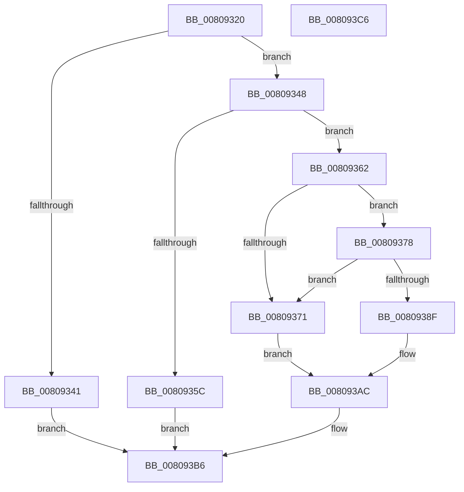

# NtTerminateEnclave

- RVA: `0x00809320`–`0x008093C7` (길이 `167` bytes)
- VA: `0x0000000140809320`
- 실행 섹션: `PAGE`
- PDB 이름 있음: `예`; PDB Function 태그: `아니요`
- unwind 정보 RVA: `0x0008E1D0`
- 디코드: `47`개 명령, `167/167` bytes 표시
- 미해석 바이트: `0` (있으면 어셈블리에 `.byte`로 보존)

> 이 문서는 커널 이미지의 기계어와 PDB 기호를 분석해 생성했습니다. 4번과 5번은 함수 원형과 자료형을 바이너리 사용 방식에서 추정한 C 해석이며 원본 소스 복구 결과는 아닙니다.

## 1. Dependencies

- 직접 호출 지점: **3**; 고유 호출 대상: **3**
- 직접 호출자로 확인된 함수: **0**
- RIP 상대 이미지 참조: **0**

### Outgoing calls
- `0x0080934F` → [MiObtainReferencedVadEx](../../text/31/MiObtainReferencedVadEx_function_00316690.md) (function, `0x00316690`)
- `0x008093A5` → [MiTerminateEnclave](MiTerminateEnclave_function_00808C18.md) (function, `0x00808C18`)
- `0x008093AF` → [MiUnlockAndDereferenceVad](../../text/31/MiUnlockAndDereferenceVad_function_00316E60.md) (function, `0x00316E60`)

### Direct callers
- 이 함수 시작 RVA로 연결되는 직접 call은 확인되지 않았습니다. 간접 호출은 완전히 역산할 수 없습니다.

### Static image references
- 디코드된 RIP-relative 메모리 참조가 없습니다.

## 2. Other-region calls and transfers

- 다른 실행 섹션으로 향하는 call: **2**
  - `0x0080934F` → [MiObtainReferencedVadEx](../../text/31/MiObtainReferencedVadEx_function_00316690.md) (`PAGE` → `.text`)
  - `0x008093AF` → [MiUnlockAndDereferenceVad](../../text/31/MiUnlockAndDereferenceVad_function_00316E60.md) (`PAGE` → `.text`)
- 별도 외부 분기/꼬리 이동을 확인하지 못했습니다.

## 3. Assembly (complete function range)

```asm
00809320  48 89 5C 24 08                  mov qword ptr [rsp + 8], rbx
00809325  48 89 74 24 18                  mov qword ptr [rsp + 0x18], rsi
0080932A  57                              push rdi
0080932B  48 83 EC 20                     sub rsp, 0x20
0080932F  83 64 24 38 00                  and dword ptr [rsp + 0x38], 0
00809334  8B F2                           mov esi, edx
00809336  48 8B D9                        mov rbx, rcx
00809339  F7 C2 FA FF FF FF               test edx, 0xfffffffa
0080933F  74 07                           je 0x140809348
00809341  B8 F0 00 00 C0                  mov eax, 0xc00000f0
00809346  EB 6E                           jmp 0x1408093b6
00809348  4C 8D 44 24 38                  lea r8, [rsp + 0x38]
0080934D  33 D2                           xor edx, edx
0080934F  E8 3C D3 B0 FF                  call 0x140316690
00809354  48 8B F8                        mov rdi, rax
00809357  48 85 C0                        test rax, rax
0080935A  75 06                           jne 0x140809362
0080935C  8B 44 24 38                     mov eax, dword ptr [rsp + 0x38]
00809360  EB 54                           jmp 0x1408093b6
00809362  8B 40 30                        mov eax, dword ptr [rax + 0x30]
00809365  25 00 00 20 0C                  and eax, 0xc200000
0080936A  3D 00 00 20 08                  cmp eax, 0x8200000
0080936F  74 07                           je 0x140809378
00809371  BB 18 00 00 C0                  mov ebx, 0xc0000018
00809376  EB 34                           jmp 0x1408093ac
00809378  0F B6 4F 20                     movzx ecx, byte ptr [rdi + 0x20]
0080937C  8B 47 18                        mov eax, dword ptr [rdi + 0x18]
0080937F  48 C1 E1 20                     shl rcx, 0x20
00809383  48 0B C8                        or rcx, rax
00809386  48 C1 E1 0C                     shl rcx, 0xc
0080938A  48 3B CB                        cmp rcx, rbx
0080938D  75 E2                           jne 0x140809371
0080938F  65 48 8B 04 25 88 01 00 00      mov rax, qword ptr gs:[0x188]
00809398  44 8B C6                        mov r8d, esi
0080939B  48 8B D7                        mov rdx, rdi
0080939E  48 8B 88 B8 00 00 00            mov rcx, qword ptr [rax + 0xb8]
008093A5  E8 6E F8 FF FF                  call 0x140808c18
008093AA  8B D8                           mov ebx, eax
008093AC  48 8B CF                        mov rcx, rdi
008093AF  E8 AC DA B0 FF                  call 0x140316e60
008093B4  8B C3                           mov eax, ebx
008093B6  48 8B 5C 24 30                  mov rbx, qword ptr [rsp + 0x30]
008093BB  48 8B 74 24 40                  mov rsi, qword ptr [rsp + 0x40]
008093C0  48 83 C4 20                     add rsp, 0x20
008093C4  5F                              pop rdi
008093C5  C3                              ret
008093C6  CC                              int3
```

## 4. C-style interpretation (structured pseudocode)

```c
__int64 __fastcall NtTerminateEnclave(__int64 a1, int a2)
{
    __int64 result;
    __int64 v_rsp;
    unsigned int v_stack_p10;
    unsigned __int64 v_stack_p18;
    unsigned __int64 v_stack_p8;

    v_stack_p8 = v_rbx;
    v_stack_p18 = v_rsi;
    v_rsp = (v_rsp) - (32);
    if (((a2) & (0xFFFFFFFAULL)) == 0) goto loc_00809348;
    goto loc_008093B6;
loc_00809348:
    a2 = 0;
    result = MiObtainReferencedVadEx(a1, a2, v_stack_p10, a4);
    if (result != 0) goto loc_00809362;
    goto loc_008093B6;
loc_00809362:
    result = (unsigned int)(((unsigned int)(*(unsigned int *)((unsigned int)(v_stack_p10) + 48))) & (0xC200000ULL));
    if (((unsigned int)(result)) == 0x8200000ULL) goto loc_00809378;
loc_00809371:
    goto loc_008093AC;
loc_00809378:
    a1 = (*(unsigned __int8 *)(result + 32)) << (32);
    a1 = (a1) | ((unsigned int)(*(unsigned int *)(result + 24)));
    a1 = (a1) << (12);
    if (a1 != ((unsigned int)(0xC0000018ULL))) goto loc_00809371;
    result = MiTerminateEnclave(*(unsigned __int64 *)(*(unsigned __int64 *)(gs_base + (0 + 392)) + 184), result, (unsigned int)((unsigned int)((unsigned int)(a2))), a4);
loc_008093AC:
    result = MiUnlockAndDereferenceVad(result, result, (unsigned int)((unsigned int)((unsigned int)(a2))), a4);
loc_008093B6:
    v_rsp = (v_rsp) + (32);
    return (unsigned int)((unsigned int)((unsigned int)((unsigned int)(result))));
}
```

## 5. (Beta) C Style

```c
int64_t NtTerminateEnclave(int64_t Arg1, int32_t Arg2)
{
    int64_t result;
    int64_t local_rsp;
    uint32_t v_stack_p10;
    uint64_t v_stack_p18;
    uint64_t v_stack_p8;

    v_stack_p8 = local_rbx;
    v_stack_p18 = local_rsi;
    local_rsp = (local_rsp) - (32);
    if (((Arg2) & (0xFFFFFFFAULL)) == 0) goto loc_00809348;
    goto loc_008093B6;
loc_00809348:
    Arg2 = 0;
    result = MiObtainReferencedVadEx(Arg1, Arg2, v_stack_p10, a4);
    if (result != 0) goto loc_00809362;
    goto loc_008093B6;
loc_00809362:
    result = (uint32_t)(((uint32_t)(*(uint32_t *)((uint32_t)(v_stack_p10) + 0x30))) & (0xC200000ULL));
    if (((uint32_t)(result)) == 0x8200000ULL) goto loc_00809378;
loc_00809371:
    goto loc_008093AC;
loc_00809378:
    Arg1 = (*(uint8_t *)(result + 0x20)) << (32);
    Arg1 = (Arg1) | ((uint32_t)(*(uint32_t *)(result + 0x18)));
    Arg1 = (Arg1) << (12);
    if (Arg1 != ((uint32_t)(0xC0000018ULL))) goto loc_00809371;
    result = MiTerminateEnclave(*(uint64_t *)(*(uint64_t *)(gs_base + (0 + 0x188)) + 0xB8), result, (uint32_t)((uint32_t)((uint32_t)(Arg2))), a4);
loc_008093AC:
    result = MiUnlockAndDereferenceVad(result, result, (uint32_t)((uint32_t)((uint32_t)(Arg2))), a4);
loc_008093B6:
    local_rsp = (local_rsp) + (32);
    return (uint32_t)((uint32_t)((uint32_t)((uint32_t)(result))));
}
```

## 6. Execution-region graph

[열기: 2D/3D 그래프와 함수 탐색 컨트롤 패널](../../../control-panel.html?section=page&rva=0x00809320&view=graph)

- 2D 그래프는 위에서 아래로 흐르고, 3D 그래프는 빈 공간을 드래그해 회전합니다. Shift+드래그는 이동, 휠은 확대·축소, 함수 노드 선택은 대상 보고서 이동입니다.

### Static fallback


