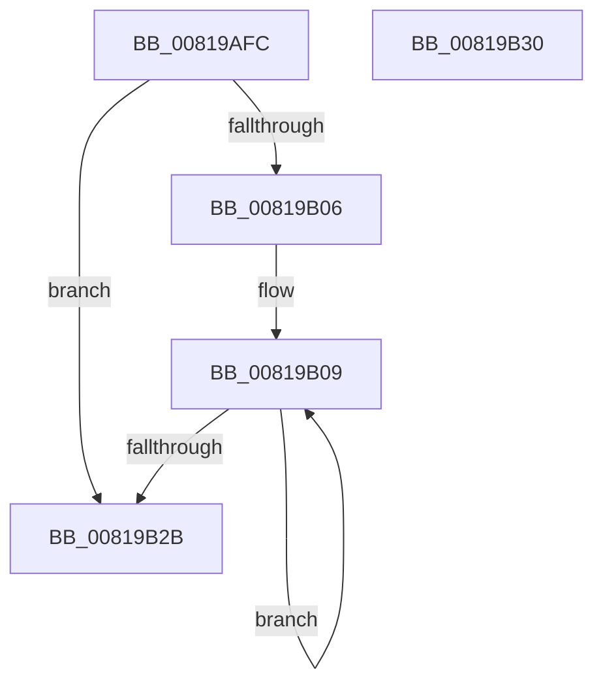

# AslComputeCrc32

- RVA: `0x00819AFC`–`0x00819B31` (길이 `53` bytes)
- VA: `0x0000000140819AFC`
- 실행 섹션: `PAGE`
- PDB 이름 있음: `예`; PDB Function 태그: `아니요`
- unwind 정보 RVA: `0x000DB714`
- 디코드: `19`개 명령, `53/53` bytes 표시
- 미해석 바이트: `0` (있으면 어셈블리에 `.byte`로 보존)

> 이 문서는 커널 이미지의 기계어와 PDB 기호를 분석해 생성했습니다. 4번과 5번은 함수 원형과 자료형을 바이너리 사용 방식에서 추정한 C 해석이며 원본 소스 복구 결과는 아닙니다.

## 1. Dependencies

- 직접 호출 지점: **0**; 고유 호출 대상: **0**
- 직접 호출자로 확인된 함수: **3**
- RIP 상대 이미지 참조: **1**

### Outgoing calls
- 직접 디코드된 call 명령이 없습니다.

### Direct callers
- [AslpFileGetCrcChecksum](AslpFileGetCrcChecksum_function_0081E6DC.md) at `0x0081E700`
- [AslpFileGetCrcChecksum](AslpFileGetCrcChecksum_function_0081E6DC.md) at `0x0081E71F`
- [AslpFileGetCrcChecksumBoot](AslpFileGetCrcChecksumBoot_function_0081E7D4.md) at `0x0081EA83`
- [AslpFileLargeGetCrcChecksum](../82/AslpFileLargeGetCrcChecksum_function_008218BC.md) at `0x00821A1A`
- [AslpFileLargeGetCrcChecksum](../82/AslpFileLargeGetCrcChecksum_function_008218BC.md) at `0x00821A24`

### Static image references
- `0x00819B1B` → RVA `0x0003E980` (`.rdata`; read)

## 2. Other-region calls and transfers

- 다른 실행 섹션으로 향하는 call: **0**
- 별도 외부 분기/꼬리 이동을 확인하지 못했습니다.

## 3. Assembly (complete function range)

```asm
00819AFC  4C 8B CA                        mov r9, rdx
00819AFF  F7 D1                           not ecx
00819B01  45 85 C0                        test r8d, r8d
00819B04  74 25                           je 0x140819b2b
00819B06  45 8B D0                        mov r10d, r8d
00819B09  41 0F B6 01                     movzx eax, byte ptr [r9]
00819B0D  8B D1                           mov edx, ecx
00819B0F  48 33 D0                        xor rdx, rax
00819B12  C1 E9 08                        shr ecx, 8
00819B15  0F B6 C2                        movzx eax, dl
00819B18  49 FF C1                        inc r9
00819B1B  48 8D 15 5E 4E 82 FF            lea rdx, [rip - 0x7db1a2]
00819B22  33 0C 82                        xor ecx, dword ptr [rdx + rax*4]
00819B25  49 83 EA 01                     sub r10, 1
00819B29  75 DE                           jne 0x140819b09
00819B2B  F7 D1                           not ecx
00819B2D  8B C1                           mov eax, ecx
00819B2F  C3                              ret
00819B30  CC                              int3
```

## 4. C-style interpretation (structured pseudocode)

```c
__int64 __fastcall AslComputeCrc32(int a1, __int64 a2, int a3)
{
    __int64 v_r10;

    a1 = (unsigned int)(~(a1));
    if (a3 == 0) goto loc_00819B2B;
loc_00819B09:
    a2 = ((unsigned int)(a1)) ^ (*(unsigned __int8 *)(a2));
    a1 = (unsigned int)((a1) >> (8));
    a4 = (a2) + 1;
    a1 = (unsigned int)((a1) ^ (*(unsigned int *)(v_rip - 8237474 + (unsigned __int8)(a2) * 4)));
    v_r10 = ((unsigned int)(a3)) - (1);
    if (condition_is_not_equal) goto loc_00819B09;
loc_00819B2B:
    a1 = (unsigned int)(~(a1));
    return (unsigned int)(a1);
}
```

## 5. (Beta) C Style

```c
int64_t AslComputeCrc32(int32_t Arg1, int64_t Arg2, int32_t Arg3)
{
    int64_t local_r10;

    Arg1 = (uint32_t)(~(Arg1));
    if (Arg3 == 0) goto loc_00819B2B;
loc_00819B09:
    Arg2 = ((uint32_t)(Arg1)) ^ (*(uint8_t *)(Arg2));
    Arg1 = (uint32_t)((Arg1) >> (8));
    a4 = (Arg2) + 1;
    Arg1 = (uint32_t)((Arg1) ^ (*(uint32_t *)(v_rip - 0x7DB1A2 + (uint8_t)(Arg2) * 4)));
    local_r10 = ((uint32_t)(Arg3)) - (1);
    if (condition_is_not_equal) goto loc_00819B09;
loc_00819B2B:
    Arg1 = (uint32_t)(~(Arg1));
    return (uint32_t)(Arg1);
}
```

## 6. Execution-region graph

[열기: 2D/3D 그래프와 함수 탐색 컨트롤 패널](../../../control-panel.html?section=page&rva=0x00819AFC&view=graph)

- 2D 그래프는 위에서 아래로 흐르고, 3D 그래프는 빈 공간을 드래그해 회전합니다. Shift+드래그는 이동, 휠은 확대·축소, 함수 노드 선택은 대상 보고서 이동입니다.

### Static fallback


