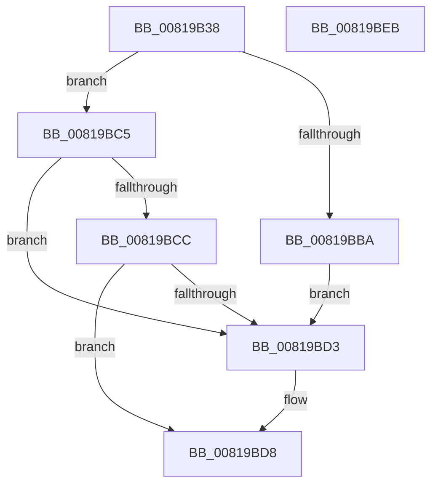

# AslDoesDirectoryExistNtPath

- RVA: `0x00819B38`–`0x00819BEC` (길이 `180` bytes)
- VA: `0x0000000140819B38`
- 실행 섹션: `PAGE`
- PDB 이름 있음: `예`; PDB Function 태그: `아니요`
- unwind 정보 RVA: `0x000B3F9C`
- 디코드: `45`개 명령, `180/180` bytes 표시
- 미해석 바이트: `0` (있으면 어셈블리에 `.byte`로 보존)

> 이 문서는 커널 이미지의 기계어와 PDB 기호를 분석해 생성했습니다. 4번과 5번은 함수 원형과 자료형을 바이너리 사용 방식에서 추정한 C 해석이며 원본 소스 복구 결과는 아닙니다.

## 1. Dependencies

- 직접 호출 지점: **3**; 고유 호출 대상: **3**
- 직접 호출자로 확인된 함수: **1**
- RIP 상대 이미지 참조: **0**

### Outgoing calls
- `0x00819B69` → [RtlInitUnicodeString](../../text/42/RtlInitUnicodeString_function_0042A780.md) (function, `0x0042A780`)
- `0x00819BB1` → [ZwOpenFile](../../text/6A/ZwOpenFile_function_006AD730.md) (function, `0x006AD730`)
- `0x00819BBE` → [ZwClose](../../text/6A/ZwClose_function_006AD2B0.md) (function, `0x006AD2B0`)

### Direct callers
- [SdbpCheckMatchingDir](SdbpCheckMatchingDir_function_00813EF0.md) at `0x00813FFC`

### Static image references
- 디코드된 RIP-relative 메모리 참조가 없습니다.

## 2. Other-region calls and transfers

- 다른 실행 섹션으로 향하는 call: **3**
  - `0x00819B69` → [RtlInitUnicodeString](../../text/42/RtlInitUnicodeString_function_0042A780.md) (`PAGE` → `.text`)
  - `0x00819BB1` → [ZwOpenFile](../../text/6A/ZwOpenFile_function_006AD730.md) (`PAGE` → `.text`)
  - `0x00819BBE` → [ZwClose](../../text/6A/ZwClose_function_006AD2B0.md) (`PAGE` → `.text`)
- 별도 외부 분기/꼬리 이동을 확인하지 못했습니다.

## 3. Assembly (complete function range)

```asm
00819B38  48 89 5C 24 08                  mov qword ptr [rsp + 8], rbx
00819B3D  55                              push rbp
00819B3E  48 8B EC                        mov rbp, rsp
00819B41  48 81 EC 80 00 00 00            sub rsp, 0x80
00819B48  33 DB                           xor ebx, ebx
00819B4A  0F 57 C0                        xorps xmm0, xmm0
00819B4D  0F 57 C9                        xorps xmm1, xmm1
00819B50  89 5D D4                        mov dword ptr [rbp - 0x2c], ebx
00819B53  48 8B D1                        mov rdx, rcx
00819B56  89 5D EC                        mov dword ptr [rbp - 0x14], ebx
00819B59  48 8D 4D B0                     lea rcx, [rbp - 0x50]
00819B5D  48 89 5D 18                     mov qword ptr [rbp + 0x18], rbx
00819B61  0F 11 45 B0                     movups xmmword ptr [rbp - 0x50], xmm0
00819B65  0F 11 4D C0                     movups xmmword ptr [rbp - 0x40], xmm1
00819B69  E8 12 0C C1 FF                  call 0x14042a780
00819B6E  48 8D 45 B0                     lea rax, [rbp - 0x50]
00819B72  C7 44 24 28 01 00 00 00         mov dword ptr [rsp + 0x28], 1
00819B7A  0F 57 C0                        xorps xmm0, xmm0
00819B7D  48 89 45 E0                     mov qword ptr [rbp - 0x20], rax
00819B81  4C 8D 4D C0                     lea r9, [rbp - 0x40]
00819B85  C7 45 D0 30 00 00 00            mov dword ptr [rbp - 0x30], 0x30
00819B8C  4C 8D 45 D0                     lea r8, [rbp - 0x30]
00819B90  48 89 5D D8                     mov qword ptr [rbp - 0x28], rbx
00819B94  BA 80 00 10 00                  mov edx, 0x100080
00819B99  C7 45 E8 40 02 00 00            mov dword ptr [rbp - 0x18], 0x240
00819BA0  48 8D 4D 18                     lea rcx, [rbp + 0x18]
00819BA4  C7 44 24 20 03 00 00 00         mov dword ptr [rsp + 0x20], 3
00819BAC  F3 0F 7F 45 F0                  movdqu xmmword ptr [rbp - 0x10], xmm0
00819BB1  E8 7A 3B E9 FF                  call 0x1406ad730
00819BB6  85 C0                           test eax, eax
00819BB8  78 0B                           js 0x140819bc5
00819BBA  48 8B 4D 18                     mov rcx, qword ptr [rbp + 0x18]
00819BBE  E8 ED 36 E9 FF                  call 0x1406ad2b0
00819BC3  EB 0E                           jmp 0x140819bd3
00819BC5  3D 22 00 00 C0                  cmp eax, 0xc0000022
00819BCA  74 07                           je 0x140819bd3
00819BCC  3D 43 00 00 C0                  cmp eax, 0xc0000043
00819BD1  75 05                           jne 0x140819bd8
00819BD3  BB 01 00 00 00                  mov ebx, 1
00819BD8  8B C3                           mov eax, ebx
00819BDA  48 8B 9C 24 90 00 00 00         mov rbx, qword ptr [rsp + 0x90]
00819BE2  48 81 C4 80 00 00 00            add rsp, 0x80
00819BE9  5D                              pop rbp
00819BEA  C3                              ret
00819BEB  CC                              int3
```

## 4. C-style interpretation (structured pseudocode)

```c
__int64 __fastcall AslDoesDirectoryExistNtPath(__int64 a1)
{
    __int64 result;
    __int64 v_rbx;
    __int64 v_rsp;
    unsigned __int64 v_stack_m18;
    unsigned int v_stack_m1C;
    unsigned int v_stack_m20;
    unsigned __int64 v_stack_m28;
    unsigned __int64 v_stack_m30;
    unsigned int v_stack_m34;
    unsigned int v_stack_m38;
    unsigned __int64 v_stack_m48;
    unsigned __int64 v_stack_m58;
    unsigned int v_stack_m60;
    unsigned int v_stack_m68;
    unsigned __int64 v_stack_p10;
    unsigned __int64 v_stack_p8;

    v_stack_p8 = v_rbx;
    v_rsp = (v_rsp) - (128);
    v_rbx = 0;
    v_stack_m34 = 0;
    v_stack_m1C = 0;
    v_stack_p10 = 0;
    v_stack_m58 = v_xmm0;
    v_stack_m48 = v_xmm1;
    result = RtlInitUnicodeString(v_stack_m58, a1, a3, a4);
    v_stack_m60 = 1;
    v_stack_m28 = v_stack_m58;
    v_stack_m38 = 48;
    v_stack_m30 = 0;
    v_stack_m20 = 576;
    v_stack_m68 = 3;
    v_stack_m18 = v_xmm0;
    result = ZwOpenFile(v_stack_p10, (unsigned int)(0x100080ULL), v_stack_m38, v_stack_m48);
    if (sign_flag) goto loc_00819BC5;
    result = ZwClose(v_stack_p10, (unsigned int)(0x100080ULL), v_stack_m38, v_stack_m48);
    goto loc_00819BD3;
loc_00819BC5:
    if (((unsigned int)(result)) == 0xC0000022ULL) goto loc_00819BD3;
    if (((unsigned int)(result)) == 0xC0000043ULL) {
        v_rbx = 1;
    }
    v_rsp = (v_rsp) + (128);
    return (unsigned int)((unsigned int)(v_rbx));
}
```

## 5. (Beta) C Style

```c
int64_t AslDoesDirectoryExistNtPath(int64_t Arg1)
{
    int64_t result;
    int64_t local_rbx;
    int64_t local_rsp;
    uint64_t v_stack_m18;
    uint32_t v_stack_m1C;
    uint32_t v_stack_m20;
    uint64_t v_stack_m28;
    uint64_t v_stack_m30;
    uint32_t v_stack_m34;
    uint32_t v_stack_m38;
    uint64_t v_stack_m48;
    uint64_t v_stack_m58;
    uint32_t v_stack_m60;
    uint32_t v_stack_m68;
    uint64_t v_stack_p10;
    uint64_t v_stack_p8;

    v_stack_p8 = local_rbx;
    local_rsp = (local_rsp) - (128);
    local_rbx = 0;
    v_stack_m34 = 0;
    v_stack_m1C = 0;
    v_stack_p10 = 0;
    v_stack_m58 = v_xmm0;
    v_stack_m48 = v_xmm1;
    result = RtlInitUnicodeString(v_stack_m58, Arg1, a3, a4);
    v_stack_m60 = 1;
    v_stack_m28 = v_stack_m58;
    v_stack_m38 = 48;
    v_stack_m30 = 0;
    v_stack_m20 = 576;
    v_stack_m68 = 3;
    v_stack_m18 = v_xmm0;
    result = ZwOpenFile(v_stack_p10, (uint32_t)(0x100080ULL), v_stack_m38, v_stack_m48);
    if (sign_flag) goto loc_00819BC5;
    result = ZwClose(v_stack_p10, (uint32_t)(0x100080ULL), v_stack_m38, v_stack_m48);
    goto loc_00819BD3;
loc_00819BC5:
    if (((uint32_t)(result)) == 0xC0000022ULL) goto loc_00819BD3;
    if (((uint32_t)(result)) == 0xC0000043ULL) {
        local_rbx = 1;
    }
    local_rsp = (local_rsp) + (128);
    return (uint32_t)((uint32_t)(local_rbx));
}
```

## 6. Execution-region graph

[열기: 2D/3D 그래프와 함수 탐색 컨트롤 패널](../../../control-panel.html?section=page&rva=0x00819B38&view=graph)

- 2D 그래프는 위에서 아래로 흐르고, 3D 그래프는 빈 공간을 드래그해 회전합니다. Shift+드래그는 이동, 휠은 확대·축소, 함수 노드 선택은 대상 보고서 이동입니다.

### Static fallback


