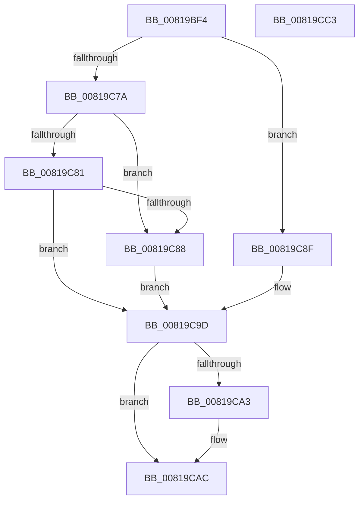

# AslDoesFileExistNtPath

- RVA: `0x00819BF4`–`0x00819CC4` (길이 `208` bytes)
- VA: `0x0000000140819BF4`
- 실행 섹션: `PAGE`
- PDB 이름 있음: `예`; PDB Function 태그: `아니요`
- unwind 정보 RVA: `0x000C7E80`
- 디코드: `54`개 명령, `208/208` bytes 표시
- 미해석 바이트: `0` (있으면 어셈블리에 `.byte`로 보존)

> 이 문서는 커널 이미지의 기계어와 PDB 기호를 분석해 생성했습니다. 4번과 5번은 함수 원형과 자료형을 바이너리 사용 방식에서 추정한 C 해석이며 원본 소스 복구 결과는 아닙니다.

## 1. Dependencies

- 직접 호출 지점: **4**; 고유 호출 대상: **4**
- 직접 호출자로 확인된 함수: **1**
- RIP 상대 이미지 참조: **0**

### Outgoing calls
- `0x00819C2D` → [RtlInitUnicodeString](../../text/42/RtlInitUnicodeString_function_0042A780.md) (function, `0x0042A780`)
- `0x00819C71` → [ZwOpenFile](../../text/6A/ZwOpenFile_function_006AD730.md) (function, `0x006AD730`)
- `0x00819C98` → [ZwClose](../../text/6A/ZwClose_function_006AD2B0.md) (function, `0x006AD2B0`)
- `0x00819CA7` → [RtlFreeAnsiString](../9C/RtlFreeAnsiString_function_009C0800.md) (function, `0x009C0800`)

### Direct callers
- [AslPathWildcardFindFirst](AslPathWildcardFindFirst_function_0081B534.md) at `0x0081B6D4`

### Static image references
- 디코드된 RIP-relative 메모리 참조가 없습니다.

## 2. Other-region calls and transfers

- 다른 실행 섹션으로 향하는 call: **3**
  - `0x00819C2D` → [RtlInitUnicodeString](../../text/42/RtlInitUnicodeString_function_0042A780.md) (`PAGE` → `.text`)
  - `0x00819C71` → [ZwOpenFile](../../text/6A/ZwOpenFile_function_006AD730.md) (`PAGE` → `.text`)
  - `0x00819C98` → [ZwClose](../../text/6A/ZwClose_function_006AD2B0.md) (`PAGE` → `.text`)
- 별도 외부 분기/꼬리 이동을 확인하지 못했습니다.

## 3. Assembly (complete function range)

```asm
00819BF4  48 89 5C 24 10                  mov qword ptr [rsp + 0x10], rbx
00819BF9  48 89 7C 24 18                  mov qword ptr [rsp + 0x18], rdi
00819BFE  55                              push rbp
00819BFF  48 8B EC                        mov rbp, rsp
00819C02  48 81 EC 80 00 00 00            sub rsp, 0x80
00819C09  33 DB                           xor ebx, ebx
00819C0B  48 8B F9                        mov rdi, rcx
00819C0E  0F 57 C0                        xorps xmm0, xmm0
00819C11  89 5D D4                        mov dword ptr [rbp - 0x2c], ebx
00819C14  0F 57 C9                        xorps xmm1, xmm1
00819C17  89 5D EC                        mov dword ptr [rbp - 0x14], ebx
00819C1A  48 8B D1                        mov rdx, rcx
00819C1D  48 89 5D 10                     mov qword ptr [rbp + 0x10], rbx
00819C21  48 8D 4D B0                     lea rcx, [rbp - 0x50]
00819C25  0F 11 45 B0                     movups xmmword ptr [rbp - 0x50], xmm0
00819C29  0F 11 4D C0                     movups xmmword ptr [rbp - 0x40], xmm1
00819C2D  E8 4E 0B C1 FF                  call 0x14042a780
00819C32  48 8D 45 B0                     lea rax, [rbp - 0x50]
00819C36  89 5C 24 28                     mov dword ptr [rsp + 0x28], ebx
00819C3A  0F 57 C0                        xorps xmm0, xmm0
00819C3D  48 89 45 E0                     mov qword ptr [rbp - 0x20], rax
00819C41  4C 8D 4D C0                     lea r9, [rbp - 0x40]
00819C45  C7 45 D0 30 00 00 00            mov dword ptr [rbp - 0x30], 0x30
00819C4C  4C 8D 45 D0                     lea r8, [rbp - 0x30]
00819C50  48 89 5D D8                     mov qword ptr [rbp - 0x28], rbx
00819C54  BA 80 00 10 00                  mov edx, 0x100080
00819C59  C7 45 E8 40 02 00 00            mov dword ptr [rbp - 0x18], 0x240
00819C60  48 8D 4D 10                     lea rcx, [rbp + 0x10]
00819C64  C7 44 24 20 01 00 00 00         mov dword ptr [rsp + 0x20], 1
00819C6C  F3 0F 7F 45 F0                  movdqu xmmword ptr [rbp - 0x10], xmm0
00819C71  E8 BA 3A E9 FF                  call 0x1406ad730
00819C76  85 C0                           test eax, eax
00819C78  79 15                           jns 0x140819c8f
00819C7A  3D 43 00 00 C0                  cmp eax, 0xc0000043
00819C7F  74 07                           je 0x140819c88
00819C81  3D 22 00 00 C0                  cmp eax, 0xc0000022
00819C86  75 15                           jne 0x140819c9d
00819C88  BB 01 00 00 00                  mov ebx, 1
00819C8D  EB 0E                           jmp 0x140819c9d
00819C8F  48 8B 4D 10                     mov rcx, qword ptr [rbp + 0x10]
00819C93  BB 01 00 00 00                  mov ebx, 1
00819C98  E8 13 36 E9 FF                  call 0x1406ad2b0
00819C9D  48 39 7D B8                     cmp qword ptr [rbp - 0x48], rdi
00819CA1  74 09                           je 0x140819cac
00819CA3  48 8D 4D B0                     lea rcx, [rbp - 0x50]
00819CA7  E8 54 6B 1A 00                  call 0x1409c0800
00819CAC  4C 8D 9C 24 80 00 00 00         lea r11, [rsp + 0x80]
00819CB4  8B C3                           mov eax, ebx
00819CB6  49 8B 5B 18                     mov rbx, qword ptr [r11 + 0x18]
00819CBA  49 8B 7B 20                     mov rdi, qword ptr [r11 + 0x20]
00819CBE  49 8B E3                        mov rsp, r11
00819CC1  5D                              pop rbp
00819CC2  C3                              ret
00819CC3  CC                              int3
```

## 4. C-style interpretation (structured pseudocode)

```c
__int64 __fastcall AslDoesFileExistNtPath(__int64 a1)
{
    __int64 result;
    __int64 v_rbx;
    __int64 v_rsp;
    unsigned __int64 v_stack_m18;
    unsigned int v_stack_m1C;
    unsigned int v_stack_m20;
    unsigned __int64 v_stack_m28;
    unsigned __int64 v_stack_m30;
    unsigned int v_stack_m34;
    unsigned int v_stack_m38;
    unsigned __int64 v_stack_m48;
    unsigned __int64 v_stack_m50;
    unsigned __int64 v_stack_m58;
    unsigned int v_stack_m60;
    unsigned int v_stack_m68;
    unsigned __int64 v_stack_m8;
    unsigned __int64 v_stack_p10;
    unsigned __int64 v_stack_p18;
    unsigned __int64 v_stack_p8;

    v_stack_p10 = v_rbx;
    v_stack_p18 = v_rdi;
    v_rsp = (v_rsp) - (128);
    v_rbx = 0;
    v_stack_m34 = 0;
    v_stack_m1C = 0;
    v_stack_p8 = 0;
    v_stack_m58 = v_xmm0;
    v_stack_m48 = v_xmm1;
    result = RtlInitUnicodeString(v_stack_m58, a1, a3, a4);
    v_stack_m60 = 0;
    v_stack_m28 = v_stack_m58;
    v_stack_m38 = 48;
    v_stack_m30 = 0;
    v_stack_m20 = 576;
    v_stack_m68 = 1;
    v_stack_m18 = v_xmm0;
    result = ZwOpenFile(v_stack_p8, (unsigned int)(0x100080ULL), v_stack_m38, v_stack_m48);
    if (!sign_flag) goto loc_00819C8F;
    if (((unsigned int)(result)) == 0xC0000043ULL) goto loc_00819C88;
    if (((unsigned int)(result)) != 0xC0000022ULL) goto loc_00819C9D;
loc_00819C88:
    goto loc_00819C9D;
loc_00819C8F:
    result = ZwClose(v_stack_p8, (unsigned int)(0x100080ULL), v_stack_m38, v_stack_m48);
loc_00819C9D:
    if (v_stack_m50 != a1) {
        a1 = v_stack_m58;
        result = RtlFreeAnsiString(a1, (unsigned int)(0x100080ULL), v_stack_m38, v_stack_m48);
    }
    return 1;
}
```

## 5. (Beta) C Style

```c
int64_t AslDoesFileExistNtPath(int64_t Arg1)
{
    int64_t result;
    int64_t local_rbx;
    int64_t local_rsp;
    uint64_t v_stack_m18;
    uint32_t v_stack_m1C;
    uint32_t v_stack_m20;
    uint64_t v_stack_m28;
    uint64_t v_stack_m30;
    uint32_t v_stack_m34;
    uint32_t v_stack_m38;
    uint64_t v_stack_m48;
    uint64_t v_stack_m50;
    uint64_t v_stack_m58;
    uint32_t v_stack_m60;
    uint32_t v_stack_m68;
    uint64_t v_stack_m8;
    uint64_t v_stack_p10;
    uint64_t v_stack_p18;
    uint64_t v_stack_p8;

    v_stack_p10 = local_rbx;
    v_stack_p18 = local_rdi;
    local_rsp = (local_rsp) - (128);
    local_rbx = 0;
    v_stack_m34 = 0;
    v_stack_m1C = 0;
    v_stack_p8 = 0;
    v_stack_m58 = v_xmm0;
    v_stack_m48 = v_xmm1;
    result = RtlInitUnicodeString(v_stack_m58, Arg1, a3, a4);
    v_stack_m60 = 0;
    v_stack_m28 = v_stack_m58;
    v_stack_m38 = 48;
    v_stack_m30 = 0;
    v_stack_m20 = 576;
    v_stack_m68 = 1;
    v_stack_m18 = v_xmm0;
    result = ZwOpenFile(v_stack_p8, (uint32_t)(0x100080ULL), v_stack_m38, v_stack_m48);
    if (!sign_flag) goto loc_00819C8F;
    if (((uint32_t)(result)) == 0xC0000043ULL) goto loc_00819C88;
    if (((uint32_t)(result)) != 0xC0000022ULL) goto loc_00819C9D;
loc_00819C88:
    goto loc_00819C9D;
loc_00819C8F:
    result = ZwClose(v_stack_p8, (uint32_t)(0x100080ULL), v_stack_m38, v_stack_m48);
loc_00819C9D:
    if (v_stack_m50 != Arg1) {
        Arg1 = v_stack_m58;
        result = RtlFreeAnsiString(Arg1, (uint32_t)(0x100080ULL), v_stack_m38, v_stack_m48);
    }
    return 1;
}
```

## 6. Execution-region graph

[열기: 2D/3D 그래프와 함수 탐색 컨트롤 패널](../../../control-panel.html?section=page&rva=0x00819BF4&view=graph)

- 2D 그래프는 위에서 아래로 흐르고, 3D 그래프는 빈 공간을 드래그해 회전합니다. Shift+드래그는 이동, 휠은 확대·축소, 함수 노드 선택은 대상 보고서 이동입니다.

### Static fallback


