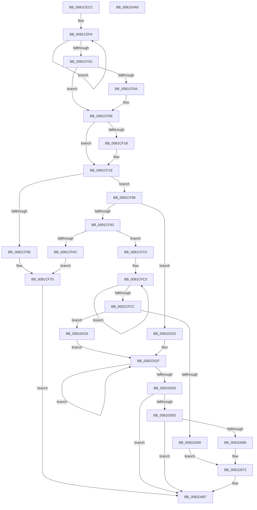

# AslEnvExpandStrings2

- RVA: `0x0081CECC`–`0x0081D0A1` (길이 `469` bytes)
- VA: `0x000000014081CECC`
- 실행 섹션: `PAGE`
- PDB 이름 있음: `예`; PDB Function 태그: `아니요`
- unwind 정보 RVA: `0x000D9DF4`
- 디코드: `123`개 명령, `469/469` bytes 표시
- 미해석 바이트: `0` (있으면 어셈블리에 `.byte`로 보존)

> 이 문서는 커널 이미지의 기계어와 PDB 기호를 분석해 생성했습니다. 4번과 5번은 함수 원형과 자료형을 바이너리 사용 방식에서 추정한 C 해석이며 원본 소스 복구 결과는 아닙니다.

## 1. Dependencies

- 직접 호출 지점: **7**; 고유 호출 대상: **5**
- 직접 호출자로 확인된 함수: **1**
- RIP 상대 이미지 참조: **5**

### Outgoing calls
- `0x0081CF52` → [AslpEnvResolveVars](AslpEnvResolveVars_function_0081D608.md) (function, `0x0081D608`)
- `0x0081CF7C` → [AslLogCallPrintf](../95/AslLogCallPrintf_function_0095E4EC.md) (function, `0x0095E4EC`)
- `0x0081CF9D` → [AslAlloc](../95/AslAlloc_function_0095BD34.md) (function, `0x0095BD34`)
- `0x0081CFFC` → [AslpEnvResolveVars](AslpEnvResolveVars_function_0081D608.md) (function, `0x0081D608`)
- `0x0081D04B` → [AslEnvExpandStrings](AslEnvExpandStrings_function_0081CCF4.md) (function, `0x0081CCF4`)
- `0x0081D082` → [AslLogCallPrintf](../95/AslLogCallPrintf_function_0095E4EC.md) (function, `0x0095E4EC`)
- `0x0081D08A` → [AslFree](../95/AslFree_function_0095B674.md) (function, `0x0095B674`)

### Direct callers
- [SdbpResolveMatchingFile](SdbpResolveMatchingFile_function_00816A20.md) at `0x00816B07`
- [SdbpResolveMatchingFile](SdbpResolveMatchingFile_function_00816A20.md) at `0x00816C3B`

### Static image references
- `0x0081CF63` → RVA `0x0003F6D0` (`.rdata`; read)
- `0x0081CF70` → RVA `0x0003F710` (`.rdata`; read)
- `0x0081CFB1` → RVA `0x000129E0` (`.rdata`; read)
- `0x0081D009` → RVA `0x0003F728` (`.rdata`; read)
- `0x0081D065` → RVA `0x0003F748` (`.rdata`; read)

## 2. Other-region calls and transfers

- 다른 실행 섹션으로 향하는 call: **0**
- 별도 외부 분기/꼬리 이동을 확인하지 못했습니다.

## 3. Assembly (complete function range)

```asm
0081CECC  4C 8B DC                        mov r11, rsp
0081CECF  4D 89 4B 20                     mov qword ptr [r11 + 0x20], r9
0081CED3  49 89 4B 08                     mov qword ptr [r11 + 8], rcx
0081CED7  53                              push rbx
0081CED8  55                              push rbp
0081CED9  56                              push rsi
0081CEDA  57                              push rdi
0081CEDB  41 54                           push r12
0081CEDD  41 55                           push r13
0081CEDF  41 56                           push r14
0081CEE1  48 83 EC 40                     sub rsp, 0x40
0081CEE5  33 C0                           xor eax, eax
0081CEE7  4D 8B E0                        mov r12, r8
0081CEEA  48 83 CE FF                     or rsi, 0xffffffffffffffff
0081CEEE  41 89 43 10                     mov dword ptr [r11 + 0x10], eax
0081CEF2  48 8B DE                        mov rbx, rsi
0081CEF5  48 8B FA                        mov rdi, rdx
0081CEF8  8B E8                           mov ebp, eax
0081CEFA  48 FF C3                        inc rbx
0081CEFD  66 39 04 5A                     cmp word ptr [rdx + rbx*2], ax
0081CF01  75 F7                           jne 0x14081cefa
0081CF03  FF C3                           inc ebx
0081CF05  4D 85 E4                        test r12, r12
0081CF08  74 04                           je 0x14081cf0e
0081CF0A  66 41 89 00                     mov word ptr [r8], ax
0081CF0E  4C 8B B4 24 A0 00 00 00         mov r14, qword ptr [rsp + 0xa0]
0081CF16  4D 85 F6                        test r14, r14
0081CF19  74 03                           je 0x14081cf1e
0081CF1B  49 89 06                        mov qword ptr [r14], rax
0081CF1E  44 0F B7 AC 24 B0 00 00 00      movzx r13d, word ptr [rsp + 0xb0]
0081CF27  48 8D 84 24 88 00 00 00         lea rax, [rsp + 0x88]
0081CF2F  48 89 44 24 30                  mov qword ptr [rsp + 0x30], rax
0081CF34  45 33 C9                        xor r9d, r9d
0081CF37  0F B7 84 24 A8 00 00 00         movzx eax, word ptr [rsp + 0xa8]
0081CF3F  45 33 C0                        xor r8d, r8d
0081CF42  66 44 89 6C 24 28               mov word ptr [rsp + 0x28], r13w
0081CF48  8B D3                           mov edx, ebx
0081CF4A  48 8B CF                        mov rcx, rdi
0081CF4D  66 89 44 24 20                  mov word ptr [rsp + 0x20], ax
0081CF52  E8 B1 06 00 00                  call 0x14081d608
0081CF57  3D 23 00 00 C0                  cmp eax, 0xc0000023
0081CF5C  74 28                           je 0x14081cf86
0081CF5E  BB E5 00 00 C0                  mov ebx, 0xc00000e5
0081CF63  4C 8D 0D 66 27 82 FF            lea r9, [rip - 0x7dd89a]
0081CF6A  41 B8 1A 03 00 00               mov r8d, 0x31a
0081CF70  48 8D 15 99 27 82 FF            lea rdx, [rip - 0x7dd867]
0081CF77  B9 01 00 00 00                  mov ecx, 1
0081CF7C  E8 6B 15 14 00                  call 0x14095e4ec
0081CF81  E9 01 01 00 00                  jmp 0x14081d087
0081CF86  3B 9C 24 88 00 00 00            cmp ebx, dword ptr [rsp + 0x88]
0081CF8D  0F 84 8A 00 00 00               je 0x14081d01d
0081CF93  8B 94 24 88 00 00 00            mov edx, dword ptr [rsp + 0x88]
0081CF9A  48 03 D2                        add rdx, rdx
0081CF9D  E8 92 ED 13 00                  call 0x14095bd34
0081CFA2  48 8B E8                        mov rbp, rax
0081CFA5  33 C0                           xor eax, eax
0081CFA7  48 85 ED                        test rbp, rbp
0081CFAA  75 14                           jne 0x14081cfc0
0081CFAC  BB 17 00 00 C0                  mov ebx, 0xc0000017
0081CFB1  4C 8D 0D 28 5A 7F FF            lea r9, [rip - 0x80a5d8]
0081CFB8  41 B8 22 03 00 00               mov r8d, 0x322
0081CFBE  EB B0                           jmp 0x14081cf70
0081CFC0  48 8B D6                        mov rdx, rsi
0081CFC3  48 FF C2                        inc rdx
0081CFC6  66 39 04 57                     cmp word ptr [rdi + rdx*2], ax
0081CFCA  75 F7                           jne 0x14081cfc3
0081CFCC  44 8B 8C 24 88 00 00 00         mov r9d, dword ptr [rsp + 0x88]
0081CFD4  48 8D 84 24 88 00 00 00         lea rax, [rsp + 0x88]
0081CFDC  48 89 44 24 30                  mov qword ptr [rsp + 0x30], rax
0081CFE1  FF C2                           inc edx
0081CFE3  0F B7 84 24 A8 00 00 00         movzx eax, word ptr [rsp + 0xa8]
0081CFEB  4C 8B C5                        mov r8, rbp
0081CFEE  66 44 89 6C 24 28               mov word ptr [rsp + 0x28], r13w
0081CFF4  48 8B CF                        mov rcx, rdi
0081CFF7  66 89 44 24 20                  mov word ptr [rsp + 0x20], ax
0081CFFC  E8 07 06 00 00                  call 0x14081d608
0081D001  8B D8                           mov ebx, eax
0081D003  33 C0                           xor eax, eax
0081D005  85 DB                           test ebx, ebx
0081D007  79 0F                           jns 0x14081d018
0081D009  4C 8D 0D 18 27 82 FF            lea r9, [rip - 0x7dd8e8]
0081D010  41 B8 2E 03 00 00               mov r8d, 0x32e
0081D016  EB 5A                           jmp 0x14081d072
0081D018  48 8B FD                        mov rdi, rbp
0081D01B  EB 02                           jmp 0x14081d01f
0081D01D  33 C0                           xor eax, eax
0081D01F  48 FF C6                        inc rsi
0081D022  66 39 04 77                     cmp word ptr [rdi + rsi*2], ax
0081D026  75 F7                           jne 0x14081d01f
0081D028  48 8B 84 24 98 00 00 00         mov rax, qword ptr [rsp + 0x98]
0081D030  4C 8B C6                        mov r8, rsi
0081D033  48 8B 8C 24 80 00 00 00         mov rcx, qword ptr [rsp + 0x80]
0081D03B  4D 8B CC                        mov r9, r12
0081D03E  4C 89 74 24 28                  mov qword ptr [rsp + 0x28], r14
0081D043  48 8B D7                        mov rdx, rdi
0081D046  48 89 44 24 20                  mov qword ptr [rsp + 0x20], rax
0081D04B  E8 A4 FC FF FF                  call 0x14081ccf4
0081D050  B9 00 00 00 80                  mov ecx, 0x80000000
0081D055  8B D8                           mov ebx, eax
0081D057  03 C1                           add eax, ecx
0081D059  85 C1                           test ecx, eax
0081D05B  75 2A                           jne 0x14081d087
0081D05D  81 FB 23 00 00 C0               cmp ebx, 0xc0000023
0081D063  74 22                           je 0x14081d087
0081D065  4C 8D 0D DC 26 82 FF            lea r9, [rip - 0x7dd924]
0081D06C  41 B8 3D 03 00 00               mov r8d, 0x33d
0081D072  48 8D 15 97 26 82 FF            lea rdx, [rip - 0x7dd969]
0081D079  89 5C 24 20                     mov dword ptr [rsp + 0x20], ebx
0081D07D  B9 01 00 00 00                  mov ecx, 1
0081D082  E8 65 14 14 00                  call 0x14095e4ec
0081D087  48 8B D5                        mov rdx, rbp
0081D08A  E8 E5 E5 13 00                  call 0x14095b674
0081D08F  8B C3                           mov eax, ebx
0081D091  48 83 C4 40                     add rsp, 0x40
0081D095  41 5E                           pop r14
0081D097  41 5D                           pop r13
0081D099  41 5C                           pop r12
0081D09B  5F                              pop rdi
0081D09C  5E                              pop rsi
0081D09D  5D                              pop rbp
0081D09E  5B                              pop rbx
0081D09F  C3                              ret
0081D0A0  CC                              int3
```

## 4. C-style interpretation (structured pseudocode)

```c
__int64 __fastcall AslEnvExpandStrings2(__int64 a1, __int64 a2, __int64 a3, __int64 a4, __int64 a5, unsigned __int16 a6, unsigned __int16 a7)
{
    __int64 result;
    __int64 v_rbx;
    __int64 v_rsi;
    __int64 v_rsp;
    unsigned __int64 v_stack_m48;
    unsigned __int16 v_stack_m50;
    unsigned __int16 v_stack_m58;
    unsigned __int64 v_stack_p10;
    unsigned __int64 v_stack_p20;
    unsigned __int64 v_stack_p8;

    *(unsigned __int64 *)(v_rsp + 32) = a4;
    *(unsigned __int64 *)(v_rsp + 8) = a1;
    v_rsp = (v_rsp) - (64);
    result = 0;
    v_rsi = (v_rsi) | (-1);
    *(unsigned int *)(v_rsp + 16) = 0;
loc_0081CEFA:
    v_rbx = (v_rsi) + 1;
    if ((*(unsigned __int16 *)(a2 + v_rbx * 2)) != 0) goto loc_0081CEFA;
    v_rbx = (unsigned int)((v_rbx) + 1);
    if (a3 != 0) {
        *(unsigned __int16 *)(a3) = 0;
    }
    if (a5 != 0) {
        *(unsigned __int64 *)(a5) = 0;
    }
    v_stack_m48 = v_stack_p10;
    a4 = 0;
    a3 = 0;
    v_stack_m50 = a7;
    v_stack_m58 = a6;
    result = AslpEnvResolveVars(a2, (unsigned int)((unsigned int)(v_rbx)), a3, a4);
    if (((unsigned int)(result)) == 0xC0000023ULL) goto loc_0081CF86;
loc_0081CF70:
    result = AslLogCallPrintf(1, v_rip - 8247399, 794, v_rip - 8247450);
    goto loc_0081D087;
loc_0081CF86:
    if (((unsigned int)((unsigned int)(0xC00000E5ULL))) == v_stack_p10) goto loc_0081D01D;
    a2 = ((unsigned int)(v_stack_p10)) + ((unsigned int)(v_stack_p10));
    result = AslAlloc(1, a2, 794, v_rip - 8247450);
    result = 0;
    if (0 != 0) goto loc_0081CFC0;
    goto loc_0081CF70;
loc_0081CFC0:
loc_0081CFC3:
    a2 = (v_rsi) + 1;
    if ((*(unsigned __int16 *)(a2 + a2 * 2)) != 0) goto loc_0081CFC3;
    v_stack_m48 = v_stack_p10;
    a2 = (unsigned int)((a2) + 1);
    v_stack_m50 = a7;
    v_stack_m58 = a6;
    result = AslpEnvResolveVars(a2, a2, 0, (unsigned int)(v_stack_p10));
    result = 0;
    if (!sign_flag) goto loc_0081D018;
    goto loc_0081D072;
loc_0081D018:
    goto loc_0081D01F;
loc_0081D01D:
    result = 0;
loc_0081D01F:
    v_rsi = (v_rsi) + 1;
    if ((*(unsigned __int16 *)(0 + v_rsi * 2)) != 0) goto loc_0081D01F;
    v_stack_m50 = a5;
    v_stack_m58 = v_stack_p20;
    result = AslEnvExpandStrings(v_stack_p8, 0, v_rsi, 0);
    result = (unsigned int)((result) + ((unsigned int)((unsigned int)(0x80000000ULL))));
    if ((((unsigned int)((unsigned int)(0x80000000ULL))) & ((unsigned int)(result))) != 0) goto loc_0081D087;
    if (((unsigned int)((unsigned int)((unsigned int)(result)))) == 0xC0000023ULL) goto loc_0081D087;
loc_0081D072:
    v_stack_m58 = (unsigned int)((unsigned int)((unsigned int)(result)));
    result = AslLogCallPrintf(1, v_rip - 8247657, 829, v_rip - 8247588);
loc_0081D087:
    result = AslFree(1, result, 829, v_rip - 8247588);
    v_rsp = (v_rsp) + (64);
    return (unsigned int)((unsigned int)((unsigned int)((unsigned int)(result))));
}
```

## 5. (Beta) C Style

```c
int64_t AslEnvExpandStrings2(int64_t Arg1, void *Arg2, void *Arg3, int64_t Arg4, int64_t Arg5, uint16_t Arg6, uint16_t Arg7)
{
    uint8_t *arg2 = (uint8_t *)Arg2;
    uint8_t *arg3 = (uint8_t *)Arg3;

    int64_t result;
    int64_t local_rbx;
    int64_t local_rsi;
    int64_t local_rsp;
    uint64_t v_stack_m48;
    uint16_t v_stack_m50;
    uint16_t v_stack_m58;
    uint64_t v_stack_p10;
    uint64_t v_stack_p20;
    uint64_t v_stack_p8;

    *(uint64_t *)(local_rsp + 0x20) = Arg4;
    *(uint64_t *)(local_rsp + 0x8) = Arg1;
    local_rsp = (local_rsp) - (64);
    result = 0;
    local_rsi = (local_rsi) | (-1);
    *(uint32_t *)(local_rsp + 0x10) = 0;
loc_0081CEFA:
    local_rbx = (local_rsi) + 1;
    if ((*(uint16_t *)(arg2 + local_rbx * 2)) != 0) goto loc_0081CEFA;
    local_rbx = (uint32_t)((local_rbx) + 1);
    if (Arg3 != NULL) {
        *(uint16_t *)(arg3) = 0;
    }
    if (Arg5 != 0) {
        *(uint64_t *)(Arg5) = 0;
    }
    v_stack_m48 = v_stack_p10;
    Arg4 = 0;
    Arg3 = 0;
    v_stack_m50 = Arg7;
    v_stack_m58 = Arg6;
    result = AslpEnvResolveVars(Arg2, (uint32_t)((uint32_t)(local_rbx)), Arg3, Arg4);
    if (((uint32_t)(result)) == 0xC0000023ULL) goto loc_0081CF86;
loc_0081CF70:
    result = AslLogCallPrintf(1, v_rip - 8247399, 794, v_rip - 8247450);
    goto loc_0081D087;
loc_0081CF86:
    if (((uint32_t)((uint32_t)(0xC00000E5ULL))) == v_stack_p10) goto loc_0081D01D;
    Arg2 = ((uint32_t)(v_stack_p10)) + ((uint32_t)(v_stack_p10));
    result = AslAlloc(1, Arg2, 794, v_rip - 8247450);
    result = 0;
    if (0 != 0) goto loc_0081CFC0;
    goto loc_0081CF70;
loc_0081CFC0:
loc_0081CFC3:
    Arg2 = (local_rsi) + 1;
    if ((*(uint16_t *)(arg2 + arg2 * 2)) != 0) goto loc_0081CFC3;
    v_stack_m48 = v_stack_p10;
    Arg2 = (uint32_t)((Arg2) + 1);
    v_stack_m50 = Arg7;
    v_stack_m58 = Arg6;
    result = AslpEnvResolveVars(Arg2, Arg2, 0, (uint32_t)(v_stack_p10));
    result = 0;
    if (!sign_flag) goto loc_0081D018;
    goto loc_0081D072;
loc_0081D018:
    goto loc_0081D01F;
loc_0081D01D:
    result = 0;
loc_0081D01F:
    local_rsi = (local_rsi) + 1;
    if ((*(uint16_t *)(0 + local_rsi * 2)) != 0) goto loc_0081D01F;
    v_stack_m50 = Arg5;
    v_stack_m58 = v_stack_p20;
    result = AslEnvExpandStrings(v_stack_p8, 0, local_rsi, 0);
    result = (uint32_t)((result) + ((uint32_t)((uint32_t)(0x80000000ULL))));
    if ((((uint32_t)((uint32_t)(0x80000000ULL))) & ((uint32_t)(result))) != 0) goto loc_0081D087;
    if (((uint32_t)((uint32_t)((uint32_t)(result)))) == 0xC0000023ULL) goto loc_0081D087;
loc_0081D072:
    v_stack_m58 = (uint32_t)((uint32_t)((uint32_t)(result)));
    result = AslLogCallPrintf(1, v_rip - 8247657, 829, v_rip - 8247588);
loc_0081D087:
    result = AslFree(1, result, 829, v_rip - 8247588);
    local_rsp = (local_rsp) + (64);
    return (uint32_t)((uint32_t)((uint32_t)((uint32_t)(result))));
}
```

### 관측된 메모리 오프셋

구조체 형식이 확인되지 않은 접근은 인자 기준의 오프셋으로만 기록했습니다.

| 기준 인자 | 오프셋 표현 | 폭 (bit) | 접근 |
|---|---:|---:|---|
| `Arg2` | `+ 0x0 + rbx*2` | `16` | `R` |
| `Arg2` | `+ 0x0 + rdx*2` | `16` | `R` |
| `Arg3` | `+ 0x0` | `16` | `W` |

## 6. Execution-region graph

[열기: 2D/3D 그래프와 함수 탐색 컨트롤 패널](../../../control-panel.html?section=page&rva=0x0081CECC&view=graph)

- 2D 그래프는 위에서 아래로 흐르고, 3D 그래프는 빈 공간을 드래그해 회전합니다. Shift+드래그는 이동, 휠은 확대·축소, 함수 노드 선택은 대상 보고서 이동입니다.

### Static fallback


