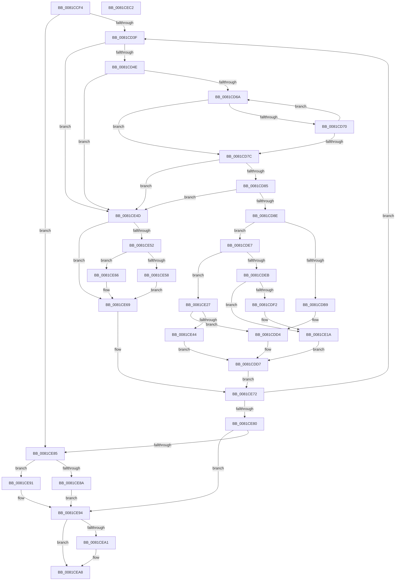

# AslEnvExpandStrings

- RVA: `0x0081CCF4`–`0x0081CEC3` (길이 `463` bytes)
- VA: `0x000000014081CCF4`
- 실행 섹션: `PAGE`
- PDB 이름 있음: `예`; PDB Function 태그: `아니요`
- unwind 정보 RVA: `0x000D9D9C`
- 디코드: `127`개 명령, `463/463` bytes 표시
- 미해석 바이트: `0` (있으면 어셈블리에 `.byte`로 보존)

> 이 문서는 커널 이미지의 기계어와 PDB 기호를 분석해 생성했습니다. 4번과 5번은 함수 원형과 자료형을 바이너리 사용 방식에서 추정한 C 해석이며 원본 소스 복구 결과는 아닙니다.

## 1. Dependencies

- 직접 호출 지점: **2**; 고유 호출 대상: **2**
- 직접 호출자로 확인된 함수: **1**
- RIP 상대 이미지 참조: **2**

### Outgoing calls
- `0x0081CDA9` → [AslEnvVarQuery](AslEnvVarQuery_function_0081D410.md) (function, `0x0081D410`)
- `0x0081CE0F` → [AslLogCallPrintf](../95/AslLogCallPrintf_function_0095E4EC.md) (function, `0x0095E4EC`)

### Direct callers
- [AslEnvExpandStrings2](AslEnvExpandStrings2_function_0081CECC.md) at `0x0081D04B`

### Static image references
- `0x0081CDF2` → RVA `0x0003F698` (`.rdata`; read)
- `0x0081CE03` → RVA `0x0003F6B8` (`.rdata`; read)

## 2. Other-region calls and transfers

- 다른 실행 섹션으로 향하는 call: **0**
- 별도 외부 분기/꼬리 이동을 확인하지 못했습니다.

## 3. Assembly (complete function range)

```asm
0081CCF4  48 8B C4                        mov rax, rsp
0081CCF7  48 89 58 10                     mov qword ptr [rax + 0x10], rbx
0081CCFB  48 89 48 08                     mov qword ptr [rax + 8], rcx
0081CCFF  55                              push rbp
0081CD00  56                              push rsi
0081CD01  57                              push rdi
0081CD02  41 54                           push r12
0081CD04  41 55                           push r13
0081CD06  41 56                           push r14
0081CD08  41 57                           push r15
0081CD0A  48 83 EC 40                     sub rsp, 0x40
0081CD0E  48 8B B4 24 A0 00 00 00         mov rsi, qword ptr [rsp + 0xa0]
0081CD16  49 8B F8                        mov rdi, r8
0081CD19  45 33 C0                        xor r8d, r8d
0081CD1C  4D 8B E1                        mov r12, r9
0081CD1F  4C 89 40 18                     mov qword ptr [rax + 0x18], r8
0081CD23  4C 8B EA                        mov r13, rdx
0081CD26  4C 8B D1                        mov r10, rcx
0081CD29  41 8B E8                        mov ebp, r8d
0081CD2C  45 8B F0                        mov r14d, r8d
0081CD2F  41 B9 23 00 00 C0               mov r9d, 0xc0000023
0081CD35  48 83 FF 01                     cmp rdi, 1
0081CD39  0F 82 46 01 00 00               jb 0x14081ce85
0081CD3F  41 0F B7 4D 00                  movzx ecx, word ptr [r13]
0081CD44  66 83 F9 25                     cmp cx, 0x25
0081CD48  0F 85 FF 00 00 00               jne 0x14081ce4d
0081CD4E  48 8D 47 FF                     lea rax, [rdi - 1]
0081CD52  4D 8B F8                        mov r15, r8
0081CD55  48 89 44 24 30                  mov qword ptr [rsp + 0x30], rax
0081CD5A  49 8D 5D 02                     lea rbx, [r13 + 2]
0081CD5E  48 8B D3                        mov rdx, rbx
0081CD61  48 85 C0                        test rax, rax
0081CD64  0F 84 E3 00 00 00               je 0x14081ce4d
0081CD6A  66 83 3B 25                     cmp word ptr [rbx], 0x25
0081CD6E  74 0C                           je 0x14081cd7c
0081CD70  48 83 C3 02                     add rbx, 2
0081CD74  49 FF C7                        inc r15
0081CD77  4C 3B F8                        cmp r15, rax
0081CD7A  72 EE                           jb 0x14081cd6a
0081CD7C  4D 85 FF                        test r15, r15
0081CD7F  0F 84 C8 00 00 00               je 0x14081ce4d
0081CD85  4C 3B F8                        cmp r15, rax
0081CD88  0F 83 BF 00 00 00               jae 0x14081ce4d
0081CD8E  48 8D 84 24 90 00 00 00         lea rax, [rsp + 0x90]
0081CD96  4D 8B CC                        mov r9, r12
0081CD99  48 89 44 24 28                  mov qword ptr [rsp + 0x28], rax
0081CD9E  4D 8B C7                        mov r8, r15
0081CDA1  49 8B CA                        mov rcx, r10
0081CDA4  48 89 74 24 20                  mov qword ptr [rsp + 0x20], rsi
0081CDA9  E8 62 06 00 00                  call 0x14081d410
0081CDAE  41 B9 23 00 00 C0               mov r9d, 0xc0000023
0081CDB4  41 3B C1                        cmp eax, r9d
0081CDB7  75 2E                           jne 0x14081cde7
0081CDB9  48 8B 84 24 90 00 00 00         mov rax, qword ptr [rsp + 0x90]
0081CDC1  48 FF C8                        dec rax
0081CDC4  4C 03 F0                        add r14, rax
0081CDC7  48 C7 C0 FE FF FF FF            mov rax, 0xfffffffffffffffe
0081CDCE  49 2B C7                        sub rax, r15
0081CDD1  48 03 F8                        add rdi, rax
0081CDD4  41 8B E9                        mov ebp, r9d
0081CDD7  4C 8B 94 24 80 00 00 00         mov r10, qword ptr [rsp + 0x80]
0081CDDF  45 33 C0                        xor r8d, r8d
0081CDE2  E9 8B 00 00 00                  jmp 0x14081ce72
0081CDE7  85 C0                           test eax, eax
0081CDE9  79 3C                           jns 0x14081ce27
0081CDEB  3D 00 01 00 C0                  cmp eax, 0xc0000100
0081CDF0  74 28                           je 0x14081ce1a
0081CDF2  4C 8D 0D 9F 28 82 FF            lea r9, [rip - 0x7dd761]
0081CDF9  89 44 24 20                     mov dword ptr [rsp + 0x20], eax
0081CDFD  41 B8 92 02 00 00               mov r8d, 0x292
0081CE03  48 8D 15 AE 28 82 FF            lea rdx, [rip - 0x7dd752]
0081CE0A  B9 01 00 00 00                  mov ecx, 1
0081CE0F  E8 D8 16 14 00                  call 0x14095e4ec
0081CE14  41 B9 23 00 00 C0               mov r9d, 0xc0000023
0081CE1A  48 8B 7C 24 30                  mov rdi, qword ptr [rsp + 0x30]
0081CE1F  49 FF C6                        inc r14
0081CE22  49 8B DD                        mov rbx, r13
0081CE25  EB B0                           jmp 0x14081cdd7
0081CE27  48 8B 8C 24 90 00 00 00         mov rcx, qword ptr [rsp + 0x90]
0081CE2F  48 C7 C0 FE FF FF FF            mov rax, 0xfffffffffffffffe
0081CE36  49 2B C7                        sub rax, r15
0081CE39  4C 03 F1                        add r14, rcx
0081CE3C  48 03 F8                        add rdi, rax
0081CE3F  48 3B F1                        cmp rsi, rcx
0081CE42  76 90                           jbe 0x14081cdd4
0081CE44  48 2B F1                        sub rsi, rcx
0081CE47  4D 8D 24 4C                     lea r12, [r12 + rcx*2]
0081CE4B  EB 8A                           jmp 0x14081cdd7
0081CE4D  41 3B E9                        cmp ebp, r9d
0081CE50  74 17                           je 0x14081ce69
0081CE52  48 83 FE 01                     cmp rsi, 1
0081CE56  76 0E                           jbe 0x14081ce66
0081CE58  48 FF CE                        dec rsi
0081CE5B  66 41 89 0C 24                  mov word ptr [r12], cx
0081CE60  49 83 C4 02                     add r12, 2
0081CE64  EB 03                           jmp 0x14081ce69
0081CE66  41 8B E9                        mov ebp, r9d
0081CE69  49 FF C6                        inc r14
0081CE6C  49 8B DD                        mov rbx, r13
0081CE6F  48 FF CF                        dec rdi
0081CE72  4C 8D 6B 02                     lea r13, [rbx + 2]
0081CE76  48 83 FF 01                     cmp rdi, 1
0081CE7A  0F 83 BF FE FF FF               jae 0x14081cd3f
0081CE80  41 3B E9                        cmp ebp, r9d
0081CE83  74 0F                           je 0x14081ce94
0081CE85  48 85 F6                        test rsi, rsi
0081CE88  74 07                           je 0x14081ce91
0081CE8A  66 45 89 04 24                  mov word ptr [r12], r8w
0081CE8F  EB 03                           jmp 0x14081ce94
0081CE91  41 8B E9                        mov ebp, r9d
0081CE94  48 8B 94 24 A8 00 00 00         mov rdx, qword ptr [rsp + 0xa8]
0081CE9C  48 85 D2                        test rdx, rdx
0081CE9F  74 07                           je 0x14081cea8
0081CEA1  49 8D 4E 01                     lea rcx, [r14 + 1]
0081CEA5  48 89 0A                        mov qword ptr [rdx], rcx
0081CEA8  48 8B 9C 24 88 00 00 00         mov rbx, qword ptr [rsp + 0x88]
0081CEB0  8B C5                           mov eax, ebp
0081CEB2  48 83 C4 40                     add rsp, 0x40
0081CEB6  41 5F                           pop r15
0081CEB8  41 5E                           pop r14
0081CEBA  41 5D                           pop r13
0081CEBC  41 5C                           pop r12
0081CEBE  5F                              pop rdi
0081CEBF  5E                              pop rsi
0081CEC0  5D                              pop rbp
0081CEC1  C3                              ret
0081CEC2  CC                              int3
```

## 4. C-style interpretation (structured pseudocode)

```c
__int64 __fastcall AslEnvExpandStrings(__int64 a1, __int64 a2, __int64 a3, __int64 a4, __int64 a5, __int64 a6)
{
    __int64 result;
    __int64 v_r12;
    __int64 v_r14;
    __int64 v_r15;
    __int64 v_rbx;
    __int64 v_rdi;
    __int64 v_rsi;
    __int64 v_rsp;
    unsigned __int64 v_stack_m48;
    unsigned __int64 v_stack_m50;
    unsigned __int64 v_stack_m58;
    unsigned __int64 v_stack_p10;
    unsigned __int64 v_stack_p18;
    unsigned __int64 v_stack_p8;

    *(unsigned __int64 *)(v_rsp + 16) = v_rbx;
    *(unsigned __int64 *)(v_rsp + 8) = a1;
    v_rsp = (v_rsp) - (64);
    a3 = 0;
    *(unsigned __int64 *)(v_rsp + 24) = 0;
    if (0 < 1) goto loc_0081CE85;
loc_0081CD3F:
    if (((unsigned __int16)(*(unsigned __int16 *)(a2))) != 37) goto loc_0081CE4D;
    v_stack_m48 = a3 - 1;
    if (a3 - 1 == 0) goto loc_0081CE4D;
loc_0081CD6A:
    if ((*(unsigned __int16 *)(a2 + 2)) == 37) goto loc_0081CD7C;
    v_rbx = (a2 + 2) + (2);
    v_r15 = (0) + 1;
    if (v_r15 < (a3 - 1)) goto loc_0081CD6A;
loc_0081CD7C:
    if (v_r15 == 0) goto loc_0081CE4D;
    if (v_r15 >= (a3 - 1)) goto loc_0081CE4D;
    v_stack_m50 = v_stack_p18;
    v_stack_m58 = a5;
    result = AslEnvVarQuery(a1, a2 + 2, v_r15, a4);
    if (((unsigned int)(result)) != ((unsigned int)((unsigned int)(0xC0000023ULL)))) goto loc_0081CDE7;
    result = (v_stack_p18) - 1;
    v_r14 = (0) + (result);
    result = (-2) - (v_r15);
    v_rdi = (a3) + (result);
loc_0081CDD4:
loc_0081CDD7:
    a3 = 0;
    goto loc_0081CE72;
loc_0081CDE7:
    if (!sign_flag) goto loc_0081CE27;
    if (((unsigned int)(result)) != 0xC0000100ULL) {
        a4 = v_rip - 8247137;
        v_stack_m58 = (unsigned int)(result);
        a3 = 658;
        a2 = v_rip - 8247122;
        a1 = 1;
        result = AslLogCallPrintf(a1, a2, a3, a4);
        a4 = 0xC0000023ULL;
    }
    v_r14 = (v_r14) + 1;
    goto loc_0081CDD7;
loc_0081CE27:
    result = (-2) - (v_r15);
    v_r14 = (v_r14) + (v_stack_p18);
    v_rdi = (v_stack_m48) + (result);
    if (a5 <= v_stack_p18) goto loc_0081CDD4;
    v_rsi = (a5) - (v_stack_p18);
    goto loc_0081CDD7;
loc_0081CE4D:
    if (((unsigned int)((unsigned int)((unsigned int)((unsigned int)(0xC0000023ULL))))) == ((unsigned int)(a4))) goto loc_0081CE69;
    if (v_rsi <= 1) goto loc_0081CE66;
    v_rsi = (v_rsi) - 1;
    *(unsigned __int16 *)(a4 + v_stack_p18 * 2) = (unsigned __int16)(v_stack_p18);
    v_r12 = (a4 + v_stack_p18 * 2) + (2);
    goto loc_0081CE69;
loc_0081CE66:
loc_0081CE69:
    v_r14 = (v_r14) + 1;
    v_rdi = (v_rdi) - 1;
loc_0081CE72:
    if (v_rdi >= 1) goto loc_0081CD3F;
    if (((unsigned int)((unsigned int)((unsigned int)(a4)))) == ((unsigned int)(a4))) goto loc_0081CE94;
loc_0081CE85:
    if (v_rsi == 0) goto loc_0081CE91;
    *(unsigned __int16 *)(v_r12) = (unsigned __int16)(a3);
    goto loc_0081CE94;
loc_0081CE91:
loc_0081CE94:
    if (a6 != 0) {
        a1 = v_r14 + 1;
        *(unsigned __int64 *)(a6) = a1;
    }
    v_rsp = (v_rsp) + (64);
    return (unsigned int)((unsigned int)((unsigned int)((unsigned int)(a4))));
}
```

## 5. (Beta) C Style

```c
int64_t AslEnvExpandStrings(int64_t Arg1, void *Arg2, int64_t Arg3, void *Arg4, int64_t Arg5, int64_t Arg6)
{
    uint8_t *arg2 = (uint8_t *)Arg2;
    uint8_t *arg4 = (uint8_t *)Arg4;

    int64_t result;
    int64_t local_r12;
    int64_t local_r14;
    int64_t local_r15;
    int64_t local_rbx;
    int64_t local_rdi;
    int64_t local_rsi;
    int64_t local_rsp;
    uint64_t v_stack_m48;
    uint64_t v_stack_m50;
    uint64_t v_stack_m58;
    uint64_t v_stack_p10;
    uint64_t v_stack_p18;
    uint64_t v_stack_p8;

    *(uint64_t *)(local_rsp + 0x10) = local_rbx;
    *(uint64_t *)(local_rsp + 0x8) = Arg1;
    local_rsp = (local_rsp) - (64);
    Arg3 = 0;
    *(uint64_t *)(local_rsp + 0x18) = 0;
    if (0 < 1) goto loc_0081CE85;
loc_0081CD3F:
    if (((uint16_t)(*(uint16_t *)(arg2))) != 37) goto loc_0081CE4D;
    v_stack_m48 = Arg3 - 1;
    if (Arg3 - 1 == 0) goto loc_0081CE4D;
loc_0081CD6A:
    if ((*(uint16_t *)(arg2 + 0x2)) == 37) goto loc_0081CD7C;
    local_rbx = (Arg2 + 2) + (2);
    local_r15 = (0) + 1;
    if (local_r15 < (Arg3 - 1)) goto loc_0081CD6A;
loc_0081CD7C:
    if (local_r15 == 0) goto loc_0081CE4D;
    if (local_r15 >= (Arg3 - 1)) goto loc_0081CE4D;
    v_stack_m50 = v_stack_p18;
    v_stack_m58 = Arg5;
    result = AslEnvVarQuery(Arg1, Arg2 + 2, local_r15, Arg4);
    if (((uint32_t)(result)) != ((uint32_t)((uint32_t)(0xC0000023ULL)))) goto loc_0081CDE7;
    result = (v_stack_p18) - 1;
    local_r14 = (0) + (result);
    result = (-2) - (local_r15);
    local_rdi = (Arg3) + (result);
loc_0081CDD4:
loc_0081CDD7:
    Arg3 = 0;
    goto loc_0081CE72;
loc_0081CDE7:
    if (!sign_flag) goto loc_0081CE27;
    if (((uint32_t)(result)) != 0xC0000100ULL) {
        Arg4 = v_rip - 8247137;
        v_stack_m58 = (uint32_t)(result);
        Arg3 = 658;
        Arg2 = v_rip - 8247122;
        Arg1 = 1;
        result = AslLogCallPrintf(Arg1, Arg2, Arg3, Arg4);
        Arg4 = 0xC0000023ULL;
    }
    local_r14 = (local_r14) + 1;
    goto loc_0081CDD7;
loc_0081CE27:
    result = (-2) - (local_r15);
    local_r14 = (local_r14) + (v_stack_p18);
    local_rdi = (v_stack_m48) + (result);
    if (Arg5 <= v_stack_p18) goto loc_0081CDD4;
    local_rsi = (Arg5) - (v_stack_p18);
    goto loc_0081CDD7;
loc_0081CE4D:
    if (((uint32_t)((uint32_t)((uint32_t)((uint32_t)(0xC0000023ULL))))) == ((uint32_t)(Arg4))) goto loc_0081CE69;
    if (local_rsi <= 1) goto loc_0081CE66;
    local_rsi = (local_rsi) - 1;
    *(uint16_t *)(arg4 + v_stack_p18 * 2) = (uint16_t)(v_stack_p18);
    local_r12 = (Arg4 + v_stack_p18 * 2) + (2);
    goto loc_0081CE69;
loc_0081CE66:
loc_0081CE69:
    local_r14 = (local_r14) + 1;
    local_rdi = (local_rdi) - 1;
loc_0081CE72:
    if (local_rdi >= 1) goto loc_0081CD3F;
    if (((uint32_t)((uint32_t)((uint32_t)(Arg4)))) == ((uint32_t)(Arg4))) goto loc_0081CE94;
loc_0081CE85:
    if (local_rsi == 0) goto loc_0081CE91;
    *(uint16_t *)(local_r12) = (uint16_t)(Arg3);
    goto loc_0081CE94;
loc_0081CE91:
loc_0081CE94:
    if (Arg6 != 0) {
        Arg1 = local_r14 + 1;
        *(uint64_t *)(Arg6) = Arg1;
    }
    local_rsp = (local_rsp) + (64);
    return (uint32_t)((uint32_t)((uint32_t)((uint32_t)(Arg4))));
}
```

### 관측된 메모리 오프셋

구조체 형식이 확인되지 않은 접근은 인자 기준의 오프셋으로만 기록했습니다.

| 기준 인자 | 오프셋 표현 | 폭 (bit) | 접근 |
|---|---:|---:|---|
| `Arg2` | `+ 0x0` | `16` | `R` |
| `Arg2` | `+ 0x2` | `64` | `R` |
| `Arg4` | `+ 0x0` | `16` | `W` |
| `Arg4` | `+ 0x0 + rcx*2` | `64` | `R` |

## 6. Execution-region graph

[열기: 2D/3D 그래프와 함수 탐색 컨트롤 패널](../../../control-panel.html?section=page&rva=0x0081CCF4&view=graph)

- 2D 그래프는 위에서 아래로 흐르고, 3D 그래프는 빈 공간을 드래그해 회전합니다. Shift+드래그는 이동, 휠은 확대·축소, 함수 노드 선택은 대상 보고서 이동입니다.

### Static fallback


