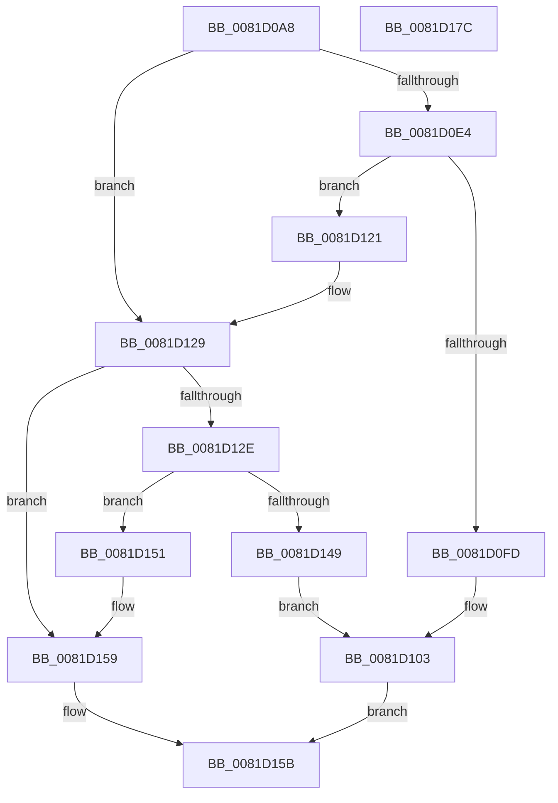

# AslEnvGetProcessWowInfo

- RVA: `0x0081D0A8`–`0x0081D17D` (길이 `213` bytes)
- VA: `0x000000014081D0A8`
- 실행 섹션: `PAGE`
- PDB 이름 있음: `예`; PDB Function 태그: `아니요`
- unwind 정보 RVA: `0x000D9DD8`
- 디코드: `60`개 명령, `213/213` bytes 표시
- 미해석 바이트: `0` (있으면 어셈블리에 `.byte`로 보존)

> 이 문서는 커널 이미지의 기계어와 PDB 기호를 분석해 생성했습니다. 4번과 5번은 함수 원형과 자료형을 바이너리 사용 방식에서 추정한 C 해석이며 원본 소스 복구 결과는 아닙니다.

## 1. Dependencies

- 직접 호출 지점: **4**; 고유 호출 대상: **3**
- 직접 호출자로 확인된 함수: **4**
- RIP 상대 이미지 참조: **3**

### Outgoing calls
- `0x0081D0F2` → [ZwQuerySystemInformation](../../text/6A/ZwQuerySystemInformation_function_006AD790.md) (function, `0x006AD790`)
- `0x0081D11A` → [AslLogCallPrintf](../95/AslLogCallPrintf_function_0095E4EC.md) (function, `0x0095E4EC`)
- `0x0081D13E` → [ZwQuerySystemInformation](../../text/6A/ZwQuerySystemInformation_function_006AD790.md) (function, `0x006AD790`)
- `0x0081D165` → [_security_check_cookie](../../text/6A/_security_check_cookie_function_006AC640.md) (function, `0x006AC640`)

### Direct callers
- [SdbpResolveMatchingFile](SdbpResolveMatchingFile_function_00816A20.md) at `0x00816A9A`
- [SdbpResolveMatchingFile](SdbpResolveMatchingFile_function_00816A20.md) at `0x00816BD8`
- [SdbGuestHostArchsToRuntimePlatformFlag](SdbGuestHostArchsToRuntimePlatformFlag_function_008174A0.md) at `0x008174D7`
- [SdbGuestTargetPlatformFlagsToRuntimePlatformFlags](SdbGuestTargetPlatformFlagsToRuntimePlatformFlags_function_00817550.md) at `0x00817574`
- [SdbpGetProcessHostGuestArchitectures](SdbpGetProcessHostGuestArchitectures_function_00818350.md) at `0x00818381`

### Static image references
- `0x0081D0B8` → RVA `0x00E0A740` (`.data`; read)
- `0x0081D103` → RVA `0x0003F888` (`.rdata`; read)
- `0x0081D10E` → RVA `0x0003F8B0` (`.rdata`; read)

## 2. Other-region calls and transfers

- 다른 실행 섹션으로 향하는 call: **3**
  - `0x0081D0F2` → [ZwQuerySystemInformation](../../text/6A/ZwQuerySystemInformation_function_006AD790.md) (`PAGE` → `.text`)
  - `0x0081D13E` → [ZwQuerySystemInformation](../../text/6A/ZwQuerySystemInformation_function_006AD790.md) (`PAGE` → `.text`)
  - `0x0081D165` → [_security_check_cookie](../../text/6A/_security_check_cookie_function_006AC640.md) (`PAGE` → `.text`)
- 별도 외부 분기/꼬리 이동을 확인하지 못했습니다.

## 3. Assembly (complete function range)

```asm
0081D0A8  4C 8B DC                        mov r11, rsp
0081D0AB  49 89 5B 18                     mov qword ptr [r11 + 0x18], rbx
0081D0AF  49 89 73 20                     mov qword ptr [r11 + 0x20], rsi
0081D0B3  57                              push rdi
0081D0B4  48 83 EC 60                     sub rsp, 0x60
0081D0B8  48 8B 05 81 D6 5E 00            mov rax, qword ptr [rip + 0x5ed681]
0081D0BF  48 33 C4                        xor rax, rsp
0081D0C2  48 89 44 24 50                  mov qword ptr [rsp + 0x50], rax
0081D0C7  33 C0                           xor eax, eax
0081D0C9  48 8B FA                        mov rdi, rdx
0081D0CC  49 89 43 C8                     mov qword ptr [r11 - 0x38], rax
0081D0D0  48 8B F1                        mov rsi, rcx
0081D0D3  49 89 43 D8                     mov qword ptr [r11 - 0x28], rax
0081D0D7  89 44 24 38                     mov dword ptr [rsp + 0x38], eax
0081D0DB  89 44 24 48                     mov dword ptr [rsp + 0x48], eax
0081D0DF  48 85 C9                        test rcx, rcx
0081D0E2  74 45                           je 0x14081d129
0081D0E4  45 33 C9                        xor r9d, r9d
0081D0E7  44 8D 40 0C                     lea r8d, [rax + 0xc]
0081D0EB  49 8D 53 C8                     lea rdx, [r11 - 0x38]
0081D0EF  8D 48 01                        lea ecx, [rax + 1]
0081D0F2  E8 99 06 E9 FF                  call 0x1406ad790
0081D0F7  8B D8                           mov ebx, eax
0081D0F9  85 C0                           test eax, eax
0081D0FB  79 24                           jns 0x14081d121
0081D0FD  41 B8 3C 07 00 00               mov r8d, 0x73c
0081D103  4C 8D 0D 7E 27 82 FF            lea r9, [rip - 0x7dd882]
0081D10A  89 44 24 20                     mov dword ptr [rsp + 0x20], eax
0081D10E  48 8D 15 9B 27 82 FF            lea rdx, [rip - 0x7dd865]
0081D115  B9 01 00 00 00                  mov ecx, 1
0081D11A  E8 CD 13 14 00                  call 0x14095e4ec
0081D11F  EB 3A                           jmp 0x14081d15b
0081D121  0F B7 44 24 30                  movzx eax, word ptr [rsp + 0x30]
0081D126  66 89 06                        mov word ptr [rsi], ax
0081D129  48 85 FF                        test rdi, rdi
0081D12C  74 2B                           je 0x14081d159
0081D12E  45 33 C9                        xor r9d, r9d
0081D131  48 8D 54 24 40                  lea rdx, [rsp + 0x40]
0081D136  45 8D 41 0C                     lea r8d, [r9 + 0xc]
0081D13A  41 8D 49 01                     lea ecx, [r9 + 1]
0081D13E  E8 4D 06 E9 FF                  call 0x1406ad790
0081D143  8B D8                           mov ebx, eax
0081D145  85 C0                           test eax, eax
0081D147  79 08                           jns 0x14081d151
0081D149  41 B8 67 07 00 00               mov r8d, 0x767
0081D14F  EB B2                           jmp 0x14081d103
0081D151  0F B7 44 24 40                  movzx eax, word ptr [rsp + 0x40]
0081D156  66 89 07                        mov word ptr [rdi], ax
0081D159  33 DB                           xor ebx, ebx
0081D15B  8B C3                           mov eax, ebx
0081D15D  48 8B 4C 24 50                  mov rcx, qword ptr [rsp + 0x50]
0081D162  48 33 CC                        xor rcx, rsp
0081D165  E8 D6 F4 E8 FF                  call 0x1406ac640
0081D16A  4C 8D 5C 24 60                  lea r11, [rsp + 0x60]
0081D16F  49 8B 5B 20                     mov rbx, qword ptr [r11 + 0x20]
0081D173  49 8B 73 28                     mov rsi, qword ptr [r11 + 0x28]
0081D177  49 8B E3                        mov rsp, r11
0081D17A  5F                              pop rdi
0081D17B  C3                              ret
0081D17C  CC                              int3
```

## 4. C-style interpretation (structured pseudocode)

```c
__int64 __fastcall AslEnvGetProcessWowInfo(__int64 a1, __int64 a2, __int64 a3, int a4)
{
    __int64 result;
    __int64 v_rbx;
    __int64 v_rsp;
    unsigned __int64 v_stack_m18;
    unsigned int v_stack_m20;
    unsigned __int64 v_stack_m28;
    unsigned int v_stack_m30;
    unsigned __int16 v_stack_m38;
    unsigned int v_stack_m48;
    unsigned __int64 v_stack_m8;

    *(unsigned __int64 *)(v_rsp + 24) = v_rbx;
    *(unsigned __int64 *)(v_rsp + 32) = v_rsi;
    v_rsp = (v_rsp) - (96);
    result = (*(unsigned __int64 *)(v_rip + 6215297)) ^ (v_rsp);
    v_stack_m18 = result;
    result = 0;
    *(unsigned __int64 *)(v_rsp - 56) = 0;
    *(unsigned __int64 *)(v_rsp - 40) = 0;
    v_stack_m30 = 0;
    v_stack_m20 = 0;
    if (a1 == 0) goto loc_0081D129;
    a4 = 0;
    result = ZwQuerySystemInformation(result + 1, v_rsp - 56, result + 12, a4);
    if (!sign_flag) goto loc_0081D121;
loc_0081D103:
    v_stack_m48 = (unsigned int)(result);
    result = AslLogCallPrintf(1, v_rip - 8247397, (unsigned int)(0x73CULL), v_rip - 8247426);
    goto loc_0081D15B;
loc_0081D121:
    *(unsigned __int16 *)(a1) = (unsigned __int16)(v_stack_m38);
loc_0081D129:
    if (a2 == 0) goto loc_0081D159;
    a4 = 0;
    result = ZwQuerySystemInformation(a4 + 1, v_stack_m28, a4 + 12, a4);
    if (!sign_flag) goto loc_0081D151;
    goto loc_0081D103;
loc_0081D151:
    *(unsigned __int16 *)(a2) = (unsigned __int16)(v_stack_m28);
loc_0081D159:
    v_rbx = 0;
loc_0081D15B:
    a1 = (v_stack_m18) ^ (v_rsp);
    result = _security_check_cookie(a1, v_stack_m28, (unsigned int)(0x767ULL), a4);
    return result;
}
```

## 5. (Beta) C Style

```c
int64_t AslEnvGetProcessWowInfo(void *Arg1, int64_t Arg2, int64_t Arg3, int32_t Arg4)
{
    uint8_t *arg1 = (uint8_t *)Arg1;

    int64_t result;
    int64_t local_rbx;
    int64_t local_rsp;
    uint64_t v_stack_m18;
    uint32_t v_stack_m20;
    uint64_t v_stack_m28;
    uint32_t v_stack_m30;
    uint16_t v_stack_m38;
    uint32_t v_stack_m48;
    uint64_t v_stack_m8;

    *(uint64_t *)(local_rsp + 0x18) = local_rbx;
    *(uint64_t *)(local_rsp + 0x20) = local_rsi;
    local_rsp = (local_rsp) - (96);
    result = (*(uint64_t *)(v_rip + 0x5ED681)) ^ (local_rsp);
    v_stack_m18 = result;
    result = 0;
    *(uint64_t *)(local_rsp - 0x38) = 0;
    *(uint64_t *)(local_rsp - 0x28) = 0;
    v_stack_m30 = 0;
    v_stack_m20 = 0;
    if (Arg1 == NULL) goto loc_0081D129;
    Arg4 = 0;
    result = ZwQuerySystemInformation(result + 1, local_rsp - 56, result + 12, Arg4);
    if (!sign_flag) goto loc_0081D121;
loc_0081D103:
    v_stack_m48 = (uint32_t)(result);
    result = AslLogCallPrintf(1, v_rip - 8247397, (uint32_t)(0x73CULL), v_rip - 8247426);
    goto loc_0081D15B;
loc_0081D121:
    *(uint16_t *)(arg1) = (uint16_t)(v_stack_m38);
loc_0081D129:
    if (Arg2 == 0) goto loc_0081D159;
    Arg4 = 0;
    result = ZwQuerySystemInformation(Arg4 + 1, v_stack_m28, Arg4 + 12, Arg4);
    if (!sign_flag) goto loc_0081D151;
    goto loc_0081D103;
loc_0081D151:
    *(uint16_t *)(Arg2) = (uint16_t)(v_stack_m28);
loc_0081D159:
    local_rbx = 0;
loc_0081D15B:
    Arg1 = (v_stack_m18) ^ (local_rsp);
    result = _security_check_cookie(Arg1, v_stack_m28, (uint32_t)(0x767ULL), Arg4);
    return result;
}
```

### 관측된 메모리 오프셋

구조체 형식이 확인되지 않은 접근은 인자 기준의 오프셋으로만 기록했습니다.

| 기준 인자 | 오프셋 표현 | 폭 (bit) | 접근 |
|---|---:|---:|---|
| `Arg1` | `+ 0x0` | `16` | `W` |

## 6. Execution-region graph

[열기: 2D/3D 그래프와 함수 탐색 컨트롤 패널](../../../control-panel.html?section=page&rva=0x0081D0A8&view=graph)

- 2D 그래프는 위에서 아래로 흐르고, 3D 그래프는 빈 공간을 드래그해 회전합니다. Shift+드래그는 이동, 휠은 확대·축소, 함수 노드 선택은 대상 보고서 이동입니다.

### Static fallback


