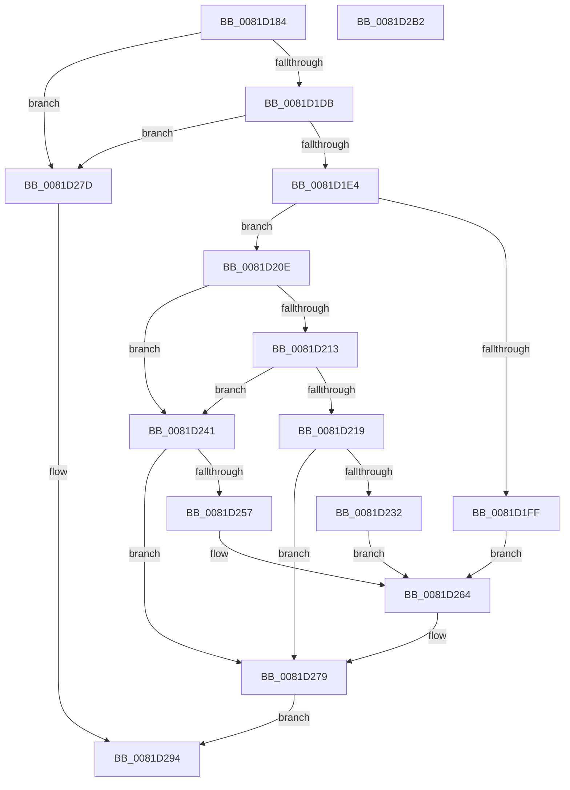

# AslEnvGetSysNativeDirPathForGuestBuf

- RVA: `0x0081D184`–`0x0081D2B3` (길이 `303` bytes)
- VA: `0x000000014081D184`
- 실행 섹션: `PAGE`
- PDB 이름 있음: `예`; PDB Function 태그: `아니요`
- unwind 정보 RVA: `0x000D9DB8`
- 디코드: `81`개 명령, `303/303` bytes 표시
- 미해석 바이트: `0` (있으면 어셈블리에 `.byte`로 보존)

> 이 문서는 커널 이미지의 기계어와 PDB 기호를 분석해 생성했습니다. 4번과 5번은 함수 원형과 자료형을 바이너리 사용 방식에서 추정한 C 해석이며 원본 소스 복구 결과는 아닙니다.

## 1. Dependencies

- 직접 호출 지점: **7**; 고유 호출 대상: **7**
- 직접 호출자로 확인된 함수: **1**
- RIP 상대 이미지 참조: **6**

### Outgoing calls
- `0x0081D1BE` → [memset](../../text/6C/memset_function_006C6C40.md) (function, `0x006C6C40`)
- `0x0081D1F4` → [AslPathToSystemPathBuf](AslPathToSystemPathBuf_function_0081B430.md) (function, `0x0081B430`)
- `0x0081D227` → [AslPathCombine](AslPathCombine_function_0081B100.md) (function, `0x0081B100`)
- `0x0081D24C` → [RtlStringCchCopyW](../../text/26/RtlStringCchCopyW_function_0026E9A4.md) (function, `0x0026E9A4`)
- `0x0081D274` → [AslLogCallPrintf](../95/AslLogCallPrintf_function_0095E4EC.md) (function, `0x0095E4EC`)
- `0x0081D28F` → [AslEnvGetSystem32DirPathBuf](AslEnvGetSystem32DirPathBuf_function_0081D2BC.md) (function, `0x0081D2BC`)
- `0x0081D29F` → [_security_check_cookie](../../text/6A/_security_check_cookie_function_006AC640.md) (function, `0x006AC640`)

### Direct callers
- [SdbpGetPathAppraiser](SdbpGetPathAppraiser_function_00817F30.md) at `0x00818045`

### Static image references
- `0x0081D192` → RVA `0x00E0A740` (`.data`; read)
- `0x0081D1E4` → RVA `0x0003F848` (`.rdata`; read)
- `0x0081D1FF` → RVA `0x0003DD48` (`.rdata`; read)
- `0x0081D232` → RVA `0x0003DD10` (`.rdata`; read)
- `0x0081D257` → RVA `0x0003E680` (`.rdata`; read)
- `0x0081D264` → RVA `0x0003F860` (`.rdata`; read)

## 2. Other-region calls and transfers

- 다른 실행 섹션으로 향하는 call: **3**
  - `0x0081D1BE` → [memset](../../text/6C/memset_function_006C6C40.md) (`PAGE` → `.text`)
  - `0x0081D24C` → [RtlStringCchCopyW](../../text/26/RtlStringCchCopyW_function_0026E9A4.md) (`PAGE` → `.text`)
  - `0x0081D29F` → [_security_check_cookie](../../text/6A/_security_check_cookie_function_006AC640.md) (`PAGE` → `.text`)
- 별도 외부 분기/꼬리 이동을 확인하지 못했습니다.

## 3. Assembly (complete function range)

```asm
0081D184  40 53                           push rbx
0081D186  55                              push rbp
0081D187  56                              push rsi
0081D188  57                              push rdi
0081D189  41 56                           push r14
0081D18B  48 81 EC C0 00 00 00            sub rsp, 0xc0
0081D192  48 8B 05 A7 D5 5E 00            mov rax, qword ptr [rip + 0x5ed5a7]
0081D199  48 33 C4                        xor rax, rsp
0081D19C  48 89 84 24 B0 00 00 00         mov qword ptr [rsp + 0xb0], rax
0081D1A4  49 8B F8                        mov rdi, r8
0081D1A7  48 8B EA                        mov rbp, rdx
0081D1AA  48 8B F1                        mov rsi, rcx
0081D1AD  33 D2                           xor edx, edx
0081D1AF  41 B8 80 00 00 00               mov r8d, 0x80
0081D1B5  48 8D 4C 24 30                  lea rcx, [rsp + 0x30]
0081D1BA  41 0F B7 D9                     movzx ebx, r9w
0081D1BE  E8 7D 9A EA FF                  call 0x1406c6c40
0081D1C3  48 8B 84 24 10 01 00 00         mov rax, qword ptr [rsp + 0x110]
0081D1CB  45 33 F6                        xor r14d, r14d
0081D1CE  66 44 89 36                     mov word ptr [rsi], r14w
0081D1D2  48 85 C0                        test rax, rax
0081D1D5  0F 84 A2 00 00 00               je 0x14081d27d
0081D1DB  66 39 18                        cmp word ptr [rax], bx
0081D1DE  0F 84 99 00 00 00               je 0x14081d27d
0081D1E4  4C 8D 05 5D 26 82 FF            lea r8, [rip - 0x7dd9a3]
0081D1EB  41 8D 56 40                     lea edx, [r14 + 0x40]
0081D1EF  48 8D 4C 24 30                  lea rcx, [rsp + 0x30]
0081D1F4  E8 37 E2 FF FF                  call 0x14081b430
0081D1F9  8B D8                           mov ebx, eax
0081D1FB  85 C0                           test eax, eax
0081D1FD  79 0F                           jns 0x14081d20e
0081D1FF  4C 8D 0D 42 0B 82 FF            lea r9, [rip - 0x7df4be]
0081D206  41 B8 DB 06 00 00               mov r8d, 0x6db
0081D20C  EB 56                           jmp 0x14081d264
0081D20E  48 85 FF                        test rdi, rdi
0081D211  74 2E                           je 0x14081d241
0081D213  66 44 39 37                     cmp word ptr [rdi], r14w
0081D217  74 28                           je 0x14081d241
0081D219  4C 8B CD                        mov r9, rbp
0081D21C  48 8D 4C 24 30                  lea rcx, [rsp + 0x30]
0081D221  4C 8B C6                        mov r8, rsi
0081D224  48 8B D7                        mov rdx, rdi
0081D227  E8 D4 DE FF FF                  call 0x14081b100
0081D22C  8B D8                           mov ebx, eax
0081D22E  85 C0                           test eax, eax
0081D230  79 47                           jns 0x14081d279
0081D232  4C 8D 0D D7 0A 82 FF            lea r9, [rip - 0x7df529]
0081D239  41 B8 E5 06 00 00               mov r8d, 0x6e5
0081D23F  EB 23                           jmp 0x14081d264
0081D241  4C 8D 44 24 30                  lea r8, [rsp + 0x30]
0081D246  48 8B D5                        mov rdx, rbp
0081D249  48 8B CE                        mov rcx, rsi
0081D24C  E8 53 17 A5 FF                  call 0x14026e9a4
0081D251  8B D8                           mov ebx, eax
0081D253  85 C0                           test eax, eax
0081D255  79 22                           jns 0x14081d279
0081D257  4C 8D 0D 22 14 82 FF            lea r9, [rip - 0x7debde]
0081D25E  41 B8 ED 06 00 00               mov r8d, 0x6ed
0081D264  48 8D 15 F5 25 82 FF            lea rdx, [rip - 0x7dda0b]
0081D26B  89 44 24 20                     mov dword ptr [rsp + 0x20], eax
0081D26F  B9 01 00 00 00                  mov ecx, 1
0081D274  E8 73 12 14 00                  call 0x14095e4ec
0081D279  8B C3                           mov eax, ebx
0081D27B  EB 17                           jmp 0x14081d294
0081D27D  44 0F B7 CB                     movzx r9d, bx
0081D281  48 89 44 24 20                  mov qword ptr [rsp + 0x20], rax
0081D286  4C 8B C7                        mov r8, rdi
0081D289  48 8B D5                        mov rdx, rbp
0081D28C  48 8B CE                        mov rcx, rsi
0081D28F  E8 28 00 00 00                  call 0x14081d2bc
0081D294  48 8B 8C 24 B0 00 00 00         mov rcx, qword ptr [rsp + 0xb0]
0081D29C  48 33 CC                        xor rcx, rsp
0081D29F  E8 9C F3 E8 FF                  call 0x1406ac640
0081D2A4  48 81 C4 C0 00 00 00            add rsp, 0xc0
0081D2AB  41 5E                           pop r14
0081D2AD  5F                              pop rdi
0081D2AE  5E                              pop rsi
0081D2AF  5D                              pop rbp
0081D2B0  5B                              pop rbx
0081D2B1  C3                              ret
0081D2B2  CC                              int3
```

## 4. C-style interpretation (structured pseudocode)

```c
__int64 __fastcall AslEnvGetSysNativeDirPathForGuestBuf(__int64 a1, __int64 a2, __int64 a3, unsigned __int16 a4, __int64 a5)
{
    __int64 result;
    __int64 v_r14;
    __int64 v_rsp;
    unsigned __int64 v_stack_m38;
    unsigned __int64 v_stack_mB8;
    unsigned int v_stack_mC8;

    v_rsp = (v_rsp) - (192);
    result = (*(unsigned __int64 *)(v_rip + 6215079)) ^ (v_rsp);
    v_stack_m38 = result;
    a2 = 0;
    result = memset(v_stack_mB8, a2, 128, a4);
    v_r14 = 0;
    *(unsigned __int16 *)(a1) = 0;
    if (a5 == 0) goto loc_0081D27D;
    if ((*(unsigned __int16 *)(a5)) == a4) goto loc_0081D27D;
    result = AslPathToSystemPathBuf(v_stack_mB8, v_r14 + 64, v_rip - 8247715, a4);
    if (!sign_flag) goto loc_0081D20E;
    goto loc_0081D264;
loc_0081D20E:
    if (a3 == 0) goto loc_0081D241;
    if ((*(unsigned __int16 *)(a3)) == 0) goto loc_0081D241;
    result = AslPathCombine(v_stack_mB8, a3, a1, 0);
    if (!sign_flag) goto loc_0081D279;
    goto loc_0081D264;
loc_0081D241:
    result = RtlStringCchCopyW(a1, 0, v_stack_mB8, v_rip - 8254761);
    if (!sign_flag) goto loc_0081D279;
loc_0081D264:
    v_stack_mC8 = (unsigned int)(result);
    result = AslLogCallPrintf(1, v_rip - 8247819, (unsigned int)(0x6EDULL), v_rip - 8252382);
loc_0081D279:
    goto loc_0081D294;
loc_0081D27D:
    v_stack_mC8 = (unsigned int)((unsigned int)((unsigned int)((unsigned int)(result))));
    result = AslEnvGetSystem32DirPathBuf(a1, 0, a3, (unsigned __int16)((unsigned int)((unsigned int)(result))));
loc_0081D294:
    a1 = (v_stack_m38) ^ (v_rsp);
    result = _security_check_cookie(a1, 0, a3, (unsigned __int16)((unsigned int)((unsigned int)(result))));
    v_rsp = (v_rsp) + (192);
    return result;
}
```

## 5. (Beta) C Style

```c
int64_t AslEnvGetSysNativeDirPathForGuestBuf(void *Arg1, int64_t Arg2, int64_t Arg3, uint16_t Arg4, int64_t Arg5)
{
    uint8_t *arg1 = (uint8_t *)Arg1;

    int64_t result;
    int64_t local_r14;
    int64_t local_rsp;
    uint64_t v_stack_m38;
    uint64_t v_stack_mB8;
    uint32_t v_stack_mC8;

    local_rsp = (local_rsp) - (192);
    result = (*(uint64_t *)(v_rip + 0x5ED5A7)) ^ (local_rsp);
    v_stack_m38 = result;
    Arg2 = 0;
    result = memset(v_stack_mB8, Arg2, 128, Arg4);
    local_r14 = 0;
    *(uint16_t *)(arg1) = 0;
    if (Arg5 == 0) goto loc_0081D27D;
    if ((*(uint16_t *)(Arg5)) == Arg4) goto loc_0081D27D;
    result = AslPathToSystemPathBuf(v_stack_mB8, local_r14 + 64, v_rip - 8247715, Arg4);
    if (!sign_flag) goto loc_0081D20E;
    goto loc_0081D264;
loc_0081D20E:
    if (Arg3 == 0) goto loc_0081D241;
    if ((*(uint16_t *)(Arg3)) == 0) goto loc_0081D241;
    result = AslPathCombine(v_stack_mB8, Arg3, Arg1, 0);
    if (!sign_flag) goto loc_0081D279;
    goto loc_0081D264;
loc_0081D241:
    result = RtlStringCchCopyW(Arg1, 0, v_stack_mB8, v_rip - 8254761);
    if (!sign_flag) goto loc_0081D279;
loc_0081D264:
    v_stack_mC8 = (uint32_t)(result);
    result = AslLogCallPrintf(1, v_rip - 8247819, (uint32_t)(0x6EDULL), v_rip - 8252382);
loc_0081D279:
    goto loc_0081D294;
loc_0081D27D:
    v_stack_mC8 = (uint32_t)((uint32_t)((uint32_t)((uint32_t)(result))));
    result = AslEnvGetSystem32DirPathBuf(Arg1, 0, Arg3, (uint16_t)((uint32_t)((uint32_t)(result))));
loc_0081D294:
    Arg1 = (v_stack_m38) ^ (local_rsp);
    result = _security_check_cookie(Arg1, 0, Arg3, (uint16_t)((uint32_t)((uint32_t)(result))));
    local_rsp = (local_rsp) + (192);
    return result;
}
```

### 관측된 메모리 오프셋

구조체 형식이 확인되지 않은 접근은 인자 기준의 오프셋으로만 기록했습니다.

| 기준 인자 | 오프셋 표현 | 폭 (bit) | 접근 |
|---|---:|---:|---|
| `Arg1` | `+ 0x0` | `16` | `W` |

## 6. Execution-region graph

[열기: 2D/3D 그래프와 함수 탐색 컨트롤 패널](../../../control-panel.html?section=page&rva=0x0081D184&view=graph)

- 2D 그래프는 위에서 아래로 흐르고, 3D 그래프는 빈 공간을 드래그해 회전합니다. Shift+드래그는 이동, 휠은 확대·축소, 함수 노드 선택은 대상 보고서 이동입니다.

### Static fallback


