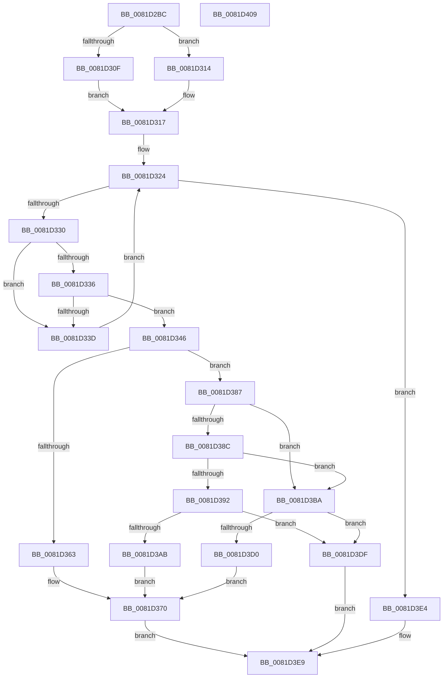

# AslEnvGetSystem32DirPathBuf

- RVA: `0x0081D2BC`–`0x0081D40A` (길이 `334` bytes)
- VA: `0x000000014081D2BC`
- 실행 섹션: `PAGE`
- PDB 이름 있음: `예`; PDB Function 태그: `아니요`
- unwind 정보 RVA: `0x000D9DB8`
- 디코드: `92`개 명령, `334/334` bytes 표시
- 미해석 바이트: `0` (있으면 어셈블리에 `.byte`로 보존)

> 이 문서는 커널 이미지의 기계어와 PDB 기호를 분석해 생성했습니다. 4번과 5번은 함수 원형과 자료형을 바이너리 사용 방식에서 추정한 C 해석이며 원본 소스 복구 결과는 아닙니다.

## 1. Dependencies

- 직접 호출 지점: **6**; 고유 호출 대상: **6**
- 직접 호출자로 확인된 함수: **2**
- RIP 상대 이미지 참조: **6**

### Outgoing calls
- `0x0081D2F6` → [memset](../../text/6C/memset_function_006C6C40.md) (function, `0x006C6C40`)
- `0x0081D358` → [AslPathToSystemPathBuf](AslPathToSystemPathBuf_function_0081B430.md) (function, `0x0081B430`)
- `0x0081D380` → [AslLogCallPrintf](../95/AslLogCallPrintf_function_0095E4EC.md) (function, `0x0095E4EC`)
- `0x0081D3A0` → [AslPathCombine](AslPathCombine_function_0081B100.md) (function, `0x0081B100`)
- `0x0081D3C5` → [RtlStringCchCopyW](../../text/26/RtlStringCchCopyW_function_0026E9A4.md) (function, `0x0026E9A4`)
- `0x0081D3F6` → [_security_check_cookie](../../text/6A/_security_check_cookie_function_006AC640.md) (function, `0x006AC640`)

### Direct callers
- [SdbpGetPathSystem](SdbpGetPathSystem_function_00818290.md) at `0x008182FD`
- [AslEnvGetSysNativeDirPathForGuestBuf](AslEnvGetSysNativeDirPathForGuestBuf_function_0081D184.md) at `0x0081D28F`

### Static image references
- `0x0081D2CA` → RVA `0x00E0A740` (`.data`; read)
- `0x0081D31A` → RVA `0x00E0A180` (`.data`; read)
- `0x0081D363` → RVA `0x0003DD48` (`.rdata`; read)
- `0x0081D370` → RVA `0x0003F660` (`.rdata`; read)
- `0x0081D3AB` → RVA `0x0003DD10` (`.rdata`; read)
- `0x0081D3D0` → RVA `0x0003E680` (`.rdata`; read)

## 2. Other-region calls and transfers

- 다른 실행 섹션으로 향하는 call: **3**
  - `0x0081D2F6` → [memset](../../text/6C/memset_function_006C6C40.md) (`PAGE` → `.text`)
  - `0x0081D3C5` → [RtlStringCchCopyW](../../text/26/RtlStringCchCopyW_function_0026E9A4.md) (`PAGE` → `.text`)
  - `0x0081D3F6` → [_security_check_cookie](../../text/6A/_security_check_cookie_function_006AC640.md) (`PAGE` → `.text`)
- 별도 외부 분기/꼬리 이동을 확인하지 못했습니다.

## 3. Assembly (complete function range)

```asm
0081D2BC  40 53                           push rbx
0081D2BE  55                              push rbp
0081D2BF  56                              push rsi
0081D2C0  57                              push rdi
0081D2C1  41 56                           push r14
0081D2C3  48 81 EC C0 00 00 00            sub rsp, 0xc0
0081D2CA  48 8B 05 6F D4 5E 00            mov rax, qword ptr [rip + 0x5ed46f]
0081D2D1  48 33 C4                        xor rax, rsp
0081D2D4  48 89 84 24 B0 00 00 00         mov qword ptr [rsp + 0xb0], rax
0081D2DC  49 8B F8                        mov rdi, r8
0081D2DF  48 8B EA                        mov rbp, rdx
0081D2E2  48 8B F1                        mov rsi, rcx
0081D2E5  33 D2                           xor edx, edx
0081D2E7  41 B8 80 00 00 00               mov r8d, 0x80
0081D2ED  48 8D 4C 24 30                  lea rcx, [rsp + 0x30]
0081D2F2  41 0F B7 D9                     movzx ebx, r9w
0081D2F6  E8 45 99 EA FF                  call 0x1406c6c40
0081D2FB  48 8B 8C 24 10 01 00 00         mov rcx, qword ptr [rsp + 0x110]
0081D303  45 33 F6                        xor r14d, r14d
0081D306  66 44 89 36                     mov word ptr [rsi], r14w
0081D30A  48 85 C9                        test rcx, rcx
0081D30D  74 05                           je 0x14081d314
0081D30F  0F B7 09                        movzx ecx, word ptr [rcx]
0081D312  EB 03                           jmp 0x14081d317
0081D314  0F B7 CB                        movzx ecx, bx
0081D317  4D 8B C6                        mov r8, r14
0081D31A  48 8D 15 5F CE 5E 00            lea rdx, [rip + 0x5ece5f]
0081D321  49 8B C6                        mov rax, r14
0081D324  48 3D 80 00 00 00               cmp rax, 0x80
0081D32A  0F 83 B4 00 00 00               jae 0x14081d3e4
0081D330  66 39 1C 10                     cmp word ptr [rax + rdx], bx
0081D334  75 07                           jne 0x14081d33d
0081D336  66 39 4C 10 02                  cmp word ptr [rax + rdx + 2], cx
0081D33B  74 09                           je 0x14081d346
0081D33D  49 FF C0                        inc r8
0081D340  48 83 C0 10                     add rax, 0x10
0081D344  EB DE                           jmp 0x14081d324
0081D346  4D 03 C0                        add r8, r8
0081D349  48 8D 4C 24 30                  lea rcx, [rsp + 0x30]
0081D34E  4E 8B 44 C2 08                  mov r8, qword ptr [rdx + r8*8 + 8]
0081D353  BA 40 00 00 00                  mov edx, 0x40
0081D358  E8 D3 E0 FF FF                  call 0x14081b430
0081D35D  8B D8                           mov ebx, eax
0081D35F  85 C0                           test eax, eax
0081D361  79 24                           jns 0x14081d387
0081D363  4C 8D 0D DE 09 82 FF            lea r9, [rip - 0x7df622]
0081D36A  41 B8 CB 05 00 00               mov r8d, 0x5cb
0081D370  48 8D 15 E9 22 82 FF            lea rdx, [rip - 0x7ddd17]
0081D377  89 44 24 20                     mov dword ptr [rsp + 0x20], eax
0081D37B  B9 01 00 00 00                  mov ecx, 1
0081D380  E8 67 11 14 00                  call 0x14095e4ec
0081D385  EB 62                           jmp 0x14081d3e9
0081D387  48 85 FF                        test rdi, rdi
0081D38A  74 2E                           je 0x14081d3ba
0081D38C  66 44 39 37                     cmp word ptr [rdi], r14w
0081D390  74 28                           je 0x14081d3ba
0081D392  4C 8B CD                        mov r9, rbp
0081D395  48 8D 4C 24 30                  lea rcx, [rsp + 0x30]
0081D39A  4C 8B C6                        mov r8, rsi
0081D39D  48 8B D7                        mov rdx, rdi
0081D3A0  E8 5B DD FF FF                  call 0x14081b100
0081D3A5  8B D8                           mov ebx, eax
0081D3A7  85 C0                           test eax, eax
0081D3A9  79 34                           jns 0x14081d3df
0081D3AB  4C 8D 0D 5E 09 82 FF            lea r9, [rip - 0x7df6a2]
0081D3B2  41 B8 D5 05 00 00               mov r8d, 0x5d5
0081D3B8  EB B6                           jmp 0x14081d370
0081D3BA  4C 8D 44 24 30                  lea r8, [rsp + 0x30]
0081D3BF  48 8B D5                        mov rdx, rbp
0081D3C2  48 8B CE                        mov rcx, rsi
0081D3C5  E8 DA 15 A5 FF                  call 0x14026e9a4
0081D3CA  8B D8                           mov ebx, eax
0081D3CC  85 C0                           test eax, eax
0081D3CE  79 0F                           jns 0x14081d3df
0081D3D0  4C 8D 0D A9 12 82 FF            lea r9, [rip - 0x7ded57]
0081D3D7  41 B8 DD 05 00 00               mov r8d, 0x5dd
0081D3DD  EB 91                           jmp 0x14081d370
0081D3DF  41 8B DE                        mov ebx, r14d
0081D3E2  EB 05                           jmp 0x14081d3e9
0081D3E4  BB BB 00 00 C0                  mov ebx, 0xc00000bb
0081D3E9  8B C3                           mov eax, ebx
0081D3EB  48 8B 8C 24 B0 00 00 00         mov rcx, qword ptr [rsp + 0xb0]
0081D3F3  48 33 CC                        xor rcx, rsp
0081D3F6  E8 45 F2 E8 FF                  call 0x1406ac640
0081D3FB  48 81 C4 C0 00 00 00            add rsp, 0xc0
0081D402  41 5E                           pop r14
0081D404  5F                              pop rdi
0081D405  5E                              pop rsi
0081D406  5D                              pop rbp
0081D407  5B                              pop rbx
0081D408  C3                              ret
0081D409  CC                              int3
```

## 4. C-style interpretation (structured pseudocode)

```c
__int64 __fastcall AslEnvGetSystem32DirPathBuf(__int64 a1, __int64 a2, __int64 a3, unsigned __int16 a4, __int64 a5)
{
    __int64 result;
    __int64 v_r14;
    __int64 v_rsp;
    unsigned __int64 v_stack_m38;
    unsigned __int64 v_stack_mB8;
    unsigned int v_stack_mC8;

    v_rsp = (v_rsp) - (192);
    result = (*(unsigned __int64 *)(v_rip + 6214767)) ^ (v_rsp);
    v_stack_m38 = result;
    a2 = 0;
    result = memset(v_stack_mB8, a2, 128, a4);
    v_r14 = 0;
    *(unsigned __int16 *)(a1) = 0;
    if (a5 == 0) goto loc_0081D314;
    goto loc_0081D317;
loc_0081D314:
loc_0081D317:
loc_0081D324:
    if (0 >= 128) goto loc_0081D3E4;
    if ((*(unsigned __int16 *)(0 + v_rip + 6213215 * 1)) != a4) goto loc_0081D33D;
    if ((*(unsigned __int16 *)(0 + v_rip + 6213215 * 1 + 2)) == a4) goto loc_0081D346;
loc_0081D33D:
    a3 = (0) + 1;
    result = (0) + (16);
    goto loc_0081D324;
loc_0081D346:
    a3 = (a3) + (a3);
    result = AslPathToSystemPathBuf(v_stack_mB8, 64, *(unsigned __int64 *)(v_rip + 6213215 + a3 * 8 + 8), a4);
    if (!sign_flag) goto loc_0081D387;
loc_0081D370:
    v_stack_mC8 = (unsigned int)(result);
    result = AslLogCallPrintf(1, v_rip - 8248599, (unsigned int)(0x5CBULL), v_rip - 8255010);
    goto loc_0081D3E9;
loc_0081D387:
    if (a3 == 0) goto loc_0081D3BA;
    if ((*(unsigned __int16 *)(a3)) == 0) goto loc_0081D3BA;
    result = AslPathCombine(v_stack_mB8, a3, a1, 0);
    if (!sign_flag) goto loc_0081D3DF;
    goto loc_0081D370;
loc_0081D3BA:
    result = RtlStringCchCopyW(a1, 0, v_stack_mB8, v_rip - 8255138);
    if (!sign_flag) goto loc_0081D3DF;
    goto loc_0081D370;
loc_0081D3DF:
    goto loc_0081D3E9;
loc_0081D3E4:
loc_0081D3E9:
    a1 = (v_stack_m38) ^ (v_rsp);
    result = _security_check_cookie(a1, 0, (unsigned int)(0x5DDULL), v_rip - 8252759);
    v_rsp = (v_rsp) + (192);
    return result;
}
```

## 5. (Beta) C Style

```c
int64_t AslEnvGetSystem32DirPathBuf(void *Arg1, int64_t Arg2, int64_t Arg3, uint16_t Arg4, int64_t Arg5)
{
    uint8_t *arg1 = (uint8_t *)Arg1;

    int64_t result;
    int64_t local_r14;
    int64_t local_rsp;
    uint64_t v_stack_m38;
    uint64_t v_stack_mB8;
    uint32_t v_stack_mC8;

    local_rsp = (local_rsp) - (192);
    result = (*(uint64_t *)(v_rip + 0x5ED46F)) ^ (local_rsp);
    v_stack_m38 = result;
    Arg2 = 0;
    result = memset(v_stack_mB8, Arg2, 128, Arg4);
    local_r14 = 0;
    *(uint16_t *)(arg1) = 0;
    if (Arg5 == 0) goto loc_0081D314;
    goto loc_0081D317;
loc_0081D314:
loc_0081D317:
loc_0081D324:
    if (0 >= 128) goto loc_0081D3E4;
    if ((*(uint16_t *)(0 + v_rip + 0x5ECE5F * 1)) != Arg4) goto loc_0081D33D;
    if ((*(uint16_t *)(0 + v_rip + 0x5ECE5F * 1 + 0x2)) == Arg4) goto loc_0081D346;
loc_0081D33D:
    Arg3 = (0) + 1;
    result = (0) + (16);
    goto loc_0081D324;
loc_0081D346:
    Arg3 = (Arg3) + (Arg3);
    result = AslPathToSystemPathBuf(v_stack_mB8, 64, *(uint64_t *)(v_rip + 0x5ECE5F + Arg3 * 8 + 0x8), Arg4);
    if (!sign_flag) goto loc_0081D387;
loc_0081D370:
    v_stack_mC8 = (uint32_t)(result);
    result = AslLogCallPrintf(1, v_rip - 8248599, (uint32_t)(0x5CBULL), v_rip - 8255010);
    goto loc_0081D3E9;
loc_0081D387:
    if (Arg3 == 0) goto loc_0081D3BA;
    if ((*(uint16_t *)(Arg3)) == 0) goto loc_0081D3BA;
    result = AslPathCombine(v_stack_mB8, Arg3, Arg1, 0);
    if (!sign_flag) goto loc_0081D3DF;
    goto loc_0081D370;
loc_0081D3BA:
    result = RtlStringCchCopyW(Arg1, 0, v_stack_mB8, v_rip - 8255138);
    if (!sign_flag) goto loc_0081D3DF;
    goto loc_0081D370;
loc_0081D3DF:
    goto loc_0081D3E9;
loc_0081D3E4:
loc_0081D3E9:
    Arg1 = (v_stack_m38) ^ (local_rsp);
    result = _security_check_cookie(Arg1, 0, (uint32_t)(0x5DDULL), v_rip - 8252759);
    local_rsp = (local_rsp) + (192);
    return result;
}
```

### 관측된 메모리 오프셋

구조체 형식이 확인되지 않은 접근은 인자 기준의 오프셋으로만 기록했습니다.

| 기준 인자 | 오프셋 표현 | 폭 (bit) | 접근 |
|---|---:|---:|---|
| `Arg1` | `+ 0x0` | `16` | `W` |

## 6. Execution-region graph

[열기: 2D/3D 그래프와 함수 탐색 컨트롤 패널](../../../control-panel.html?section=page&rva=0x0081D2BC&view=graph)

- 2D 그래프는 위에서 아래로 흐르고, 3D 그래프는 빈 공간을 드래그해 회전합니다. Shift+드래그는 이동, 휠은 확대·축소, 함수 노드 선택은 대상 보고서 이동입니다.

### Static fallback


