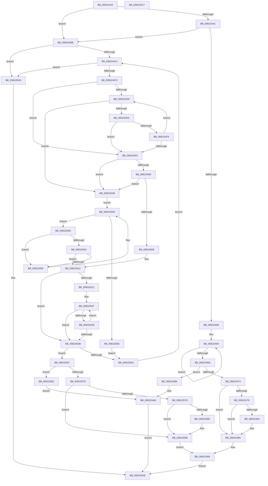

# AslEnvVarQuery

- RVA: `0x0081D410`–`0x0081D5C8` (길이 `440` bytes)
- VA: `0x000000014081D410`
- 실행 섹션: `PAGE`
- PDB 이름 있음: `예`; PDB Function 태그: `아니요`
- unwind 정보 RVA: `0x00075C18`
- 디코드: `130`개 명령, `440/440` bytes 표시
- 미해석 바이트: `0` (있으면 어셈블리에 `.byte`로 보존)

> 이 문서는 커널 이미지의 기계어와 PDB 기호를 분석해 생성했습니다. 4번과 5번은 함수 원형과 자료형을 바이너리 사용 방식에서 추정한 C 해석이며 원본 소스 복구 결과는 아닙니다.

## 1. Dependencies

- 직접 호출 지점: **5**; 고유 호출 대상: **4**
- 직접 호출자로 확인된 함수: **2**
- RIP 상대 이미지 참조: **1**

### Outgoing calls
- `0x0081D44F` → [wcsnicmp](../../text/50/wcsnicmp_function_005001C0.md) (function, `0x005001C0`)
- `0x0081D458` → [RtlGetNtSystemRoot](../A1/RtlGetNtSystemRoot_function_00A1DCD0.md) (function, `0x00A1DCD0`)
- `0x0081D4AC` → [memcpy](../../text/6C/memcpy_function_006C6840.md) (function, `0x006C6840`)
- `0x0081D4E0` → [RtlUpcaseUnicodeChar](../85/RtlUpcaseUnicodeChar_function_0085F0F0.md) (function, `0x0085F0F0`)
- `0x0081D4EC` → [RtlUpcaseUnicodeChar](../85/RtlUpcaseUnicodeChar_function_0085F0F0.md) (function, `0x0085F0F0`)

### Direct callers
- [SdbpGetProcessHistory](SdbpGetProcessHistory_function_00817250.md) at `0x008172B7`
- [SdbpGetProcessHistory](SdbpGetProcessHistory_function_00817250.md) at `0x00817356`
- [AslEnvExpandStrings](AslEnvExpandStrings_function_0081CCF4.md) at `0x0081CDA9`

### Static image references
- `0x0081D448` → RVA `0x0003F680` (`.rdata`; read)

## 2. Other-region calls and transfers

- 다른 실행 섹션으로 향하는 call: **2**
  - `0x0081D44F` → [wcsnicmp](../../text/50/wcsnicmp_function_005001C0.md) (`PAGE` → `.text`)
  - `0x0081D4AC` → [memcpy](../../text/6C/memcpy_function_006C6840.md) (`PAGE` → `.text`)
- 별도 외부 분기/꼬리 이동을 확인하지 못했습니다.

## 3. Assembly (complete function range)

```asm
0081D410  48 89 5C 24 08                  mov qword ptr [rsp + 8], rbx
0081D415  48 89 6C 24 10                  mov qword ptr [rsp + 0x10], rbp
0081D41A  48 89 74 24 18                  mov qword ptr [rsp + 0x18], rsi
0081D41F  57                              push rdi
0081D420  41 54                           push r12
0081D422  41 55                           push r13
0081D424  41 56                           push r14
0081D426  41 57                           push r15
0081D428  48 83 EC 20                     sub rsp, 0x20
0081D42C  33 F6                           xor esi, esi
0081D42E  4A 8D 2C 42                     lea rbp, [rdx + r8*2]
0081D432  4D 8B F1                        mov r14, r9
0081D435  4C 8B E2                        mov r12, rdx
0081D438  48 8B F9                        mov rdi, rcx
0081D43B  49 83 F8 0A                     cmp r8, 0xa
0081D43F  72 7A                           jb 0x14081d4bb
0081D441  44 8D 46 0A                     lea r8d, [rsi + 0xa]
0081D445  49 8B CC                        mov rcx, r12
0081D448  48 8D 15 31 22 82 FF            lea rdx, [rip - 0x7dddcf]
0081D44F  E8 6C 2D CE FF                  call 0x1405001c0
0081D454  85 C0                           test eax, eax
0081D456  75 63                           jne 0x14081d4bb
0081D458  E8 73 08 20 00                  call 0x140a1dcd0
0081D45D  48 8B D0                        mov rdx, rax
0081D460  48 83 CB FF                     or rbx, 0xffffffffffffffff
0081D464  48 FF C3                        inc rbx
0081D467  66 39 34 58                     cmp word ptr [rax + rbx*2], si
0081D46B  75 F7                           jne 0x14081d464
0081D46D  48 3B 5C 24 70                  cmp rbx, qword ptr [rsp + 0x70]
0081D472  72 27                           jb 0x14081d49b
0081D474  4D 85 F6                        test r14, r14
0081D477  74 0C                           je 0x14081d485
0081D479  48 83 7C 24 70 01               cmp qword ptr [rsp + 0x70], 1
0081D47F  72 04                           jb 0x14081d485
0081D481  66 41 89 36                     mov word ptr [r14], si
0081D485  48 8D 4B 01                     lea rcx, [rbx + 1]
0081D489  48 8B 44 24 78                  mov rax, qword ptr [rsp + 0x78]
0081D48E  BE 23 00 00 C0                  mov esi, 0xc0000023
0081D493  48 89 08                        mov qword ptr [rax], rcx
0081D496  E9 0D 01 00 00                  jmp 0x14081d5a8
0081D49B  48 8B 44 24 78                  mov rax, qword ptr [rsp + 0x78]
0081D4A0  48 89 18                        mov qword ptr [rax], rbx
0081D4A3  48 03 DB                        add rbx, rbx
0081D4A6  4C 8B C3                        mov r8, rbx
0081D4A9  49 8B CE                        mov rcx, r14
0081D4AC  E8 8F 93 EA FF                  call 0x1406c6840
0081D4B1  66 42 89 34 33                  mov word ptr [rbx + r14], si
0081D4B6  E9 ED 00 00 00                  jmp 0x14081d5a8
0081D4BB  48 85 FF                        test rdi, rdi
0081D4BE  0F 84 DF 00 00 00               je 0x14081d5a3
0081D4C4  66 39 37                        cmp word ptr [rdi], si
0081D4C7  0F 84 D6 00 00 00               je 0x14081d5a3
0081D4CD  4C 8B EF                        mov r13, rdi
0081D4D0  4D 8B FC                        mov r15, r12
0081D4D3  4C 3B E5                        cmp r12, rbp
0081D4D6  73 2B                           jae 0x14081d503
0081D4D8  0F B7 0F                        movzx ecx, word ptr [rdi]
0081D4DB  66 85 C9                        test cx, cx
0081D4DE  74 69                           je 0x14081d549
0081D4E0  E8 0B 1C 04 00                  call 0x14085f0f0
0081D4E5  41 0F B7 0F                     movzx ecx, word ptr [r15]
0081D4E9  0F B7 D8                        movzx ebx, ax
0081D4EC  E8 FF 1B 04 00                  call 0x14085f0f0
0081D4F1  66 3B D8                        cmp bx, ax
0081D4F4  75 0D                           jne 0x14081d503
0081D4F6  48 83 C7 02                     add rdi, 2
0081D4FA  49 83 C7 02                     add r15, 2
0081D4FE  4C 3B FD                        cmp r15, rbp
0081D501  72 D5                           jb 0x14081d4d8
0081D503  4C 3B FD                        cmp r15, rbp
0081D506  75 41                           jne 0x14081d549
0081D508  66 83 3F 3D                     cmp word ptr [rdi], 0x3d
0081D50C  75 3B                           jne 0x14081d549
0081D50E  41 B8 01 00 00 00               mov r8d, 1
0081D514  48 8B D7                        mov rdx, rdi
0081D517  66 39 37                        cmp word ptr [rdi], si
0081D51A  74 1F                           je 0x14081d53b
0081D51C  48 8B CE                        mov rcx, rsi
0081D51F  48 8B C1                        mov rax, rcx
0081D522  48 83 E0 FE                     and rax, 0xfffffffffffffffe
0081D526  48 3D FE FF 00 00               cmp rax, 0xfffe
0081D52C  7D 0D                           jge 0x14081d53b
0081D52E  48 83 C7 02                     add rdi, 2
0081D532  48 83 C1 02                     add rcx, 2
0081D536  66 39 37                        cmp word ptr [rdi], si
0081D539  75 E4                           jne 0x14081d51f
0081D53B  45 85 C0                        test r8d, r8d
0081D53E  75 27                           jne 0x14081d567
0081D540  48 83 C7 02                     add rdi, 2
0081D544  E9 7B FF FF FF                  jmp 0x14081d4c4
0081D549  44 8B C6                        mov r8d, esi
0081D54C  EB 0F                           jmp 0x14081d55d
0081D54E  66 83 F8 3D                     cmp ax, 0x3d
0081D552  75 05                           jne 0x14081d559
0081D554  49 3B FD                        cmp rdi, r13
0081D557  75 BB                           jne 0x14081d514
0081D559  48 83 C7 02                     add rdi, 2
0081D55D  0F B7 07                        movzx eax, word ptr [rdi]
0081D560  66 85 C0                        test ax, ax
0081D563  75 E9                           jne 0x14081d54e
0081D565  EB D9                           jmp 0x14081d540
0081D567  48 83 C2 02                     add rdx, 2
0081D56B  48 2B FA                        sub rdi, rdx
0081D56E  48 D1 FF                        sar rdi, 1
0081D571  48 3B 7C 24 70                  cmp rdi, qword ptr [rsp + 0x70]
0081D576  72 1A                           jb 0x14081d592
0081D578  4D 85 F6                        test r14, r14
0081D57B  74 0C                           je 0x14081d589
0081D57D  48 83 7C 24 70 01               cmp qword ptr [rsp + 0x70], 1
0081D583  72 04                           jb 0x14081d589
0081D585  66 41 89 36                     mov word ptr [r14], si
0081D589  48 8D 4F 01                     lea rcx, [rdi + 1]
0081D58D  E9 F7 FE FF FF                  jmp 0x14081d489
0081D592  48 8B 44 24 78                  mov rax, qword ptr [rsp + 0x78]
0081D597  48 8D 1C 3F                     lea rbx, [rdi + rdi]
0081D59B  48 89 38                        mov qword ptr [rax], rdi
0081D59E  E9 03 FF FF FF                  jmp 0x14081d4a6
0081D5A3  BE 00 01 00 C0                  mov esi, 0xc0000100
0081D5A8  48 8B 5C 24 50                  mov rbx, qword ptr [rsp + 0x50]
0081D5AD  8B C6                           mov eax, esi
0081D5AF  48 8B 74 24 60                  mov rsi, qword ptr [rsp + 0x60]
0081D5B4  48 8B 6C 24 58                  mov rbp, qword ptr [rsp + 0x58]
0081D5B9  48 83 C4 20                     add rsp, 0x20
0081D5BD  41 5F                           pop r15
0081D5BF  41 5E                           pop r14
0081D5C1  41 5D                           pop r13
0081D5C3  41 5C                           pop r12
0081D5C5  5F                              pop rdi
0081D5C6  C3                              ret
0081D5C7  CC                              int3
```

## 4. C-style interpretation (structured pseudocode)

```c
__int64 __fastcall AslEnvVarQuery(__int64 a1, __int64 a2, __int64 a3, __int64 a4, __int64 a5, __int64 a6)
{
    __int64 result;
    __int64 v_r15;
    __int64 v_rbx;
    __int64 v_rdi;
    __int64 v_rsi;
    __int64 v_rsp;
    unsigned __int64 v_stack_p10;
    unsigned __int64 v_stack_p18;
    unsigned __int64 v_stack_p8;

    v_stack_p8 = v_rbx;
    v_stack_p10 = v_rbp;
    v_stack_p18 = v_rsi;
    v_rsp = (v_rsp) - (32);
    v_rsi = 0;
    if (a3 < 10) goto loc_0081D4BB;
    result = wcsnicmp(a2, v_rip - 8248783, v_rsi + 10, a4);
    if ((unsigned int)(result) != 0) goto loc_0081D4BB;
    result = RtlGetNtSystemRoot(a2, v_rip - 8248783, v_rsi + 10, a4);
    v_rbx = (v_rbx) | (-1);
loc_0081D464:
    v_rbx = (v_rbx) + 1;
    if ((*(unsigned __int16 *)(result + v_rbx * 2)) != 0) goto loc_0081D464;
    if (v_rbx < a5) goto loc_0081D49B;
    if (a4 == 0) goto loc_0081D485;
    if (a5 >= 1) {
        *(unsigned __int16 *)(a4) = 0;
    }
loc_0081D489:
    *(unsigned __int64 *)(a6) = v_rbx + 1;
    goto loc_0081D5A8;
loc_0081D49B:
    *(unsigned __int64 *)(a6) = v_rbx;
    v_rbx = (v_rbx) + (v_rbx);
loc_0081D4A6:
    result = memcpy(a4, result, v_rbx, a4);
    *(unsigned __int16 *)(v_rbx + a4 * 1) = (unsigned __int16)((unsigned int)(0xC0000023ULL));
    goto loc_0081D5A8;
loc_0081D4BB:
    if (a1 == 0) goto loc_0081D5A3;
loc_0081D4C4:
    if ((*(unsigned __int16 *)(a1)) == ((unsigned __int16)((unsigned int)(0xC0000023ULL)))) goto loc_0081D5A3;
    if (a2 >= (a2 + a3 * 2)) goto loc_0081D503;
loc_0081D4D8:
    if ((unsigned __int16)(*(unsigned __int16 *)(a1)) == 0) goto loc_0081D549;
    result = RtlUpcaseUnicodeChar(*(unsigned __int16 *)(a1), result, v_rbx, a4);
    result = RtlUpcaseUnicodeChar(*(unsigned __int16 *)(a2), result, v_rbx, a4);
    if (((unsigned __int16)((unsigned __int16)(result))) != ((unsigned __int16)(result))) goto loc_0081D503;
    v_rdi = (a1) + (2);
    v_r15 = (a2) + (2);
    if (v_r15 < (a2 + a3 * 2)) goto loc_0081D4D8;
loc_0081D503:
    if (v_r15 != (a2 + a3 * 2)) goto loc_0081D549;
    if ((*(unsigned __int16 *)(v_rdi)) != 61) goto loc_0081D549;
loc_0081D514:
    if ((*(unsigned __int16 *)(v_rdi)) == ((unsigned __int16)((unsigned int)(0xC0000023ULL)))) goto loc_0081D53B;
loc_0081D51F:
    result = ((unsigned int)(0xC0000023ULL)) & (-2);
    if (result >= 0xFFFEULL) goto loc_0081D53B;
    v_rdi = (v_rdi) + (2);
    a1 = ((unsigned int)(0xC0000023ULL)) + (2);
    if ((*(unsigned __int16 *)(v_rdi)) != ((unsigned __int16)((unsigned int)(0xC0000023ULL)))) goto loc_0081D51F;
loc_0081D53B:
    if (1 != 0) goto loc_0081D567;
loc_0081D540:
    v_rdi = (v_rdi) + (2);
    goto loc_0081D4C4;
loc_0081D549:
    goto loc_0081D55D;
loc_0081D54E:
    if (((unsigned __int16)(result)) != 61) goto loc_0081D559;
    if (v_rdi != a1) goto loc_0081D514;
loc_0081D559:
    v_rdi = (v_rdi) + (2);
loc_0081D55D:
    if ((unsigned __int16)(*(unsigned __int16 *)(v_rdi)) != 0) goto loc_0081D54E;
    goto loc_0081D540;
loc_0081D567:
    a2 = (v_rdi) + (2);
    v_rdi = (v_rdi) - (a2);
    v_rdi = (v_rdi) >> (1);
    if (v_rdi < a5) goto loc_0081D592;
    if (a4 == 0) goto loc_0081D589;
    if (a5 >= 1) {
        *(unsigned __int16 *)(a4) = (unsigned __int16)((unsigned int)(0xC0000023ULL));
    }
    goto loc_0081D489;
loc_0081D592:
    *(unsigned __int64 *)(a6) = v_rdi;
    goto loc_0081D4A6;
loc_0081D5A3:
loc_0081D5A8:
    v_rsp = (v_rsp) + (32);
    return (unsigned int)((unsigned int)((unsigned int)(0xC0000100ULL)));
}
```

## 5. (Beta) C Style

```c
int64_t AslEnvVarQuery(int64_t Arg1, void *Arg2, int64_t Arg3, int64_t Arg4, int64_t Arg5, void *Arg6)
{
    uint8_t *arg2 = (uint8_t *)Arg2;
    uint8_t *arg6 = (uint8_t *)Arg6;

    int64_t result;
    int64_t local_r15;
    int64_t local_rbx;
    int64_t local_rdi;
    int64_t local_rsi;
    int64_t local_rsp;
    uint64_t v_stack_p10;
    uint64_t v_stack_p18;
    uint64_t v_stack_p8;

    v_stack_p8 = local_rbx;
    v_stack_p10 = local_rbp;
    v_stack_p18 = local_rsi;
    local_rsp = (local_rsp) - (32);
    local_rsi = 0;
    if (Arg3 < 10) goto loc_0081D4BB;
    result = wcsnicmp(Arg2, v_rip - 8248783, local_rsi + 10, Arg4);
    if ((uint32_t)(result) != 0) goto loc_0081D4BB;
    result = RtlGetNtSystemRoot(Arg2, v_rip - 8248783, local_rsi + 10, Arg4);
    local_rbx = (local_rbx) | (-1);
loc_0081D464:
    local_rbx = (local_rbx) + 1;
    if ((*(uint16_t *)(result + local_rbx * 2)) != 0) goto loc_0081D464;
    if (local_rbx < Arg5) goto loc_0081D49B;
    if (Arg4 == 0) goto loc_0081D485;
    if (Arg5 >= 1) {
        *(uint16_t *)(Arg4) = 0;
    }
loc_0081D489:
    *(uint64_t *)(arg6) = local_rbx + 1;
    goto loc_0081D5A8;
loc_0081D49B:
    *(uint64_t *)(arg6) = local_rbx;
    local_rbx = (local_rbx) + (local_rbx);
loc_0081D4A6:
    result = memcpy(Arg4, result, local_rbx, Arg4);
    *(uint16_t *)(local_rbx + Arg4 * 1) = (uint16_t)((uint32_t)(0xC0000023ULL));
    goto loc_0081D5A8;
loc_0081D4BB:
    if (Arg1 == 0) goto loc_0081D5A3;
loc_0081D4C4:
    if ((*(uint16_t *)(Arg1)) == ((uint16_t)((uint32_t)(0xC0000023ULL)))) goto loc_0081D5A3;
    if (Arg2 >= (Arg2 + Arg3 * 2)) goto loc_0081D503;
loc_0081D4D8:
    if ((uint16_t)(*(uint16_t *)(Arg1)) == 0) goto loc_0081D549;
    result = RtlUpcaseUnicodeChar(*(uint16_t *)(Arg1), result, local_rbx, Arg4);
    result = RtlUpcaseUnicodeChar(*(uint16_t *)(arg2), result, local_rbx, Arg4);
    if (((uint16_t)((uint16_t)(result))) != ((uint16_t)(result))) goto loc_0081D503;
    local_rdi = (Arg1) + (2);
    local_r15 = (Arg2) + (2);
    if (local_r15 < (Arg2 + Arg3 * 2)) goto loc_0081D4D8;
loc_0081D503:
    if (local_r15 != (Arg2 + Arg3 * 2)) goto loc_0081D549;
    if ((*(uint16_t *)(local_rdi)) != 61) goto loc_0081D549;
loc_0081D514:
    if ((*(uint16_t *)(local_rdi)) == ((uint16_t)((uint32_t)(0xC0000023ULL)))) goto loc_0081D53B;
loc_0081D51F:
    result = ((uint32_t)(0xC0000023ULL)) & (-2);
    if (result >= 0xFFFEULL) goto loc_0081D53B;
    local_rdi = (local_rdi) + (2);
    Arg1 = ((uint32_t)(0xC0000023ULL)) + (2);
    if ((*(uint16_t *)(local_rdi)) != ((uint16_t)((uint32_t)(0xC0000023ULL)))) goto loc_0081D51F;
loc_0081D53B:
    if (1 != 0) goto loc_0081D567;
loc_0081D540:
    local_rdi = (local_rdi) + (2);
    goto loc_0081D4C4;
loc_0081D549:
    goto loc_0081D55D;
loc_0081D54E:
    if (((uint16_t)(result)) != 61) goto loc_0081D559;
    if (local_rdi != Arg1) goto loc_0081D514;
loc_0081D559:
    local_rdi = (local_rdi) + (2);
loc_0081D55D:
    if ((uint16_t)(*(uint16_t *)(local_rdi)) != 0) goto loc_0081D54E;
    goto loc_0081D540;
loc_0081D567:
    Arg2 = (local_rdi) + (2);
    local_rdi = (local_rdi) - (Arg2);
    local_rdi = (local_rdi) >> (1);
    if (local_rdi < Arg5) goto loc_0081D592;
    if (Arg4 == 0) goto loc_0081D589;
    if (Arg5 >= 1) {
        *(uint16_t *)(Arg4) = (uint16_t)((uint32_t)(0xC0000023ULL));
    }
    goto loc_0081D489;
loc_0081D592:
    *(uint64_t *)(arg6) = local_rdi;
    goto loc_0081D4A6;
loc_0081D5A3:
loc_0081D5A8:
    local_rsp = (local_rsp) + (32);
    return (uint32_t)((uint32_t)((uint32_t)(0xC0000100ULL)));
}
```

### 관측된 메모리 오프셋

구조체 형식이 확인되지 않은 접근은 인자 기준의 오프셋으로만 기록했습니다.

| 기준 인자 | 오프셋 표현 | 폭 (bit) | 접근 |
|---|---:|---:|---|
| `Arg2` | `+ 0x0 + r8*2` | `64` | `R` |
| `Arg6` | `+ 0x0` | `64` | `W` |

## 6. Execution-region graph

[열기: 2D/3D 그래프와 함수 탐색 컨트롤 패널](../../../control-panel.html?section=page&rva=0x0081D410&view=graph)

- 2D 그래프는 위에서 아래로 흐르고, 3D 그래프는 빈 공간을 드래그해 회전합니다. Shift+드래그는 이동, 휠은 확대·축소, 함수 노드 선택은 대상 보고서 이동입니다.

### Static fallback


