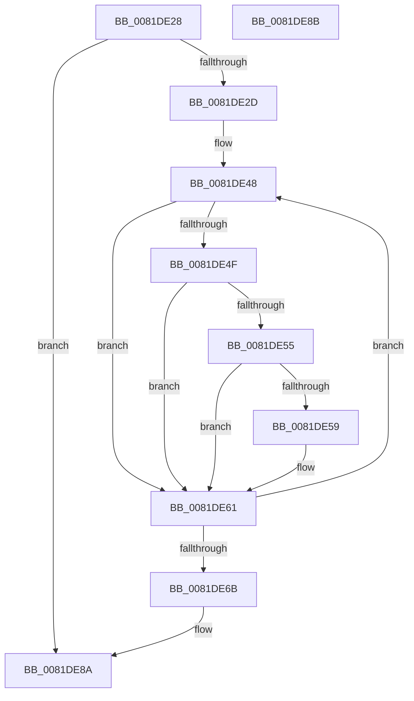

# AslFileFreeAttributes

- RVA: `0x0081DE28`–`0x0081DE8C` (길이 `100` bytes)
- VA: `0x000000014081DE28`
- 실행 섹션: `PAGE`
- PDB 이름 있음: `예`; PDB Function 태그: `아니요`
- unwind 정보 RVA: `0x000ADC24`
- 디코드: `31`개 명령, `100/100` bytes 표시
- 미해석 바이트: `0` (있으면 어셈블리에 `.byte`로 보존)

> 이 문서는 커널 이미지의 기계어와 PDB 기호를 분석해 생성했습니다. 4번과 5번은 함수 원형과 자료형을 바이너리 사용 방식에서 추정한 C 해석이며 원본 소스 복구 결과는 아닙니다.

## 1. Dependencies

- 직접 호출 지점: **2**; 고유 호출 대상: **2**
- 직접 호출자로 확인된 함수: **1**
- RIP 상대 이미지 참조: **0**

### Outgoing calls
- `0x0081DE5C` → [AslFree](../95/AslFree_function_0095B674.md) (function, `0x0095B674`)
- `0x0081DE76` → [memset](../../text/6C/memset_function_006C6C40.md) (function, `0x006C6C40`)

### Direct callers
- [SdbpCheckAllAttributes](SdbpCheckAllAttributes_function_008187EC.md) at `0x00818A69`

### Static image references
- 디코드된 RIP-relative 메모리 참조가 없습니다.

## 2. Other-region calls and transfers

- 다른 실행 섹션으로 향하는 call: **1**
  - `0x0081DE76` → [memset](../../text/6C/memset_function_006C6C40.md) (`PAGE` → `.text`)
- 별도 외부 분기/꼬리 이동을 확인하지 못했습니다.

## 3. Assembly (complete function range)

```asm
0081DE28  48 85 C9                        test rcx, rcx
0081DE2B  74 5D                           je 0x14081de8a
0081DE2D  48 89 5C 24 08                  mov qword ptr [rsp + 8], rbx
0081DE32  48 89 74 24 10                  mov qword ptr [rsp + 0x10], rsi
0081DE37  57                              push rdi
0081DE38  48 83 EC 20                     sub rsp, 0x20
0081DE3C  48 8B F9                        mov rdi, rcx
0081DE3F  48 8D 59 10                     lea rbx, [rcx + 0x10]
0081DE43  BE 24 00 00 00                  mov esi, 0x24
0081DE48  8B 43 08                        mov eax, dword ptr [rbx + 8]
0081DE4B  A8 01                           test al, 1
0081DE4D  74 12                           je 0x14081de61
0081DE4F  83 7B F0 04                     cmp dword ptr [rbx - 0x10], 4
0081DE53  75 0C                           jne 0x14081de61
0081DE55  A8 04                           test al, 4
0081DE57  74 08                           je 0x14081de61
0081DE59  48 8B 13                        mov rdx, qword ptr [rbx]
0081DE5C  E8 13 D8 13 00                  call 0x14095b674
0081DE61  48 83 C3 20                     add rbx, 0x20
0081DE65  48 83 EE 01                     sub rsi, 1
0081DE69  75 DD                           jne 0x14081de48
0081DE6B  33 D2                           xor edx, edx
0081DE6D  41 B8 80 04 00 00               mov r8d, 0x480
0081DE73  48 8B CF                        mov rcx, rdi
0081DE76  E8 C5 8D EA FF                  call 0x1406c6c40
0081DE7B  48 8B 5C 24 30                  mov rbx, qword ptr [rsp + 0x30]
0081DE80  48 8B 74 24 38                  mov rsi, qword ptr [rsp + 0x38]
0081DE85  48 83 C4 20                     add rsp, 0x20
0081DE89  5F                              pop rdi
0081DE8A  C3                              ret
0081DE8B  CC                              int3
```

## 4. C-style interpretation (structured pseudocode)

```c
__int64 __fastcall AslFileFreeAttributes(__int64 a1)
{
    __int64 result;
    __int64 v_rbx;
    __int64 v_rsi;
    __int64 v_rsp;
    unsigned __int64 v_stack_p10;
    unsigned __int64 v_stack_p8;

    if (a1 == 0) goto loc_0081DE8A;
    v_stack_p8 = v_rbx;
    v_stack_p10 = v_rsi;
    v_rsp = (v_rsp) - (32);
loc_0081DE48:
    if ((((unsigned __int8)((unsigned int)(*(unsigned int *)(a1 + 16 + 8)))) & (1)) == 0) goto loc_0081DE61;
    if ((*(unsigned int *)(a1 + 16 - 16)) != 4) goto loc_0081DE61;
    result = (unsigned int)(*(unsigned int *)(a1 + 16 + 8));
    if ((((unsigned __int8)((unsigned int)(*(unsigned int *)(a1 + 16 + 8)))) & (4)) != 0) {
        a2 = *(unsigned __int64 *)(a1 + 16);
        result = AslFree(a1, a2, a3, a4);
    }
    v_rbx = (a1 + 16) + (32);
    v_rsi = (36) - (1);
    if (condition_is_not_equal) goto loc_0081DE48;
    a2 = 0;
    result = memset(a1, a2, (unsigned int)(0x480ULL), a4);
    v_rsp = (v_rsp) + (32);
loc_0081DE8A:
    return result;
}
```

## 5. (Beta) C Style

```c
int64_t AslFileFreeAttributes(int64_t Arg1)
{
    int64_t result;
    int64_t local_rbx;
    int64_t local_rsi;
    int64_t local_rsp;
    uint64_t v_stack_p10;
    uint64_t v_stack_p8;

    if (Arg1 == 0) goto loc_0081DE8A;
    v_stack_p8 = local_rbx;
    v_stack_p10 = local_rsi;
    local_rsp = (local_rsp) - (32);
loc_0081DE48:
    if ((((uint8_t)((uint32_t)(*(uint32_t *)(Arg1 + 0x10 + 0x8)))) & (1)) == 0) goto loc_0081DE61;
    if ((*(uint32_t *)(Arg1 + 0x10 - 0x10)) != 4) goto loc_0081DE61;
    result = (uint32_t)(*(uint32_t *)(Arg1 + 0x10 + 0x8));
    if ((((uint8_t)((uint32_t)(*(uint32_t *)(Arg1 + 0x10 + 0x8)))) & (4)) != 0) {
        a2 = *(uint64_t *)(Arg1 + 0x10);
        result = AslFree(Arg1, a2, a3, a4);
    }
    local_rbx = (Arg1 + 16) + (32);
    local_rsi = (36) - (1);
    if (condition_is_not_equal) goto loc_0081DE48;
    a2 = 0;
    result = memset(Arg1, a2, (uint32_t)(0x480ULL), a4);
    local_rsp = (local_rsp) + (32);
loc_0081DE8A:
    return result;
}
```

## 6. Execution-region graph

[열기: 2D/3D 그래프와 함수 탐색 컨트롤 패널](../../../control-panel.html?section=page&rva=0x0081DE28&view=graph)

- 2D 그래프는 위에서 아래로 흐르고, 3D 그래프는 빈 공간을 드래그해 회전합니다. Shift+드래그는 이동, 휠은 확대·축소, 함수 노드 선택은 대상 보고서 이동입니다.

### Static fallback


