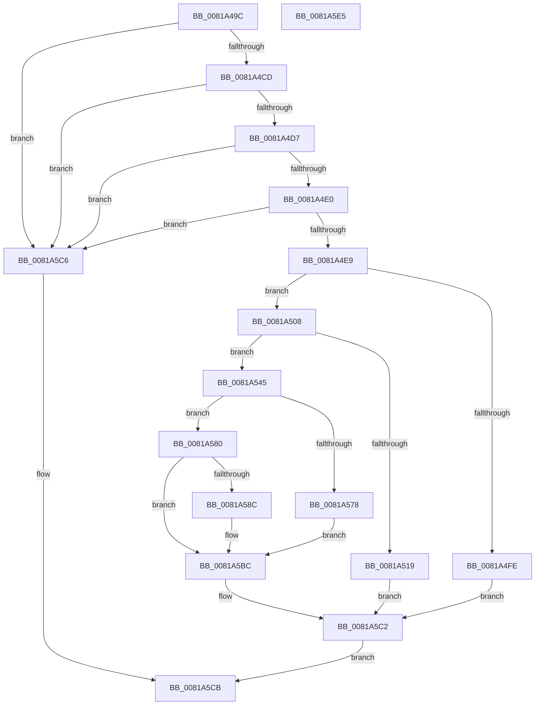

# AslFileMappingCreateFromImageView

- RVA: `0x0081A49C`–`0x0081A5E6` (길이 `330` bytes)
- VA: `0x000000014081A49C`
- 실행 섹션: `PAGE`
- PDB 이름 있음: `예`; PDB Function 태그: `아니요`
- unwind 정보 RVA: `0x000CF454`
- 디코드: `84`개 명령, `330/330` bytes 표시
- 미해석 바이트: `0` (있으면 어셈블리에 `.byte`로 보존)

> 이 문서는 커널 이미지의 기계어와 PDB 기호를 분석해 생성했습니다. 4번과 5번은 함수 원형과 자료형을 바이너리 사용 방식에서 추정한 C 해석이며 원본 소스 복구 결과는 아닙니다.

## 1. Dependencies

- 직접 호출 지점: **6**; 고유 호출 대상: **5**
- 직접 호출자로 확인된 함수: **1**
- RIP 상대 이미지 참조: **3**

### Outgoing calls
- `0x0081A4F1` → [AslAlloc](../95/AslAlloc_function_0095BD34.md) (function, `0x0095BD34`)
- `0x0081A50E` → [AslStringDuplicate](../95/AslStringDuplicate_function_00958604.md) (function, `0x00958604`)
- `0x0081A536` → [AslLogCallPrintf](../95/AslLogCallPrintf_function_0095E4EC.md) (function, `0x0095E4EC`)
- `0x0081A53E` → [AslFileMappingDelete](../95/AslFileMappingDelete_function_0095B728.md) (function, `0x0095B728`)
- `0x0081A583` → [AslpFileMappingGetFileKind](../AF/AslpFileMappingGetFileKind_function_00AF950C.md) (function, `0x00AF950C`)
- `0x0081A5B1` → [AslLogCallPrintf](../95/AslLogCallPrintf_function_0095E4EC.md) (function, `0x0095E4EC`)

### Direct callers
- [SdbGetDatabaseMatch](../95/SdbGetDatabaseMatch_function_00958240.md) at `0x009582DF`

### Static image references
- `0x0081A519` → RVA `0x0003DB80` (`.rdata`; read)
- `0x0081A52A` → RVA `0x0003EE30` (`.rdata`; read)
- `0x0081A590` → RVA `0x0003EE00` (`.rdata`; read)

## 2. Other-region calls and transfers

- 다른 실행 섹션으로 향하는 call: **0**
- 별도 외부 분기/꼬리 이동을 확인하지 못했습니다.

## 3. Assembly (complete function range)

```asm
0081A49C  48 89 5C 24 08                  mov qword ptr [rsp + 8], rbx
0081A4A1  48 89 6C 24 10                  mov qword ptr [rsp + 0x10], rbp
0081A4A6  48 89 7C 24 18                  mov qword ptr [rsp + 0x18], rdi
0081A4AB  41 54                           push r12
0081A4AD  41 56                           push r14
0081A4AF  41 57                           push r15
0081A4B1  48 83 EC 30                     sub rsp, 0x30
0081A4B5  45 33 E4                        xor r12d, r12d
0081A4B8  4D 8B F9                        mov r15, r9
0081A4BB  49 8B E8                        mov rbp, r8
0081A4BE  48 8B FA                        mov rdi, rdx
0081A4C1  4C 8B F1                        mov r14, rcx
0081A4C4  48 85 D2                        test rdx, rdx
0081A4C7  0F 84 F9 00 00 00               je 0x14081a5c6
0081A4CD  66 44 39 22                     cmp word ptr [rdx], r12w
0081A4D1  0F 84 EF 00 00 00               je 0x14081a5c6
0081A4D7  48 85 C9                        test rcx, rcx
0081A4DA  0F 84 E6 00 00 00               je 0x14081a5c6
0081A4E0  4D 85 C0                        test r8, r8
0081A4E3  0F 84 DD 00 00 00               je 0x14081a5c6
0081A4E9  41 8D 54 24 58                  lea edx, [r12 + 0x58]
0081A4EE  4C 89 21                        mov qword ptr [rcx], r12
0081A4F1  E8 3E 18 14 00                  call 0x14095bd34
0081A4F6  48 8B D8                        mov rbx, rax
0081A4F9  48 85 C0                        test rax, rax
0081A4FC  75 0A                           jne 0x14081a508
0081A4FE  BF 17 00 00 C0                  mov edi, 0xc0000017
0081A503  E9 BA 00 00 00                  jmp 0x14081a5c2
0081A508  48 8B D7                        mov rdx, rdi
0081A50B  48 8B CB                        mov rcx, rbx
0081A50E  E8 F1 E0 13 00                  call 0x140958604
0081A513  8B F8                           mov edi, eax
0081A515  85 C0                           test eax, eax
0081A517  79 2C                           jns 0x14081a545
0081A519  4C 8D 0D 60 36 82 FF            lea r9, [rip - 0x7dc9a0]
0081A520  89 44 24 20                     mov dword ptr [rsp + 0x20], eax
0081A524  41 B8 44 01 00 00               mov r8d, 0x144
0081A52A  48 8D 15 FF 48 82 FF            lea rdx, [rip - 0x7db701]
0081A531  B9 01 00 00 00                  mov ecx, 1
0081A536  E8 B1 3F 14 00                  call 0x14095e4ec
0081A53B  48 8B CB                        mov rcx, rbx
0081A53E  E8 E5 11 14 00                  call 0x14095b728
0081A543  EB 7D                           jmp 0x14081a5c2
0081A545  C7 43 50 01 00 00 00            mov dword ptr [rbx + 0x50], 1
0081A54C  48 8D 4B 08                     lea rcx, [rbx + 8]
0081A550  4C 89 63 30                     mov qword ptr [rbx + 0x30], r12
0081A554  48 8D 7B 40                     lea rdi, [rbx + 0x40]
0081A558  48 C7 43 38 00 00 00 01         mov qword ptr [rbx + 0x38], 0x1000000
0081A560  4C 89 21                        mov qword ptr [rcx], r12
0081A563  4C 89 63 10                     mov qword ptr [rbx + 0x10], r12
0081A567  4C 89 7B 18                     mov qword ptr [rbx + 0x18], r15
0081A56B  48 89 6B 20                     mov qword ptr [rbx + 0x20], rbp
0081A56F  4C 89 7B 28                     mov qword ptr [rbx + 0x28], r15
0081A573  4D 85 FF                        test r15, r15
0081A576  75 08                           jne 0x14081a580
0081A578  C7 07 01 00 00 00               mov dword ptr [rdi], 1
0081A57E  EB 3C                           jmp 0x14081a5bc
0081A580  48 8B D7                        mov rdx, rdi
0081A583  E8 84 EF 2D 00                  call 0x140af950c
0081A588  85 C0                           test eax, eax
0081A58A  79 30                           jns 0x14081a5bc
0081A58C  89 44 24 28                     mov dword ptr [rsp + 0x28], eax
0081A590  4C 8D 0D 69 48 82 FF            lea r9, [rip - 0x7db797]
0081A597  48 8B 03                        mov rax, qword ptr [rbx]
0081A59A  48 8D 15 8F 48 82 FF            lea rdx, [rip - 0x7db771]
0081A5A1  41 B8 65 01 00 00               mov r8d, 0x165
0081A5A7  48 89 44 24 20                  mov qword ptr [rsp + 0x20], rax
0081A5AC  B9 01 00 00 00                  mov ecx, 1
0081A5B1  E8 36 3F 14 00                  call 0x14095e4ec
0081A5B6  C7 07 03 00 00 00               mov dword ptr [rdi], 3
0081A5BC  49 89 1E                        mov qword ptr [r14], rbx
0081A5BF  41 8B FC                        mov edi, r12d
0081A5C2  8B C7                           mov eax, edi
0081A5C4  EB 05                           jmp 0x14081a5cb
0081A5C6  B8 0D 00 00 C0                  mov eax, 0xc000000d
0081A5CB  48 8B 5C 24 50                  mov rbx, qword ptr [rsp + 0x50]
0081A5D0  48 8B 6C 24 58                  mov rbp, qword ptr [rsp + 0x58]
0081A5D5  48 8B 7C 24 60                  mov rdi, qword ptr [rsp + 0x60]
0081A5DA  48 83 C4 30                     add rsp, 0x30
0081A5DE  41 5F                           pop r15
0081A5E0  41 5E                           pop r14
0081A5E2  41 5C                           pop r12
0081A5E4  C3                              ret
0081A5E5  CC                              int3
```

## 4. C-style interpretation (structured pseudocode)

```c
__int64 __fastcall AslFileMappingCreateFromImageView(__int64 a1, __int64 a2, __int64 a3, __int64 a4)
{
    __int64 result;
    __int64 v_r12;
    __int64 v_rsp;
    unsigned int v_stack_m20;
    unsigned int v_stack_m28;
    unsigned __int64 v_stack_p10;
    unsigned __int64 v_stack_p18;
    unsigned __int64 v_stack_p8;

    v_stack_p8 = v_rbx;
    v_stack_p10 = v_rbp;
    v_stack_p18 = v_rdi;
    v_rsp = (v_rsp) - (48);
    v_r12 = 0;
    if (a2 == 0) goto loc_0081A5C6;
    if ((*(unsigned __int16 *)(a2)) == 0) goto loc_0081A5C6;
    if (a1 == 0) goto loc_0081A5C6;
    if (a3 == 0) goto loc_0081A5C6;
    *(unsigned __int64 *)(a1) = 0;
    result = AslAlloc(a1, v_r12 + 88, a3, a4);
    if (result != 0) goto loc_0081A508;
    goto loc_0081A5C2;
loc_0081A508:
    result = AslStringDuplicate(result, (unsigned int)(0xC0000017ULL), a3, a4);
    if (!sign_flag) goto loc_0081A545;
    v_stack_m28 = (unsigned int)(result);
    result = AslLogCallPrintf(1, v_rip - 8238849, 324, v_rip - 8243616);
    result = AslFileMappingDelete(result, v_rip - 8238849, 324, v_rip - 8243616);
    goto loc_0081A5C2;
loc_0081A545:
    *(unsigned int *)(result + 80) = 1;
    *(unsigned __int64 *)(result + 48) = 0;
    *(unsigned __int64 *)(result + 56) = 0x1000000ULL;
    *(unsigned __int64 *)(result + 8) = 0;
    *(unsigned __int64 *)(result + 16) = 0;
    *(unsigned __int64 *)(result + 24) = a4;
    *(unsigned __int64 *)(result + 32) = a3;
    *(unsigned __int64 *)(result + 40) = a4;
    if (a4 != 0) goto loc_0081A580;
    *(unsigned int *)(result + 64) = 1;
    goto loc_0081A5BC;
loc_0081A580:
    result = AslpFileMappingGetFileKind(result + 8, result + 64, 324, v_rip - 8243616);
    if (sign_flag) {
        v_stack_m20 = (unsigned int)(result);
        a4 = v_rip - 8238999;
        result = *(unsigned __int64 *)(result);
        a2 = v_rip - 8238961;
        a3 = 357;
        v_stack_m28 = result;
        a1 = 1;
        result = AslLogCallPrintf(a1, a2, a3, a4);
        *(unsigned int *)(result + 64) = 3;
    }
    *(unsigned __int64 *)(a1) = result;
loc_0081A5C2:
    goto loc_0081A5CB;
loc_0081A5C6:
loc_0081A5CB:
    v_rsp = (v_rsp) + (48);
    return (unsigned int)(0xC000000DULL);
}
```

## 5. (Beta) C Style

```c
int64_t AslFileMappingCreateFromImageView(void *Arg1, int64_t Arg2, int64_t Arg3, int64_t Arg4)
{
    uint8_t *arg1 = (uint8_t *)Arg1;

    int64_t result;
    int64_t local_r12;
    int64_t local_rsp;
    uint32_t v_stack_m20;
    uint32_t v_stack_m28;
    uint64_t v_stack_p10;
    uint64_t v_stack_p18;
    uint64_t v_stack_p8;

    v_stack_p8 = local_rbx;
    v_stack_p10 = local_rbp;
    v_stack_p18 = local_rdi;
    local_rsp = (local_rsp) - (48);
    local_r12 = 0;
    if (Arg2 == 0) goto loc_0081A5C6;
    if ((*(uint16_t *)(Arg2)) == 0) goto loc_0081A5C6;
    if (Arg1 == NULL) goto loc_0081A5C6;
    if (Arg3 == 0) goto loc_0081A5C6;
    *(uint64_t *)(arg1) = 0;
    result = AslAlloc(Arg1, local_r12 + 88, Arg3, Arg4);
    if (result != 0) goto loc_0081A508;
    goto loc_0081A5C2;
loc_0081A508:
    result = AslStringDuplicate(result, (uint32_t)(0xC0000017ULL), Arg3, Arg4);
    if (!sign_flag) goto loc_0081A545;
    v_stack_m28 = (uint32_t)(result);
    result = AslLogCallPrintf(1, v_rip - 8238849, 324, v_rip - 8243616);
    result = AslFileMappingDelete(result, v_rip - 8238849, 324, v_rip - 8243616);
    goto loc_0081A5C2;
loc_0081A545:
    *(uint32_t *)(result + 0x50) = 1;
    *(uint64_t *)(result + 0x30) = 0;
    *(uint64_t *)(result + 0x38) = 0x1000000ULL;
    *(uint64_t *)(result + 0x8) = 0;
    *(uint64_t *)(result + 0x10) = 0;
    *(uint64_t *)(result + 0x18) = Arg4;
    *(uint64_t *)(result + 0x20) = Arg3;
    *(uint64_t *)(result + 0x28) = Arg4;
    if (Arg4 != 0) goto loc_0081A580;
    *(uint32_t *)(result + 0x40) = 1;
    goto loc_0081A5BC;
loc_0081A580:
    result = AslpFileMappingGetFileKind(result + 8, result + 64, 324, v_rip - 8243616);
    if (sign_flag) {
        v_stack_m20 = (uint32_t)(result);
        Arg4 = v_rip - 8238999;
        result = *(uint64_t *)(result);
        Arg2 = v_rip - 8238961;
        Arg3 = 357;
        v_stack_m28 = result;
        Arg1 = 1;
        result = AslLogCallPrintf(Arg1, Arg2, Arg3, Arg4);
        *(uint32_t *)(result + 0x40) = 3;
    }
    *(uint64_t *)(arg1) = result;
loc_0081A5C2:
    goto loc_0081A5CB;
loc_0081A5C6:
loc_0081A5CB:
    local_rsp = (local_rsp) + (48);
    return (uint32_t)(0xC000000DULL);
}
```

### 관측된 메모리 오프셋

구조체 형식이 확인되지 않은 접근은 인자 기준의 오프셋으로만 기록했습니다.

| 기준 인자 | 오프셋 표현 | 폭 (bit) | 접근 |
|---|---:|---:|---|
| `Arg1` | `+ 0x0` | `64` | `W` |

## 6. Execution-region graph

[열기: 2D/3D 그래프와 함수 탐색 컨트롤 패널](../../../control-panel.html?section=page&rva=0x0081A49C&view=graph)

- 2D 그래프는 위에서 아래로 흐르고, 3D 그래프는 빈 공간을 드래그해 회전합니다. Shift+드래그는 이동, 휠은 확대·축소, 함수 노드 선택은 대상 보고서 이동입니다.

### Static fallback


