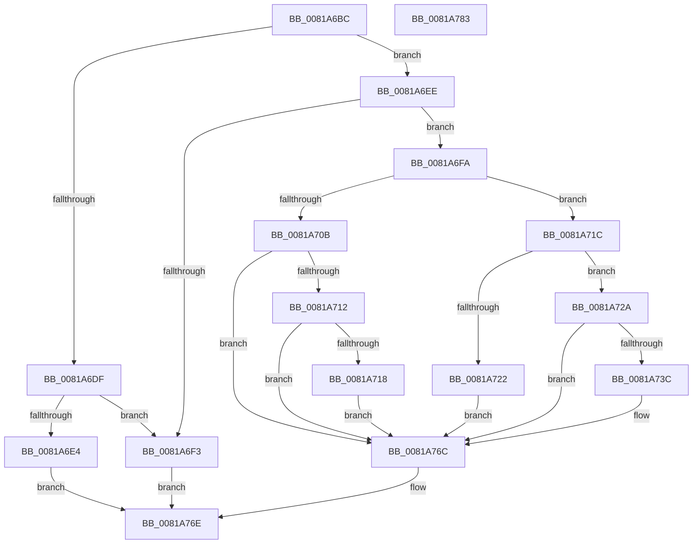

# AslFileMappingEnsureMappedAs

- RVA: `0x0081A6BC`–`0x0081A784` (길이 `200` bytes)
- VA: `0x000000014081A6BC`
- 실행 섹션: `PAGE`
- PDB 이름 있음: `예`; PDB Function 태그: `아니요`
- unwind 정보 RVA: `0x00066400`
- 디코드: `57`개 명령, `200/200` bytes 표시
- 미해석 바이트: `0` (있으면 어셈블리에 `.byte`로 보존)

> 이 문서는 커널 이미지의 기계어와 PDB 기호를 분석해 생성했습니다. 4번과 5번은 함수 원형과 자료형을 바이너리 사용 방식에서 추정한 C 해석이며 원본 소스 복구 결과는 아닙니다.

## 1. Dependencies

- 직접 호출 지점: **3**; 고유 호출 대상: **3**
- 직접 호출자로 확인된 함수: **3**
- RIP 상대 이미지 참조: **2**

### Outgoing calls
- `0x0081A700` → [RtlFileMapMapView](../../text/69/RtlFileMapMapView_function_0069D048.md) (function, `0x0069D048`)
- `0x0081A731` → [AslpFileMappingGetFileKind](../AF/AslpFileMappingGetFileKind_function_00AF950C.md) (function, `0x00AF950C`)
- `0x0081A761` → [AslLogCallPrintf](../95/AslLogCallPrintf_function_0095E4EC.md) (function, `0x0095E4EC`)

### Direct callers
- [SdbOpenDatabaseEx](SdbOpenDatabaseEx_function_00812284.md) at `0x00812446`
- [SdbpCheckMatchingTextEntry](SdbpCheckMatchingTextEntry_function_00814A70.md) at `0x00814B88`
- [AslpFileGetChecksumAttributes](AslpFileGetChecksumAttributes_function_0081E130.md) at `0x0081E1BF`

### Static image references
- `0x0081A740` → RVA `0x0003EE00` (`.rdata`; read)
- `0x0081A74A` → RVA `0x0003EE58` (`.rdata`; read)

## 2. Other-region calls and transfers

- 다른 실행 섹션으로 향하는 call: **1**
  - `0x0081A700` → [RtlFileMapMapView](../../text/69/RtlFileMapMapView_function_0069D048.md) (`PAGE` → `.text`)
- 별도 외부 분기/꼬리 이동을 확인하지 못했습니다.

## 3. Assembly (complete function range)

```asm
0081A6BC  48 89 5C 24 08                  mov qword ptr [rsp + 8], rbx
0081A6C1  48 89 6C 24 10                  mov qword ptr [rsp + 0x10], rbp
0081A6C6  48 89 74 24 18                  mov qword ptr [rsp + 0x18], rsi
0081A6CB  57                              push rdi
0081A6CC  48 83 EC 30                     sub rsp, 0x30
0081A6D0  83 79 50 00                     cmp dword ptr [rcx + 0x50], 0
0081A6D4  48 8D 71 40                     lea rsi, [rcx + 0x40]
0081A6D8  8B 06                           mov eax, dword ptr [rsi]
0081A6DA  48 8B F9                        mov rdi, rcx
0081A6DD  74 0F                           je 0x14081a6ee
0081A6DF  83 F8 01                        cmp eax, 1
0081A6E2  74 0F                           je 0x14081a6f3
0081A6E4  B8 6D 04 00 C0                  mov eax, 0xc000046d
0081A6E9  E9 80 00 00 00                  jmp 0x14081a76e
0081A6EE  83 F8 01                        cmp eax, 1
0081A6F1  75 07                           jne 0x14081a6fa
0081A6F3  B8 1E 01 00 C0                  mov eax, 0xc000011e
0081A6F8  EB 74                           jmp 0x14081a76e
0081A6FA  33 D2                           xor edx, edx
0081A6FC  48 83 C1 08                     add rcx, 8
0081A700  E8 43 29 E8 FF                  call 0x14069d048
0081A705  8B D8                           mov ebx, eax
0081A707  85 C0                           test eax, eax
0081A709  79 11                           jns 0x14081a71c
0081A70B  3D 0E 01 00 C0                  cmp eax, 0xc000010e
0081A710  75 5A                           jne 0x14081a76c
0081A712  80 7F 3B 00                     cmp byte ptr [rdi + 0x3b], 0
0081A716  75 54                           jne 0x14081a76c
0081A718  33 DB                           xor ebx, ebx
0081A71A  EB 50                           jmp 0x14081a76c
0081A71C  80 7F 3B 00                     cmp byte ptr [rdi + 0x3b], 0
0081A720  74 08                           je 0x14081a72a
0081A722  C7 06 06 00 00 00               mov dword ptr [rsi], 6
0081A728  EB 42                           jmp 0x14081a76c
0081A72A  48 8B D6                        mov rdx, rsi
0081A72D  48 8D 4F 08                     lea rcx, [rdi + 8]
0081A731  E8 D6 ED 2D 00                  call 0x140af950c
0081A736  8B D8                           mov ebx, eax
0081A738  85 C0                           test eax, eax
0081A73A  79 30                           jns 0x14081a76c
0081A73C  89 44 24 28                     mov dword ptr [rsp + 0x28], eax
0081A740  4C 8D 0D B9 46 82 FF            lea r9, [rip - 0x7db947]
0081A747  48 8B 07                        mov rax, qword ptr [rdi]
0081A74A  48 8D 15 07 47 82 FF            lea rdx, [rip - 0x7db8f9]
0081A751  41 B8 FC 01 00 00               mov r8d, 0x1fc
0081A757  48 89 44 24 20                  mov qword ptr [rsp + 0x20], rax
0081A75C  B9 01 00 00 00                  mov ecx, 1
0081A761  E8 86 3D 14 00                  call 0x14095e4ec
0081A766  C7 06 03 00 00 00               mov dword ptr [rsi], 3
0081A76C  8B C3                           mov eax, ebx
0081A76E  48 8B 5C 24 40                  mov rbx, qword ptr [rsp + 0x40]
0081A773  48 8B 6C 24 48                  mov rbp, qword ptr [rsp + 0x48]
0081A778  48 8B 74 24 50                  mov rsi, qword ptr [rsp + 0x50]
0081A77D  48 83 C4 30                     add rsp, 0x30
0081A781  5F                              pop rdi
0081A782  C3                              ret
0081A783  CC                              int3
```

## 4. C-style interpretation (structured pseudocode)

```c
__int64 __fastcall AslFileMappingEnsureMappedAs(__int64 a1, int a2)
{
    __int64 result;
    __int64 v_rbx;
    __int64 v_rsp;
    unsigned int v_stack_m10;
    unsigned __int64 v_stack_m18;
    unsigned __int64 v_stack_p10;
    unsigned __int64 v_stack_p18;
    unsigned __int64 v_stack_p8;

    v_stack_p8 = v_rbx;
    v_stack_p10 = v_rbp;
    v_stack_p18 = v_rsi;
    v_rsp = (v_rsp) - (48);
    if ((*(unsigned int *)(a1 + 80)) == 0) goto loc_0081A6EE;
    if (((unsigned int)((unsigned int)(*(unsigned int *)(a1 + 64)))) == 1) goto loc_0081A6F3;
    goto loc_0081A76E;
loc_0081A6EE:
    if (((unsigned int)((unsigned int)(0xC000046DULL))) != 1) goto loc_0081A6FA;
loc_0081A6F3:
    goto loc_0081A76E;
loc_0081A6FA:
    a2 = 0;
    a1 = (a1) + (8);
    result = RtlFileMapMapView(a1, a2, a3, a4);
    if (!sign_flag) goto loc_0081A71C;
    if (((unsigned int)(result)) != 0xC000010EULL) goto loc_0081A76C;
    if ((*(unsigned __int8 *)(a1 + 59)) != 0) goto loc_0081A76C;
    v_rbx = 0;
    goto loc_0081A76C;
loc_0081A71C:
    if ((*(unsigned __int8 *)(a1 + 59)) == 0) goto loc_0081A72A;
    *(unsigned int *)(a1 + 64) = 6;
    goto loc_0081A76C;
loc_0081A72A:
    result = AslpFileMappingGetFileKind(a1 + 8, a1 + 64, a3, a4);
    if (sign_flag) {
        v_stack_m10 = (unsigned int)(result);
        a4 = v_rip - 8239431;
        result = *(unsigned __int64 *)(a1);
        a2 = v_rip - 8239353;
        a3 = 508;
        v_stack_m18 = result;
        a1 = 1;
        result = AslLogCallPrintf(a1, a2, a3, a4);
        *(unsigned int *)(a1 + 64) = 3;
    }
loc_0081A76E:
    v_rsp = (v_rsp) + (48);
    return (unsigned int)((unsigned int)((unsigned int)((unsigned int)(result))));
}
```

## 5. (Beta) C Style

```c
int64_t AslFileMappingEnsureMappedAs(void *Arg1, int32_t Arg2)
{
    uint8_t *arg1 = (uint8_t *)Arg1;

    int64_t result;
    int64_t local_rbx;
    int64_t local_rsp;
    uint32_t v_stack_m10;
    uint64_t v_stack_m18;
    uint64_t v_stack_p10;
    uint64_t v_stack_p18;
    uint64_t v_stack_p8;

    v_stack_p8 = local_rbx;
    v_stack_p10 = local_rbp;
    v_stack_p18 = local_rsi;
    local_rsp = (local_rsp) - (48);
    if ((*(uint32_t *)(arg1 + 0x50)) == 0) goto loc_0081A6EE;
    if (((uint32_t)((uint32_t)(*(uint32_t *)(arg1 + 0x40)))) == 1) goto loc_0081A6F3;
    goto loc_0081A76E;
loc_0081A6EE:
    if (((uint32_t)((uint32_t)(0xC000046DULL))) != 1) goto loc_0081A6FA;
loc_0081A6F3:
    goto loc_0081A76E;
loc_0081A6FA:
    Arg2 = 0;
    Arg1 = (Arg1) + (8);
    result = RtlFileMapMapView(Arg1, Arg2, a3, a4);
    if (!sign_flag) goto loc_0081A71C;
    if (((uint32_t)(result)) != 0xC000010EULL) goto loc_0081A76C;
    if ((*(uint8_t *)(arg1 + 0x3B)) != 0) goto loc_0081A76C;
    local_rbx = 0;
    goto loc_0081A76C;
loc_0081A71C:
    if ((*(uint8_t *)(arg1 + 0x3B)) == 0) goto loc_0081A72A;
    *(uint32_t *)(arg1 + 0x40) = 6;
    goto loc_0081A76C;
loc_0081A72A:
    result = AslpFileMappingGetFileKind(Arg1 + 8, Arg1 + 64, a3, a4);
    if (sign_flag) {
        v_stack_m10 = (uint32_t)(result);
        a4 = v_rip - 8239431;
        result = *(uint64_t *)(arg1);
        Arg2 = v_rip - 8239353;
        a3 = 508;
        v_stack_m18 = result;
        Arg1 = 1;
        result = AslLogCallPrintf(Arg1, Arg2, a3, a4);
        *(uint32_t *)(arg1 + 0x40) = 3;
    }
loc_0081A76E:
    local_rsp = (local_rsp) + (48);
    return (uint32_t)((uint32_t)((uint32_t)((uint32_t)(result))));
}
```

### 관측된 메모리 오프셋

구조체 형식이 확인되지 않은 접근은 인자 기준의 오프셋으로만 기록했습니다.

| 기준 인자 | 오프셋 표현 | 폭 (bit) | 접근 |
|---|---:|---:|---|
| `Arg1` | `+ 0x0` | `32` | `R` |
| `Arg1` | `+ 0x0` | `32` | `W` |
| `Arg1` | `+ 0x0` | `64` | `R` |
| `Arg1` | `+ 0x8` | `64` | `R` |
| `Arg1` | `+ 0x3B` | `8` | `R` |
| `Arg1` | `+ 0x40` | `64` | `R` |
| `Arg1` | `+ 0x50` | `32` | `R` |

## 6. Execution-region graph

[열기: 2D/3D 그래프와 함수 탐색 컨트롤 패널](../../../control-panel.html?section=page&rva=0x0081A6BC&view=graph)

- 2D 그래프는 위에서 아래로 흐르고, 3D 그래프는 빈 공간을 드래그해 회전합니다. Shift+드래그는 이동, 휠은 확대·축소, 함수 노드 선택은 대상 보고서 이동입니다.

### Static fallback


