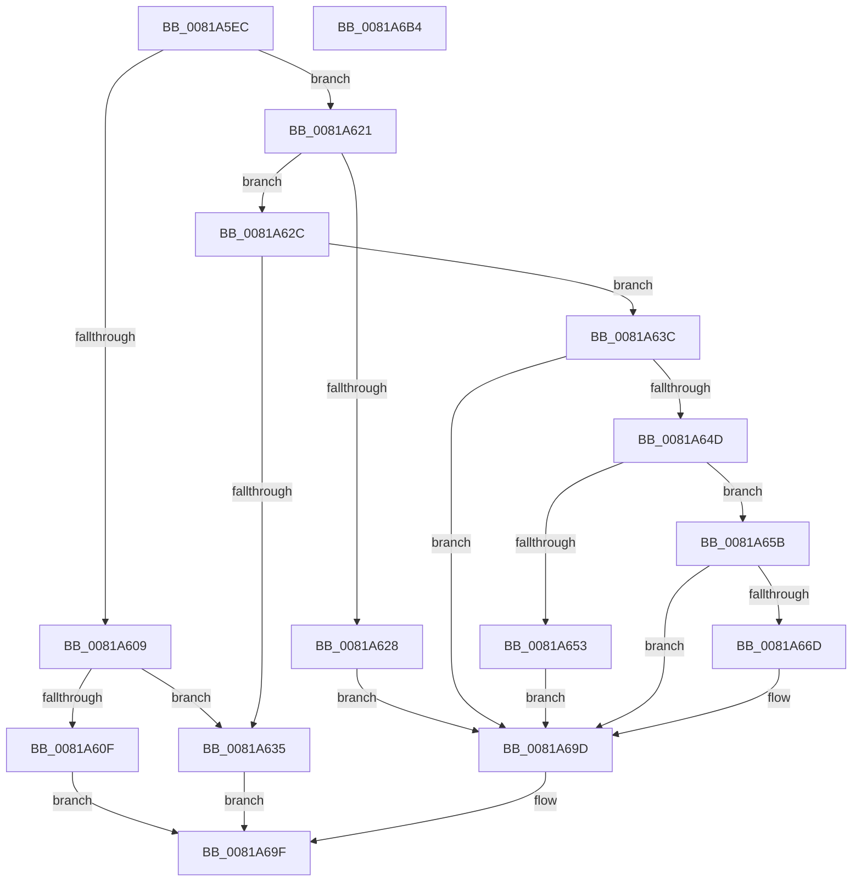

# AslFileMappingEnsure

- RVA: `0x0081A5EC`–`0x0081A6B5` (길이 `201` bytes)
- VA: `0x000000014081A5EC`
- 실행 섹션: `PAGE`
- PDB 이름 있음: `예`; PDB Function 태그: `아니요`
- unwind 정보 RVA: `0x00066400`
- 디코드: `58`개 명령, `201/201` bytes 표시
- 미해석 바이트: `0` (있으면 어셈블리에 `.byte`로 보존)

> 이 문서는 커널 이미지의 기계어와 PDB 기호를 분석해 생성했습니다. 4번과 5번은 함수 원형과 자료형을 바이너리 사용 방식에서 추정한 C 해석이며 원본 소스 복구 결과는 아닙니다.

## 1. Dependencies

- 직접 호출 지점: **3**; 고유 호출 대상: **3**
- 직접 호출자로 확인된 함수: **10**
- RIP 상대 이미지 참조: **2**

### Outgoing calls
- `0x0081A642` → [RtlFileMapMapView](../../text/69/RtlFileMapMapView_function_0069D048.md) (function, `0x0069D048`)
- `0x0081A662` → [AslpFileMappingGetFileKind](../AF/AslpFileMappingGetFileKind_function_00AF950C.md) (function, `0x00AF950C`)
- `0x0081A692` → [AslLogCallPrintf](../95/AslLogCallPrintf_function_0095E4EC.md) (function, `0x0095E4EC`)

### Direct callers
- [AslFileMappingGetFileKindDetail](AslFileMappingGetFileKindDetail_function_0081A78C.md) at `0x0081A7CC`
- [AslFileMappingGetImageTypeEx](AslFileMappingGetImageTypeEx_function_0081A950.md) at `0x0081A9B1`
- [AslFileAllocAndGetAttributes](AslFileAllocAndGetAttributes_function_0081D8EC.md) at `0x0081D9E8`
- [AslpFileGetClrVersionAttribute](AslpFileGetClrVersionAttribute_function_0081E54C.md) at `0x0081E591`
- [AslpFileGetExeWrapperAttribute](AslpFileGetExeWrapperAttribute_function_0081EC80.md) at `0x0081EC9D`
- [AslpFileGetHeaderAttributesNE](AslpFileGetHeaderAttributesNE_function_0081EE80.md) at `0x0081EEA8`
- [AslpFileGetHeaderAttributesPE](AslpFileGetHeaderAttributesPE_function_0081F028.md) at `0x0081F06F`
- [AslpFileGetPeExportNameAttribute](AslpFileGetPeExportNameAttribute_function_0081F884.md) at `0x0081F8A7`
- [AslpFileGetVersionBlock](AslpFileGetVersionBlock_function_0081FA50.md) at `0x0081FADB`
- [AslpFileGetVersionBlockImageOnly](../82/AslpFileGetVersionBlockImageOnly_function_00820260.md) at `0x008202C8`

### Static image references
- `0x0081A671` → RVA `0x0003EE00` (`.rdata`; read)
- `0x0081A67B` → RVA `0x0003EE78` (`.rdata`; read)

## 2. Other-region calls and transfers

- 다른 실행 섹션으로 향하는 call: **1**
  - `0x0081A642` → [RtlFileMapMapView](../../text/69/RtlFileMapMapView_function_0069D048.md) (`PAGE` → `.text`)
- 별도 외부 분기/꼬리 이동을 확인하지 못했습니다.

## 3. Assembly (complete function range)

```asm
0081A5EC  48 89 5C 24 08                  mov qword ptr [rsp + 8], rbx
0081A5F1  48 89 6C 24 10                  mov qword ptr [rsp + 0x10], rbp
0081A5F6  48 89 74 24 18                  mov qword ptr [rsp + 0x18], rsi
0081A5FB  57                              push rdi
0081A5FC  48 83 EC 30                     sub rsp, 0x30
0081A600  83 79 50 00                     cmp dword ptr [rcx + 0x50], 0
0081A604  48 8B D9                        mov rbx, rcx
0081A607  74 18                           je 0x14081a621
0081A609  83 79 40 01                     cmp dword ptr [rcx + 0x40], 1
0081A60D  74 26                           je 0x14081a635
0081A60F  48 8B 41 20                     mov rax, qword ptr [rcx + 0x20]
0081A613  48 F7 D8                        neg rax
0081A616  1B C0                           sbb eax, eax
0081A618  F7 D0                           not eax
0081A61A  25 6D 04 00 C0                  and eax, 0xc000046d
0081A61F  EB 7E                           jmp 0x14081a69f
0081A621  48 83 79 20 00                  cmp qword ptr [rcx + 0x20], 0
0081A626  74 04                           je 0x14081a62c
0081A628  33 FF                           xor edi, edi
0081A62A  EB 71                           jmp 0x14081a69d
0081A62C  48 8D 71 40                     lea rsi, [rcx + 0x40]
0081A630  83 3E 01                        cmp dword ptr [rsi], 1
0081A633  75 07                           jne 0x14081a63c
0081A635  B8 1E 01 00 C0                  mov eax, 0xc000011e
0081A63A  EB 63                           jmp 0x14081a69f
0081A63C  33 D2                           xor edx, edx
0081A63E  48 83 C1 08                     add rcx, 8
0081A642  E8 01 2A E8 FF                  call 0x14069d048
0081A647  8B F8                           mov edi, eax
0081A649  85 C0                           test eax, eax
0081A64B  78 50                           js 0x14081a69d
0081A64D  80 7B 3B 00                     cmp byte ptr [rbx + 0x3b], 0
0081A651  74 08                           je 0x14081a65b
0081A653  C7 06 06 00 00 00               mov dword ptr [rsi], 6
0081A659  EB 42                           jmp 0x14081a69d
0081A65B  48 8B D6                        mov rdx, rsi
0081A65E  48 8D 4B 08                     lea rcx, [rbx + 8]
0081A662  E8 A5 EE 2D 00                  call 0x140af950c
0081A667  8B F8                           mov edi, eax
0081A669  85 C0                           test eax, eax
0081A66B  79 30                           jns 0x14081a69d
0081A66D  89 44 24 28                     mov dword ptr [rsp + 0x28], eax
0081A671  4C 8D 0D 88 47 82 FF            lea r9, [rip - 0x7db878]
0081A678  48 8B 03                        mov rax, qword ptr [rbx]
0081A67B  48 8D 15 F6 47 82 FF            lea rdx, [rip - 0x7db80a]
0081A682  41 B8 54 02 00 00               mov r8d, 0x254
0081A688  48 89 44 24 20                  mov qword ptr [rsp + 0x20], rax
0081A68D  B9 01 00 00 00                  mov ecx, 1
0081A692  E8 55 3E 14 00                  call 0x14095e4ec
0081A697  C7 06 03 00 00 00               mov dword ptr [rsi], 3
0081A69D  8B C7                           mov eax, edi
0081A69F  48 8B 5C 24 40                  mov rbx, qword ptr [rsp + 0x40]
0081A6A4  48 8B 6C 24 48                  mov rbp, qword ptr [rsp + 0x48]
0081A6A9  48 8B 74 24 50                  mov rsi, qword ptr [rsp + 0x50]
0081A6AE  48 83 C4 30                     add rsp, 0x30
0081A6B2  5F                              pop rdi
0081A6B3  C3                              ret
0081A6B4  CC                              int3
```

## 4. C-style interpretation (structured pseudocode)

```c
__int64 __fastcall AslFileMappingEnsure(__int64 a1, int a2)
{
    __int64 result;
    __int64 v_rdi;
    __int64 v_rsp;
    unsigned int v_stack_m10;
    unsigned __int64 v_stack_m18;
    unsigned __int64 v_stack_p10;
    unsigned __int64 v_stack_p18;
    unsigned __int64 v_stack_p8;

    v_stack_p8 = v_rbx;
    v_stack_p10 = v_rbp;
    v_stack_p18 = v_rsi;
    v_rsp = (v_rsp) - (48);
    if ((*(unsigned int *)(a1 + 80)) == 0) goto loc_0081A621;
    if ((*(unsigned int *)(a1 + 64)) == 1) goto loc_0081A635;
    result = -(*(unsigned __int64 *)(a1 + 32));
    result = (unsigned int)(~(result));
    result = (unsigned int)((result) & (0xC000046DULL));
    goto loc_0081A69F;
loc_0081A621:
    if ((*(unsigned __int64 *)(a1 + 32)) == 0) goto loc_0081A62C;
    v_rdi = 0;
    goto loc_0081A69D;
loc_0081A62C:
    if ((*(unsigned int *)(a1 + 64)) != 1) goto loc_0081A63C;
loc_0081A635:
    goto loc_0081A69F;
loc_0081A63C:
    a2 = 0;
    a1 = (a1) + (8);
    result = RtlFileMapMapView(a1, a2, a3, a4);
    if (sign_flag) goto loc_0081A69D;
    if ((*(unsigned __int8 *)(a1 + 59)) == 0) goto loc_0081A65B;
    *(unsigned int *)(a1 + 64) = 6;
    goto loc_0081A69D;
loc_0081A65B:
    result = AslpFileMappingGetFileKind(a1 + 8, a1 + 64, a3, a4);
    if (sign_flag) {
        v_stack_m10 = (unsigned int)(result);
        a4 = v_rip - 8239224;
        result = *(unsigned __int64 *)(a1);
        a2 = v_rip - 8239114;
        a3 = 596;
        v_stack_m18 = result;
        a1 = 1;
        result = AslLogCallPrintf(a1, a2, a3, a4);
        *(unsigned int *)(a1 + 64) = 3;
    }
loc_0081A69F:
    v_rsp = (v_rsp) + (48);
    return (unsigned int)((unsigned int)((unsigned int)((unsigned int)(result))));
}
```

## 5. (Beta) C Style

```c
int64_t AslFileMappingEnsure(void *Arg1, int32_t Arg2)
{
    uint8_t *arg1 = (uint8_t *)Arg1;

    int64_t result;
    int64_t local_rdi;
    int64_t local_rsp;
    uint32_t v_stack_m10;
    uint64_t v_stack_m18;
    uint64_t v_stack_p10;
    uint64_t v_stack_p18;
    uint64_t v_stack_p8;

    v_stack_p8 = local_rbx;
    v_stack_p10 = local_rbp;
    v_stack_p18 = local_rsi;
    local_rsp = (local_rsp) - (48);
    if ((*(uint32_t *)(arg1 + 0x50)) == 0) goto loc_0081A621;
    if ((*(uint32_t *)(arg1 + 0x40)) == 1) goto loc_0081A635;
    result = -(*(uint64_t *)(arg1 + 0x20));
    result = (uint32_t)(~(result));
    result = (uint32_t)((result) & (0xC000046DULL));
    goto loc_0081A69F;
loc_0081A621:
    if ((*(uint64_t *)(arg1 + 0x20)) == 0) goto loc_0081A62C;
    local_rdi = 0;
    goto loc_0081A69D;
loc_0081A62C:
    if ((*(uint32_t *)(arg1 + 0x40)) != 1) goto loc_0081A63C;
loc_0081A635:
    goto loc_0081A69F;
loc_0081A63C:
    Arg2 = 0;
    Arg1 = (Arg1) + (8);
    result = RtlFileMapMapView(Arg1, Arg2, a3, a4);
    if (sign_flag) goto loc_0081A69D;
    if ((*(uint8_t *)(arg1 + 0x3B)) == 0) goto loc_0081A65B;
    *(uint32_t *)(arg1 + 0x40) = 6;
    goto loc_0081A69D;
loc_0081A65B:
    result = AslpFileMappingGetFileKind(Arg1 + 8, Arg1 + 64, a3, a4);
    if (sign_flag) {
        v_stack_m10 = (uint32_t)(result);
        a4 = v_rip - 8239224;
        result = *(uint64_t *)(arg1);
        Arg2 = v_rip - 8239114;
        a3 = 596;
        v_stack_m18 = result;
        Arg1 = 1;
        result = AslLogCallPrintf(Arg1, Arg2, a3, a4);
        *(uint32_t *)(arg1 + 0x40) = 3;
    }
loc_0081A69F:
    local_rsp = (local_rsp) + (48);
    return (uint32_t)((uint32_t)((uint32_t)((uint32_t)(result))));
}
```

### 관측된 메모리 오프셋

구조체 형식이 확인되지 않은 접근은 인자 기준의 오프셋으로만 기록했습니다.

| 기준 인자 | 오프셋 표현 | 폭 (bit) | 접근 |
|---|---:|---:|---|
| `Arg1` | `+ 0x0` | `32` | `R` |
| `Arg1` | `+ 0x0` | `32` | `W` |
| `Arg1` | `+ 0x0` | `64` | `R` |
| `Arg1` | `+ 0x8` | `64` | `R` |
| `Arg1` | `+ 0x20` | `64` | `R` |
| `Arg1` | `+ 0x3B` | `8` | `R` |
| `Arg1` | `+ 0x40` | `32` | `R` |
| `Arg1` | `+ 0x40` | `64` | `R` |
| `Arg1` | `+ 0x50` | `32` | `R` |

## 6. Execution-region graph

[열기: 2D/3D 그래프와 함수 탐색 컨트롤 패널](../../../control-panel.html?section=page&rva=0x0081A5EC&view=graph)

- 2D 그래프는 위에서 아래로 흐르고, 3D 그래프는 빈 공간을 드래그해 회전합니다. Shift+드래그는 이동, 휠은 확대·축소, 함수 노드 선택은 대상 보고서 이동입니다.

### Static fallback


