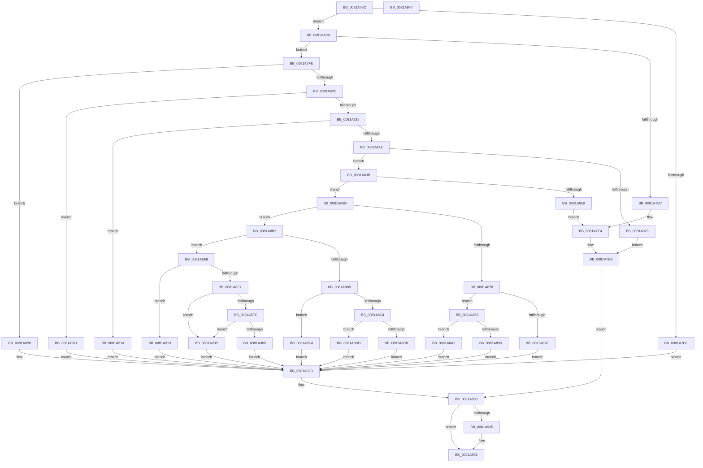

# AslFileMappingGetFileKindDetail

- RVA: `0x0081A78C`–`0x0081A948` (길이 `444` bytes)
- VA: `0x000000014081A78C`
- 실행 섹션: `PAGE`
- PDB 이름 있음: `예`; PDB Function 태그: `아니요`
- unwind 정보 RVA: `0x000D9C8C`
- 디코드: `129`개 명령, `444/444` bytes 표시
- 미해석 바이트: `0` (있으면 어셈블리에 `.byte`로 보존)

> 이 문서는 커널 이미지의 기계어와 PDB 기호를 분석해 생성했습니다. 4번과 5번은 함수 원형과 자료형을 바이너리 사용 방식에서 추정한 C 해석이며 원본 소스 복구 결과는 아닙니다.

## 1. Dependencies

- 직접 호출 지점: **3**; 고유 호출 대상: **3**
- 직접 호출자로 확인된 함수: **2**
- RIP 상대 이미지 참조: **4**

### Outgoing calls
- `0x0081A7CC` → [AslFileMappingEnsure](AslFileMappingEnsure_function_0081A5EC.md) (function, `0x0081A5EC`)
- `0x0081A7F4` → [AslLogCallPrintf](../95/AslLogCallPrintf_function_0095E4EC.md) (function, `0x0095E4EC`)
- `0x0081A850` → [AslFileMappingGetImageTypeEx](AslFileMappingGetImageTypeEx_function_0081A950.md) (function, `0x0081A950`)

### Direct callers
- [AslpFileGetFileKindDetailAttribute](AslpFileGetFileKindDetailAttribute_function_0081EDFC.md) at `0x0081EE13`
- [AslpFileIsArm64XBinary](../82/AslpFileIsArm64XBinary_function_008206B0.md) at `0x008206E6`

### Static image references
- `0x0081A7D7` → RVA `0x0003EE90` (`.rdata`; read)
- `0x0081A7E8` → RVA `0x0003EF80` (`.rdata`; read)
- `0x0081A82C` → RVA `0x0003EFA0` (`.rdata`; read)
- `0x0081A85B` → RVA `0x0003EFC0` (`.rdata`; read)

## 2. Other-region calls and transfers

- 다른 실행 섹션으로 향하는 call: **0**
- 별도 외부 분기/꼬리 이동을 확인하지 못했습니다.

## 3. Assembly (complete function range)

```asm
0081A78C  40 55                           push rbp
0081A78E  53                              push rbx
0081A78F  56                              push rsi
0081A790  57                              push rdi
0081A791  41 56                           push r14
0081A793  41 57                           push r15
0081A795  48 8B EC                        mov rbp, rsp
0081A798  48 83 EC 38                     sub rsp, 0x38
0081A79C  45 33 FF                        xor r15d, r15d
0081A79F  48 8B F2                        mov rsi, rdx
0081A7A2  83 7A 40 01                     cmp dword ptr [rdx + 0x40], 1
0081A7A6  4C 8B F1                        mov r14, rcx
0081A7A9  41 8B DF                        mov ebx, r15d
0081A7AC  66 44 89 7D 40                  mov word ptr [rbp + 0x40], r15w
0081A7B1  66 44 89 7D 38                  mov word ptr [rbp + 0x38], r15w
0081A7B6  44 89 7D 50                     mov dword ptr [rbp + 0x50], r15d
0081A7BA  44 89 7D 48                     mov dword ptr [rbp + 0x48], r15d
0081A7BE  75 09                           jne 0x14081a7c9
0081A7C0  41 8D 5F 01                     lea ebx, [r15 + 1]
0081A7C4  E9 64 01 00 00                  jmp 0x14081a92d
0081A7C9  48 8B CE                        mov rcx, rsi
0081A7CC  E8 1B FE FF FF                  call 0x14081a5ec
0081A7D1  8B F8                           mov edi, eax
0081A7D3  85 C0                           test eax, eax
0081A7D5  79 27                           jns 0x14081a7fe
0081A7D7  4C 8D 0D B2 46 82 FF            lea r9, [rip - 0x7db94e]
0081A7DE  41 B8 71 05 00 00               mov r8d, 0x571
0081A7E4  89 44 24 20                     mov dword ptr [rsp + 0x20], eax
0081A7E8  48 8D 15 91 47 82 FF            lea rdx, [rip - 0x7db86f]
0081A7EF  B9 01 00 00 00                  mov ecx, 1
0081A7F4  E8 F3 3C 14 00                  call 0x14095e4ec
0081A7F9  E9 32 01 00 00                  jmp 0x14081a930
0081A7FE  8B 56 40                        mov edx, dword ptr [rsi + 0x40]
0081A801  8B CA                           mov ecx, edx
0081A803  83 E9 03                        sub ecx, 3
0081A806  0F 84 1C 01 00 00               je 0x14081a928
0081A80C  83 E9 01                        sub ecx, 1
0081A80F  0F 84 0C 01 00 00               je 0x14081a921
0081A815  83 E9 01                        sub ecx, 1
0081A818  0F 84 FC 00 00 00               je 0x14081a91a
0081A81E  83 F9 01                        cmp ecx, 1
0081A821  74 18                           je 0x14081a83b
0081A823  BF 01 00 00 C0                  mov edi, 0xc0000001
0081A828  89 54 24 20                     mov dword ptr [rsp + 0x20], edx
0081A82C  4C 8D 0D 6D 47 82 FF            lea r9, [rip - 0x7db893]
0081A833  41 B8 94 05 00 00               mov r8d, 0x594
0081A839  EB AD                           jmp 0x14081a7e8
0081A83B  4C 8D 4D 50                     lea r9, [rbp + 0x50]
0081A83F  48 89 74 24 20                  mov qword ptr [rsp + 0x20], rsi
0081A844  4C 8D 45 48                     lea r8, [rbp + 0x48]
0081A848  48 8D 55 38                     lea rdx, [rbp + 0x38]
0081A84C  48 8D 4D 40                     lea rcx, [rbp + 0x40]
0081A850  E8 FB 00 00 00                  call 0x14081a950
0081A855  8B F8                           mov edi, eax
0081A857  85 C0                           test eax, eax
0081A859  79 12                           jns 0x14081a86d
0081A85B  4C 8D 0D 5E 47 82 FF            lea r9, [rip - 0x7db8a2]
0081A862  41 B8 9E 05 00 00               mov r8d, 0x59e
0081A868  E9 77 FF FF FF                  jmp 0x14081a7e4
0081A86D  B8 0B 02 00 00                  mov eax, 0x20b
0081A872  44 39 7D 48                     cmp dword ptr [rbp + 0x48], r15d
0081A876  74 3B                           je 0x14081a8b3
0081A878  66 39 45 38                     cmp word ptr [rbp + 0x38], ax
0081A87C  75 0A                           jne 0x14081a888
0081A87E  BB 0F 00 00 00                  mov ebx, 0xf
0081A883  E9 A5 00 00 00                  jmp 0x14081a92d
0081A888  8B 4D 50                        mov ecx, dword ptr [rbp + 0x50]
0081A88B  BA 02 00 02 00                  mov edx, 0x20002
0081A890  8B C1                           mov eax, ecx
0081A892  23 C2                           and eax, edx
0081A894  3B C2                           cmp eax, edx
0081A896  75 0A                           jne 0x14081a8a2
0081A898  BB 0E 00 00 00                  mov ebx, 0xe
0081A89D  E9 8B 00 00 00                  jmp 0x14081a92d
0081A8A2  81 E1 03 00 02 00               and ecx, 0x20003
0081A8A8  FF C9                           dec ecx
0081A8AA  F7 D9                           neg ecx
0081A8AC  1B DB                           sbb ebx, ebx
0081A8AE  83 C3 0D                        add ebx, 0xd
0081A8B1  EB 7A                           jmp 0x14081a92d
0081A8B3  66 39 45 38                     cmp word ptr [rbp + 0x38], ax
0081A8B7  75 32                           jne 0x14081a8eb
0081A8B9  0F B7 45 40                     movzx eax, word ptr [rbp + 0x40]
0081A8BD  3D 00 02 00 00                  cmp eax, 0x200
0081A8C2  74 20                           je 0x14081a8e4
0081A8C4  3D 64 86 00 00                  cmp eax, 0x8664
0081A8C9  74 12                           je 0x14081a8dd
0081A8CB  BB 0A 00 00 00                  mov ebx, 0xa
0081A8D0  3D 64 AA 00 00                  cmp eax, 0xaa64
0081A8D5  8D 4B FE                        lea ecx, [rbx - 2]
0081A8D8  0F 45 D9                        cmovne ebx, ecx
0081A8DB  EB 50                           jmp 0x14081a92d
0081A8DD  BB 09 00 00 00                  mov ebx, 9
0081A8E2  EB 49                           jmp 0x14081a92d
0081A8E4  BB 0B 00 00 00                  mov ebx, 0xb
0081A8E9  EB 42                           jmp 0x14081a92d
0081A8EB  0F B7 4D 40                     movzx ecx, word ptr [rbp + 0x40]
0081A8EF  81 E9 4C 01 00 00               sub ecx, 0x14c
0081A8F5  74 1C                           je 0x14081a913
0081A8F7  83 E9 74                        sub ecx, 0x74
0081A8FA  74 10                           je 0x14081a90c
0081A8FC  BB 04 00 00 00                  mov ebx, 4
0081A901  3B CB                           cmp ecx, ebx
0081A903  74 07                           je 0x14081a90c
0081A905  BB 05 00 00 00                  mov ebx, 5
0081A90A  EB 21                           jmp 0x14081a92d
0081A90C  BB 07 00 00 00                  mov ebx, 7
0081A911  EB 1A                           jmp 0x14081a92d
0081A913  BB 06 00 00 00                  mov ebx, 6
0081A918  EB 13                           jmp 0x14081a92d
0081A91A  BB 04 00 00 00                  mov ebx, 4
0081A91F  EB 0C                           jmp 0x14081a92d
0081A921  BB 03 00 00 00                  mov ebx, 3
0081A926  EB 05                           jmp 0x14081a92d
0081A928  BB 02 00 00 00                  mov ebx, 2
0081A92D  41 8B FF                        mov edi, r15d
0081A930  4D 85 F6                        test r14, r14
0081A933  74 03                           je 0x14081a938
0081A935  41 89 1E                        mov dword ptr [r14], ebx
0081A938  8B C7                           mov eax, edi
0081A93A  48 83 C4 38                     add rsp, 0x38
0081A93E  41 5F                           pop r15
0081A940  41 5E                           pop r14
0081A942  5F                              pop rdi
0081A943  5E                              pop rsi
0081A944  5B                              pop rbx
0081A945  5D                              pop rbp
0081A946  C3                              ret
0081A947  CC                              int3
```

## 4. C-style interpretation (structured pseudocode)

```c
__int64 __fastcall AslFileMappingGetFileKindDetail(__int64 a1, __int64 a2)
{
    __int64 result;
    __int64 v_r15;
    __int64 v_rbx;
    __int64 v_rsp;
    unsigned int v_stack_m48;
    unsigned __int16 v_stack_p10;
    unsigned int v_stack_p18;
    unsigned int v_stack_p20;
    unsigned __int16 v_stack_p8;

    v_rsp = (v_rsp) - (56);
    v_r15 = 0;
    v_stack_p10 = 0;
    v_stack_p8 = 0;
    v_stack_p20 = 0;
    v_stack_p18 = 0;
    if ((*(unsigned int *)(a2 + 64)) != 1) goto loc_0081A7C9;
    goto loc_0081A92D;
loc_0081A7C9:
    result = AslFileMappingEnsure(a2, a2, a3, a4);
    if (!sign_flag) goto loc_0081A7FE;
loc_0081A7E4:
    v_stack_m48 = (unsigned int)(result);
loc_0081A7E8:
    result = AslLogCallPrintf(1, v_rip - 8239215, (unsigned int)(0x571ULL), v_rip - 8239438);
    goto loc_0081A930;
loc_0081A7FE:
    a1 = (unsigned int)(((unsigned int)((unsigned int)((unsigned int)(*(unsigned int *)(a2 + 64))))) - (3));
    if (condition_is_equal) goto loc_0081A928;
    a1 = (unsigned int)((a1) - (1));
    if (condition_is_equal) goto loc_0081A921;
    a1 = (unsigned int)((a1) - (1));
    if (condition_is_equal) goto loc_0081A91A;
    if (((unsigned int)(a1)) == 1) goto loc_0081A83B;
    v_stack_m48 = (unsigned int)((unsigned int)(*(unsigned int *)(a2 + 64)));
    goto loc_0081A7E8;
loc_0081A83B:
    v_stack_m48 = a2;
    result = AslFileMappingGetImageTypeEx(v_stack_p10, v_stack_p8, v_stack_p18, v_stack_p20);
    if (!sign_flag) goto loc_0081A86D;
    goto loc_0081A7E4;
loc_0081A86D:
    if (v_stack_p18 == 0) goto loc_0081A8B3;
    if (v_stack_p8 != 523) goto loc_0081A888;
    goto loc_0081A92D;
loc_0081A888:
    result = (unsigned int)(((unsigned int)((unsigned int)((unsigned int)(v_stack_p20)))) & ((unsigned int)((unsigned int)(0x20002ULL))));
    if (((unsigned int)(result)) != ((unsigned int)((unsigned int)(0x20002ULL)))) goto loc_0081A8A2;
    goto loc_0081A92D;
loc_0081A8A2:
    a1 = (unsigned int)(((unsigned int)(v_stack_p20)) & (0x20003ULL));
    a1 = (unsigned int)((a1) - 1);
    a1 = (unsigned int)(-(a1));
    v_rbx = (unsigned int)((14) + (13));
    goto loc_0081A92D;
loc_0081A8B3:
    if (v_stack_p8 != ((unsigned __int16)(result))) goto loc_0081A8EB;
    if (((unsigned int)(v_stack_p10)) == 512) goto loc_0081A8E4;
    if (((unsigned int)(v_stack_p10)) == 0x8664ULL) goto loc_0081A8DD;
    v_rbx = 10;
    if (((unsigned int)(v_stack_p10)) != 0xAA64ULL) { v_rbx = (unsigned int)(10 - 2); }
    goto loc_0081A92D;
loc_0081A8DD:
    goto loc_0081A92D;
loc_0081A8E4:
    goto loc_0081A92D;
loc_0081A8EB:
    a1 = (unsigned int)((v_stack_p10) - (332));
    if (condition_is_equal) goto loc_0081A913;
    a1 = (unsigned int)((a1) - (116));
    if (condition_is_equal) goto loc_0081A90C;
    if (((unsigned int)(a1)) == 4) goto loc_0081A90C;
    goto loc_0081A92D;
loc_0081A90C:
    goto loc_0081A92D;
loc_0081A913:
    goto loc_0081A92D;
loc_0081A91A:
    goto loc_0081A92D;
loc_0081A921:
    goto loc_0081A92D;
loc_0081A928:
loc_0081A92D:
loc_0081A930:
    if (a1 != 0) {
        *(unsigned int *)(a1) = 2;
    }
    v_rsp = (v_rsp) + (56);
    return 0;
}
```

## 5. (Beta) C Style

```c
int64_t AslFileMappingGetFileKindDetail(int64_t Arg1, void *Arg2)
{
    uint8_t *arg2 = (uint8_t *)Arg2;

    int64_t result;
    int64_t local_r15;
    int64_t local_rbx;
    int64_t local_rsp;
    uint32_t v_stack_m48;
    uint16_t v_stack_p10;
    uint32_t v_stack_p18;
    uint32_t v_stack_p20;
    uint16_t v_stack_p8;

    local_rsp = (local_rsp) - (56);
    local_r15 = 0;
    v_stack_p10 = 0;
    v_stack_p8 = 0;
    v_stack_p20 = 0;
    v_stack_p18 = 0;
    if ((*(uint32_t *)(arg2 + 0x40)) != 1) goto loc_0081A7C9;
    goto loc_0081A92D;
loc_0081A7C9:
    result = AslFileMappingEnsure(Arg2, Arg2, a3, a4);
    if (!sign_flag) goto loc_0081A7FE;
loc_0081A7E4:
    v_stack_m48 = (uint32_t)(result);
loc_0081A7E8:
    result = AslLogCallPrintf(1, v_rip - 8239215, (uint32_t)(0x571ULL), v_rip - 8239438);
    goto loc_0081A930;
loc_0081A7FE:
    Arg1 = (uint32_t)(((uint32_t)((uint32_t)((uint32_t)(*(uint32_t *)(arg2 + 0x40))))) - (3));
    if (condition_is_equal) goto loc_0081A928;
    Arg1 = (uint32_t)((Arg1) - (1));
    if (condition_is_equal) goto loc_0081A921;
    Arg1 = (uint32_t)((Arg1) - (1));
    if (condition_is_equal) goto loc_0081A91A;
    if (((uint32_t)(Arg1)) == 1) goto loc_0081A83B;
    v_stack_m48 = (uint32_t)((uint32_t)(*(uint32_t *)(arg2 + 0x40)));
    goto loc_0081A7E8;
loc_0081A83B:
    v_stack_m48 = Arg2;
    result = AslFileMappingGetImageTypeEx(v_stack_p10, v_stack_p8, v_stack_p18, v_stack_p20);
    if (!sign_flag) goto loc_0081A86D;
    goto loc_0081A7E4;
loc_0081A86D:
    if (v_stack_p18 == 0) goto loc_0081A8B3;
    if (v_stack_p8 != 523) goto loc_0081A888;
    goto loc_0081A92D;
loc_0081A888:
    result = (uint32_t)(((uint32_t)((uint32_t)((uint32_t)(v_stack_p20)))) & ((uint32_t)((uint32_t)(0x20002ULL))));
    if (((uint32_t)(result)) != ((uint32_t)((uint32_t)(0x20002ULL)))) goto loc_0081A8A2;
    goto loc_0081A92D;
loc_0081A8A2:
    Arg1 = (uint32_t)(((uint32_t)(v_stack_p20)) & (0x20003ULL));
    Arg1 = (uint32_t)((Arg1) - 1);
    Arg1 = (uint32_t)(-(Arg1));
    local_rbx = (uint32_t)((14) + (13));
    goto loc_0081A92D;
loc_0081A8B3:
    if (v_stack_p8 != ((uint16_t)(result))) goto loc_0081A8EB;
    if (((uint32_t)(v_stack_p10)) == 512) goto loc_0081A8E4;
    if (((uint32_t)(v_stack_p10)) == 0x8664ULL) goto loc_0081A8DD;
    local_rbx = 10;
    if (((uint32_t)(v_stack_p10)) != 0xAA64ULL) { local_rbx = (uint32_t)(10 - 2); }
    goto loc_0081A92D;
loc_0081A8DD:
    goto loc_0081A92D;
loc_0081A8E4:
    goto loc_0081A92D;
loc_0081A8EB:
    Arg1 = (uint32_t)((v_stack_p10) - (332));
    if (condition_is_equal) goto loc_0081A913;
    Arg1 = (uint32_t)((Arg1) - (116));
    if (condition_is_equal) goto loc_0081A90C;
    if (((uint32_t)(Arg1)) == 4) goto loc_0081A90C;
    goto loc_0081A92D;
loc_0081A90C:
    goto loc_0081A92D;
loc_0081A913:
    goto loc_0081A92D;
loc_0081A91A:
    goto loc_0081A92D;
loc_0081A921:
    goto loc_0081A92D;
loc_0081A928:
loc_0081A92D:
loc_0081A930:
    if (Arg1 != 0) {
        *(uint32_t *)(Arg1) = 2;
    }
    local_rsp = (local_rsp) + (56);
    return 0;
}
```

### 관측된 메모리 오프셋

구조체 형식이 확인되지 않은 접근은 인자 기준의 오프셋으로만 기록했습니다.

| 기준 인자 | 오프셋 표현 | 폭 (bit) | 접근 |
|---|---:|---:|---|
| `Arg2` | `+ 0x40` | `32` | `R` |

## 6. Execution-region graph

[열기: 2D/3D 그래프와 함수 탐색 컨트롤 패널](../../../control-panel.html?section=page&rva=0x0081A78C&view=graph)

- 2D 그래프는 위에서 아래로 흐르고, 3D 그래프는 빈 공간을 드래그해 회전합니다. Shift+드래그는 이동, 휠은 확대·축소, 함수 노드 선택은 대상 보고서 이동입니다.

### Static fallback


