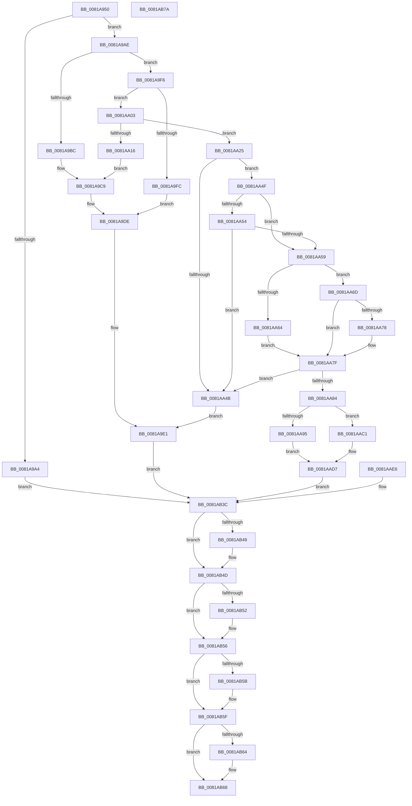

# AslFileMappingGetImageTypeEx

- RVA: `0x0081A950`–`0x0081AB7B` (길이 `555` bytes)
- VA: `0x000000014081A950`
- 실행 섹션: `PAGE`
- PDB 이름 있음: `예`; PDB Function 태그: `아니요`
- unwind 정보 RVA: `0x000D9CE0`
- 디코드: `147`개 명령, `555/555` bytes 표시
- 미해석 바이트: `0` (있으면 어셈블리에 `.byte`로 보존)

> 이 문서는 커널 이미지의 기계어와 PDB 기호를 분석해 생성했습니다. 4번과 5번은 함수 원형과 자료형을 바이너리 사용 방식에서 추정한 C 해석이며 원본 소스 복구 결과는 아닙니다.

## 1. Dependencies

- 직접 호출 지점: **6**; 고유 호출 대상: **4**
- 직접 호출자로 확인된 함수: **1**
- RIP 상대 이미지 참조: **5**

### Outgoing calls
- `0x0081A9B1` → [AslFileMappingEnsure](AslFileMappingEnsure_function_0081A5EC.md) (function, `0x0081A5EC`)
- `0x0081A9D9` → [AslLogCallPrintf](../95/AslLogCallPrintf_function_0095E4EC.md) (function, `0x0095E4EC`)
- `0x0081AA0B` → [AslpFileGetImageNtHeader](AslpFileGetImageNtHeader_function_0081F434.md) (function, `0x0081F434`)
- `0x0081AA8B` → [AslpImageRvaToVa](../82/AslpImageRvaToVa_function_008214BC.md) (function, `0x008214BC`)
- `0x0081AAAC` → [AslLogCallPrintf](../95/AslLogCallPrintf_function_0095E4EC.md) (function, `0x0095E4EC`)
- `0x0081AB09` → [AslLogCallPrintf](../95/AslLogCallPrintf_function_0095E4EC.md) (function, `0x0095E4EC`)

### Direct callers
- [AslFileMappingGetFileKindDetail](AslFileMappingGetFileKindDetail_function_0081A78C.md) at `0x0081A850`

### Static image references
- `0x0081A9BC` → RVA `0x0003EE90` (`.rdata`; read)
- `0x0081A9CD` → RVA `0x0003EEB8` (`.rdata`; read)
- `0x0081AA16` → RVA `0x0003EED8` (`.rdata`; read)
- `0x0081AA95` → RVA `0x0003EF00` (`.rdata`; read)
- `0x0081AAF0` → RVA `0x0003EF20` (`.rdata`; read)

## 2. Other-region calls and transfers

- 다른 실행 섹션으로 향하는 call: **0**
- 별도 외부 분기/꼬리 이동을 확인하지 못했습니다.

## 3. Assembly (complete function range)

```asm
0081A950  48 8B C4                        mov rax, rsp
0081A953  4C 89 48 20                     mov qword ptr [rax + 0x20], r9
0081A957  4C 89 40 18                     mov qword ptr [rax + 0x18], r8
0081A95B  48 89 50 10                     mov qword ptr [rax + 0x10], rdx
0081A95F  48 89 48 08                     mov qword ptr [rax + 8], rcx
0081A963  53                              push rbx
0081A964  56                              push rsi
0081A965  57                              push rdi
0081A966  41 54                           push r12
0081A968  41 55                           push r13
0081A96A  41 56                           push r14
0081A96C  41 57                           push r15
0081A96E  48 83 EC 60                     sub rsp, 0x60
0081A972  4D 8B E1                        mov r12, r9
0081A975  4D 8B E8                        mov r13, r8
0081A978  4C 8B C2                        mov r8, rdx
0081A97B  33 FF                           xor edi, edi
0081A97D  48 89 78 B0                     mov qword ptr [rax - 0x50], rdi
0081A981  44 8B F7                        mov r14d, edi
0081A984  0F B7 D7                        movzx edx, di
0081A987  44 0F B7 FF                     movzx r15d, di
0081A98B  8B CF                           mov ecx, edi
0081A98D  89 48 A4                        mov dword ptr [rax - 0x5c], ecx
0081A990  8B C7                           mov eax, edi
0081A992  89 44 24 38                     mov dword ptr [rsp + 0x38], eax
0081A996  48 8B B4 24 C0 00 00 00         mov rsi, qword ptr [rsp + 0xc0]
0081A99E  83 7E 40 01                     cmp dword ptr [rsi + 0x40], 1
0081A9A2  75 0A                           jne 0x14081a9ae
0081A9A4  BB 7B 00 00 C0                  mov ebx, 0xc000007b
0081A9A9  E9 8E 01 00 00                  jmp 0x14081ab3c
0081A9AE  48 8B CE                        mov rcx, rsi
0081A9B1  E8 36 FC FF FF                  call 0x14081a5ec
0081A9B6  8B D8                           mov ebx, eax
0081A9B8  85 C0                           test eax, eax
0081A9BA  79 3A                           jns 0x14081a9f6
0081A9BC  4C 8D 0D CD 44 82 FF            lea r9, [rip - 0x7dbb33]
0081A9C3  41 B8 53 04 00 00               mov r8d, 0x453
0081A9C9  89 44 24 20                     mov dword ptr [rsp + 0x20], eax
0081A9CD  48 8D 15 E4 44 82 FF            lea rdx, [rip - 0x7dbb1c]
0081A9D4  B9 01 00 00 00                  mov ecx, 1
0081A9D9  E8 0E 3B 14 00                  call 0x14095e4ec
0081A9DE  0F B7 D7                        movzx edx, di
0081A9E1  8B 4C 24 3C                     mov ecx, dword ptr [rsp + 0x3c]
0081A9E5  8B 44 24 38                     mov eax, dword ptr [rsp + 0x38]
0081A9E9  4C 8B 84 24 A8 00 00 00         mov r8, qword ptr [rsp + 0xa8]
0081A9F1  E9 46 01 00 00                  jmp 0x14081ab3c
0081A9F6  83 7E 40 06                     cmp dword ptr [rsi + 0x40], 6
0081A9FA  74 07                           je 0x14081aa03
0081A9FC  BB 7B 00 00 C0                  mov ebx, 0xc000007b
0081AA01  EB DB                           jmp 0x14081a9de
0081AA03  48 8B D6                        mov rdx, rsi
0081AA06  48 8D 4C 24 48                  lea rcx, [rsp + 0x48]
0081AA0B  E8 24 4A 00 00                  call 0x14081f434
0081AA10  8B D8                           mov ebx, eax
0081AA12  85 C0                           test eax, eax
0081AA14  79 0F                           jns 0x14081aa25
0081AA16  4C 8D 0D BB 44 82 FF            lea r9, [rip - 0x7dbb45]
0081AA1D  41 B8 67 04 00 00               mov r8d, 0x467
0081AA23  EB A4                           jmp 0x14081a9c9
0081AA25  48 8B 4C 24 48                  mov rcx, qword ptr [rsp + 0x48]
0081AA2A  0F B7 51 04                     movzx edx, word ptr [rcx + 4]
0081AA2E  66 89 54 24 30                  mov word ptr [rsp + 0x30], dx
0081AA33  66 89 94 24 C0 00 00 00         mov word ptr [rsp + 0xc0], dx
0081AA3B  44 0F B7 79 18                  movzx r15d, word ptr [rcx + 0x18]
0081AA40  66 44 89 7C 24 34               mov word ptr [rsp + 0x34], r15w
0081AA46  39 7E 50                        cmp dword ptr [rsi + 0x50], edi
0081AA49  74 04                           je 0x14081aa4f
0081AA4B  8B DF                           mov ebx, edi
0081AA4D  EB 92                           jmp 0x14081a9e1
0081AA4F  4D 85 ED                        test r13, r13
0081AA52  75 05                           jne 0x14081aa59
0081AA54  4D 85 E4                        test r12, r12
0081AA57  74 F2                           je 0x14081aa4b
0081AA59  B8 0B 01 00 00                  mov eax, 0x10b
0081AA5E  66 44 3B F8                     cmp r15w, ax
0081AA62  75 09                           jne 0x14081aa6d
0081AA64  44 8B B1 E8 00 00 00            mov r14d, dword ptr [rcx + 0xe8]
0081AA6B  EB 12                           jmp 0x14081aa7f
0081AA6D  B8 0B 02 00 00                  mov eax, 0x20b
0081AA72  66 44 3B F8                     cmp r15w, ax
0081AA76  75 07                           jne 0x14081aa7f
0081AA78  44 8B B1 F8 00 00 00            mov r14d, dword ptr [rcx + 0xf8]
0081AA7F  45 85 F6                        test r14d, r14d
0081AA82  74 C7                           je 0x14081aa4b
0081AA84  48 8D 56 08                     lea rdx, [rsi + 8]
0081AA88  45 8B C6                        mov r8d, r14d
0081AA8B  E8 2C 6A 00 00                  call 0x1408214bc
0081AA90  48 85 C0                        test rax, rax
0081AA93  75 2C                           jne 0x14081aac1
0081AA95  4C 8D 0D 64 44 82 FF            lea r9, [rip - 0x7dbb9c]
0081AA9C  41 B8 9D 04 00 00               mov r8d, 0x49d
0081AAA2  48 8D 15 0F 44 82 FF            lea rdx, [rip - 0x7dbbf1]
0081AAA9  8D 48 02                        lea ecx, [rax + 2]
0081AAAC  E8 3B 3A 14 00                  call 0x14095e4ec
0081AAB1  8B DF                           mov ebx, edi
0081AAB3  89 5C 24 40                     mov dword ptr [rsp + 0x40], ebx
0081AAB7  8B 44 24 38                     mov eax, dword ptr [rsp + 0x38]
0081AABB  8B 4C 24 3C                     mov ecx, dword ptr [rsp + 0x3c]
0081AABF  EB 16                           jmp 0x14081aad7
0081AAC1  B9 01 00 00 00                  mov ecx, 1
0081AAC6  89 4C 24 3C                     mov dword ptr [rsp + 0x3c], ecx
0081AACA  8B 40 10                        mov eax, dword ptr [rax + 0x10]
0081AACD  89 44 24 38                     mov dword ptr [rsp + 0x38], eax
0081AAD1  8B DF                           mov ebx, edi
0081AAD3  89 5C 24 40                     mov dword ptr [rsp + 0x40], ebx
0081AAD7  0F B7 54 24 30                  movzx edx, word ptr [rsp + 0x30]
0081AADC  4C 8B 84 24 A8 00 00 00         mov r8, qword ptr [rsp + 0xa8]
0081AAE4  EB 56                           jmp 0x14081ab3c
0081AAE6  8B D8                           mov ebx, eax
0081AAE8  89 44 24 40                     mov dword ptr [rsp + 0x40], eax
0081AAEC  89 44 24 20                     mov dword ptr [rsp + 0x20], eax
0081AAF0  4C 8D 0D 29 44 82 FF            lea r9, [rip - 0x7dbbd7]
0081AAF7  41 B8 AA 04 00 00               mov r8d, 0x4aa
0081AAFD  48 8D 15 B4 43 82 FF            lea rdx, [rip - 0x7dbc4c]
0081AB04  B9 01 00 00 00                  mov ecx, 1
0081AB09  E8 DE 39 14 00                  call 0x14095e4ec
0081AB0E  4C 8B A4 24 B8 00 00 00         mov r12, qword ptr [rsp + 0xb8]
0081AB16  4C 8B AC 24 B0 00 00 00         mov r13, qword ptr [rsp + 0xb0]
0081AB1E  0F B7 94 24 C0 00 00 00         movzx edx, word ptr [rsp + 0xc0]
0081AB26  44 0F B7 7C 24 34               movzx r15d, word ptr [rsp + 0x34]
0081AB2C  8B 44 24 38                     mov eax, dword ptr [rsp + 0x38]
0081AB30  8B 4C 24 3C                     mov ecx, dword ptr [rsp + 0x3c]
0081AB34  4C 8B 84 24 A8 00 00 00         mov r8, qword ptr [rsp + 0xa8]
0081AB3C  4C 8B 8C 24 A0 00 00 00         mov r9, qword ptr [rsp + 0xa0]
0081AB44  4D 85 C9                        test r9, r9
0081AB47  74 04                           je 0x14081ab4d
0081AB49  66 41 89 11                     mov word ptr [r9], dx
0081AB4D  4D 85 C0                        test r8, r8
0081AB50  74 04                           je 0x14081ab56
0081AB52  66 45 89 38                     mov word ptr [r8], r15w
0081AB56  4D 85 ED                        test r13, r13
0081AB59  74 04                           je 0x14081ab5f
0081AB5B  41 89 4D 00                     mov dword ptr [r13], ecx
0081AB5F  4D 85 E4                        test r12, r12
0081AB62  74 04                           je 0x14081ab68
0081AB64  41 89 04 24                     mov dword ptr [r12], eax
0081AB68  8B C3                           mov eax, ebx
0081AB6A  48 83 C4 60                     add rsp, 0x60
0081AB6E  41 5F                           pop r15
0081AB70  41 5E                           pop r14
0081AB72  41 5D                           pop r13
0081AB74  41 5C                           pop r12
0081AB76  5F                              pop rdi
0081AB77  5E                              pop rsi
0081AB78  5B                              pop rbx
0081AB79  C3                              ret
0081AB7A  CC                              int3
```

## 4. C-style interpretation (structured pseudocode)

```c
__int64 __fastcall AslFileMappingGetImageTypeEx(__int64 a1, __int64 a2, __int64 a3, __int64 a4, __int64 a5)
{
    __int64 result;
    __int64 v_r14;
    __int64 v_rdi;
    __int64 v_rsp;
    unsigned __int64 v_stack_m50;
    unsigned int v_stack_m58;
    unsigned int v_stack_m5C;
    unsigned int v_stack_m60;
    unsigned __int16 v_stack_m64;
    unsigned __int16 v_stack_m68;
    unsigned int v_stack_m78;
    unsigned __int64 v_stack_p10;
    unsigned __int64 v_stack_p18;
    unsigned __int64 v_stack_p20;
    unsigned __int16 v_stack_p28;
    unsigned __int64 v_stack_p8;

    *(unsigned __int64 *)(v_rsp + 32) = a4;
    *(unsigned __int64 *)(v_rsp + 24) = a3;
    *(unsigned __int64 *)(v_rsp + 16) = a2;
    *(unsigned __int64 *)(v_rsp + 8) = a1;
    v_rsp = (v_rsp) - (96);
    v_rdi = 0;
    *(unsigned __int64 *)(v_rsp - 80) = 0;
    *(unsigned int *)(v_rsp - 92) = 0;
    v_stack_m60 = 0;
    if ((*(unsigned int *)(a5 + 64)) != 1) goto loc_0081A9AE;
    goto loc_0081AB3C;
loc_0081A9AE:
    result = AslFileMappingEnsure(a5, 0, a2, a4);
    if (!sign_flag) goto loc_0081A9F6;
loc_0081A9C9:
    v_stack_m78 = (unsigned int)(result);
    result = AslLogCallPrintf(1, v_rip - 8239900, (unsigned int)(0x453ULL), v_rip - 8239923);
loc_0081A9DE:
loc_0081A9E1:
    goto loc_0081AB3C;
loc_0081A9F6:
    if ((*(unsigned int *)(a5 + 64)) == 6) goto loc_0081AA03;
    goto loc_0081A9DE;
loc_0081AA03:
    result = AslpFileGetImageNtHeader(v_stack_m50, a5, v_stack_p10, v_rip - 8239923);
    if (!sign_flag) goto loc_0081AA25;
    goto loc_0081A9C9;
loc_0081AA25:
    v_stack_m68 = (unsigned __int16)(*(unsigned __int16 *)(v_stack_m50 + 4));
    v_stack_p28 = (unsigned __int16)(*(unsigned __int16 *)(v_stack_m50 + 4));
    v_stack_m64 = (unsigned __int16)(*(unsigned __int16 *)(v_stack_m50 + 24));
    if ((*(unsigned int *)(a5 + 80)) == 0) goto loc_0081AA4F;
loc_0081AA4B:
    goto loc_0081A9E1;
loc_0081AA4F:
    if (a3 != 0) goto loc_0081AA59;
    if (a4 == 0) goto loc_0081AA4B;
loc_0081AA59:
    if (((unsigned __int16)(*(unsigned __int16 *)(v_stack_m50 + 24))) != 267) goto loc_0081AA6D;
    goto loc_0081AA7F;
loc_0081AA6D:
    v_r14 = (unsigned int)(*(unsigned int *)(v_stack_m50 + 232));
    if (((unsigned __int16)(*(unsigned __int16 *)(v_stack_m50 + 24))) == 523) {
        v_r14 = *(unsigned int *)(v_stack_m50 + 248);
    }
    if ((unsigned int)(v_r14) == 0) goto loc_0081AA4B;
    result = AslpImageRvaToVa(v_stack_m50, a5 + 8, (unsigned int)((unsigned int)(v_r14)), v_rip - 8239941);
    if (result != 0) goto loc_0081AAC1;
    result = AslLogCallPrintf(result + 2, v_rip - 8240113, (unsigned int)(0x49DULL), v_rip - 8240028);
    v_stack_m58 = 0;
    goto loc_0081AAD7;
loc_0081AAC1:
    v_stack_m5C = 1;
    v_stack_m60 = (unsigned int)((unsigned int)(*(unsigned int *)((unsigned int)(v_stack_m60) + 16)));
    v_stack_m58 = 0;
loc_0081AAD7:
    goto loc_0081AB3C;
loc_0081AB3C:
    if (v_stack_p8 != 0) {
        *(unsigned __int16 *)(v_stack_p8) = (unsigned __int16)(v_stack_m68);
    }
    if (v_stack_p10 != 0) {
        *(unsigned __int16 *)(v_stack_p10) = (unsigned __int16)(*(unsigned __int16 *)(v_stack_m50 + 24));
    }
    if (a3 != 0) {
        *(unsigned int *)(a3) = 1;
    }
    if (a4 != 0) {
        *(unsigned int *)(a4) = (unsigned int)((unsigned int)(*(unsigned int *)((unsigned int)(v_stack_m60) + 16)));
    }
    v_rsp = (v_rsp) + (96);
    return 0;
}
```

## 5. (Beta) C Style

```c
int64_t AslFileMappingGetImageTypeEx(int64_t Arg1, int64_t Arg2, int64_t Arg3, int64_t Arg4, void *Arg5)
{
    uint8_t *arg5 = (uint8_t *)Arg5;

    int64_t result;
    int64_t local_r14;
    int64_t local_rdi;
    int64_t local_rsp;
    uint64_t v_stack_m50;
    uint32_t v_stack_m58;
    uint32_t v_stack_m5C;
    uint32_t v_stack_m60;
    uint16_t v_stack_m64;
    uint16_t v_stack_m68;
    uint32_t v_stack_m78;
    uint64_t v_stack_p10;
    uint64_t v_stack_p18;
    uint64_t v_stack_p20;
    uint16_t v_stack_p28;
    uint64_t v_stack_p8;

    *(uint64_t *)(local_rsp + 0x20) = Arg4;
    *(uint64_t *)(local_rsp + 0x18) = Arg3;
    *(uint64_t *)(local_rsp + 0x10) = Arg2;
    *(uint64_t *)(local_rsp + 0x8) = Arg1;
    local_rsp = (local_rsp) - (96);
    local_rdi = 0;
    *(uint64_t *)(local_rsp - 0x50) = 0;
    *(uint32_t *)(local_rsp - 0x5C) = 0;
    v_stack_m60 = 0;
    if ((*(uint32_t *)(arg5 + 0x40)) != 1) goto loc_0081A9AE;
    goto loc_0081AB3C;
loc_0081A9AE:
    result = AslFileMappingEnsure(Arg5, 0, Arg2, Arg4);
    if (!sign_flag) goto loc_0081A9F6;
loc_0081A9C9:
    v_stack_m78 = (uint32_t)(result);
    result = AslLogCallPrintf(1, v_rip - 8239900, (uint32_t)(0x453ULL), v_rip - 8239923);
loc_0081A9DE:
loc_0081A9E1:
    goto loc_0081AB3C;
loc_0081A9F6:
    if ((*(uint32_t *)(arg5 + 0x40)) == 6) goto loc_0081AA03;
    goto loc_0081A9DE;
loc_0081AA03:
    result = AslpFileGetImageNtHeader(v_stack_m50, Arg5, v_stack_p10, v_rip - 8239923);
    if (!sign_flag) goto loc_0081AA25;
    goto loc_0081A9C9;
loc_0081AA25:
    v_stack_m68 = (uint16_t)(*(uint16_t *)(v_stack_m50 + 0x4));
    v_stack_p28 = (uint16_t)(*(uint16_t *)(v_stack_m50 + 0x4));
    v_stack_m64 = (uint16_t)(*(uint16_t *)(v_stack_m50 + 0x18));
    if ((*(uint32_t *)(arg5 + 0x50)) == 0) goto loc_0081AA4F;
loc_0081AA4B:
    goto loc_0081A9E1;
loc_0081AA4F:
    if (Arg3 != 0) goto loc_0081AA59;
    if (Arg4 == 0) goto loc_0081AA4B;
loc_0081AA59:
    if (((uint16_t)(*(uint16_t *)(v_stack_m50 + 0x18))) != 267) goto loc_0081AA6D;
    goto loc_0081AA7F;
loc_0081AA6D:
    local_r14 = (uint32_t)(*(uint32_t *)(v_stack_m50 + 0xE8));
    if (((uint16_t)(*(uint16_t *)(v_stack_m50 + 0x18))) == 523) {
        local_r14 = *(uint32_t *)(v_stack_m50 + 0xF8);
    }
    if ((uint32_t)(local_r14) == 0) goto loc_0081AA4B;
    result = AslpImageRvaToVa(v_stack_m50, Arg5 + 8, (uint32_t)((uint32_t)(local_r14)), v_rip - 8239941);
    if (result != 0) goto loc_0081AAC1;
    result = AslLogCallPrintf(result + 2, v_rip - 8240113, (uint32_t)(0x49DULL), v_rip - 8240028);
    v_stack_m58 = 0;
    goto loc_0081AAD7;
loc_0081AAC1:
    v_stack_m5C = 1;
    v_stack_m60 = (uint32_t)((uint32_t)(*(uint32_t *)((uint32_t)(v_stack_m60) + 0x10)));
    v_stack_m58 = 0;
loc_0081AAD7:
    goto loc_0081AB3C;
loc_0081AB3C:
    if (v_stack_p8 != 0) {
        *(uint16_t *)(v_stack_p8) = (uint16_t)(v_stack_m68);
    }
    if (v_stack_p10 != 0) {
        *(uint16_t *)(v_stack_p10) = (uint16_t)(*(uint16_t *)(v_stack_m50 + 0x18));
    }
    if (Arg3 != 0) {
        *(uint32_t *)(Arg3) = 1;
    }
    if (Arg4 != 0) {
        *(uint32_t *)(Arg4) = (uint32_t)((uint32_t)(*(uint32_t *)((uint32_t)(v_stack_m60) + 0x10)));
    }
    local_rsp = (local_rsp) + (96);
    return 0;
}
```

### 관측된 메모리 오프셋

구조체 형식이 확인되지 않은 접근은 인자 기준의 오프셋으로만 기록했습니다.

| 기준 인자 | 오프셋 표현 | 폭 (bit) | 접근 |
|---|---:|---:|---|
| `Arg5` | `+ 0x8` | `64` | `R` |
| `Arg5` | `+ 0x40` | `32` | `R` |
| `Arg5` | `+ 0x50` | `32` | `R` |

## 6. Execution-region graph

[열기: 2D/3D 그래프와 함수 탐색 컨트롤 패널](../../../control-panel.html?section=page&rva=0x0081A950&view=graph)

- 2D 그래프는 위에서 아래로 흐르고, 3D 그래프는 빈 공간을 드래그해 회전합니다. Shift+드래그는 이동, 휠은 확대·축소, 함수 노드 선택은 대상 보고서 이동입니다.

### Static fallback


