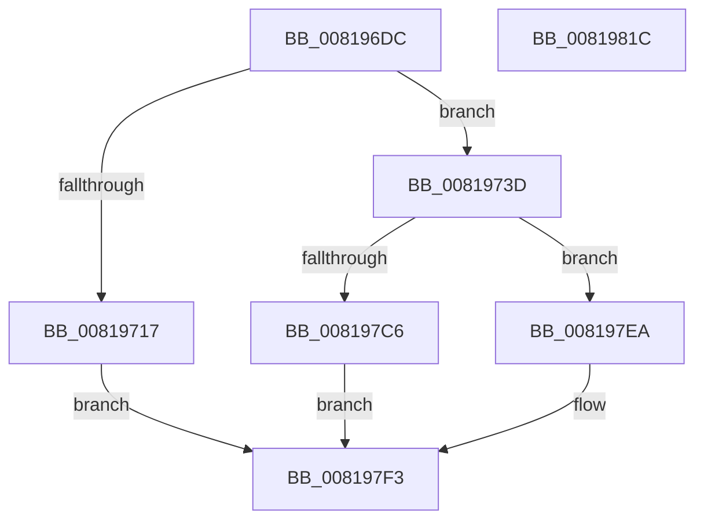

# AslGuidToString_UStr

- RVA: `0x008196DC`–`0x0081981D` (길이 `321` bytes)
- VA: `0x00000001408196DC`
- 실행 섹션: `PAGE`
- PDB 이름 있음: `예`; PDB Function 태그: `아니요`
- unwind 정보 RVA: `0x000C4204`
- 디코드: `77`개 명령, `321/321` bytes 표시
- 미해석 바이트: `0` (있으면 어셈블리에 `.byte`로 보존)

> 이 문서는 커널 이미지의 기계어와 PDB 기호를 분석해 생성했습니다. 4번과 5번은 함수 원형과 자료형을 바이너리 사용 방식에서 추정한 C 해석이며 원본 소스 복구 결과는 아닙니다.

## 1. Dependencies

- 직접 호출 지점: **5**; 고유 호출 대상: **4**
- 직접 호출자로 확인된 함수: **1**
- RIP 상대 이미지 참조: **4**

### Outgoing calls
- `0x0081970A` → [AslAlloc](../95/AslAlloc_function_0095BD34.md) (function, `0x0095BD34`)
- `0x0081972E` → [AslLogCallPrintf](../95/AslLogCallPrintf_function_0095E4EC.md) (function, `0x0095E4EC`)
- `0x008197BB` → [RtlStringCchPrintfW](../../text/48/RtlStringCchPrintfW_function_00482D5C.md) (function, `0x00482D5C`)
- `0x008197E3` → [AslLogCallPrintf](../95/AslLogCallPrintf_function_0095E4EC.md) (function, `0x0095E4EC`)
- `0x008197F6` → [AslFree](../95/AslFree_function_0095B674.md) (function, `0x0095B674`)

### Direct callers
- [SdbResolveDatabaseEx](SdbResolveDatabaseEx_function_00817A54.md) at `0x00817B7D`

### Static image references
- `0x00819717` → RVA `0x000129E0` (`.rdata`; read)
- `0x00819724` → RVA `0x0003E5F0` (`.rdata`; read)
- `0x0081978E` → RVA `0x0001E390` (`.rdata`; read)
- `0x008197C6` → RVA `0x0001E420` (`.rdata`; read)

## 2. Other-region calls and transfers

- 다른 실행 섹션으로 향하는 call: **1**
  - `0x008197BB` → [RtlStringCchPrintfW](../../text/48/RtlStringCchPrintfW_function_00482D5C.md) (`PAGE` → `.text`)
- 별도 외부 분기/꼬리 이동을 확인하지 못했습니다.

## 3. Assembly (complete function range)

```asm
008196DC  48 8B C4                        mov rax, rsp
008196DF  48 89 58 08                     mov qword ptr [rax + 8], rbx
008196E3  48 89 68 10                     mov qword ptr [rax + 0x10], rbp
008196E7  48 89 70 18                     mov qword ptr [rax + 0x18], rsi
008196EB  48 89 78 20                     mov qword ptr [rax + 0x20], rdi
008196EF  41 54                           push r12
008196F1  41 56                           push r14
008196F3  41 57                           push r15
008196F5  48 83 EC 70                     sub rsp, 0x70
008196F9  4C 8B E2                        mov r12, rdx
008196FC  C7 01 4C 00 4E 00               mov dword ptr [rcx], 0x4e004c
00819702  BA 4E 00 00 00                  mov edx, 0x4e
00819707  4C 8B F9                        mov r15, rcx
0081970A  E8 25 26 14 00                  call 0x14095bd34
0081970F  4C 8B F0                        mov r14, rax
00819712  48 85 C0                        test rax, rax
00819715  75 26                           jne 0x14081973d
00819717  4C 8D 0D C2 92 7F FF            lea r9, [rip - 0x806d3e]
0081971E  41 B8 F6 00 00 00               mov r8d, 0xf6
00819724  48 8D 15 C5 4E 82 FF            lea rdx, [rip - 0x7db13b]
0081972B  8D 48 01                        lea ecx, [rax + 1]
0081972E  E8 B9 4D 14 00                  call 0x14095e4ec
00819733  BB 17 00 00 C0                  mov ebx, 0xc0000017
00819738  E9 B6 00 00 00                  jmp 0x1408197f3
0081973D  41 0F B6 4C 24 0E               movzx ecx, byte ptr [r12 + 0xe]
00819743  45 0F B6 44 24 0D               movzx r8d, byte ptr [r12 + 0xd]
00819749  45 0F B6 4C 24 0C               movzx r9d, byte ptr [r12 + 0xc]
0081974F  41 0F B6 44 24 0F               movzx eax, byte ptr [r12 + 0xf]
00819755  45 0F B6 54 24 0B               movzx r10d, byte ptr [r12 + 0xb]
0081975B  45 0F B6 5C 24 0A               movzx r11d, byte ptr [r12 + 0xa]
00819761  41 0F B6 5C 24 09               movzx ebx, byte ptr [r12 + 9]
00819767  41 0F B6 7C 24 08               movzx edi, byte ptr [r12 + 8]
0081976D  41 0F B7 74 24 06               movzx esi, word ptr [r12 + 6]
00819773  41 0F B7 57 02                  movzx edx, word ptr [r15 + 2]
00819778  41 0F B7 6C 24 04               movzx ebp, word ptr [r12 + 4]
0081977E  89 44 24 68                     mov dword ptr [rsp + 0x68], eax
00819782  89 4C 24 60                     mov dword ptr [rsp + 0x60], ecx
00819786  49 8B CE                        mov rcx, r14
00819789  44 89 44 24 58                  mov dword ptr [rsp + 0x58], r8d
0081978E  4C 8D 05 FB 4B 80 FF            lea r8, [rip - 0x7fb405]
00819795  44 89 4C 24 50                  mov dword ptr [rsp + 0x50], r9d
0081979A  45 8B 0C 24                     mov r9d, dword ptr [r12]
0081979E  44 89 54 24 48                  mov dword ptr [rsp + 0x48], r10d
008197A3  44 89 5C 24 40                  mov dword ptr [rsp + 0x40], r11d
008197A8  89 5C 24 38                     mov dword ptr [rsp + 0x38], ebx
008197AC  89 7C 24 30                     mov dword ptr [rsp + 0x30], edi
008197B0  89 74 24 28                     mov dword ptr [rsp + 0x28], esi
008197B4  48 D1 EA                        shr rdx, 1
008197B7  89 6C 24 20                     mov dword ptr [rsp + 0x20], ebp
008197BB  E8 9C 95 C6 FF                  call 0x140482d5c
008197C0  8B D8                           mov ebx, eax
008197C2  85 C0                           test eax, eax
008197C4  79 24                           jns 0x1408197ea
008197C6  4C 8D 0D 53 4C 80 FF            lea r9, [rip - 0x7fb3ad]
008197CD  89 44 24 20                     mov dword ptr [rsp + 0x20], eax
008197D1  41 B8 0A 01 00 00               mov r8d, 0x10a
008197D7  48 8D 15 12 4E 82 FF            lea rdx, [rip - 0x7db1ee]
008197DE  B9 01 00 00 00                  mov ecx, 1
008197E3  E8 04 4D 14 00                  call 0x14095e4ec
008197E8  EB 09                           jmp 0x1408197f3
008197EA  4D 89 77 08                     mov qword ptr [r15 + 8], r14
008197EE  45 33 F6                        xor r14d, r14d
008197F1  33 DB                           xor ebx, ebx
008197F3  49 8B D6                        mov rdx, r14
008197F6  E8 79 1E 14 00                  call 0x14095b674
008197FB  4C 8D 5C 24 70                  lea r11, [rsp + 0x70]
00819800  8B C3                           mov eax, ebx
00819802  49 8B 5B 20                     mov rbx, qword ptr [r11 + 0x20]
00819806  49 8B 6B 28                     mov rbp, qword ptr [r11 + 0x28]
0081980A  49 8B 73 30                     mov rsi, qword ptr [r11 + 0x30]
0081980E  49 8B 7B 38                     mov rdi, qword ptr [r11 + 0x38]
00819812  49 8B E3                        mov rsp, r11
00819815  41 5F                           pop r15
00819817  41 5E                           pop r14
00819819  41 5C                           pop r12
0081981B  C3                              ret
0081981C  CC                              int3
```

## 4. C-style interpretation (structured pseudocode)

```c
__int64 __fastcall AslGuidToString_UStr(__int64 a1, __int64 a2)
{
    __int64 result;
    __int64 v_r14;
    __int64 v_rbx;
    __int64 v_rsp;
    unsigned __int64 v_stack_m18;
    unsigned int v_stack_m20;
    unsigned int v_stack_m28;
    unsigned int v_stack_m30;
    unsigned int v_stack_m38;
    unsigned int v_stack_m40;
    unsigned int v_stack_m48;
    unsigned int v_stack_m50;
    unsigned int v_stack_m58;
    unsigned int v_stack_m60;
    unsigned int v_stack_m68;

    *(unsigned __int64 *)(v_rsp + 8) = v_rbx;
    *(unsigned __int64 *)(v_rsp + 16) = v_rbp;
    *(unsigned __int64 *)(v_rsp + 24) = v_rsi;
    *(unsigned __int64 *)(v_rsp + 32) = v_rdi;
    v_rsp = (v_rsp) - (112);
    *(unsigned int *)(a1) = 0x4E004CULL;
    result = AslAlloc(a1, 78, a3, a4);
    if (result != 0) goto loc_0081973D;
    result = AslLogCallPrintf(result + 1, v_rip - 8237371, 246, v_rip - 8416574);
    goto loc_008197F3;
loc_0081973D:
    v_stack_m20 = (unsigned int)(*(unsigned __int8 *)(a2 + 15));
    v_stack_m28 = (unsigned int)(*(unsigned __int8 *)(a2 + 14));
    v_stack_m30 = (unsigned int)(*(unsigned __int8 *)(a2 + 13));
    v_stack_m38 = (unsigned int)(*(unsigned __int8 *)(a2 + 12));
    v_stack_m40 = (unsigned int)(*(unsigned __int8 *)(a2 + 11));
    v_stack_m48 = (unsigned int)(*(unsigned __int8 *)(a2 + 10));
    v_stack_m50 = (unsigned int)(*(unsigned __int8 *)(a2 + 9));
    v_stack_m58 = (unsigned int)(*(unsigned __int8 *)(a2 + 8));
    v_stack_m60 = (unsigned int)(*(unsigned __int16 *)(a2 + 6));
    a2 = (*(unsigned __int16 *)(a1 + 2)) >> (1);
    v_stack_m68 = (unsigned int)(*(unsigned __int16 *)(a2 + 4));
    result = RtlStringCchPrintfW(result, a2, v_rip - 8369157, (unsigned int)(*(unsigned int *)(a2)));
    if (!sign_flag) goto loc_008197EA;
    v_stack_m68 = (unsigned int)(result);
    result = AslLogCallPrintf(1, v_rip - 8237550, 266, v_rip - 8369069);
    goto loc_008197F3;
loc_008197EA:
    *(unsigned __int64 *)(a1 + 8) = result;
    v_r14 = 0;
    v_rbx = 0;
loc_008197F3:
    result = AslFree(1, 0, 266, v_rip - 8369069);
    return 0;
}
```

## 5. (Beta) C Style

```c
int64_t AslGuidToString_UStr(void *Arg1, void *Arg2)
{
    uint8_t *arg1 = (uint8_t *)Arg1;
    uint8_t *arg2 = (uint8_t *)Arg2;

    int64_t result;
    int64_t local_r14;
    int64_t local_rbx;
    int64_t local_rsp;
    uint64_t v_stack_m18;
    uint32_t v_stack_m20;
    uint32_t v_stack_m28;
    uint32_t v_stack_m30;
    uint32_t v_stack_m38;
    uint32_t v_stack_m40;
    uint32_t v_stack_m48;
    uint32_t v_stack_m50;
    uint32_t v_stack_m58;
    uint32_t v_stack_m60;
    uint32_t v_stack_m68;

    *(uint64_t *)(local_rsp + 0x8) = local_rbx;
    *(uint64_t *)(local_rsp + 0x10) = local_rbp;
    *(uint64_t *)(local_rsp + 0x18) = local_rsi;
    *(uint64_t *)(local_rsp + 0x20) = local_rdi;
    local_rsp = (local_rsp) - (112);
    *(uint32_t *)(arg1) = 0x4E004CULL;
    result = AslAlloc(Arg1, 78, a3, a4);
    if (result != 0) goto loc_0081973D;
    result = AslLogCallPrintf(result + 1, v_rip - 8237371, 246, v_rip - 8416574);
    goto loc_008197F3;
loc_0081973D:
    v_stack_m20 = (uint32_t)(*(uint8_t *)(arg2 + 0xF));
    v_stack_m28 = (uint32_t)(*(uint8_t *)(arg2 + 0xE));
    v_stack_m30 = (uint32_t)(*(uint8_t *)(arg2 + 0xD));
    v_stack_m38 = (uint32_t)(*(uint8_t *)(arg2 + 0xC));
    v_stack_m40 = (uint32_t)(*(uint8_t *)(arg2 + 0xB));
    v_stack_m48 = (uint32_t)(*(uint8_t *)(arg2 + 0xA));
    v_stack_m50 = (uint32_t)(*(uint8_t *)(arg2 + 0x9));
    v_stack_m58 = (uint32_t)(*(uint8_t *)(arg2 + 0x8));
    v_stack_m60 = (uint32_t)(*(uint16_t *)(arg2 + 0x6));
    Arg2 = (*(uint16_t *)(arg1 + 0x2)) >> (1);
    v_stack_m68 = (uint32_t)(*(uint16_t *)(arg2 + 0x4));
    result = RtlStringCchPrintfW(result, Arg2, v_rip - 8369157, (uint32_t)(*(uint32_t *)(arg2)));
    if (!sign_flag) goto loc_008197EA;
    v_stack_m68 = (uint32_t)(result);
    result = AslLogCallPrintf(1, v_rip - 8237550, 266, v_rip - 8369069);
    goto loc_008197F3;
loc_008197EA:
    *(uint64_t *)(arg1 + 0x8) = result;
    local_r14 = 0;
    local_rbx = 0;
loc_008197F3:
    result = AslFree(1, 0, 266, v_rip - 8369069);
    return 0;
}
```

### 관측된 메모리 오프셋

구조체 형식이 확인되지 않은 접근은 인자 기준의 오프셋으로만 기록했습니다.

| 기준 인자 | 오프셋 표현 | 폭 (bit) | 접근 |
|---|---:|---:|---|
| `Arg1` | `+ 0x0` | `32` | `W` |
| `Arg1` | `+ 0x2` | `16` | `R` |
| `Arg1` | `+ 0x8` | `64` | `W` |
| `Arg2` | `+ 0x0` | `32` | `R` |
| `Arg2` | `+ 0x4` | `16` | `R` |
| `Arg2` | `+ 0x6` | `16` | `R` |
| `Arg2` | `+ 0x8` | `8` | `R` |
| `Arg2` | `+ 0x9` | `8` | `R` |
| `Arg2` | `+ 0xA` | `8` | `R` |
| `Arg2` | `+ 0xB` | `8` | `R` |
| `Arg2` | `+ 0xC` | `8` | `R` |
| `Arg2` | `+ 0xD` | `8` | `R` |
| `Arg2` | `+ 0xE` | `8` | `R` |
| `Arg2` | `+ 0xF` | `8` | `R` |

## 6. Execution-region graph

[열기: 2D/3D 그래프와 함수 탐색 컨트롤 패널](../../../control-panel.html?section=page&rva=0x008196DC&view=graph)

- 2D 그래프는 위에서 아래로 흐르고, 3D 그래프는 빈 공간을 드래그해 회전합니다. Shift+드래그는 이동, 휠은 확대·축소, 함수 노드 선택은 대상 보고서 이동입니다.

### Static fallback


