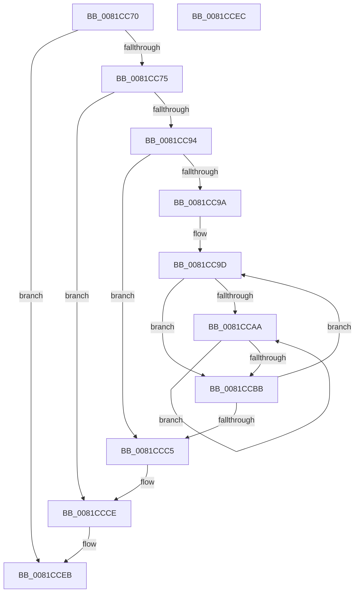

# AslHashFree

- RVA: `0x0081CC70`–`0x0081CCED` (길이 `125` bytes)
- VA: `0x000000014081CC70`
- 실행 섹션: `PAGE`
- PDB 이름 있음: `예`; PDB Function 태그: `아니요`
- unwind 정보 RVA: `0x000D9D84`
- 디코드: `38`개 명령, `125/125` bytes 표시
- 미해석 바이트: `0` (있으면 어셈블리에 `.byte`로 보존)

> 이 문서는 커널 이미지의 기계어와 PDB 기호를 분석해 생성했습니다. 4번과 5번은 함수 원형과 자료형을 바이너리 사용 방식에서 추정한 C 해석이며 원본 소스 복구 결과는 아닙니다.

## 1. Dependencies

- 직접 호출 지점: **3**; 고유 호출 대상: **1**
- 직접 호출자로 확인된 함수: **2**
- RIP 상대 이미지 참조: **0**

### Outgoing calls
- `0x0081CCAE` → [AslFree](../95/AslFree_function_0095B674.md) (function, `0x0095B674`)
- `0x0081CCC9` → [AslFree](../95/AslFree_function_0095B674.md) (function, `0x0095B674`)
- `0x0081CCD1` → [AslFree](../95/AslFree_function_0095B674.md) (function, `0x0095B674`)

### Direct callers
- [SdbpReleaseSearchDBContext](../95/SdbpReleaseSearchDBContext_function_00958118.md) at `0x00958182`
- [SdbpReleaseSearchDBContext](../95/SdbpReleaseSearchDBContext_function_00958118.md) at `0x00958195`
- [sub_00B2765C](../B2/Unknown_function_00B2765C.md) at `0x00B27680`

### Static image references
- 디코드된 RIP-relative 메모리 참조가 없습니다.

## 2. Other-region calls and transfers

- 다른 실행 섹션으로 향하는 call: **0**
- 별도 외부 분기/꼬리 이동을 확인하지 못했습니다.

## 3. Assembly (complete function range)

```asm
0081CC70  48 85 C9                        test rcx, rcx
0081CC73  74 76                           je 0x14081cceb
0081CC75  48 89 5C 24 08                  mov qword ptr [rsp + 8], rbx
0081CC7A  48 89 74 24 10                  mov qword ptr [rsp + 0x10], rsi
0081CC7F  48 89 7C 24 18                  mov qword ptr [rsp + 0x18], rdi
0081CC84  41 56                           push r14
0081CC86  48 83 EC 20                     sub rsp, 0x20
0081CC8A  48 83 79 08 00                  cmp qword ptr [rcx + 8], 0
0081CC8F  48 8B F9                        mov rdi, rcx
0081CC92  74 3A                           je 0x14081ccce
0081CC94  33 F6                           xor esi, esi
0081CC96  39 31                           cmp dword ptr [rcx], esi
0081CC98  7E 2B                           jle 0x14081ccc5
0081CC9A  45 33 F6                        xor r14d, r14d
0081CC9D  48 8B 47 08                     mov rax, qword ptr [rdi + 8]
0081CCA1  49 8B 14 06                     mov rdx, qword ptr [r14 + rax]
0081CCA5  48 85 D2                        test rdx, rdx
0081CCA8  74 11                           je 0x14081ccbb
0081CCAA  48 8B 5A 10                     mov rbx, qword ptr [rdx + 0x10]
0081CCAE  E8 C1 E9 13 00                  call 0x14095b674
0081CCB3  48 8B D3                        mov rdx, rbx
0081CCB6  48 85 DB                        test rbx, rbx
0081CCB9  75 EF                           jne 0x14081ccaa
0081CCBB  FF C6                           inc esi
0081CCBD  49 83 C6 08                     add r14, 8
0081CCC1  3B 37                           cmp esi, dword ptr [rdi]
0081CCC3  7C D8                           jl 0x14081cc9d
0081CCC5  48 8B 57 08                     mov rdx, qword ptr [rdi + 8]
0081CCC9  E8 A6 E9 13 00                  call 0x14095b674
0081CCCE  48 8B D7                        mov rdx, rdi
0081CCD1  E8 9E E9 13 00                  call 0x14095b674
0081CCD6  48 8B 5C 24 30                  mov rbx, qword ptr [rsp + 0x30]
0081CCDB  48 8B 74 24 38                  mov rsi, qword ptr [rsp + 0x38]
0081CCE0  48 8B 7C 24 40                  mov rdi, qword ptr [rsp + 0x40]
0081CCE5  48 83 C4 20                     add rsp, 0x20
0081CCE9  41 5E                           pop r14
0081CCEB  C3                              ret
0081CCEC  CC                              int3
```

## 4. C-style interpretation (structured pseudocode)

```c
__int64 __fastcall AslHashFree(__int64 a1)
{
    __int64 result;
    __int64 v_r14;
    __int64 v_rsi;
    __int64 v_rsp;
    unsigned __int64 v_stack_p10;
    unsigned __int64 v_stack_p18;
    unsigned __int64 v_stack_p8;

    if (a1 == 0) goto loc_0081CCEB;
    v_stack_p8 = v_rbx;
    v_stack_p10 = v_rsi;
    v_stack_p18 = v_rdi;
    v_rsp = (v_rsp) - (32);
    if ((*(unsigned __int64 *)(a1 + 8)) == 0) goto loc_0081CCCE;
    v_rsi = 0;
    if ((*(unsigned int *)(a1)) <= 0) goto loc_0081CCC5;
    v_r14 = 0;
loc_0081CC9D:
    if (*(unsigned __int64 *)(v_r14 + *(unsigned __int64 *)(a1 + 8) * 1) == 0) goto loc_0081CCBB;
loc_0081CCAA:
    result = AslFree(a1, *(unsigned __int64 *)(v_r14 + *(unsigned __int64 *)(a1 + 8) * 1), a3, a4);
    if (*(unsigned __int64 *)(*(unsigned __int64 *)(v_r14 + *(unsigned __int64 *)(a1 + 8) * 1) + 16) != 0) goto loc_0081CCAA;
loc_0081CCBB:
    v_rsi = (unsigned int)((v_rsi) + 1);
    v_r14 = (v_r14) + (8);
    if (((unsigned int)(v_rsi)) < (*(unsigned int *)(a1))) goto loc_0081CC9D;
loc_0081CCC5:
    result = AslFree(a1, *(unsigned __int64 *)(a1 + 8), a3, a4);
loc_0081CCCE:
    result = AslFree(a1, a1, a3, a4);
    v_rsp = (v_rsp) + (32);
loc_0081CCEB:
    return result;
}
```

## 5. (Beta) C Style

```c
int64_t AslHashFree(int64_t Arg1)
{
    int64_t result;
    int64_t local_r14;
    int64_t local_rsi;
    int64_t local_rsp;
    uint64_t v_stack_p10;
    uint64_t v_stack_p18;
    uint64_t v_stack_p8;

    if (Arg1 == 0) goto loc_0081CCEB;
    v_stack_p8 = local_rbx;
    v_stack_p10 = local_rsi;
    v_stack_p18 = local_rdi;
    local_rsp = (local_rsp) - (32);
    if ((*(uint64_t *)(Arg1 + 0x8)) == 0) goto loc_0081CCCE;
    local_rsi = 0;
    if ((*(uint32_t *)(Arg1)) <= 0) goto loc_0081CCC5;
    local_r14 = 0;
loc_0081CC9D:
    if (*(uint64_t *)(local_r14 + *(uint64_t *)(Arg1 + 0x8) * 1) == 0) goto loc_0081CCBB;
loc_0081CCAA:
    result = AslFree(Arg1, *(uint64_t *)(local_r14 + *(uint64_t *)(Arg1 + 0x8) * 1), a3, a4);
    if (*(uint64_t *)(*(uint64_t *)(local_r14 + *(uint64_t *)(Arg1 + 0x8) * 1) + 0x10) != 0) goto loc_0081CCAA;
loc_0081CCBB:
    local_rsi = (uint32_t)((local_rsi) + 1);
    local_r14 = (local_r14) + (8);
    if (((uint32_t)(local_rsi)) < (*(uint32_t *)(Arg1))) goto loc_0081CC9D;
loc_0081CCC5:
    result = AslFree(Arg1, *(uint64_t *)(Arg1 + 0x8), a3, a4);
loc_0081CCCE:
    result = AslFree(Arg1, Arg1, a3, a4);
    local_rsp = (local_rsp) + (32);
loc_0081CCEB:
    return result;
}
```

## 6. Execution-region graph

[열기: 2D/3D 그래프와 함수 탐색 컨트롤 패널](../../../control-panel.html?section=page&rva=0x0081CC70&view=graph)

- 2D 그래프는 위에서 아래로 흐르고, 3D 그래프는 빈 공간을 드래그해 회전합니다. Shift+드래그는 이동, 휠은 확대·축소, 함수 노드 선택은 대상 보고서 이동입니다.

### Static fallback


