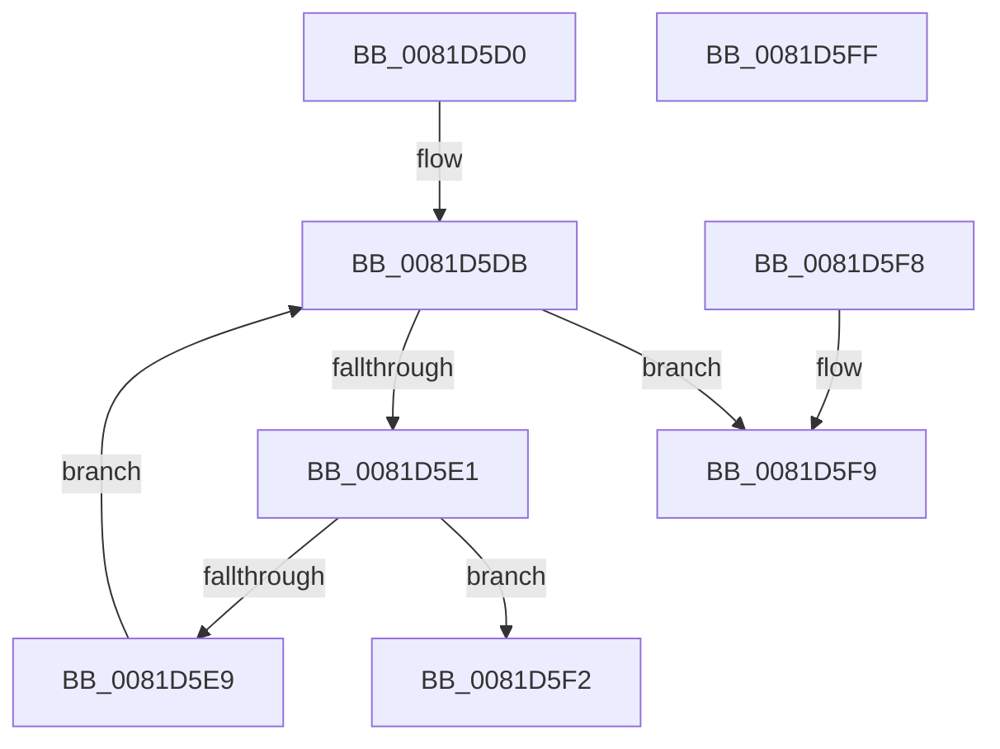

# AslImageFileToArchitecture

- RVA: `0x0081D5D0`–`0x0081D600` (길이 `48` bytes)
- VA: `0x000000014081D5D0`
- 실행 섹션: `PAGE`
- PDB 이름 있음: `예`; PDB Function 태그: `아니요`
- unwind 정보 RVA: `0x000DB714`
- 디코드: `16`개 명령, `48/48` bytes 표시
- 미해석 바이트: `0` (있으면 어셈블리에 `.byte`로 보존)

> 이 문서는 커널 이미지의 기계어와 PDB 기호를 분석해 생성했습니다. 4번과 5번은 함수 원형과 자료형을 바이너리 사용 방식에서 추정한 C 해석이며 원본 소스 복구 결과는 아닙니다.

## 1. Dependencies

- 직접 호출 지점: **0**; 고유 호출 대상: **0**
- 직접 호출자로 확인된 함수: **2**
- RIP 상대 이미지 참조: **1**

### Outgoing calls
- 직접 디코드된 call 명령이 없습니다.

### Direct callers
- [SdbpResolveMatchingFile](SdbpResolveMatchingFile_function_00816A20.md) at `0x00816AD1`
- [SdbpResolveMatchingFile](SdbpResolveMatchingFile_function_00816A20.md) at `0x00816BFE`
- [SdbpGetProcessHostGuestArchitectures](SdbpGetProcessHostGuestArchitectures_function_00818350.md) at `0x008183B8`

### Static image references
- `0x0081D5D2` → RVA `0x00E0EE98` (`.data`; read)

## 2. Other-region calls and transfers

- 다른 실행 섹션으로 향하는 call: **0**
- 별도 외부 분기/꼬리 이동을 확인하지 못했습니다.

## 3. Assembly (complete function range)

```asm
0081D5D0  33 D2                           xor edx, edx
0081D5D2  4C 8D 05 BF 18 5F 00            lea r8, [rip + 0x5f18bf]
0081D5D9  8B C2                           mov eax, edx
0081D5DB  48 83 F8 10                     cmp rax, 0x10
0081D5DF  73 18                           jae 0x14081d5f9
0081D5E1  66 42 39 4C 00 02               cmp word ptr [rax + r8 + 2], cx
0081D5E7  74 09                           je 0x14081d5f2
0081D5E9  48 FF C2                        inc rdx
0081D5EC  48 83 C0 04                     add rax, 4
0081D5F0  EB E9                           jmp 0x14081d5db
0081D5F2  41 0F B7 04 90                  movzx eax, word ptr [r8 + rdx*4]
0081D5F7  C3                              ret
0081D5F8  CC                              int3
0081D5F9  B8 FF FF 00 00                  mov eax, 0xffff
0081D5FE  C3                              ret
0081D5FF  CC                              int3
```

## 4. C-style interpretation (structured pseudocode)

```c
__int64 __fastcall AslImageFileToArchitecture(unsigned __int16 a1, int a2)
{
    __int64 result;

    a2 = 0;
loc_0081D5DB:
    if (0 >= 16) goto loc_0081D5F9;
    if ((*(unsigned __int16 *)(0 + v_rip + 6232255 * 1 + 2)) == a1) goto loc_0081D5F2;
    a2 = (a2) + 1;
    result = (0) + (4);
    goto loc_0081D5DB;
loc_0081D5F2:
    return *(unsigned __int16 *)(v_rip + 6232255 + a2 * 4);
loc_0081D5F9:
    return (unsigned int)(0xFFFFULL);
}
```

## 5. (Beta) C Style

```c
int64_t AslImageFileToArchitecture(uint16_t Arg1, int32_t Arg2)
{
    int64_t result;

    Arg2 = 0;
loc_0081D5DB:
    if (0 >= 16) goto loc_0081D5F9;
    if ((*(uint16_t *)(0 + v_rip + 0x5F18BF * 1 + 0x2)) == Arg1) goto loc_0081D5F2;
    Arg2 = (Arg2) + 1;
    result = (0) + (4);
    goto loc_0081D5DB;
loc_0081D5F2:
    return *(uint16_t *)(v_rip + 0x5F18BF + Arg2 * 4);
loc_0081D5F9:
    return (uint32_t)(0xFFFFULL);
}
```

## 6. Execution-region graph

[열기: 2D/3D 그래프와 함수 탐색 컨트롤 패널](../../../control-panel.html?section=page&rva=0x0081D5D0&view=graph)

- 2D 그래프는 위에서 아래로 흐르고, 3D 그래프는 빈 공간을 드래그해 회전합니다. Shift+드래그는 이동, 휠은 확대·축소, 함수 노드 선택은 대상 보고서 이동입니다.

### Static fallback


