# AslPathCleanUstr

- RVA: `0x0081AE0C`–`0x0081B0F7` (길이 `747` bytes)
- VA: `0x000000014081AE0C`
- 실행 섹션: `PAGE`
- PDB 이름 있음: `예`; PDB Function 태그: `아니요`
- unwind 정보 RVA: `0x0008C20C`
- 디코드: `205`개 명령, `747/747` bytes 표시
- 미해석 바이트: `0` (있으면 어셈블리에 `.byte`로 보존)

> 이 문서는 커널 이미지의 기계어와 PDB 기호를 분석해 생성했습니다. 4번과 5번은 함수 원형과 자료형을 바이너리 사용 방식에서 추정한 C 해석이며 원본 소스 복구 결과는 아닙니다.

## 1. Dependencies

- 직접 호출 지점: **7**; 고유 호출 대상: **3**
- 직접 호출자로 확인된 함수: **1**
- RIP 상대 이미지 참조: **8**

### Outgoing calls
- `0x0081AE6F` → [wcsnicmp](../../text/50/wcsnicmp_function_005001C0.md) (function, `0x005001C0`)
- `0x0081AE99` → [wcsncmp](../../text/50/wcsncmp_function_00501CA0.md) (function, `0x00501CA0`)
- `0x0081AEB7` → [wcsncmp](../../text/50/wcsncmp_function_00501CA0.md) (function, `0x00501CA0`)
- `0x0081AECD` → [wcsncmp](../../text/50/wcsncmp_function_00501CA0.md) (function, `0x00501CA0`)
- `0x0081AEEF` → [wcsncmp](../../text/50/wcsncmp_function_00501CA0.md) (function, `0x00501CA0`)
- `0x0081B08E` → [AslLogCallPrintf](../95/AslLogCallPrintf_function_0095E4EC.md) (function, `0x0095E4EC`)
- `0x0081B0D2` → [AslLogCallPrintf](../95/AslLogCallPrintf_function_0095E4EC.md) (function, `0x0095E4EC`)

### Direct callers
- [AslPathWildcardFindFirst](AslPathWildcardFindFirst_function_0081B534.md) at `0x0081B5FE`

### Static image references
- `0x0081AE68` → RVA `0x0003F2F8` (`.rdata`; read)
- `0x0081AE8F` → RVA `0x0001BAC0` (`.rdata`; read)
- `0x0081AEAD` → RVA `0x0001BAB0` (`.rdata`; read)
- `0x0081AEC3` → RVA `0x0003F328` (`.rdata`; read)
- `0x0081AEE5` → RVA `0x0003F334` (`.rdata`; read)
- `0x0081B078` → RVA `0x0003F380` (`.rdata`; read)
- `0x0081B085` → RVA `0x0003F368` (`.rdata`; read)
- `0x0081B0B5` → RVA `0x0003F340` (`.rdata`; read)

## 2. Other-region calls and transfers

- 다른 실행 섹션으로 향하는 call: **5**
  - `0x0081AE6F` → [wcsnicmp](../../text/50/wcsnicmp_function_005001C0.md) (`PAGE` → `.text`)
  - `0x0081AE99` → [wcsncmp](../../text/50/wcsncmp_function_00501CA0.md) (`PAGE` → `.text`)
  - `0x0081AEB7` → [wcsncmp](../../text/50/wcsncmp_function_00501CA0.md) (`PAGE` → `.text`)
  - `0x0081AECD` → [wcsncmp](../../text/50/wcsncmp_function_00501CA0.md) (`PAGE` → `.text`)
  - `0x0081AEEF` → [wcsncmp](../../text/50/wcsncmp_function_00501CA0.md) (`PAGE` → `.text`)
- 별도 외부 분기/꼬리 이동을 확인하지 못했습니다.

## 3. Assembly (complete function range)

```asm
0081AE0C  48 89 5C 24 08                  mov qword ptr [rsp + 8], rbx
0081AE11  48 89 6C 24 10                  mov qword ptr [rsp + 0x10], rbp
0081AE16  48 89 74 24 18                  mov qword ptr [rsp + 0x18], rsi
0081AE1B  57                              push rdi
0081AE1C  41 54                           push r12
0081AE1E  41 55                           push r13
0081AE20  41 56                           push r14
0081AE22  41 57                           push r15
0081AE24  48 83 EC 30                     sub rsp, 0x30
0081AE28  0F B7 01                        movzx eax, word ptr [rcx]
0081AE2B  41 BD 02 00 00 00               mov r13d, 2
0081AE31  44 0F B7 E0                     movzx r12d, ax
0081AE35  4C 8B F9                        mov r15, rcx
0081AE38  66 41 D1 EC                     shr r12w, 1
0081AE3C  66 41 3B C5                     cmp ax, r13w
0081AE40  0F 82 6A 02 00 00               jb 0x14081b0b0
0081AE46  48 8D 79 08                     lea rdi, [rcx + 8]
0081AE4A  33 F6                           xor esi, esi
0081AE4C  48 8B 0F                        mov rcx, qword ptr [rdi]
0081AE4F  66 39 31                        cmp word ptr [rcx], si
0081AE52  0F 84 58 02 00 00               je 0x14081b0b0
0081AE58  45 8D 45 06                     lea r8d, [r13 + 6]
0081AE5C  8D 6E 01                        lea ebp, [rsi + 1]
0081AE5F  8D 5E 04                        lea ebx, [rsi + 4]
0081AE62  66 45 3B E0                     cmp r12w, r8w
0081AE66  72 1B                           jb 0x14081ae83
0081AE68  48 8D 15 89 44 82 FF            lea rdx, [rip - 0x7dbb77]
0081AE6F  E8 4C 53 CE FF                  call 0x1405001c0
0081AE74  85 C0                           test eax, eax
0081AE76  75 05                           jne 0x14081ae7d
0081AE78  8D 5E 05                        lea ebx, [rsi + 5]
0081AE7B  EB 7D                           jmp 0x14081aefa
0081AE7D  4D 8D 77 08                     lea r14, [r15 + 8]
0081AE81  EB 09                           jmp 0x14081ae8c
0081AE83  4C 8B F7                        mov r14, rdi
0081AE86  66 44 3B E3                     cmp r12w, bx
0081AE8A  72 50                           jb 0x14081aedc
0081AE8C  48 8B 0F                        mov rcx, qword ptr [rdi]
0081AE8F  48 8D 15 2A 0C 80 FF            lea rdx, [rip - 0x7ff3d6]
0081AE96  4C 8B C3                        mov r8, rbx
0081AE99  E8 02 6E CE FF                  call 0x140501ca0
0081AE9E  85 C0                           test eax, eax
0081AEA0  75 08                           jne 0x14081aeaa
0081AEA2  8D 58 03                        lea ebx, [rax + 3]
0081AEA5  49 8B FE                        mov rdi, r14
0081AEA8  EB 50                           jmp 0x14081aefa
0081AEAA  48 8B 0F                        mov rcx, qword ptr [rdi]
0081AEAD  48 8D 15 FC 0B 80 FF            lea rdx, [rip - 0x7ff404]
0081AEB4  4C 8B C3                        mov r8, rbx
0081AEB7  E8 E4 6D CE FF                  call 0x140501ca0
0081AEBC  85 C0                           test eax, eax
0081AEBE  74 E5                           je 0x14081aea5
0081AEC0  49 8B 0E                        mov rcx, qword ptr [r14]
0081AEC3  48 8D 15 5E 44 82 FF            lea rdx, [rip - 0x7dbba2]
0081AECA  4C 8B C3                        mov r8, rbx
0081AECD  E8 CE 6D CE FF                  call 0x140501ca0
0081AED2  85 C0                           test eax, eax
0081AED4  74 CF                           je 0x14081aea5
0081AED6  49 8D 7F 08                     lea rdi, [r15 + 8]
0081AEDA  EB 06                           jmp 0x14081aee2
0081AEDC  66 45 3B E5                     cmp r12w, r13w
0081AEE0  76 16                           jbe 0x14081aef8
0081AEE2  49 8B 0E                        mov rcx, qword ptr [r14]
0081AEE5  48 8D 15 48 44 82 FF            lea rdx, [rip - 0x7dbbb8]
0081AEEC  4D 8B C5                        mov r8, r13
0081AEEF  E8 AC 6D CE FF                  call 0x140501ca0
0081AEF4  85 C0                           test eax, eax
0081AEF6  74 02                           je 0x14081aefa
0081AEF8  8B DD                           mov ebx, ebp
0081AEFA  45 0F B7 07                     movzx r8d, word ptr [r15]
0081AEFE  44 0F B7 D6                     movzx r10d, si
0081AF02  41 BE 5C 00 00 00               mov r14d, 0x5c
0081AF08  66 41 BD 2F 00                  mov r13w, 0x2f
0081AF0D  41 0F B7 CA                     movzx ecx, r10w
0081AF11  48 03 C9                        add rcx, rcx
0081AF14  49 3B C8                        cmp rcx, r8
0081AF17  73 1D                           jae 0x14081af36
0081AF19  48 8B 07                        mov rax, qword ptr [rdi]
0081AF1C  0F B7 14 01                     movzx edx, word ptr [rcx + rax]
0081AF20  66 41 3B D6                     cmp dx, r14w
0081AF24  74 06                           je 0x14081af2c
0081AF26  66 41 3B D5                     cmp dx, r13w
0081AF2A  75 02                           jne 0x14081af2e
0081AF2C  2B DD                           sub ebx, ebp
0081AF2E  66 44 03 D5                     add r10w, bp
0081AF32  85 DB                           test ebx, ebx
0081AF34  7F D7                           jg 0x14081af0d
0081AF36  45 0F B7 C2                     movzx r8d, r10w
0081AF3A  45 0F B7 CA                     movzx r9d, r10w
0081AF3E  BF FF FF 00 00                  mov edi, 0xffff
0081AF43  66 45 3B CC                     cmp r9w, r12w
0081AF47  0F 83 4D 01 00 00               jae 0x14081b09a
0081AF4D  66 45 3B C8                     cmp r9w, r8w
0081AF51  0F 82 21 01 00 00               jb 0x14081b078
0081AF57  49 8B 4F 08                     mov rcx, qword ptr [r15 + 8]
0081AF5B  41 0F B7 C1                     movzx eax, r9w
0081AF5F  0F B7 14 41                     movzx edx, word ptr [rcx + rax*2]
0081AF63  66 41 3B D6                     cmp dx, r14w
0081AF67  0F 84 E3 00 00 00               je 0x14081b050
0081AF6D  66 41 3B D5                     cmp dx, r13w
0081AF71  0F 84 D9 00 00 00               je 0x14081b050
0081AF77  66 83 FA 2E                     cmp dx, 0x2e
0081AF7B  74 3D                           je 0x14081afba
0081AF7D  41 0F B7 C1                     movzx eax, r9w
0081AF81  0F B7 14 41                     movzx edx, word ptr [rcx + rax*2]
0081AF85  66 41 3B D6                     cmp dx, r14w
0081AF89  74 26                           je 0x14081afb1
0081AF8B  66 41 3B D5                     cmp dx, r13w
0081AF8F  74 20                           je 0x14081afb1
0081AF91  66 45 3B C8                     cmp r9w, r8w
0081AF95  74 0C                           je 0x14081afa3
0081AF97  41 0F B7 C0                     movzx eax, r8w
0081AF9B  66 89 14 41                     mov word ptr [rcx + rax*2], dx
0081AF9F  49 8B 4F 08                     mov rcx, qword ptr [r15 + 8]
0081AFA3  66 44 03 C5                     add r8w, bp
0081AFA7  66 44 03 CD                     add r9w, bp
0081AFAB  66 45 3B CC                     cmp r9w, r12w
0081AFAF  72 CC                           jb 0x14081af7d
0081AFB1  66 44 03 CF                     add r9w, di
0081AFB5  E9 B5 00 00 00                  jmp 0x14081b06f
0081AFBA  41 0F B7 D1                     movzx edx, r9w
0081AFBE  45 0F B7 DC                     movzx r11d, r12w
0081AFC2  8D 42 01                        lea eax, [rdx + 1]
0081AFC5  41 3B C3                        cmp eax, r11d
0081AFC8  0F 84 CC 00 00 00               je 0x14081b09a
0081AFCE  0F B7 44 51 02                  movzx eax, word ptr [rcx + rdx*2 + 2]
0081AFD3  66 41 3B C6                     cmp ax, r14w
0081AFD7  74 71                           je 0x14081b04a
0081AFD9  66 41 3B C5                     cmp ax, r13w
0081AFDD  74 6B                           je 0x14081b04a
0081AFDF  66 83 F8 2E                     cmp ax, 0x2e
0081AFE3  0F 85 86 00 00 00               jne 0x14081b06f
0081AFE9  8D 42 02                        lea eax, [rdx + 2]
0081AFEC  41 3B C3                        cmp eax, r11d
0081AFEF  74 2D                           je 0x14081b01e
0081AFF1  0F B7 44 51 04                  movzx eax, word ptr [rcx + rdx*2 + 4]
0081AFF6  66 41 3B C6                     cmp ax, r14w
0081AFFA  74 22                           je 0x14081b01e
0081AFFC  66 41 3B C5                     cmp ax, r13w
0081B000  75 6D                           jne 0x14081b06f
0081B002  EB 1A                           jmp 0x14081b01e
0081B004  49 8B 4F 08                     mov rcx, qword ptr [r15 + 8]
0081B008  41 0F B7 D0                     movzx edx, r8w
0081B00C  0F B7 04 51                     movzx eax, word ptr [rcx + rdx*2]
0081B010  66 89 34 51                     mov word ptr [rcx + rdx*2], si
0081B014  66 41 3B C6                     cmp ax, r14w
0081B018  74 0C                           je 0x14081b026
0081B01A  66 44 03 C7                     add r8w, di
0081B01E  66 45 3B C2                     cmp r8w, r10w
0081B022  73 E0                           jae 0x14081b004
0081B024  EB 20                           jmp 0x14081b046
0081B026  49 8B 4F 08                     mov rcx, qword ptr [r15 + 8]
0081B02A  41 0F B7 D0                     movzx edx, r8w
0081B02E  0F B7 04 51                     movzx eax, word ptr [rcx + rdx*2]
0081B032  66 89 34 51                     mov word ptr [rcx + rdx*2], si
0081B036  66 41 3B C6                     cmp ax, r14w
0081B03A  74 0E                           je 0x14081b04a
0081B03C  66 44 03 C7                     add r8w, di
0081B040  66 45 3B C2                     cmp r8w, r10w
0081B044  73 E0                           jae 0x14081b026
0081B046  66 44 03 C5                     add r8w, bp
0081B04A  66 44 03 CD                     add r9w, bp
0081B04E  EB 1F                           jmp 0x14081b06f
0081B050  66 45 85 C0                     test r8w, r8w
0081B054  74 0C                           je 0x14081b062
0081B056  41 0F B7 C0                     movzx eax, r8w
0081B05A  66 44 39 74 41 FE               cmp word ptr [rcx + rax*2 - 2], r14w
0081B060  74 0D                           je 0x14081b06f
0081B062  41 0F B7 C0                     movzx eax, r8w
0081B066  66 44 03 C5                     add r8w, bp
0081B06A  66 44 89 34 41                  mov word ptr [rcx + rax*2], r14w
0081B06F  66 44 03 CD                     add r9w, bp
0081B073  E9 CB FE FF FF                  jmp 0x14081af43
0081B078  4C 8D 0D 01 43 82 FF            lea r9, [rip - 0x7dbcff]
0081B07F  41 B8 EC 02 00 00               mov r8d, 0x2ec
0081B085  48 8D 15 DC 42 82 FF            lea rdx, [rip - 0x7dbd24]
0081B08C  8B CD                           mov ecx, ebp
0081B08E  E8 59 34 14 00                  call 0x14095e4ec
0081B093  BE E5 00 00 C0                  mov esi, 0xc00000e5
0081B098  EB 3D                           jmp 0x14081b0d7
0081B09A  49 8B 47 08                     mov rax, qword ptr [r15 + 8]
0081B09E  41 0F B7 C8                     movzx ecx, r8w
0081B0A2  66 45 03 C0                     add r8w, r8w
0081B0A6  66 89 34 48                     mov word ptr [rax + rcx*2], si
0081B0AA  66 45 89 07                     mov word ptr [r15], r8w
0081B0AE  EB 27                           jmp 0x14081b0d7
0081B0B0  BE F2 00 00 C0                  mov esi, 0xc00000f2
0081B0B5  4C 8D 0D 84 42 82 FF            lea r9, [rip - 0x7dbd7c]
0081B0BC  41 B8 E0 02 00 00               mov r8d, 0x2e0
0081B0C2  89 74 24 20                     mov dword ptr [rsp + 0x20], esi
0081B0C6  48 8D 15 9B 42 82 FF            lea rdx, [rip - 0x7dbd65]
0081B0CD  B9 01 00 00 00                  mov ecx, 1
0081B0D2  E8 15 34 14 00                  call 0x14095e4ec
0081B0D7  48 8B 5C 24 60                  mov rbx, qword ptr [rsp + 0x60]
0081B0DC  8B C6                           mov eax, esi
0081B0DE  48 8B 74 24 70                  mov rsi, qword ptr [rsp + 0x70]
0081B0E3  48 8B 6C 24 68                  mov rbp, qword ptr [rsp + 0x68]
0081B0E8  48 83 C4 30                     add rsp, 0x30
0081B0EC  41 5F                           pop r15
0081B0EE  41 5E                           pop r14
0081B0F0  41 5D                           pop r13
0081B0F2  41 5C                           pop r12
0081B0F4  5F                              pop rdi
0081B0F5  C3                              ret
0081B0F6  CC                              int3
```

## 4. C-style interpretation (structured pseudocode)

```c
__int64 __fastcall AslPathCleanUstr(__int64 a1)
{
    __int64 result;
    __int64 v_r10;
    __int64 v_r12;
    __int64 v_rbx;
    __int64 v_rsi;
    __int64 v_rsp;
    unsigned int v_stack_m38;
    unsigned __int64 v_stack_p10;
    unsigned __int64 v_stack_p18;
    unsigned __int64 v_stack_p8;

    v_stack_p8 = v_rbx;
    v_stack_p10 = v_rbp;
    v_stack_p18 = v_rsi;
    v_rsp = (v_rsp) - (48);
    v_r12 = (unsigned __int16)(((unsigned __int16)(*(unsigned __int16 *)(a1))) >> (1));
    if (((unsigned __int16)(*(unsigned __int16 *)(a1))) < 2) goto loc_0081B0B0;
    v_rsi = 0;
    if ((*(unsigned __int16 *)(*(unsigned __int64 *)(a1 + 8))) == 0) goto loc_0081B0B0;
    if (((unsigned __int16)(v_r12)) < ((unsigned __int16)(2 + 6))) goto loc_0081AE83;
    result = wcsnicmp(*(unsigned __int64 *)(a1 + 8), v_rip - 8239991, 2 + 6, a4);
    if ((unsigned int)(result) != 0) goto loc_0081AE7D;
    goto loc_0081AEFA;
loc_0081AE7D:
    goto loc_0081AE8C;
loc_0081AE83:
    if (((unsigned __int16)(v_r12)) < ((unsigned __int16)(v_rsi + 5))) goto loc_0081AEDC;
loc_0081AE8C:
    result = wcsncmp(*(unsigned __int64 *)(a1 + 8), v_rip - 8385494, v_rsi + 5, a4);
    if ((unsigned int)(result) != 0) goto loc_0081AEAA;
loc_0081AEA5:
    goto loc_0081AEFA;
loc_0081AEAA:
    result = wcsncmp(*(unsigned __int64 *)(a1 + 8), v_rip - 8385540, result + 3, a4);
    if ((unsigned int)(result) == 0) goto loc_0081AEA5;
    result = wcsncmp(*(unsigned __int64 *)(a1 + 8), v_rip - 8240034, result + 3, a4);
    if ((unsigned int)(result) == 0) goto loc_0081AEA5;
    goto loc_0081AEE2;
loc_0081AEDC:
    if (((unsigned __int16)(v_r12)) <= 2) goto loc_0081AEF8;
loc_0081AEE2:
    result = wcsncmp(*(unsigned __int64 *)(a1 + 8), v_rip - 8240056, 2, a4);
    v_rbx = result + 3;
    if ((unsigned int)(result) != 0) {
        v_rbx = (unsigned int)(v_rsi + 1);
    }
loc_0081AF0D:
    a1 = (0) + (0);
    if (a1 >= (*(unsigned __int16 *)(a1))) goto loc_0081AF36;
    if (((unsigned __int16)(*(unsigned __int16 *)(a1 + *(unsigned __int64 *)(a1 + 8) * 1))) == 92) goto loc_0081AF2C;
    if (((unsigned __int16)(*(unsigned __int16 *)(a1 + *(unsigned __int64 *)(a1 + 8) * 1))) == 47) {
        v_rbx = (unsigned int)((v_rbx) - ((unsigned int)(v_rsi + 1)));
    }
    v_r10 = (unsigned __int16)((0) + ((unsigned __int16)(v_rsi + 1)));
    if (condition_is_greater) goto loc_0081AF0D;
loc_0081AF36:
loc_0081AF43:
    if (((unsigned __int16)((unsigned __int16)(v_r10))) >= ((unsigned __int16)(v_r12))) goto loc_0081B09A;
    if (((unsigned __int16)((unsigned __int16)(v_r10))) < ((unsigned __int16)((unsigned __int16)(v_r10)))) goto loc_0081B078;
    if (((unsigned __int16)(*(unsigned __int16 *)(*(unsigned __int64 *)(a1 + 8) + (unsigned __int16)((unsigned __int16)(v_r10)) * 2))) == 92) goto loc_0081B050;
    if (((unsigned __int16)(*(unsigned __int16 *)(*(unsigned __int64 *)(a1 + 8) + (unsigned __int16)((unsigned __int16)(v_r10)) * 2))) == 47) goto loc_0081B050;
    if (((unsigned __int16)(*(unsigned __int16 *)(*(unsigned __int64 *)(a1 + 8) + (unsigned __int16)((unsigned __int16)(v_r10)) * 2))) == 46) goto loc_0081AFBA;
loc_0081AF7D:
    if (((unsigned __int16)(*(unsigned __int16 *)(*(unsigned __int64 *)(a1 + 8) + (unsigned __int16)((unsigned __int16)(v_r10)) * 2))) == 92) goto loc_0081AFB1;
    if (((unsigned __int16)(*(unsigned __int16 *)(*(unsigned __int64 *)(a1 + 8) + (unsigned __int16)((unsigned __int16)(v_r10)) * 2))) == 47) goto loc_0081AFB1;
    result = (unsigned __int16)((unsigned __int16)(v_r10));
    if (((unsigned __int16)((unsigned __int16)(v_r10))) != ((unsigned __int16)((unsigned __int16)(v_r10)))) {
        result = (unsigned __int16)((unsigned __int16)(v_r10));
        *(unsigned __int16 *)(*(unsigned __int64 *)(a1 + 8) + result * 2) = (unsigned __int16)(*(unsigned __int16 *)(*(unsigned __int64 *)(a1 + 8) + (unsigned __int16)((unsigned __int16)(v_r10)) * 2));
        a1 = *(unsigned __int64 *)(a1 + 8);
    }
    a3 = (unsigned __int16)(((unsigned __int16)(v_r10)) + ((unsigned __int16)(v_rsi + 1)));
    a4 = (unsigned __int16)(((unsigned __int16)(v_r10)) + ((unsigned __int16)(v_rsi + 1)));
    if (((unsigned __int16)(a4)) < ((unsigned __int16)(v_r12))) goto loc_0081AF7D;
loc_0081AFB1:
    a4 = (unsigned __int16)((a4) + ((unsigned __int16)((unsigned int)(0xFFFFULL))));
    goto loc_0081B06F;
loc_0081AFBA:
    if (((unsigned int)((unsigned __int16)(a4) + 1)) == ((unsigned int)((unsigned __int16)(v_r12)))) goto loc_0081B09A;
    if (((unsigned __int16)(*(unsigned __int16 *)(a1 + (unsigned __int16)(a4) * 2 + 2))) == 92) goto loc_0081B04A;
    if (((unsigned __int16)(*(unsigned __int16 *)(a1 + (unsigned __int16)(a4) * 2 + 2))) == 47) goto loc_0081B04A;
    if (((unsigned __int16)(*(unsigned __int16 *)(a1 + (unsigned __int16)(a4) * 2 + 2))) != 46) goto loc_0081B06F;
    if (((unsigned int)((unsigned __int16)(a4) + 2)) == ((unsigned int)((unsigned __int16)(v_r12)))) goto loc_0081B01E;
    if (((unsigned __int16)(*(unsigned __int16 *)(a1 + (unsigned __int16)(a4) * 2 + 4))) == 92) goto loc_0081B01E;
    if (((unsigned __int16)(*(unsigned __int16 *)(a1 + (unsigned __int16)(a4) * 2 + 4))) != 47) goto loc_0081B06F;
    goto loc_0081B01E;
loc_0081B004:
    *(unsigned __int16 *)(*(unsigned __int64 *)(a1 + 8) + (unsigned __int16)(a3) * 2) = 0;
    if (((unsigned __int16)(*(unsigned __int16 *)(*(unsigned __int64 *)(a1 + 8) + (unsigned __int16)(a3) * 2))) == 92) goto loc_0081B026;
    a3 = (unsigned __int16)((a3) + ((unsigned __int16)((unsigned int)(0xFFFFULL))));
loc_0081B01E:
    if (((unsigned __int16)(a3)) >= ((unsigned __int16)(v_r10))) goto loc_0081B004;
    goto loc_0081B046;
loc_0081B026:
    *(unsigned __int16 *)(*(unsigned __int64 *)(a1 + 8) + (unsigned __int16)(a3) * 2) = 0;
    if (((unsigned __int16)(*(unsigned __int16 *)(*(unsigned __int64 *)(a1 + 8) + (unsigned __int16)(a3) * 2))) == 92) goto loc_0081B04A;
    a3 = (unsigned __int16)((a3) + ((unsigned __int16)((unsigned int)(0xFFFFULL))));
    if (((unsigned __int16)(a3)) >= ((unsigned __int16)(v_r10))) goto loc_0081B026;
loc_0081B046:
    a3 = (unsigned __int16)((a3) + ((unsigned __int16)(v_rsi + 1)));
loc_0081B04A:
    a4 = (unsigned __int16)((a4) + ((unsigned __int16)(v_rsi + 1)));
    goto loc_0081B06F;
loc_0081B050:
    if ((unsigned __int16)(a3) == 0) goto loc_0081B062;
    result = (unsigned __int16)(a3);
    if ((*(unsigned __int16 *)(*(unsigned __int64 *)(a1 + 8) + (unsigned __int16)(a3) * 2 - 2)) != 92) {
        result = (unsigned __int16)(a3);
        a3 = (unsigned __int16)((a3) + ((unsigned __int16)(v_rsi + 1)));
        *(unsigned __int16 *)(*(unsigned __int64 *)(a1 + 8) + result * 2) = 92;
    }
    a4 = (unsigned __int16)((a4) + ((unsigned __int16)(v_rsi + 1)));
    goto loc_0081AF43;
loc_0081B078:
    result = AslLogCallPrintf((unsigned int)((unsigned int)(v_rsi + 1)), v_rip - 8240420, 748, v_rip - 8240383);
    goto loc_0081B0D7;
loc_0081B09A:
    a3 = (unsigned __int16)((748) + (748));
    *(unsigned __int16 *)(*(unsigned __int64 *)(a1 + 8) + 748 * 2) = (unsigned __int16)((unsigned int)(0xC00000E5ULL));
    *(unsigned __int16 *)(a1) = (unsigned __int16)(a3);
    goto loc_0081B0D7;
loc_0081B0B0:
    v_stack_m38 = (unsigned int)((unsigned int)(0xC00000F2ULL));
    result = AslLogCallPrintf(1, v_rip - 8240485, 736, v_rip - 8240508);
loc_0081B0D7:
    v_rsp = (v_rsp) + (48);
    return (unsigned int)((unsigned int)((unsigned int)(0xC00000F2ULL)));
}
```

## 5. (Beta) C Style

```c
int64_t AslPathCleanUstr(void *Arg1)
{
    uint8_t *arg1 = (uint8_t *)Arg1;

    int64_t result;
    int64_t local_r10;
    int64_t local_r12;
    int64_t local_rbx;
    int64_t local_rsi;
    int64_t local_rsp;
    uint32_t v_stack_m38;
    uint64_t v_stack_p10;
    uint64_t v_stack_p18;
    uint64_t v_stack_p8;

    v_stack_p8 = local_rbx;
    v_stack_p10 = local_rbp;
    v_stack_p18 = local_rsi;
    local_rsp = (local_rsp) - (48);
    local_r12 = (uint16_t)(((uint16_t)(*(uint16_t *)(arg1))) >> (1));
    if (((uint16_t)(*(uint16_t *)(arg1))) < 2) goto loc_0081B0B0;
    local_rsi = 0;
    if ((*(uint16_t *)(*(uint64_t *)(arg1 + 0x8))) == 0) goto loc_0081B0B0;
    if (((uint16_t)(local_r12)) < ((uint16_t)(2 + 6))) goto loc_0081AE83;
    result = wcsnicmp(*(uint64_t *)(arg1 + 0x8), v_rip - 8239991, 2 + 6, a4);
    if ((uint32_t)(result) != 0) goto loc_0081AE7D;
    goto loc_0081AEFA;
loc_0081AE7D:
    goto loc_0081AE8C;
loc_0081AE83:
    if (((uint16_t)(local_r12)) < ((uint16_t)(local_rsi + 5))) goto loc_0081AEDC;
loc_0081AE8C:
    result = wcsncmp(*(uint64_t *)(arg1 + 0x8), v_rip - 8385494, local_rsi + 5, a4);
    if ((uint32_t)(result) != 0) goto loc_0081AEAA;
loc_0081AEA5:
    goto loc_0081AEFA;
loc_0081AEAA:
    result = wcsncmp(*(uint64_t *)(arg1 + 0x8), v_rip - 8385540, result + 3, a4);
    if ((uint32_t)(result) == 0) goto loc_0081AEA5;
    result = wcsncmp(*(uint64_t *)(arg1 + 0x8), v_rip - 8240034, result + 3, a4);
    if ((uint32_t)(result) == 0) goto loc_0081AEA5;
    goto loc_0081AEE2;
loc_0081AEDC:
    if (((uint16_t)(local_r12)) <= 2) goto loc_0081AEF8;
loc_0081AEE2:
    result = wcsncmp(*(uint64_t *)(arg1 + 0x8), v_rip - 8240056, 2, a4);
    local_rbx = result + 3;
    if ((uint32_t)(result) != 0) {
        local_rbx = (uint32_t)(local_rsi + 1);
    }
loc_0081AF0D:
    Arg1 = (0) + (0);
    if (Arg1 >= (*(uint16_t *)(arg1))) goto loc_0081AF36;
    if (((uint16_t)(*(uint16_t *)(arg1 + *(uint64_t *)(arg1 + 0x8) * 1))) == 92) goto loc_0081AF2C;
    if (((uint16_t)(*(uint16_t *)(arg1 + *(uint64_t *)(arg1 + 0x8) * 1))) == 47) {
        local_rbx = (uint32_t)((local_rbx) - ((uint32_t)(local_rsi + 1)));
    }
    local_r10 = (uint16_t)((0) + ((uint16_t)(local_rsi + 1)));
    if (condition_is_greater) goto loc_0081AF0D;
loc_0081AF36:
loc_0081AF43:
    if (((uint16_t)((uint16_t)(local_r10))) >= ((uint16_t)(local_r12))) goto loc_0081B09A;
    if (((uint16_t)((uint16_t)(local_r10))) < ((uint16_t)((uint16_t)(local_r10)))) goto loc_0081B078;
    if (((uint16_t)(*(uint16_t *)(*(uint64_t *)(arg1 + 0x8) + (uint16_t)((uint16_t)(local_r10)) * 2))) == 92) goto loc_0081B050;
    if (((uint16_t)(*(uint16_t *)(*(uint64_t *)(arg1 + 0x8) + (uint16_t)((uint16_t)(local_r10)) * 2))) == 47) goto loc_0081B050;
    if (((uint16_t)(*(uint16_t *)(*(uint64_t *)(arg1 + 0x8) + (uint16_t)((uint16_t)(local_r10)) * 2))) == 46) goto loc_0081AFBA;
loc_0081AF7D:
    if (((uint16_t)(*(uint16_t *)(*(uint64_t *)(arg1 + 0x8) + (uint16_t)((uint16_t)(local_r10)) * 2))) == 92) goto loc_0081AFB1;
    if (((uint16_t)(*(uint16_t *)(*(uint64_t *)(arg1 + 0x8) + (uint16_t)((uint16_t)(local_r10)) * 2))) == 47) goto loc_0081AFB1;
    result = (uint16_t)((uint16_t)(local_r10));
    if (((uint16_t)((uint16_t)(local_r10))) != ((uint16_t)((uint16_t)(local_r10)))) {
        result = (uint16_t)((uint16_t)(local_r10));
        *(uint16_t *)(*(uint64_t *)(arg1 + 0x8) + result * 2) = (uint16_t)(*(uint16_t *)(*(uint64_t *)(arg1 + 0x8) + (uint16_t)((uint16_t)(local_r10)) * 2));
        Arg1 = *(uint64_t *)(arg1 + 0x8);
    }
    a3 = (uint16_t)(((uint16_t)(local_r10)) + ((uint16_t)(local_rsi + 1)));
    a4 = (uint16_t)(((uint16_t)(local_r10)) + ((uint16_t)(local_rsi + 1)));
    if (((uint16_t)(a4)) < ((uint16_t)(local_r12))) goto loc_0081AF7D;
loc_0081AFB1:
    a4 = (uint16_t)((a4) + ((uint16_t)((uint32_t)(0xFFFFULL))));
    goto loc_0081B06F;
loc_0081AFBA:
    if (((uint32_t)((uint16_t)(a4) + 1)) == ((uint32_t)((uint16_t)(local_r12)))) goto loc_0081B09A;
    if (((uint16_t)(*(uint16_t *)(arg1 + (uint16_t)(a4) * 2 + 0x2))) == 92) goto loc_0081B04A;
    if (((uint16_t)(*(uint16_t *)(arg1 + (uint16_t)(a4) * 2 + 0x2))) == 47) goto loc_0081B04A;
    if (((uint16_t)(*(uint16_t *)(arg1 + (uint16_t)(a4) * 2 + 0x2))) != 46) goto loc_0081B06F;
    if (((uint32_t)((uint16_t)(a4) + 2)) == ((uint32_t)((uint16_t)(local_r12)))) goto loc_0081B01E;
    if (((uint16_t)(*(uint16_t *)(arg1 + (uint16_t)(a4) * 2 + 0x4))) == 92) goto loc_0081B01E;
    if (((uint16_t)(*(uint16_t *)(arg1 + (uint16_t)(a4) * 2 + 0x4))) != 47) goto loc_0081B06F;
    goto loc_0081B01E;
loc_0081B004:
    *(uint16_t *)(*(uint64_t *)(arg1 + 0x8) + (uint16_t)(a3) * 2) = 0;
    if (((uint16_t)(*(uint16_t *)(*(uint64_t *)(arg1 + 0x8) + (uint16_t)(a3) * 2))) == 92) goto loc_0081B026;
    a3 = (uint16_t)((a3) + ((uint16_t)((uint32_t)(0xFFFFULL))));
loc_0081B01E:
    if (((uint16_t)(a3)) >= ((uint16_t)(local_r10))) goto loc_0081B004;
    goto loc_0081B046;
loc_0081B026:
    *(uint16_t *)(*(uint64_t *)(arg1 + 0x8) + (uint16_t)(a3) * 2) = 0;
    if (((uint16_t)(*(uint16_t *)(*(uint64_t *)(arg1 + 0x8) + (uint16_t)(a3) * 2))) == 92) goto loc_0081B04A;
    a3 = (uint16_t)((a3) + ((uint16_t)((uint32_t)(0xFFFFULL))));
    if (((uint16_t)(a3)) >= ((uint16_t)(local_r10))) goto loc_0081B026;
loc_0081B046:
    a3 = (uint16_t)((a3) + ((uint16_t)(local_rsi + 1)));
loc_0081B04A:
    a4 = (uint16_t)((a4) + ((uint16_t)(local_rsi + 1)));
    goto loc_0081B06F;
loc_0081B050:
    if ((uint16_t)(a3) == 0) goto loc_0081B062;
    result = (uint16_t)(a3);
    if ((*(uint16_t *)(*(uint64_t *)(arg1 + 0x8) + (uint16_t)(a3) * 2 - 0x2)) != 92) {
        result = (uint16_t)(a3);
        a3 = (uint16_t)((a3) + ((uint16_t)(local_rsi + 1)));
        *(uint16_t *)(*(uint64_t *)(arg1 + 0x8) + result * 2) = 92;
    }
    a4 = (uint16_t)((a4) + ((uint16_t)(local_rsi + 1)));
    goto loc_0081AF43;
loc_0081B078:
    result = AslLogCallPrintf((uint32_t)((uint32_t)(local_rsi + 1)), v_rip - 8240420, 748, v_rip - 8240383);
    goto loc_0081B0D7;
loc_0081B09A:
    a3 = (uint16_t)((748) + (748));
    *(uint16_t *)(*(uint64_t *)(arg1 + 0x8) + 0x2EC * 2) = (uint16_t)((uint32_t)(0xC00000E5ULL));
    *(uint16_t *)(arg1) = (uint16_t)(a3);
    goto loc_0081B0D7;
loc_0081B0B0:
    v_stack_m38 = (uint32_t)((uint32_t)(0xC00000F2ULL));
    result = AslLogCallPrintf(1, v_rip - 8240485, 736, v_rip - 8240508);
loc_0081B0D7:
    local_rsp = (local_rsp) + (48);
    return (uint32_t)((uint32_t)((uint32_t)(0xC00000F2ULL)));
}
```

### 관측된 메모리 오프셋

구조체 형식이 확인되지 않은 접근은 인자 기준의 오프셋으로만 기록했습니다.

| 기준 인자 | 오프셋 표현 | 폭 (bit) | 접근 |
|---|---:|---:|---|
| `Arg1` | `+ 0x0` | `16` | `R` |
| `Arg1` | `+ 0x0` | `16` | `W` |
| `Arg1` | `+ 0x0` | `64` | `R` |
| `Arg1` | `+ 0x8` | `64` | `R` |

## 6. Execution-region graph

[열기: 2D/3D 그래프와 함수 탐색 컨트롤 패널](../../../control-panel.html?section=page&rva=0x0081AE0C&view=graph)

- 2D 그래프는 위에서 아래로 흐르고, 3D 그래프는 빈 공간을 드래그해 회전합니다. Shift+드래그는 이동, 휠은 확대·축소, 함수 노드 선택은 대상 보고서 이동입니다.

### Static fallback

```mermaid
flowchart TD
  bb_0081AE0C[BB_0081AE0C]
  bb_0081AE46[BB_0081AE46]
  bb_0081AE58[BB_0081AE58]
  bb_0081AE68[BB_0081AE68]
  bb_0081AE78[BB_0081AE78]
  bb_0081AE7D[BB_0081AE7D]
  bb_0081AE83[BB_0081AE83]
  bb_0081AE8C[BB_0081AE8C]
  bb_0081AEA2[BB_0081AEA2]
  bb_0081AEA5[BB_0081AEA5]
  bb_0081AEAA[BB_0081AEAA]
  bb_0081AEC0[BB_0081AEC0]
  bb_0081AED6[BB_0081AED6]
  bb_0081AEDC[BB_0081AEDC]
  bb_0081AEE2[BB_0081AEE2]
  bb_0081AEF8[BB_0081AEF8]
  bb_0081AEFA[BB_0081AEFA]
  bb_0081AF0D[BB_0081AF0D]
  bb_0081AF19[BB_0081AF19]
  bb_0081AF26[BB_0081AF26]
  bb_0081AF2C[BB_0081AF2C]
  bb_0081AF2E[BB_0081AF2E]
  bb_0081AF36[BB_0081AF36]
  bb_0081AF43[BB_0081AF43]
  bb_0081AF4D[BB_0081AF4D]
  bb_0081AF57[BB_0081AF57]
  bb_0081AF6D[BB_0081AF6D]
  bb_0081AF77[BB_0081AF77]
  bb_0081AF7D[BB_0081AF7D]
  bb_0081AF8B[BB_0081AF8B]
  bb_0081AF91[BB_0081AF91]
  bb_0081AF97[BB_0081AF97]
  bb_0081AFA3[BB_0081AFA3]
  bb_0081AFB1[BB_0081AFB1]
  bb_0081AFBA[BB_0081AFBA]
  bb_0081AFCE[BB_0081AFCE]
  bb_0081AFD9[BB_0081AFD9]
  bb_0081AFDF[BB_0081AFDF]
  bb_0081AFE9[BB_0081AFE9]
  bb_0081AFF1[BB_0081AFF1]
  bb_0081AFFC[BB_0081AFFC]
  bb_0081B002[BB_0081B002]
  bb_0081B004[BB_0081B004]
  bb_0081B01A[BB_0081B01A]
  bb_0081B01E[BB_0081B01E]
  bb_0081B024[BB_0081B024]
  bb_0081B026[BB_0081B026]
  bb_0081B03C[BB_0081B03C]
  bb_0081B046[BB_0081B046]
  bb_0081B04A[BB_0081B04A]
  bb_0081B050[BB_0081B050]
  bb_0081B056[BB_0081B056]
  bb_0081B062[BB_0081B062]
  bb_0081B06F[BB_0081B06F]
  bb_0081B078[BB_0081B078]
  bb_0081B09A[BB_0081B09A]
  bb_0081B0B0[BB_0081B0B0]
  bb_0081B0D7[BB_0081B0D7]
  bb_0081B0F6[BB_0081B0F6]
  bb_0081AE0C -->|branch| bb_0081B0B0
  bb_0081AE0C -->|fallthrough| bb_0081AE46
  bb_0081AE46 -->|branch| bb_0081B0B0
  bb_0081AE46 -->|fallthrough| bb_0081AE58
  bb_0081AE58 -->|branch| bb_0081AE83
  bb_0081AE58 -->|fallthrough| bb_0081AE68
  bb_0081AE68 -->|branch| bb_0081AE7D
  bb_0081AE68 -->|fallthrough| bb_0081AE78
  bb_0081AE78 -->|branch| bb_0081AEFA
  bb_0081AE7D -->|branch| bb_0081AE8C
  bb_0081AE83 -->|branch| bb_0081AEDC
  bb_0081AE83 -->|fallthrough| bb_0081AE8C
  bb_0081AE8C -->|branch| bb_0081AEAA
  bb_0081AE8C -->|fallthrough| bb_0081AEA2
  bb_0081AEA2 -->|flow| bb_0081AEA5
  bb_0081AEA5 -->|branch| bb_0081AEFA
  bb_0081AEAA -->|branch| bb_0081AEA5
  bb_0081AEAA -->|fallthrough| bb_0081AEC0
  bb_0081AEC0 -->|branch| bb_0081AEA5
  bb_0081AEC0 -->|fallthrough| bb_0081AED6
  bb_0081AED6 -->|branch| bb_0081AEE2
  bb_0081AEDC -->|branch| bb_0081AEF8
  bb_0081AEDC -->|fallthrough| bb_0081AEE2
  bb_0081AEE2 -->|branch| bb_0081AEFA
  bb_0081AEE2 -->|fallthrough| bb_0081AEF8
  bb_0081AEF8 -->|flow| bb_0081AEFA
  bb_0081AEFA -->|flow| bb_0081AF0D
  bb_0081AF0D -->|branch| bb_0081AF36
  bb_0081AF0D -->|fallthrough| bb_0081AF19
  bb_0081AF19 -->|branch| bb_0081AF2C
  bb_0081AF19 -->|fallthrough| bb_0081AF26
  bb_0081AF26 -->|branch| bb_0081AF2E
  bb_0081AF26 -->|fallthrough| bb_0081AF2C
  bb_0081AF2C -->|flow| bb_0081AF2E
  bb_0081AF2E -->|branch| bb_0081AF0D
  bb_0081AF2E -->|fallthrough| bb_0081AF36
  bb_0081AF36 -->|flow| bb_0081AF43
  bb_0081AF43 -->|branch| bb_0081B09A
  bb_0081AF43 -->|fallthrough| bb_0081AF4D
  bb_0081AF4D -->|branch| bb_0081B078
  bb_0081AF4D -->|fallthrough| bb_0081AF57
  bb_0081AF57 -->|branch| bb_0081B050
  bb_0081AF57 -->|fallthrough| bb_0081AF6D
  bb_0081AF6D -->|branch| bb_0081B050
  bb_0081AF6D -->|fallthrough| bb_0081AF77
  bb_0081AF77 -->|branch| bb_0081AFBA
  bb_0081AF77 -->|fallthrough| bb_0081AF7D
  bb_0081AF7D -->|branch| bb_0081AFB1
  bb_0081AF7D -->|fallthrough| bb_0081AF8B
  bb_0081AF8B -->|branch| bb_0081AFB1
  bb_0081AF8B -->|fallthrough| bb_0081AF91
  bb_0081AF91 -->|branch| bb_0081AFA3
  bb_0081AF91 -->|fallthrough| bb_0081AF97
  bb_0081AF97 -->|flow| bb_0081AFA3
  bb_0081AFA3 -->|branch| bb_0081AF7D
  bb_0081AFA3 -->|fallthrough| bb_0081AFB1
  bb_0081AFB1 -->|branch| bb_0081B06F
  bb_0081AFBA -->|branch| bb_0081B09A
  bb_0081AFBA -->|fallthrough| bb_0081AFCE
  bb_0081AFCE -->|branch| bb_0081B04A
  bb_0081AFCE -->|fallthrough| bb_0081AFD9
  bb_0081AFD9 -->|branch| bb_0081B04A
  bb_0081AFD9 -->|fallthrough| bb_0081AFDF
  bb_0081AFDF -->|branch| bb_0081B06F
  bb_0081AFDF -->|fallthrough| bb_0081AFE9
  bb_0081AFE9 -->|branch| bb_0081B01E
  bb_0081AFE9 -->|fallthrough| bb_0081AFF1
  bb_0081AFF1 -->|branch| bb_0081B01E
  bb_0081AFF1 -->|fallthrough| bb_0081AFFC
  bb_0081AFFC -->|branch| bb_0081B06F
  bb_0081AFFC -->|fallthrough| bb_0081B002
  bb_0081B002 -->|branch| bb_0081B01E
  bb_0081B004 -->|branch| bb_0081B026
  bb_0081B004 -->|fallthrough| bb_0081B01A
  bb_0081B01A -->|flow| bb_0081B01E
  bb_0081B01E -->|branch| bb_0081B004
  bb_0081B01E -->|fallthrough| bb_0081B024
  bb_0081B024 -->|branch| bb_0081B046
  bb_0081B026 -->|branch| bb_0081B04A
  bb_0081B026 -->|fallthrough| bb_0081B03C
  bb_0081B03C -->|branch| bb_0081B026
  bb_0081B03C -->|fallthrough| bb_0081B046
  bb_0081B046 -->|flow| bb_0081B04A
  bb_0081B04A -->|branch| bb_0081B06F
  bb_0081B050 -->|branch| bb_0081B062
  bb_0081B050 -->|fallthrough| bb_0081B056
  bb_0081B056 -->|branch| bb_0081B06F
  bb_0081B056 -->|fallthrough| bb_0081B062
  bb_0081B062 -->|flow| bb_0081B06F
  bb_0081B06F -->|branch| bb_0081AF43
  bb_0081B078 -->|branch| bb_0081B0D7
  bb_0081B09A -->|branch| bb_0081B0D7
  bb_0081B0B0 -->|flow| bb_0081B0D7
```


