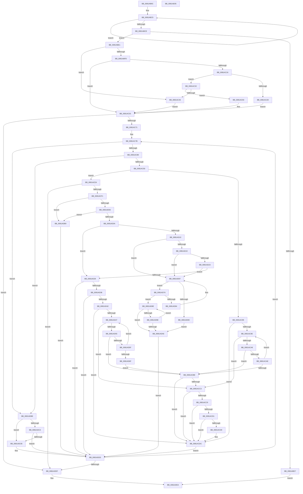

# AslPathClean

- RVA: `0x0081AB9C`–`0x0081AE06` (길이 `618` bytes)
- VA: `0x000000014081AB9C`
- 실행 섹션: `PAGE`
- PDB 이름 있음: `예`; PDB Function 태그: `아니요`
- unwind 정보 RVA: `0x0005FEF8`
- 디코드: `174`개 명령, `618/618` bytes 표시
- 미해석 바이트: `0` (있으면 어셈블리에 `.byte`로 보존)

> 이 문서는 커널 이미지의 기계어와 PDB 기호를 분석해 생성했습니다. 4번과 5번은 함수 원형과 자료형을 바이너리 사용 방식에서 추정한 C 해석이며 원본 소스 복구 결과는 아닙니다.

## 1. Dependencies

- 직접 호출 지점: **5**; 고유 호출 대상: **3**
- 직접 호출자로 확인된 함수: **1**
- RIP 상대 이미지 참조: **2**

### Outgoing calls
- `0x0081ABE6` → [wcschr](../../text/50/wcschr_function_00501A60.md) (function, `0x00501A60`)
- `0x0081AC0D` → [wcsncmp](../../text/50/wcsncmp_function_00501CA0.md) (function, `0x00501CA0`)
- `0x0081AC24` → [wcsncmp](../../text/50/wcsncmp_function_00501CA0.md) (function, `0x00501CA0`)
- `0x0081AC38` → [wcschr](../../text/50/wcschr_function_00501A60.md) (function, `0x00501A60`)
- `0x0081AC5D` → [memcpy](../../text/6C/memcpy_function_006C6840.md) (function, `0x006C6840`)

### Direct callers
- [SdbpResolveMatchingFile](SdbpResolveMatchingFile_function_00816A20.md) at `0x00816CA2`

### Static image references
- `0x0081AC06` → RVA `0x0001BAC0` (`.rdata`; read)
- `0x0081AC1D` → RVA `0x0003F334` (`.rdata`; read)

## 2. Other-region calls and transfers

- 다른 실행 섹션으로 향하는 call: **5**
  - `0x0081ABE6` → [wcschr](../../text/50/wcschr_function_00501A60.md) (`PAGE` → `.text`)
  - `0x0081AC0D` → [wcsncmp](../../text/50/wcsncmp_function_00501CA0.md) (`PAGE` → `.text`)
  - `0x0081AC24` → [wcsncmp](../../text/50/wcsncmp_function_00501CA0.md) (`PAGE` → `.text`)
  - `0x0081AC38` → [wcschr](../../text/50/wcschr_function_00501A60.md) (`PAGE` → `.text`)
  - `0x0081AC5D` → [memcpy](../../text/6C/memcpy_function_006C6840.md) (`PAGE` → `.text`)
- 별도 외부 분기/꼬리 이동을 확인하지 못했습니다.

## 3. Assembly (complete function range)

```asm
0081AB9C  48 8B C4                        mov rax, rsp
0081AB9F  48 89 58 08                     mov qword ptr [rax + 8], rbx
0081ABA3  48 89 68 10                     mov qword ptr [rax + 0x10], rbp
0081ABA7  48 89 70 18                     mov qword ptr [rax + 0x18], rsi
0081ABAB  48 89 78 20                     mov qword ptr [rax + 0x20], rdi
0081ABAF  41 54                           push r12
0081ABB1  41 56                           push r14
0081ABB3  41 57                           push r15
0081ABB5  48 83 EC 20                     sub rsp, 0x20
0081ABB9  48 83 CF FF                     or rdi, 0xffffffffffffffff
0081ABBD  4C 8B F2                        mov r14, rdx
0081ABC0  33 ED                           xor ebp, ebp
0081ABC2  48 8B F1                        mov rsi, rcx
0081ABC5  48 FF C7                        inc rdi
0081ABC8  66 39 2C 79                     cmp word ptr [rcx + rdi*2], bp
0081ABCC  75 F7                           jne 0x14081abc5
0081ABCE  48 8D 47 01                     lea rax, [rdi + 1]
0081ABD2  4C 3B C0                        cmp r8, rax
0081ABD5  73 0A                           jae 0x14081abe1
0081ABD7  BD 23 00 00 C0                  mov ebp, 0xc0000023
0081ABDC  E9 03 02 00 00                  jmp 0x14081ade4
0081ABE1  BA 3A 00 00 00                  mov edx, 0x3a
0081ABE6  E8 75 6E CE FF                  call 0x140501a60
0081ABEB  41 BF 01 00 00 00               mov r15d, 1
0081ABF1  48 8B D8                        mov rbx, rax
0081ABF4  45 8D 67 5B                     lea r12d, [r15 + 0x5b]
0081ABF8  48 85 C0                        test rax, rax
0081ABFB  75 48                           jne 0x14081ac45
0081ABFD  8D 58 04                        lea ebx, [rax + 4]
0081AC00  48 8B CE                        mov rcx, rsi
0081AC03  44 8B C3                        mov r8d, ebx
0081AC06  48 8D 15 B3 0E 80 FF            lea rdx, [rip - 0x7ff14d]
0081AC0D  E8 8E 70 CE FF                  call 0x140501ca0
0081AC12  85 C0                           test eax, eax
0081AC14  74 3D                           je 0x14081ac53
0081AC16  45 8D 47 01                     lea r8d, [r15 + 1]
0081AC1A  48 8B CE                        mov rcx, rsi
0081AC1D  48 8D 15 10 47 82 FF            lea rdx, [rip - 0x7db8f0]
0081AC24  E8 77 70 CE FF                  call 0x140501ca0
0081AC29  85 C0                           test eax, eax
0081AC2B  75 05                           jne 0x14081ac32
0081AC2D  8D 58 02                        lea ebx, [rax + 2]
0081AC30  EB 21                           jmp 0x14081ac53
0081AC32  41 8B D4                        mov edx, r12d
0081AC35  48 8B CE                        mov rcx, rsi
0081AC38  E8 23 6E CE FF                  call 0x140501a60
0081AC3D  48 8B D8                        mov rbx, rax
0081AC40  48 85 C0                        test rax, rax
0081AC43  74 0B                           je 0x14081ac50
0081AC45  48 2B DE                        sub rbx, rsi
0081AC48  48 D1 EB                        shr rbx, 1
0081AC4B  49 03 DF                        add rbx, r15
0081AC4E  EB 03                           jmp 0x14081ac53
0081AC50  49 8B DF                        mov rbx, r15
0081AC53  4C 8D 04 1B                     lea r8, [rbx + rbx]
0081AC57  48 8B D6                        mov rdx, rsi
0081AC5A  49 8B CE                        mov rcx, r14
0081AC5D  E8 DE BB EA FF                  call 0x1406c6840
0081AC62  48 8B CB                        mov rcx, rbx
0081AC65  48 8B D3                        mov rdx, rbx
0081AC68  48 3B DF                        cmp rbx, rdi
0081AC6B  0F 83 6E 01 00 00               jae 0x14081addf
0081AC71  66 41 BA 2F 00                  mov r10w, 0x2f
0081AC76  66 41 B9 2E 00                  mov r9w, 0x2e
0081AC7B  0F B7 04 56                     movzx eax, word ptr [rsi + rdx*2]
0081AC7F  66 41 3B C4                     cmp ax, r12w
0081AC83  0F 84 35 01 00 00               je 0x14081adbe
0081AC89  66 41 3B C2                     cmp ax, r10w
0081AC8D  0F 84 2B 01 00 00               je 0x14081adbe
0081AC93  66 41 3B C1                     cmp ax, r9w
0081AC97  74 4B                           je 0x14081ace4
0081AC99  48 3B D7                        cmp rdx, rdi
0081AC9C  73 3E                           jae 0x14081acdc
0081AC9E  0F B7 04 56                     movzx eax, word ptr [rsi + rdx*2]
0081ACA2  66 41 3B C4                     cmp ax, r12w
0081ACA6  74 1B                           je 0x14081acc3
0081ACA8  66 41 3B C2                     cmp ax, r10w
0081ACAC  74 10                           je 0x14081acbe
0081ACAE  66 41 89 04 4E                  mov word ptr [r14 + rcx*2], ax
0081ACB3  49 03 D7                        add rdx, r15
0081ACB6  49 03 CF                        add rcx, r15
0081ACB9  48 3B D7                        cmp rdx, rdi
0081ACBC  72 E0                           jb 0x14081ac9e
0081ACBE  48 3B D7                        cmp rdx, rdi
0081ACC1  73 19                           jae 0x14081acdc
0081ACC3  48 83 F9 02                     cmp rcx, 2
0081ACC7  72 13                           jb 0x14081acdc
0081ACC9  66 45 39 4C 4E FE               cmp word ptr [r14 + rcx*2 - 2], r9w
0081ACCF  75 0B                           jne 0x14081acdc
0081ACD1  66 45 39 4C 4E FC               cmp word ptr [r14 + rcx*2 - 4], r9w
0081ACD7  74 03                           je 0x14081acdc
0081ACD9  49 2B CF                        sub rcx, r15
0081ACDC  49 2B D7                        sub rdx, r15
0081ACDF  E9 EF 00 00 00                  jmp 0x14081add3
0081ACE4  4C 8D 42 01                     lea r8, [rdx + 1]
0081ACE8  4C 3B C7                        cmp r8, rdi
0081ACEB  0F 84 EE 00 00 00               je 0x14081addf
0081ACF1  0F B7 44 56 02                  movzx eax, word ptr [rsi + rdx*2 + 2]
0081ACF6  66 41 3B C4                     cmp ax, r12w
0081ACFA  0F 84 B9 00 00 00               je 0x14081adb9
0081AD00  66 41 3B C2                     cmp ax, r10w
0081AD04  0F 84 AF 00 00 00               je 0x14081adb9
0081AD0A  66 41 3B C1                     cmp ax, r9w
0081AD0E  75 19                           jne 0x14081ad29
0081AD10  48 8D 42 02                     lea rax, [rdx + 2]
0081AD14  48 3B C7                        cmp rax, rdi
0081AD17  74 6E                           je 0x14081ad87
0081AD19  0F B7 04 46                     movzx eax, word ptr [rsi + rax*2]
0081AD1D  66 41 3B C4                     cmp ax, r12w
0081AD21  74 64                           je 0x14081ad87
0081AD23  66 41 3B C2                     cmp ax, r10w
0081AD27  74 5E                           je 0x14081ad87
0081AD29  0F B7 44 56 04                  movzx eax, word ptr [rsi + rdx*2 + 4]
0081AD2E  66 41 3B C4                     cmp ax, r12w
0081AD32  0F 84 9B 00 00 00               je 0x14081add3
0081AD38  66 41 3B C2                     cmp ax, r10w
0081AD3C  0F 84 91 00 00 00               je 0x14081add3
0081AD42  48 3B D7                        cmp rdx, rdi
0081AD45  73 95                           jae 0x14081acdc
0081AD47  0F B7 04 56                     movzx eax, word ptr [rsi + rdx*2]
0081AD4B  66 41 3B C4                     cmp ax, r12w
0081AD4F  0F 84 6E FF FF FF               je 0x14081acc3
0081AD55  66 41 3B C2                     cmp ax, r10w
0081AD59  0F 84 5F FF FF FF               je 0x14081acbe
0081AD5F  66 41 89 04 4E                  mov word ptr [r14 + rcx*2], ax
0081AD64  49 03 D7                        add rdx, r15
0081AD67  49 03 CF                        add rcx, r15
0081AD6A  48 3B D7                        cmp rdx, rdi
0081AD6D  72 D8                           jb 0x14081ad47
0081AD6F  E9 4A FF FF FF                  jmp 0x14081acbe
0081AD74  41 0F B7 04 4E                  movzx eax, word ptr [r14 + rcx*2]
0081AD79  66 41 89 2C 4E                  mov word ptr [r14 + rcx*2], bp
0081AD7E  66 41 3B C4                     cmp ax, r12w
0081AD82  74 0A                           je 0x14081ad8e
0081AD84  49 2B CF                        sub rcx, r15
0081AD87  48 3B CB                        cmp rcx, rbx
0081AD8A  73 E8                           jae 0x14081ad74
0081AD8C  EB 18                           jmp 0x14081ada6
0081AD8E  41 0F B7 04 4E                  movzx eax, word ptr [r14 + rcx*2]
0081AD93  66 41 89 2C 4E                  mov word ptr [r14 + rcx*2], bp
0081AD98  66 41 3B C4                     cmp ax, r12w
0081AD9C  74 08                           je 0x14081ada6
0081AD9E  49 2B CF                        sub rcx, r15
0081ADA1  48 3B CB                        cmp rcx, rbx
0081ADA4  73 E8                           jae 0x14081ad8e
0081ADA6  48 3B CB                        cmp rcx, rbx
0081ADA9  48 8D 41 01                     lea rax, [rcx + 1]
0081ADAD  49 8B D0                        mov rdx, r8
0081ADB0  48 0F 43 C1                     cmovae rax, rcx
0081ADB4  48 8B C8                        mov rcx, rax
0081ADB7  EB 1A                           jmp 0x14081add3
0081ADB9  49 8B D0                        mov rdx, r8
0081ADBC  EB 15                           jmp 0x14081add3
0081ADBE  48 85 C9                        test rcx, rcx
0081ADC1  74 08                           je 0x14081adcb
0081ADC3  66 45 39 64 4E FE               cmp word ptr [r14 + rcx*2 - 2], r12w
0081ADC9  74 08                           je 0x14081add3
0081ADCB  66 45 89 24 4E                  mov word ptr [r14 + rcx*2], r12w
0081ADD0  49 03 CF                        add rcx, r15
0081ADD3  49 03 D7                        add rdx, r15
0081ADD6  48 3B D7                        cmp rdx, rdi
0081ADD9  0F 82 9C FE FF FF               jb 0x14081ac7b
0081ADDF  66 41 89 2C 4E                  mov word ptr [r14 + rcx*2], bp
0081ADE4  48 8B 5C 24 40                  mov rbx, qword ptr [rsp + 0x40]
0081ADE9  8B C5                           mov eax, ebp
0081ADEB  48 8B 6C 24 48                  mov rbp, qword ptr [rsp + 0x48]
0081ADF0  48 8B 74 24 50                  mov rsi, qword ptr [rsp + 0x50]
0081ADF5  48 8B 7C 24 58                  mov rdi, qword ptr [rsp + 0x58]
0081ADFA  48 83 C4 20                     add rsp, 0x20
0081ADFE  41 5F                           pop r15
0081AE00  41 5E                           pop r14
0081AE02  41 5C                           pop r12
0081AE04  C3                              ret
0081AE05  CC                              int3
```

## 4. C-style interpretation (structured pseudocode)

```c
__int64 __fastcall AslPathClean(__int64 a1, __int64 a2, __int64 a3)
{
    __int64 result;
    __int64 v_rbp;
    __int64 v_rbx;
    __int64 v_rdi;
    __int64 v_rsp;
    unsigned __int64 v_stack_p10;
    unsigned __int64 v_stack_p18;
    unsigned __int64 v_stack_p20;
    unsigned __int64 v_stack_p8;

    *(unsigned __int64 *)(v_rsp + 8) = v_rbx;
    *(unsigned __int64 *)(v_rsp + 16) = v_rbp;
    *(unsigned __int64 *)(v_rsp + 24) = v_rsi;
    *(unsigned __int64 *)(v_rsp + 32) = v_rdi;
    v_rsp = (v_rsp) - (32);
    v_rdi = (v_rdi) | (-1);
    v_rbp = 0;
loc_0081ABC5:
    v_rdi = (v_rdi) + 1;
    if ((*(unsigned __int16 *)(a1 + v_rdi * 2)) != 0) goto loc_0081ABC5;
    if (a3 >= (v_rdi + 1)) goto loc_0081ABE1;
    goto loc_0081ADE4;
loc_0081ABE1:
    result = wcschr(a1, 58, a3, a4);
    if (result != 0) goto loc_0081AC45;
    result = wcsncmp(a1, v_rip - 8384845, (unsigned int)((unsigned int)(result + 4)), a4);
    if ((unsigned int)(result) == 0) goto loc_0081AC53;
    result = wcsncmp(a1, v_rip - 8239344, 1 + 1, a4);
    if ((unsigned int)(result) != 0) goto loc_0081AC32;
    goto loc_0081AC53;
loc_0081AC32:
    result = wcschr(a1, (unsigned int)((unsigned int)(1 + 91)), 1 + 1, a4);
    if (result == 0) goto loc_0081AC50;
loc_0081AC45:
    v_rbx = (result) - (a1);
    v_rbx = (v_rbx) >> (1);
    v_rbx = (v_rbx) + (1);
    goto loc_0081AC53;
loc_0081AC50:
loc_0081AC53:
    result = memcpy(a2, a1, 1 + 1 * 1, a4);
    if (1 >= v_rdi) goto loc_0081ADDF;
loc_0081AC7B:
    if (((unsigned __int16)(*(unsigned __int16 *)(a1 + 1 * 2))) == ((unsigned __int16)(1 + 91))) goto loc_0081ADBE;
    if (((unsigned __int16)(*(unsigned __int16 *)(a1 + 1 * 2))) == 47) goto loc_0081ADBE;
    if (((unsigned __int16)(*(unsigned __int16 *)(a1 + 1 * 2))) == 46) goto loc_0081ACE4;
    if (1 >= v_rdi) goto loc_0081ACDC;
loc_0081AC9E:
    if (((unsigned __int16)(*(unsigned __int16 *)(a1 + 1 * 2))) == ((unsigned __int16)(1 + 91))) goto loc_0081ACC3;
    if (((unsigned __int16)(*(unsigned __int16 *)(a1 + 1 * 2))) == 47) goto loc_0081ACBE;
    *(unsigned __int16 *)(a2 + 1 * 2) = (unsigned __int16)(*(unsigned __int16 *)(a1 + 1 * 2));
    a2 = (1) + (1);
    a1 = (1) + (1);
    if (a2 < v_rdi) goto loc_0081AC9E;
loc_0081ACBE:
    if (a2 >= v_rdi) goto loc_0081ACDC;
loc_0081ACC3:
    if (a1 < 2) goto loc_0081ACDC;
    if ((*(unsigned __int16 *)(a2 + a1 * 2 - 2)) != 46) goto loc_0081ACDC;
    if ((*(unsigned __int16 *)(a2 + a1 * 2 - 4)) != 46) {
        a1 = (a1) - (1);
    }
    a2 = (a2) - (1);
    goto loc_0081ADD3;
loc_0081ACE4:
    if ((a2 + 1) == v_rdi) goto loc_0081ADDF;
    if (((unsigned __int16)(*(unsigned __int16 *)(a1 + a2 * 2 + 2))) == ((unsigned __int16)(1 + 91))) goto loc_0081ADB9;
    if (((unsigned __int16)(*(unsigned __int16 *)(a1 + a2 * 2 + 2))) == 47) goto loc_0081ADB9;
    if (((unsigned __int16)(*(unsigned __int16 *)(a1 + a2 * 2 + 2))) != 46) goto loc_0081AD29;
    if ((a2 + 2) == v_rdi) goto loc_0081AD87;
    if (((unsigned __int16)(*(unsigned __int16 *)(a1 + a2 + 2 * 2))) == ((unsigned __int16)(1 + 91))) goto loc_0081AD87;
    if (((unsigned __int16)(*(unsigned __int16 *)(a1 + a2 + 2 * 2))) == 47) goto loc_0081AD87;
loc_0081AD29:
    if (((unsigned __int16)(*(unsigned __int16 *)(a1 + a2 * 2 + 4))) == ((unsigned __int16)(1 + 91))) goto loc_0081ADD3;
    if (((unsigned __int16)(*(unsigned __int16 *)(a1 + a2 * 2 + 4))) == 47) goto loc_0081ADD3;
    if (a2 >= v_rdi) goto loc_0081ACDC;
loc_0081AD47:
    if (((unsigned __int16)(*(unsigned __int16 *)(a1 + a2 * 2))) == ((unsigned __int16)(1 + 91))) goto loc_0081ACC3;
    if (((unsigned __int16)(*(unsigned __int16 *)(a1 + a2 * 2))) == 47) goto loc_0081ACBE;
    *(unsigned __int16 *)(a2 + a1 * 2) = (unsigned __int16)(*(unsigned __int16 *)(a1 + a2 * 2));
    a2 = (a2) + (1);
    a1 = (a1) + (1);
    if (a2 < v_rdi) goto loc_0081AD47;
    goto loc_0081ACBE;
loc_0081AD74:
    *(unsigned __int16 *)(a2 + a1 * 2) = (unsigned __int16)((unsigned int)(0xC0000023ULL));
    if (((unsigned __int16)(*(unsigned __int16 *)(a2 + a1 * 2))) == ((unsigned __int16)(1 + 91))) goto loc_0081AD8E;
    a1 = (a1) - (1);
loc_0081AD87:
    if (a1 >= 1) goto loc_0081AD74;
    goto loc_0081ADA6;
loc_0081AD8E:
    *(unsigned __int16 *)(a2 + a1 * 2) = (unsigned __int16)((unsigned int)(0xC0000023ULL));
    if (((unsigned __int16)(*(unsigned __int16 *)(a2 + a1 * 2))) == ((unsigned __int16)(1 + 91))) goto loc_0081ADA6;
    a1 = (a1) - (1);
    if (a1 >= 1) goto loc_0081AD8E;
loc_0081ADA6:
    result = a1 + 1;
    if (a1 >= 1) { result = a1; }
    goto loc_0081ADD3;
loc_0081ADB9:
    goto loc_0081ADD3;
loc_0081ADBE:
    if (result == 0) goto loc_0081ADCB;
    if ((*(unsigned __int16 *)(a2 + result * 2 - 2)) != ((unsigned __int16)(1 + 91))) {
        *(unsigned __int16 *)(a2 + result * 2) = (unsigned __int16)(1 + 91);
        a1 = (result) + (1);
    }
    a2 = (a2 + 1) + (1);
    if (a2 < v_rdi) goto loc_0081AC7B;
loc_0081ADDF:
    *(unsigned __int16 *)(a2 + a1 * 2) = (unsigned __int16)((unsigned int)(0xC0000023ULL));
loc_0081ADE4:
    v_rsp = (v_rsp) + (32);
    return (unsigned int)((unsigned int)((unsigned int)(0xC0000023ULL)));
}
```

## 5. (Beta) C Style

```c
int64_t AslPathClean(void *Arg1, void *Arg2, int64_t Arg3)
{
    uint8_t *arg1 = (uint8_t *)Arg1;
    uint8_t *arg2 = (uint8_t *)Arg2;

    int64_t result;
    int64_t local_rbp;
    int64_t local_rbx;
    int64_t local_rdi;
    int64_t local_rsp;
    uint64_t v_stack_p10;
    uint64_t v_stack_p18;
    uint64_t v_stack_p20;
    uint64_t v_stack_p8;

    *(uint64_t *)(local_rsp + 0x8) = local_rbx;
    *(uint64_t *)(local_rsp + 0x10) = local_rbp;
    *(uint64_t *)(local_rsp + 0x18) = local_rsi;
    *(uint64_t *)(local_rsp + 0x20) = local_rdi;
    local_rsp = (local_rsp) - (32);
    local_rdi = (local_rdi) | (-1);
    local_rbp = 0;
loc_0081ABC5:
    local_rdi = (local_rdi) + 1;
    if ((*(uint16_t *)(arg1 + local_rdi * 2)) != 0) goto loc_0081ABC5;
    if (Arg3 >= (local_rdi + 1)) goto loc_0081ABE1;
    goto loc_0081ADE4;
loc_0081ABE1:
    result = wcschr(Arg1, 58, Arg3, a4);
    if (result != 0) goto loc_0081AC45;
    result = wcsncmp(Arg1, v_rip - 8384845, (uint32_t)((uint32_t)(result + 4)), a4);
    if ((uint32_t)(result) == 0) goto loc_0081AC53;
    result = wcsncmp(Arg1, v_rip - 8239344, 1 + 1, a4);
    if ((uint32_t)(result) != 0) goto loc_0081AC32;
    goto loc_0081AC53;
loc_0081AC32:
    result = wcschr(Arg1, (uint32_t)((uint32_t)(1 + 91)), 1 + 1, a4);
    if (result == 0) goto loc_0081AC50;
loc_0081AC45:
    local_rbx = (result) - (Arg1);
    local_rbx = (local_rbx) >> (1);
    local_rbx = (local_rbx) + (1);
    goto loc_0081AC53;
loc_0081AC50:
loc_0081AC53:
    result = memcpy(Arg2, Arg1, 1 + 1 * 1, a4);
    if (1 >= local_rdi) goto loc_0081ADDF;
loc_0081AC7B:
    if (((uint16_t)(*(uint16_t *)(arg1 + 0x1 * 2))) == ((uint16_t)(1 + 91))) goto loc_0081ADBE;
    if (((uint16_t)(*(uint16_t *)(arg1 + 0x1 * 2))) == 47) goto loc_0081ADBE;
    if (((uint16_t)(*(uint16_t *)(arg1 + 0x1 * 2))) == 46) goto loc_0081ACE4;
    if (1 >= local_rdi) goto loc_0081ACDC;
loc_0081AC9E:
    if (((uint16_t)(*(uint16_t *)(arg1 + 0x1 * 2))) == ((uint16_t)(1 + 91))) goto loc_0081ACC3;
    if (((uint16_t)(*(uint16_t *)(arg1 + 0x1 * 2))) == 47) goto loc_0081ACBE;
    *(uint16_t *)(arg2 + 0x1 * 2) = (uint16_t)(*(uint16_t *)(arg1 + 0x1 * 2));
    Arg2 = (1) + (1);
    Arg1 = (1) + (1);
    if (Arg2 < local_rdi) goto loc_0081AC9E;
loc_0081ACBE:
    if (Arg2 >= local_rdi) goto loc_0081ACDC;
loc_0081ACC3:
    if (Arg1 < 2) goto loc_0081ACDC;
    if ((*(uint16_t *)(arg2 + arg1 * 2 - 0x2)) != 46) goto loc_0081ACDC;
    if ((*(uint16_t *)(arg2 + arg1 * 2 - 0x4)) != 46) {
        Arg1 = (Arg1) - (1);
    }
    Arg2 = (Arg2) - (1);
    goto loc_0081ADD3;
loc_0081ACE4:
    if ((Arg2 + 1) == local_rdi) goto loc_0081ADDF;
    if (((uint16_t)(*(uint16_t *)(arg1 + arg2 * 2 + 0x2))) == ((uint16_t)(1 + 91))) goto loc_0081ADB9;
    if (((uint16_t)(*(uint16_t *)(arg1 + arg2 * 2 + 0x2))) == 47) goto loc_0081ADB9;
    if (((uint16_t)(*(uint16_t *)(arg1 + arg2 * 2 + 0x2))) != 46) goto loc_0081AD29;
    if ((Arg2 + 2) == local_rdi) goto loc_0081AD87;
    if (((uint16_t)(*(uint16_t *)(arg1 + arg2 + 0x2 * 2))) == ((uint16_t)(1 + 91))) goto loc_0081AD87;
    if (((uint16_t)(*(uint16_t *)(arg1 + arg2 + 0x2 * 2))) == 47) goto loc_0081AD87;
loc_0081AD29:
    if (((uint16_t)(*(uint16_t *)(arg1 + arg2 * 2 + 0x4))) == ((uint16_t)(1 + 91))) goto loc_0081ADD3;
    if (((uint16_t)(*(uint16_t *)(arg1 + arg2 * 2 + 0x4))) == 47) goto loc_0081ADD3;
    if (Arg2 >= local_rdi) goto loc_0081ACDC;
loc_0081AD47:
    if (((uint16_t)(*(uint16_t *)(arg1 + arg2 * 2))) == ((uint16_t)(1 + 91))) goto loc_0081ACC3;
    if (((uint16_t)(*(uint16_t *)(arg1 + arg2 * 2))) == 47) goto loc_0081ACBE;
    *(uint16_t *)(arg2 + arg1 * 2) = (uint16_t)(*(uint16_t *)(arg1 + arg2 * 2));
    Arg2 = (Arg2) + (1);
    Arg1 = (Arg1) + (1);
    if (Arg2 < local_rdi) goto loc_0081AD47;
    goto loc_0081ACBE;
loc_0081AD74:
    *(uint16_t *)(arg2 + arg1 * 2) = (uint16_t)((uint32_t)(0xC0000023ULL));
    if (((uint16_t)(*(uint16_t *)(arg2 + arg1 * 2))) == ((uint16_t)(1 + 91))) goto loc_0081AD8E;
    Arg1 = (Arg1) - (1);
loc_0081AD87:
    if (Arg1 >= 1) goto loc_0081AD74;
    goto loc_0081ADA6;
loc_0081AD8E:
    *(uint16_t *)(arg2 + arg1 * 2) = (uint16_t)((uint32_t)(0xC0000023ULL));
    if (((uint16_t)(*(uint16_t *)(arg2 + arg1 * 2))) == ((uint16_t)(1 + 91))) goto loc_0081ADA6;
    Arg1 = (Arg1) - (1);
    if (Arg1 >= 1) goto loc_0081AD8E;
loc_0081ADA6:
    result = Arg1 + 1;
    if (Arg1 >= 1) { result = Arg1; }
    goto loc_0081ADD3;
loc_0081ADB9:
    goto loc_0081ADD3;
loc_0081ADBE:
    if (result == 0) goto loc_0081ADCB;
    if ((*(uint16_t *)(arg2 + result * 2 - 0x2)) != ((uint16_t)(1 + 91))) {
        *(uint16_t *)(arg2 + result * 2) = (uint16_t)(1 + 91);
        Arg1 = (result) + (1);
    }
    Arg2 = (Arg2 + 1) + (1);
    if (Arg2 < local_rdi) goto loc_0081AC7B;
loc_0081ADDF:
    *(uint16_t *)(arg2 + arg1 * 2) = (uint16_t)((uint32_t)(0xC0000023ULL));
loc_0081ADE4:
    local_rsp = (local_rsp) + (32);
    return (uint32_t)((uint32_t)((uint32_t)(0xC0000023ULL)));
}
```

### 관측된 메모리 오프셋

구조체 형식이 확인되지 않은 접근은 인자 기준의 오프셋으로만 기록했습니다.

| 기준 인자 | 오프셋 표현 | 폭 (bit) | 접근 |
|---|---:|---:|---|
| `Arg1` | `+ 0x0 + rax*2` | `16` | `R` |
| `Arg1` | `+ 0x0 + rdi*2` | `16` | `R` |
| `Arg1` | `+ 0x0 + rdx*2` | `16` | `R` |
| `Arg1` | `+ 0x2 + rdx*2` | `16` | `R` |
| `Arg1` | `+ 0x4 + rdx*2` | `16` | `R` |
| `Arg2` | `- 0x4 + rcx*2` | `16` | `R` |
| `Arg2` | `- 0x2 + rcx*2` | `16` | `R` |
| `Arg2` | `+ 0x0 + rcx*2` | `16` | `R` |
| `Arg2` | `+ 0x0 + rcx*2` | `16` | `W` |

## 6. Execution-region graph

[열기: 2D/3D 그래프와 함수 탐색 컨트롤 패널](../../../control-panel.html?section=page&rva=0x0081AB9C&view=graph)

- 2D 그래프는 위에서 아래로 흐르고, 3D 그래프는 빈 공간을 드래그해 회전합니다. Shift+드래그는 이동, 휠은 확대·축소, 함수 노드 선택은 대상 보고서 이동입니다.

### Static fallback


